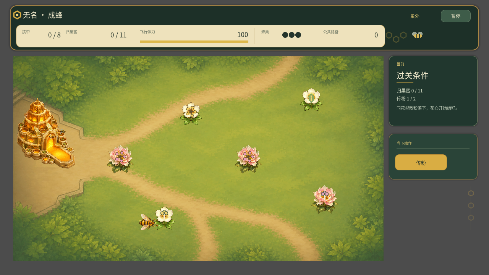
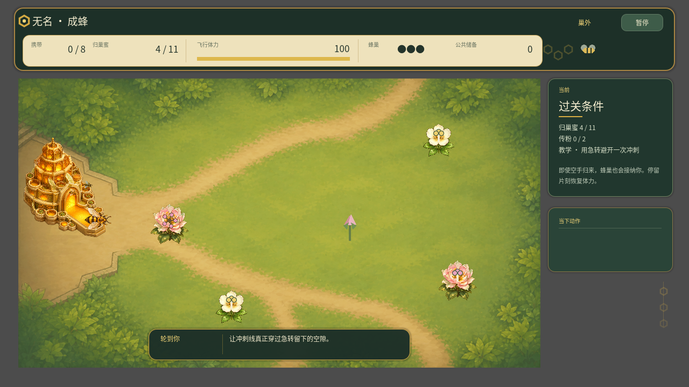
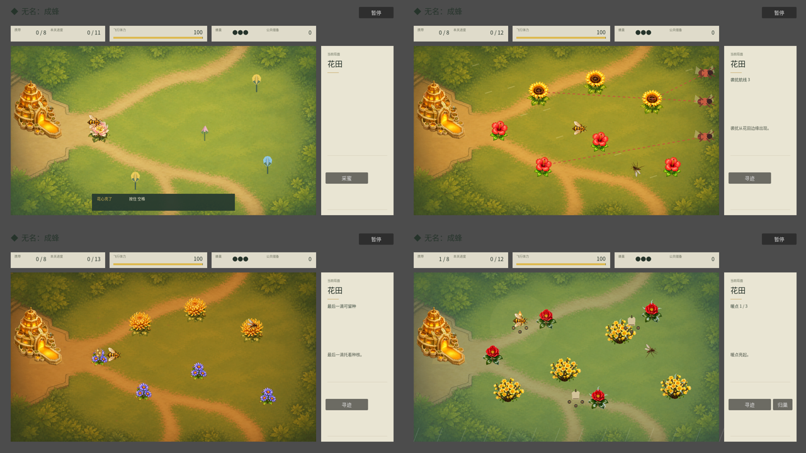
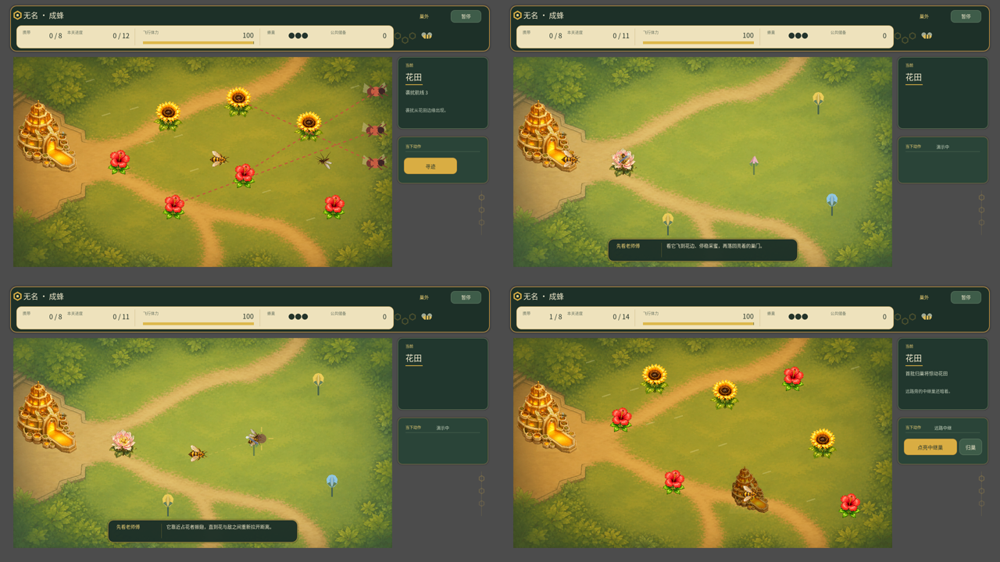
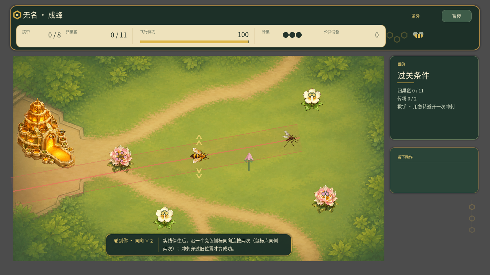
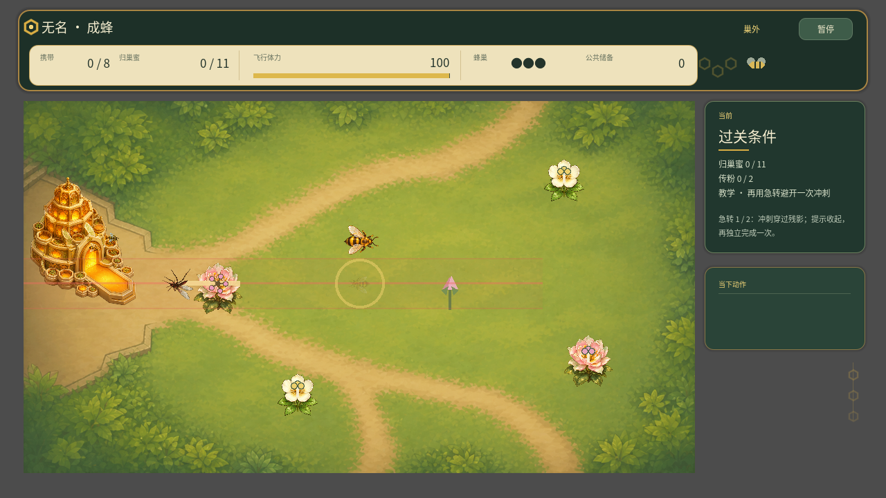

# 《无名：成蜂》玩家反馈整改与验证记录

日期：2026-08-24

## 结论

玩家反馈成立。此前的错误不在于反馈“不够具体”，而在于开发侧把“太短、太单调、教学没感觉、音乐像一首、四季没玩出来”擅自翻译成了 `4 × 3` 大关、固定 32–42 分钟和一组强制门禁。这套结构方案已经撤回，不再作为产品决定。

本轮保留原有 24 节点推进，不替玩家反馈发明新游戏结构；整改集中在玩家能直接操作、看见和听见的内容。完成标准采用以下规则：

> 玩家无法从操作、画面或声音中感知的系统，不计为已实现。代码存在、文档描述、自动化通过或侧栏提示，都不能代替真人体验证据。

## 证据等级

- **已实现事实**：已经进入本轮代码和资源，可由仓库直接核对；
- **开发者自测**：自动化流程、视觉快照或开发环境中的完整操作验证；
- **待玩家验证**：必须由未参与开发的玩家实际游玩后才能下结论；
- **外部玩家证据**：本轮尚未取得。以下任何内容都不得表述为“玩家已经认可”。

## 2026-08-25 旧固定候选首轮证据结论

当时的固定候选 `0.9.5-rc.2 / f57ea02c` 收到一份 A 包导出和 Alan 的八轨逐轨盲听。A 包的提交、clean 状态与 macOS artifact SHA-256 全部匹配；其身份字段选择“外部玩家”，但匿名导出不能证明填写者未参与开发，当前交付上下文也无法消除冲突。因此先按**身份待确认**归档，外部玩家样本仍为 **0**。完整原话、JSON 校验和与证据限制见 [`PLAYTEST.md`](PLAYTEST.md)。该 A 包随后触发 PR #69，但仍只属于 `f57ea02c`，不能迁移为任何后续候选的通过证据。

| 证据 | 现在可以下的结论 | 不能下的结论 | 触发任务 |
| --- | --- | --- | --- |
| A 包首分钟 | 原话为“用空格采蜜采不成功”；当前采蜜需进入 46px 并持续约 0.42 秒，而老师傅模仿提示没有说“按住”；填写者在被害虫击败后选择技术问题，改后愿意再玩 | 不能据此断言崩溃、某输入设备坏了、六项教学通过、节奏或四季好坏 | P0 首分钟采蜜事实／操作／持续反馈；采蜜复测后再判断急转与授粉 |
| A 包表单质量 | 末尾原话“问卷太长了 后面好多没认真填”；后半六项统一状态与大量“无”必须降权 | 不能把后半选择当六项掌握率，也不能拿这张表直接招募外部样本 | P0 缩短参与者表单，把时间线／机制接触交给观察者，并由协调者核验身份 |
| Alan 八轨逐轨盲听与 D/G 定向 A/B | 逐轨阶段其余六轨总体正向；D/G A/B 两组的偏好与属性全选 `tie`，原话均为“都不好”，替换准备度为 `neither` | 不能推断 PR #70 候选比基线更差，也不能外推其余六轨、八轨整体、季节配对、耐循环或实机混音；当前主线基线同样未获认可 | PR #70 关闭且不合并；秋季两轨转入结构性新方向，下轮 A/B 先匹配到 `±0.3 LU` |
| Alan 秋季方向草图选择 | 探索选 K，原话“k整段都可以q开头挺好的 后面又乱七八糟的”；Boss 选两条都可，原话“这两个都很好” | 只批准把 K 与 T/Z 的优点发展成全长候选，不等于正式替换、长期耐循环、实机混音或外部玩家通过 | Draft PR #74 保持未合并；另开正式双轨分支，完成响度匹配的最终 A/B 后再决定合并 |
| Alan 秋季全长最终 A/B | 响度精确匹配后，探索选 Y = 正式候选，Boss 选 M = 正式候选；问题原文均为“更愿意把哪一个留在游戏里” | 只通过秋季双轨的 Alan 创作者替换门禁；不能外推长期耐循环、游戏内混音、其余六轨或外部玩家 | PR #76 已合并为 `de78f2c` 并生成固定桌面 artifact；完整映射与边界见 [`PLAYTEST.md`](PLAYTEST.md) |

**本轮不启动**关卡时长数值、四季路线深化、Boss 规则重做、饮蜜或多蜂巢扩展：本次 A 包没有这些方面的可靠到达、时间或回忆证据。急转原话反映的是“最后一刻才积分”的心理模型，先在采蜜 P0 后做短切片观察，不立即削弱预警或改判定窗口。

### Alan 秋季双轨定向 A/B 与方向草图：先失败，后选出可继续方向

会话 `NB-MUSIC-AB-20260825-R1` 在 PR #70 基线 `846fc6d39f56b31346531ace0f1a3e290befe30a` 与候选 `f2274054292c7c5d00f4592c903f0b19c32b6aa8` 间比较秋 Boss、秋探索。两组偏好与定向属性全部为 `tie`，原话分别为“都不好”和“都不好 ”，整体验收为 `replacement_readiness: neither`。结果 JSON SHA-256、答案表 SHA-256、四个匿名 WAV 的映射与完整证据边界见 [`PLAYTEST.md`](PLAYTEST.md)。这是 Alan 创作者门禁，足以否决 PR #70，但不增加外部玩家样本。

该 A/B 的候选分别比基线低约 `1.9 LU` 与 `1.4 LU`，所以不能用本轮解释具体是哪项编曲改变造成否决；它不影响“两版都不接受”的门禁。PR #70 关闭且不合并，主线保留基线只是版本事实，不代表基线通过。秋季两轨下一轮先换结构方向并把比较响度匹配到 `±0.3 LU`；其余六轨不因这项结果重写。

随后 Draft PR #74 只制作四条短方向草图。Alan 选择 K 作为秋探索全长骨架，明确 Q 只有开头可取、后半“乱七八糟”；T、Z 两条 Boss 方向均获“这两个都很好”。完整 package identity、四轨映射、播放记录和 SHA-256 见 [`PLAYTEST.md`](PLAYTEST.md)。该结果把条件任务从“寻找结构方向”推进到“制作全长候选”，但正式八轨仍未改变，Draft PR #74 也不得当作替换 PR 合并。

PR #76 随后把 K 发展为 124 BPM、4/4、16 小节秋探索，并只保留 Q 开头两处稀疏 pickup；秋 Boss 以 128 BPM、4/4、16 小节的 Z post-punk dub 为全程骨架，T 只在 7 小节作反句与收束。最终 listener 将探索组精确匹配到 `-18.0 LUFS`、Boss 组匹配到 `-19.0 LUFS`；Alan 盲选 Y、M，揭盲后两者均为正式候选。该结果通过秋季双轨替换门禁，允许 PR #76 合并；它不补齐总体配对、长期耐循环或实机混音。

### 当前源码与最近固定 artifact 的边界

当前 `main` 基线为 `21deedb8dc7f48b02453a02f27973b67f5d0f005`；运行代码沿用 `a58358c3ac90d6edac8a654777beb378d978b688`，其后 PR #92 只追加证据记录。J7 可恢复载粉仍是 PR #94 候选，未进入 `main` 或固定 artifact。最近固定桌面 artifact 仍来自 PR #87 的完整提交 `57aefc4933db88968777b11ea1d1679c6374842a`；GitHub run [`32867365895`](https://github.com/alanthssss/nameless-becoming/actions/runs/32867365895) 的双端包和 sidecar 曾通过实包复验，精确身份见 [`BUILD_MANIFEST.md`](BUILD_MANIFEST.md)。但该旧包不含 PR #90／#91，只能支撑下文的历史 Main 局部反馈，**不可继续用于下一轮 B01**。下一轮必须从包含 #90／#91 及届时已合并修复的最新 clean `main` 重建 artifact，创建全新 session／ticket，并由 `npm run playtest:launch` 取得精确 ready receipt 后才交给 Alan；旧 `NB-20260825-6412D7BA` 永久关闭、不复用。

### 2026-08-25 开发者实现：B01 急转延迟复测切片

**证据定级：实现事实与开发者自动测试，不是 Alan 完整人工流程，也不是外部玩家学习证据。** 固定 B01 已由 `ready` 生产 catalog 和编译期 registry 绑定到独立 typed scene；该 scene 与主流程共用急转输入／因果规则，但不实例化 Main、MentorTutorial 或 SaveManager，也不读写任何存档。

时序固定为“2.8 秒老师傅因果示范 → 有界引导模仿 → 无提示实践 → 实践首次成功后恰好 180 秒 active 花间路线 → 一次无字、同配置复测 → 中性结束”。内部结果只能是 `completed_independent`、`attempted_incomplete` 或 `not_attempted` 之一；玩家端不展示通过／失败评价。Godot 自动回归验证了有界阶段、180 秒 active 边界、单次复测与互斥结果；它只证明机会和判定被构造，不证明玩家已学会急转。PR #87 合并后，已从完整 clean 提交 `57aefc4` 重建 artifact、sidecar 和 schema v1 manifest，并生成 Alan B01 自测包 `NB-20260825-6412D7BA`；第一次进程确实用该 participant 包的 exact ticket 进入 B01，但因交接失败没有形成玩法结果。后续虽收到同会话 form JSON，实际 runtime 却是标准 `Main`，因此 B01 仍无有效结果，不能记录为已完成、已学会或已通过；Windows 真机与外部玩家证据也仍待补。

### 2026-08-26 B01 首次交接失败、第二次启动误入 Main

**Alan 原话证据：**第一次启动属于误关；他看到“可以关闭”后就关闭，因为启动前并不知道这是要实际试玩。根因是协调者没有在启动前说明测试任务，而不是玩家没有尝试、没有学会或 B01 内部机制失败。因此首轮不得记为 `not_attempted`，也不能进入学习成败统计。

第二次原计划用同一 exact ticket 做程序性重试，但实际进程命令是 `"<exe>" --playtest-ticket=<ticket>`，遗漏 Godot 引擎参数与 user arguments 之间的 `--`。在 `57aefc4` 旧构建中，`OS.get_cmdline_user_args()` 因此为空，旧 bootstrap 随即进入标准 `Main`；玩家又描述“过了几关、未到 Boss”，而 B01 不含这些结构。该进程、旧构建代码与玩家原话共同支持第二轮进入 Main 的判定。这次定级为**协调者 launch execution failure**，不是 B01 procedural replay；表单的 B01 task/product 字段是生成时静态元数据，不是 scene 运行遥测。PR #90 后的当前主线已改为检测 raw args 中错放的 ticket 并以 `PT-ARG-SEPARATOR` fail closed，不再沿用旧行为。

已收到 `playtest-NB-20260825-6412D7BA.json`，SHA-256 为 `d7ac2c4b7f754bc910a2e86c2d9feb2230a392d565c926b3305dd31ed32046f8`。产品版本、完整提交、clean 状态与 macOS artifact SHA-256 均匹配 `57aefc4`，但表单 `task: B / 固定切片 B01` 的静态元数据与上述 Main 运行证据链不匹配。该结果不可计入 B01 或程序性重试；只作为 Alan 对历史 `Main` 的局部自测：自报 `end_reason: time_limit`、`replay_intent: after_changes`，实际时长不可得；最远“还没到第一个boss, 过了几关”，总体“整体感觉比之前好多了,但是还是有很多具体的方面需要改善的”。完整逐字原话与证据边界见 [`PLAYTEST.md`](PLAYTEST.md)。

这份 Main 自测提出三项后续输入：闪避成功后是否给自身 buff 或给被闪避敌人 debuff；质疑右侧／上侧提示的位置，并建议验证更简约的画内表达；整体美术尚未达到待宣传、待发售水准。第一项暂记为设计建议，不预先批准机制；第二项继续打开信息内化验证，不预先批准某个唯一布局；第三项继续打开代表场景画风统一的交付门禁。本次首分钟答案为原始字符串 `没有卡顿 \n`，说明旧问法中的“卡”可能被理解成性能卡顿，不能据此推断玩家先做了什么或没有流程阻塞；PR #91 已将短表改为分别询问先做什么、操作未成功或停下来想的地方，并保持旧原话不变。

今后每次 participant handoff 必须在启动前只确认一句：“这是一段约10分钟的实际试玩；按画面行动，结束后再填表”。该说明不得扩展为机制、按键、目标或成功条件解释。B01 重开必须使用最新 clean `main` 重建 artifact 和全新 session／ticket；实际执行只走 `npm run playtest:launch`，由助手核对 session／slice／commit／ticket SHA-256 的精确 ready receipt 后再交给 Alan。手写 `"<exe>" -- "--playtest-ticket=<ticket>"` 只保留为协议说明，不作为实际执行入口。

### 2026-08-25 开发者复查：Boss 失败／暂停 HUD 运行时错误

**证据定级：内部源码试听时发现的开发者运行日志，不是 Alan 或外部玩家反馈。** `de78f2c` 本机日志在失律者战败页记录了 8,938 次同一 `SCRIPT ERROR`（日志 2,690,810 bytes）：HUD 每帧把 `boss_loss` 当普通采集关并读取显式 Boss 节点不存在的 `goal`。同一缺陷也会影响 Boss 中暂停与最后一命后的整轮失败；循环终点的熊战又复用普通大雪节点，不能只靠节点是否带 `boss` 字段推断上下文。继续回归还发现，进入 Boss 后上一普通节点的季节机制没有结束；大雪暖点保留的花索引会在 Boss 已清空花朵后继续绘制并越界。

**本修复已实现**：进入整轮失败前记录来源相位；HUD 在 Boss 胜利、可重试失败、Boss 中暂停和 Boss 最后一命失败期间都保持调律上下文；进入任何 Boss 前统一结束普通节点机制。`fix_boss_term_test.gd` 现在覆盖显式 Boss、重试、暂停、最后一命、终点熊战，以及残留 Boss 数据下的普通关失败；测试入口同时把日志中的任意 `SCRIPT ERROR` 判为失败，避免“成功标记存在但运行时仍在报错”的假绿。Godot 4.6.2 本地 9 组回归通过，退出时既存的资源释放提示不属于本次脚本错误。

**发布影响与关闭证据**：`de78f2c` 桌面 artifact 的来源与哈希仍真实，但已知包含该 P1，停止把它用于后续完整流程或 Boss 失败／暂停验收。PR #79 已把修复合入 `21a44bd`；run [`32844593593`](https://github.com/alanthssss/nameless-becoming/actions/runs/32844593593) 又从该精确提交重新生成并复验固定双端 artifact，因此构建层 P1 已关闭。该结论是开发者修复／构建证据，不是玩家验收通过。

### 2026-08-25 开发者复查：外围弹层键盘焦点断链

**证据定级：开发者源码复现与 Godot 自动回归，不是 Alan 或外部玩家体验证据。** 当前成长三选一在隐藏主按钮后没有把焦点交给任一卡片，收成分配也没有把焦点交给滑杆；此前完整流程测试直接调用 `on_upgrade_selected()`／`confirm_allocation()`，因此无法发现“不碰鼠标时 Enter 没有对象可确认”的真实 GUI 缺口。应用恢复逻辑又只尝试聚焦可见主按钮，成长卡或分配滑杆出现时无法修复焦点。

**本修复已实现**：外围弹层按当前状态统一解析主焦点；成长页选择第一个未满项并让方向键跳过满级项，三项全满时选择“再次出巢”，收成分配以滑杆起步并可用 Tab 到确认。弹层焦点意外清空时恢复最近仍有效的弹层控件，应用切回也走同一规则。应用切出只允许 `playing`／`boss` 自动进入暂停；手动暂停或静态弹层不再把同一个 toggle 路径反向调用成后台解暂停。`ui_accept` 的阶段推进只由当前聚焦控件处理；未处理输入只修复焦点，不再直接调用阶段回调，从而避免“确认分配后新出现的再次出巢按钮又吃到同一次 Enter”而连续推进两步。

**自动验证与未完成证据**：`hud_responsive_test.gd` 通过真实 GUI `ui_accept`／方向动作与物理 Tab 依次验证标题出巢、跳过满级成长、失焦恢复、成长全满、分配滑杆、Tab 确认和单次输入只推进一次；`fix_boss_term_test.gd` 通过 Node notification 路由覆盖手动暂停、游玩、Boss 与静态弹层的 focus-out／focus-in，断言任何已暂停状态都不会被失焦反向恢复。该结果只证明 Godot 4.6.2 无界面输入路由与状态断言成立；修复存在于源码与 `57aefc4` 历史 artifact，但 Alan、独立玩家、Web 浏览器焦点、macOS／Windows 实际窗口切换仍须人工验证。

## 2026-08-25 Alan 直接复核：完成条件与授粉生态纠偏

**证据定级：Alan 对当前构建的直接反馈，不是未参与开发的外部玩家测试。外部玩家证据仍为 0。**

Alan 指出三个问题：关卡到底还缺什么才完成不清楚；授粉目标被隐藏，出现后又与其他花近乎同形，无法在行动前判断哪朵是给粉者、哪朵是受粉者；“携粉碰花苞 → 花立即开放并生成花蜜”把授粉、开花和分泌花蜜错误合并。这些问题使 2026-08-24 构建的春季因果链未通过直接复核。

该图由本任务修改后的 Godot 主场景直接截取：侧栏同时显示“归巢蜜 `0/11`”与“传粉 `1/2`”；花田中开放花以五枚散粉花心、三瓣受粉花心和绿色结籽体区分，蜂身保留松散花粉。它是实现事实与开发者视觉快照，不是玩家可读性已经通过的证据。

### 已批准的授粉模型

> **已开放的花药 → 蜜蜂身上松散可见的花粉 → 同一可见花型的可接受柱头 → 结籽。**

- 给粉花与受粉花都是已开放、可预先看见的花；授粉目标不再依靠“寻迹后才出现”。
- 兼容性由同一可见花型表达；同型花内的**开放花药**与**可接受柱头**必须在器官形状、姿态和状态反馈上明显不同，不能只靠隐藏角色或文字判断。
- 蜜蜂接触开放花药后，花粉以松散颗粒附在身体上；它不是抽象背包图标，也不应只是无动态的腿部色块。
- 同型花的柱头接触到花粉后，可见结果是柱头已受粉并进入结籽，不是花瓣瞬间打开，也不是当场新增或恢复花蜜。

### 实现与验收条件

- 关卡开始时列出所有会阻止结算的条件及各自进度；若结籽是必做项，必须从开局起显示“结籽 `x/y`”，若不是必做项，就不得暗中阻止结算。
- 最后一项已列条件达成时必须立即触发结算反馈；不得再出现资源数字已满、但玩家不知道还有隐藏门禁的状态。
- 在不用寻迹、不看教学文字时，玩家也能指出一组同型给粉花／受粉花，说出“花药取粉 → 柱头授粉 → 结籽”，并从身上散粉与种子状态判断两步是否成立。

**本任务已实现**：顶部改为“归巢蜜”，侧栏常驻所有结算条件；春季替换为开放花器官、同可见花型兼容、蜂身散粉和结籽状态；授粉不再改写花蜜；快速访花加蜜规则已移除；连环花的路线奖励改为多取目标花现有库存，不再补回花蜜。该任务当时的 8 组 Godot 回归与 `git diff --check` 通过；该阶段主线再加入 HUD 回归后为 9 组。上述仍只是实现事实与开发者自测，器官在真实运动中是否无需解释即可辨认，仍待 Alan 与独立玩家复核。下文 2026-08-24 的“闭合花苞 → 开花／回蜜”只保留为旧构建历史。

### 2026-08-26 Alan 直接复核：携粉状态不可恢复读取

**证据定级：Alan 对实际游玩中花粉状态的直接反馈，不是外部玩家测试。** 他指出蜂身现有散粉无法让玩家稳定感知“我同时带着什么、该送到哪朵花”；只要错过采粉瞬间或中途走神，就只能依赖短时记忆。由此，上一轮“蜂身已有散粉”只能算规则与绘制存在，不能算可读性通过；该项重新打开为 P0。

**PR #94 候选切片已实现的规则与表现（尚未进入 `main`／固定 artifact）**：`pollen_charges` 成为唯一规则真相，不再保留会把双类型坍缩成单一 current 的状态；两类花粉各最多携带两份，并在蜂贴图之后以胸腹体表的两个稳定**散粉锚区**精确画出 `0/1/2`。锚区是分布在体表的松散花粉的可读镜像，不是后足花粉筐，也不改变“胸腹等接触面花粉沉积到柱头”的生态因果。A 型使用金黄圆粒，B 型使用玫红菱粒；同一形色字母表复用于花药、柱头、蜂身、触角寻迹、传递与拒绝反馈。携粉寻迹时，每类各指向最近同型可接受柱头，普通蜜花推荐线暂时收起，危险区与归巢线保留；无粉时仍使用原寻蜜逻辑。

成功传粉不再瞬时写结果：按键后蜂身先减一份，目标进入约 `0.46s` 的 pending 防重复状态，对应形态颗粒从身体飞到柱头，落地后才写入 `pollinated/seed_setting`、增加进度并播放独立成功音；全程不改变花蜜。不匹配不会扣粉或结籽，实际携带颗粒会在目标前弹回，目标自身形态脉冲并播放独立短音。老师傅授粉示范同步改为“花药取粉 → 身体持续携粉 → 落向同型柱头 → 结籽”四拍，示范仍不修改真实资源。

**仍未关闭的人类门禁**：遮住右侧文字，先取得两类花粉，正常行动或分心至少 10 秒；玩家仍须能从蜂身指出两类载粉，停稳寻迹后分别指出去向，并从一次故意送错与一次正确送达中看出“弹回不扣量”及“身体减一 → 落柱头 → 结籽”。自动测试和三张开发者快照只证明状态、顺序和绘制路径存在，不能证明运动中尺寸、对比度或形态已经足够；Alan 与独立玩家复核仍待完成，外部玩家证据仍为 0。

## 2026-08-25 Alan 直接复核：过关条件卡文字重叠

Alan 在正确分支实机截图中指出，第三行老师傅要求越过原有 `42px` 条件区，与下方情境消息绘制在同一位置。该问题说明“条件已经显示”不等于“条件可读”，属于交付界面缺陷，不得以自动化此前已通过为由关闭反馈。

**已实现事实**：第一张状态卡由 184px 增至 220px，结算条件获得 74px 独立区域，可容纳三项条件及老师傅要求的换行；情境消息移动到其后并限制为最多两行，第二张“当下动作”卡整体下移。流程测试遍历 8 个教学主题的示范／模仿／实践共 24 种文案，按实际字体行高验证条件文本不会越界，并断言条件区、消息区保持安全间距。该截图与自动化证明重叠已消除；字号、密度是否舒服仍由 Alan 实机判断。

## 2026-08-24 六项复核结论

该图由 Godot 实际运行的春、夏、秋、冬代表节点拼成，不是概念图。它证明新版背景、花型和机制实体已接进构建；它不能证明画风、音乐或玩法已经得到 Alan 或外部玩家认可。

| 用户指出的问题 | 本轮已实现事实 | 仍需真人判断 |
| --- | --- | --- |
| 不知道空圈是什么 | 四季机制中的常驻空圈已改成实体：开放花药、三瓣可接受柱头与绿色结籽体，成熟/破裂种核，可点亮的蜂蜡暖点；临时寻迹或攻击范围只在动作发生时短暂出现 | 不经解释是否能看懂每个实体及其状态变化 |
| 背景花哨、模糊且与角色不同画风 | 接入 `spring_field_v2.png`：删除烘焙在背景里的大蜂巢、大花、单位、圆环和 UI，降低中央纹理噪声并保留清楚路径；蜂巢、花和单位改为独立清晰层 | 背景与角色是否真的像同一款游戏，仍由 Alan 审美复核 |
| 花是否符合季节 | 春使用白色单瓣春花／粉色重瓣授粉花，夏使用木槿／向日葵，秋使用紫菀／菊花，冬使用山茶／蜡梅；实际路由由玩法组而非屏幕季节标题决定 | 小尺寸运动中能否一眼认出季节与高价值花 |
| 感受不到不同季节玩法 | 春要从开放花药取粉并送到同型开放柱头结籽；夏有翅劫掠者会移动、偷蜜并必须逐只惊退；秋最后一滴前强制松手，玩家再按决定采尽还是留种；冬花田受寒且减速，携蜜点亮三处暖点后逐段恢复路线 | 玩家是否真的改变路线、顺序、撤离时机，而非仍概括为“都是采蜜” |
| 蜂巢定位和蜜蜂种类不清 | 蜂巢碰撞、归巢落点和画面入口统一到左侧同一锚点；入口、落巢通道、储蜜格和卸蜜活动均由世界反馈表达；现阶段先以侦察、采蜜、守卫三类角色蜂表现蜂群分工，不增加新可玩物种 | 三类分工是否可辨，以及是否确有增加物种的玩法价值 |
| 8 首音乐阴沉、像一条和弦持续呜响 | 8 轨全部重编为不同速度、拍号和曲风；移除旧低八度常驻 pad、弦音色里的 `0.5×` 次谐波和 Boss 全局 `0.94` 降调；夏季探索加入 funk，夏 Boss 使用 stop-time punk，秋 Boss 最终改为 post-punk dub／industrial 反句，冬 Boss 使用 half-time rock | 秋季双轨已通过 Alan 最终盲听替换门禁；整套“不阴间”、长期耐循环与实机混音仍须继续验证 |

## 2026-08-24 第三轮：编曲、交付界面、老师傅与中继巢

该图由 Godot 真实主场景的四个状态拼成：夏季常规界面、老师傅出巢示范、老师傅驱离示范、立夏中继巢。它证明界面、教学角色和中继巢已经接进可玩流程；它不能证明最终审美、教学理解率或关卡节奏已经通过真人验证。

### 本轮产品决定

- **音乐继续丰富，但只做选择性点缀。** 8 轨保留电子／funk／朋克骨架，统一使用有起音和休止的鼓组、写定 bass 与短促拨弦瞬态；不再给每首铺一层持续民乐。春探索保留约 4.4% 时长的合成笛式转音，夏 Boss 保留约 2.6% 的笛式停顿标点，冬探索保留约 6.9% 的箫式气息。旧秋探索约 8.6% 的合成二胡式滑音在盲听中形成“猫叫”错读，已随被否决版本退出；PR #76 正式秋探索不再使用该手势。它们都是程序合成音色，不冒充真实器乐录音。
- **不把多个等价主蜂巢直接塞进单屏。** 等价卸蜜点会同时稀释“归巢”、Q 键导航、蜂蜜储备和敌害安全边界。本轮只在立夏实现一个小型“中继巢”切片：消耗 1 滴随身蜜点亮，玩家停在落脚区时恢复体力，但最多恢复到上限的 65%；它不能交付目标、不能增加储备、不能触发归巢或季节结算，Q 键仍只返回主巢。该切片用一条真实路线验证“远端据点是否增加关卡内容”，不提前承诺大地图架构。
- **外围界面从原型卡片改为同一套产品壳。** 顶部使用深苔色外壳、蜂蜜金状态与蜂蜡内托盘；右侧只保留“当前”和“当下动作”两张紧凑卡；暂停入口、情境操作和教学条共享同一材质、圆角、层级和色彩语法。PR #65 随后把 1280×720 逻辑画面扩展为带安全留边的等比适配，并自动覆盖 1024 宽、1440×900 与 1920×1080；它不是世界内容重排，也不能替代真实系统缩放、极端宽高比或触摸屏验收。
- **老师傅只演示，不替玩家做。** 老师傅复用玩家蜂的质感与轮廓，以银灰翼和靛青绑带区分，不新增卡通头像或另一套画风。教学统一为“示范 → 模仿 → 无提示实践”：示范阶段冻结真实模拟且不修改花蜜、体力、敌害或储备；模仿和实践必须由真实世界结果推进，单纯按键不能过关。
- **首关与三组季节教学已接入。** 首关依次训练出巢归巢、寻迹、驱离、闪避和授粉，每项至少包含一次模仿和一次隐藏提示的实践；夏季首次劫掠、秋季首次留种、冬季首次点暖点也各自使用同一节奏。阶段结算会等待该节点核心教学完成，但不再用不透明的文字门禁冒充教学。

### 本轮证据边界

- Godot 烟雾、完整流程、Boss、音乐、四季机制、中继巢、老师傅教学与 HUD 响应式共 9 组自动化通过；音乐格式、频谱差异、循环接缝和确定性重生成通过回归。
- 最终审查曾发现测试直接写 `tutorial_step` 掩盖首趟真实流程软锁，现已改为由“离巢距离 → 实际携蜜 → 真实卸蜜”推进；夏季老师傅会等袭扰者真正持有赃蜜后才开放惊退，无赃蜜惊退也不再发出返蜜成功事件；秋季一次只开放一朵真实种花，第一次成功后才开放无提示练习花，失败会换一朵继续教，完成后再解锁整片花田。
- 上述属于**已实现事实和开发者自测**。Alan 需要重新试听 8 轨并实际完成首关、立夏、秋季留种与冬季暖点；外部玩家证据仍为 0。

## 本轮实际实现

### 1. 关卡不再一次采完，难度来自局面而非纯拖时

**已实现事实**

- 保留 24 节点和原有正色节点，不改成 `4 × 3`；
- 基础携带上限为 8，普通节点目标提高到 10–15。第一关目标为 11，必须至少两次归巢；老师傅与传粉分别以常驻清单列明，不再靠一滴藏在花苞里的资源暗门强迫教学；
- 采蜜蜂成长保留采集速度和单花产量，不再扩大携带上限；因此后期成长不会把普通节点重新压回一次归巢；
- 每关额外预留两次合法饮蜜，以及留种或暖点会永久消耗的花蜜预算；选择机制不会把剩余目标变成数学上不可完成；
- 第一关不再是若干等价花朵：安全花、气味隐藏花、被蚊虫占据的资源花，以及预先开放且花心有别的给粉花／受粉花共同组成一条可读路线；
- 春、夏、秋、冬的季节行为会改变资源是否可用、路线是否安全以及能否完成节点，不再只改变数值和颜色；
- 四位 Boss 不再共用“靠近花连续按三次”的空壳流程。每位 Boss 都有独立暴露条件，且三阶段逐步加速、缩短窗口；画眉的假回声会随阶段增加；
- Boss 巢口恢复改为两次有限恢复，不能无限磨过去。

**待玩家验证**

- 不能仅凭目标数字宣称“关卡时长已解决”。需要记录首次完成时间、重复劳动占比、失败原因和是否出现路线/撤离判断；
- 目标不是越长越好。若玩家只是重复采同一批花，应继续删改内容，而不是继续提高目标值。

### 2. 教学改成因果成立才算学会

**已实现事实**

- 寻迹：按键只会显露隐藏花及花香轨迹；必须顺着线索找到并采到该花才进入下一步；
- 惊退：教学蚊虫先占据资源区；只有它真实离开资源范围、采集路线恢复才算成功；
- 急转：教学蚊虫先用虚线跟随玩家，再冻结为与真实危险宽度一致的实线通道。锁定时只显示场地内确实可达、且吸附到单个 WASD 轴的侧标；玩家必须在锁定后向其中一侧双击同一方向，且第一次输入发生在被锁定的位置附近。若同时按下斜向两轴，系统选择更远离攻击线的一轴，不会先取到沿线方向。敌虫穿过锁定的旧位置时，蜜蜂已经离开通道才算成功。留在线上靠无敌帧硬穿、锁定前抢跑、先普通飞离再空地双击均不算完成；
- 首次失败会安全重演，不以扣血或死亡惩罚玩家；
- 教学动作与第一关真实资源路线相连，不是独立弹窗或勾选框；
- 同一时刻只保留一条短操作提示，移除侧栏说明流。

**开发者自测**

- 流程测试分别验证“只按寻迹键不通过”“只按惊退键不通过”“空地急转不通过”，并覆盖方向键映射与登记窗口、鼠标／触摸首击后真实移动、单次触摸不发动、斜向同帧输入、锁定前缓存清除、起点因果和 36px 通道边界；老师傅测试通过真实蚊虫状态机完成 `1/2 → recover → 再锁线 → 2/2`，不是直接写成功事件；
- 两张归档视觉快照直接检查锁定实线、可行侧标，以及蜂已在线外而敌害穿过旧位置的残影／确认波纹；跟随虚线和动作中的速度感仍需用实机动态复核，不能由静态图代替。动作发动音、路线锁定音与真实躲开确认音已经分开。

**待玩家验证**

- 未参与开发的玩家能否不经口头提示完成第一趟出巢；
- 首节点内能否分别正确使用寻迹、惊退和急转；当前正常路线没有稳定的“教学约 3 分钟后再次遭遇同一急转语法”机会，缺失复测记录不得算作迁移失败；
- 玩家能否说清“寻迹提供了什么”和“震翼为什么不是攻击”。
- 普通蚊虫当前仍以持续跟随为主；锁线急转在首关两次练习后主要于失律之熊再次使用。是否需要让后续普通敌害复用这套攻击语法，必须依据迁移测试决定，当前不得宣称已经形成持续练习曲线。

### 3. 音乐交付 4 个探索主题与 4 个 Boss 变奏

**已实现事实**

- 新增春、夏、秋、冬探索各 1 首，以及对应 Boss 变奏各 1 首，共 8 个独立 WAV 资源；
- 8 首共享 `C-D-E-G-A` 五声音高场，但分别改变中心音、速度、拍号、节奏密度、音色与空间，不再共享一条低频和弦底；
- Boss 变奏不是简单提高音量：相对探索曲会改变速度、节奏、和声与停顿结构；调律阶段当前只改变存在感，不再通过全局降调伪造变化；
- 普通节点按机制组切换四季探索音乐，四个 Boss 使用各自对应变奏；归巢只柔化当前探索音乐，不再错误复用 Boss 音乐；
- 旧的单一程序化背景循环已经从音效组件移除。

| 音轨 | BPM／拍号 | 曲风与情绪 | 服务的玩法 |
| --- | --- | --- | --- |
| 春·探索 | 104／4-4 | 木质室内民谣，`3+3+2` 分枝脉冲；轻快、好奇、向上生长 | 出巢、寻找开放花药、身上携散粉、给同型花柱头授粉结籽 |
| 春·Boss | 148／4-4 | 翅拍 breakbeat 与被截断的春季句尾；敏捷、紧迫 | 失律之蚊的吸取与短暂暴露窗口 |
| 夏·探索 | 116／4-4 | 切分 funk、问答式采集动机；热、忙碌、群体协作 | 劫掠蜂出现、偷蜜与逐只惊退 |
| 夏·Boss | 172／4-4 | stop-time punk；冲动、粗粝、急停 | 蟋蟀跳跃、落地、停顿窗口 |
| 秋·探索 | 124／4-4 | amber-circuit electro-funk；K 半拍骨架贯穿 16 小节，Q 仅作开头两处稀疏 pickup，每四小节留出呼吸 | 松手观察种核，再决定采尽或留种 |
| 秋·Boss | 128／4-4 | post-punk dub 全程诱引骨架；9 小节完整 Z，7 小节以 T 的 stop-time industrial 作反句，回声有限 | 寻迹分辨真身与假回声 |
| 冬·探索 | 108／6-8（附点四分音符=72） | 温暖而稀疏的脉冲；寒冷中的互相支撑 | 体温下降、点亮蜂蜡暖点、恢复远端路线 |
| 冬·Boss | 96／4-4 | half-time rock，冲锋—静默—碰撞；沉重、坚定 | 熊的蓄力冲锋与撞暖花暴露 |

此前“有个和弦一直呜呜响”的根因已定位：旧生成器把根音低八度 pad 长时间保持，`string` 振荡器又混入 `sin(phase × 0.5)` 的人工次谐波；Boss 播放还统一使用 `pitch_scale = 0.94`，把整轨一起压低、放慢。这三项叠加造成持续低频占位和“八首像同一条阴沉底”的听感。新母带只保留编写出来的短低音，不在每个弦音中藏半频率成分，Boss 以原始 `pitch_scale = 1.0` 播放。

**开发者自测**

- 8 个音频均为 44.1 kHz 双声道、整数小节渲染、可循环，时长按编曲分别为 22.326～30.968 秒，内容哈希互不相同；
- 自动化验证探索、Boss、归巢三种切换不会映射到错误资源。
- 64 段 Hann FFT 自动分析显示：40～250 Hz 能量占比由旧版 64.4%～91.5% 降至 15.8%～57.6%，低中频持续占用由旧版 8 轨全部 100% 降至 17.2%～59.4%；本版频谱质心 428～994 Hz、活跃动态范围 3.64～11.00 dB；同季探索／Boss 频谱余弦相似度为春 0.622、夏 0.811、秋 0.777、冬 0.614，全部低于 0.92 门槛；循环接缝为 -120 dBFS。

**待玩家验证**

- FFT、哈希、BPM 和风格标签只能证明文件结构不同且旧持续低频回归没有复发，不能证明“不阴间”、耐听或情绪正确。使用盲听记录：同季探索/Boss 是否能被区分，四组气质是否能被稳定配对；
- 若玩家仍然认为“只有一首”，优先改编曲与音色，不用曲目数量反驳玩家。

### 4. 节气与季节退出高频文字，进入世界反馈

**已实现事实**

- 普通游玩 HUD 不再常驻显示节气名、季节名、阴阳值和诗性解释；
- 普通归巢、转场与下一节点提示不再重复节气名；正色 Boss 仅保留少量身份文字作为仪式节点；
- 花朵状态、敌害状态和四季机制不再用侧栏长句逐项播报；
- 隐藏花由花香微粒表现，占领路线由移动敌人与红色虚线表现，锁闭花由闭合/霜冻轮廓表现，Boss 暴露窗口由金色光晕和专属动作表现；
- 此前四季机制使用的常驻空圈已分别替换为开放花药／可接受柱头／结籽体、成熟或破裂的种核、蜂蜡暖点；抽象圈不再承担目标说明；
- 文字只承担首次控制、当前唯一动作和无障碍兜底，不再承担世界观讲解。

**待玩家验证**

- 关闭首次教学文字后，熟悉操作的玩家能否判断当前最重要的风险、可用资源和正确行动；
- 玩家是否能感到气候和生命循环的变化，而不需要说出“春夏秋冬”或二十四节气名称。

### 5. 四季现在改变实际行为

**已实现事实**

| 机制组 | 玩家必须处理的真实局面 | 可见结果 |
|---|---|---|
| 春／授粉 | 接触带开放花药的给粉花，松散花粉留在蜂身；再把花粉送到同一可见花型的开放柱头 | 柱头转为绿色结籽体且传粉进度增加；花蜜不变，完成两次才可结束 |
| 夏／征召 | 第一次真实交蜜会触发移动劫掠者，劫掠者奔向最富花源并实际偷走花蜜 | 偷满后仍会守着赃蜜，玩家必须改线逐只惊退；花蜜落回且航线清空后才可结束 |
| 秋／留种 | 花只剩最后一滴时采集自动暂停，必须真实松开再按；玩家由此决定留下种核或采尽 | 留下后种核在下一次真实归巢成熟并增加储备；采尽则显示破裂种荚，两种结果均可见 |
| 冬／抱团 | 寒区同时降低体温和移动速度；携蜜依次点亮三个实体蜂蜡暖点 | 暖点逐段开放远处花田，完整暖链把速度由最低约 72% 恢复到约 98%；点完整链后才可结束 |

春季行已替换为 2026-08-25 的纠偏实现。被否决的“闭合花苞 → 立即开花／回蜜”仅作为前文问题历史保留，不再描述当前构建。

**开发者自测**

- 独立机制测试验证每一季的触发、失败分支、资源变化和完成门槛；
- 流程测试验证四季机制已接入真实节点，而不是只在独立脚本中存在。

**待玩家验证**

- 玩家是否真的因此改变路线、采集顺序或撤离时机；
- 如果玩家仍把四组都概括为“采蜜”，即使自动化全部通过，也继续判定为未解决。

### 6. 低噪世界、季节花与蜂巢锚点

**已实现事实**

- `spring_field_v2.png` 作为四组玩法共用的清晰低噪地表；夏、秋、冬以光线、热纹、落叶和霜层改变氛围，不再换一张模糊装饰画；
- 花朵共 8 个轮廓映射：春白色单瓣／粉色重瓣，夏木槿／向日葵，秋紫菀／菊花，冬山茶／蜡梅；普通与高价值花保持独立、可移动的透明 PNG；
- 背景不再烘焙蜂巢。蜂巢入口独立绘制于左侧，卸蜜、回血与冬季取暖共同使用巢门矩形 `Rect2(34, 350, 176, 120)`，归巢落点 `(150, 410)` 位于落巢通道内；左侧其他高度不再误算归巢；
- 蜂群先使用同一物种的侦察、采蜜、守卫三类角色蜂：寻迹时侦察蜂离巢，卸蜜时采蜜蜂穿过落巢通道，袭扰发生时守卫蜂停在巢口。现阶段不新增可玩蜂种，因为新物种若没有独立操作、取舍与成长，只会增加美术名词而不能解决“蜂巢像活的社会吗”。

**待玩家验证**

- Alan 需在实际运动和 100% 缩放下判断背景、玩家蜂、花、蜂巢是否属于同一画风；
- 未参与开发的玩家需在不看季节名时指出花型差异、蜂巢入口和三类蜂群活动。自动快照只能证明资产接线与大体层级，不能代替上述判断。

## Boss 的四种暴露条件

| Boss | 可调律的前提 | 玩家读取 |
|---|---|---|
| 蚊 | 完成一次真实吸取后短暂饱食 | 吸取连线结束，身体进入金色暴露状态 |
| 蟋蟀 | 跳跃落地后的短暂停顿 | 落点阴影、落地停顿和金色窗口 |
| 鸫 | 玩家用寻迹识破真实回声 | 多个假回声中只有真身被显露 |
| 熊 | 玩家闪过冲锋，使其撞上暖花 | 冲锋路径、暖花碎光与眩晕窗口 |

每次成功只推进一个调律阶段。四位 Boss 的后续阶段都会更快、暴露更短；画眉的假回声数量还会继续增加。

## 本轮验证边界

本轮本地验证包括：Godot 烟雾测试、完整流程测试、数据修复回归、8 轨音乐资源测试、Boss 状态机测试、四季机制测试、字体覆盖检查和四个关键局面的视觉快照。它们能证明流程可运行、因果门槛存在、资源接线正确，不能证明关卡有趣、难度恰当或音乐已经达到目标气质。

下一轮必须使用可玩的构建进行外部复测，最少记录：

1. 首次出巢每一步是否需要口头帮助；
2. 每个普通节点与 Boss 的完成时间、失败点和无决策重复时长；
3. 四季中玩家实际改变过的路线或资源选择；
4. 不显示名称时，玩家对四组气质和四位 Boss 规则的描述；
5. 8 轨盲听配对结果；
6. 不看教学文字时，玩家能否说出当前所有完成条件，并分辨同型花的开放花药与可接受柱头；
7. 玩家原话。不得把开发者解释改写成玩家证据。

## 2026-08-25 当前执行矩阵与依赖

本节是本轮反馈整改的唯一执行视图；详细设计仍由各专项文档维护。分支或 worktree 只表示任务隔离，不自动表示工作已完成、已合并或已取得玩家证据。

### 当前基线快照

| 用途 | worktree / 分支 | 状态 | 结论 |
| --- | --- | --- | --- |
| 已合并源码事实 | PR #63／#64／#65／#69／#76／#79／#81／#82／#85／#87／#90／#91 | 在既有玩法、音画与 B01 基础上，PR #90 加入错放 ticket fail-closed、启动器自动分隔和精确 ready receipt；PR #91 修订六字段短表问题 | 自动验证通过；真人玩法、美术、Windows 和发行状态不因此改变 |
| 最近固定桌面 artifact（历史证据） | `nameless-becoming-candidates/57aefc4-run-32867365895/`（仓库外本机副本） | macOS／Windows artifact 由 run [`32867365895`](https://github.com/alanthssss/nameless-becoming/actions/runs/32867365895) 从 `57aefc4` 构建并复验 | 不含 PR #90／#91；只用于解释已归档 Main 局部反馈，不可生成或重开下一轮 B01 |
| HUD 响应式与饮蜜入口 | PR #65，历史实现提交 `f57ea02c`，已包含于 `57aefc4` | 14 组 Godot、46 个 Node 测试、lint、CI 与独立 P0/P1 复核通过；Alan 已允许合并视觉与按钮方向 | 代码已合并；真实系统缩放、极端宽高比、原生触摸与完整流程仍需设备证据 |
| 首轮试玩证据工具与 B01 固定切片 | PR #67／#85／#87；PR #90 启动防护；PR #91 短表修订 | 旧会话第一次为 protocol failure，第二次为 `57aefc4` launch execution failure；PR #90／#91 已合并并通过自动验证 | `NB-20260825-6412D7BA` 永久关闭；待最新 clean main 新 artifact、全新 session／ticket、真实 ready receipt 与有效 B01 participant／observer |
| 固定 Main 局部自测（自报 `time_limit`） | `57aefc4` macOS artifact；会话短表 `NB-20260825-6412D7BA` | JSON 身份匹配 artifact，SHA-256 为 `d7ac2c4b7f754bc910a2e86c2d9feb2230a392d565c926b3305dd31ed32046f8`；实际时长不可得，过了几关但未到首个 Boss；Alan 认为整体比之前好，同时提出闪避成功后 buff/debuff、提示融入画面和美术未达宣传／发售水准 | 表单静态 task metadata 与 Main 运行证据链不匹配，只能作 Alan 自测反馈；不能算 B01、完整流程、Boss、四季、外部玩家或发行通过 |
| 首轮结果 | 旧 `f57ea02c` 会话 `NB-20260825-D9EFAA79`；Alan 八轨导出；PR #70 A/B；Draft PR #74 方向选择；PR #76 全长最终 A/B | A 包来源匹配但身份待确认，外部样本仍为 0；首分钟采蜜卡住且问卷过长。PR #70 两组均否决；随后方向草图获准继续，最终全长 A/B 的探索 Y 与 Boss M 均选中正式候选 | 采蜜修复仍须重测；PR #70 与 Draft #74 不合并；PR #76 已合并进入主线；`57aefc4` 现只作历史 artifact |

静态快照会过期。每次打开 Godot 或交付构建前，仍须重新核对绝对路径、分支、短提交号和 PR 状态。

### `NB-20260825-6412D7BA` 原话转译任务

本表以收到的 JSON 原话为 J0／J1／J2／J4／J5／J6 的主要来源；J3 同时纳入 Alan 随后在 2026-08-26 提出的直接美术反馈，不把它伪装成 JSON 字段。生成时的 `task: B / 固定切片 B01` 不是运行时 scene 遥测。依据第二次进程命令、`57aefc4` 旧 bootstrap 对空 user arguments 的行为，以及“过了几关、还没到第一个 Boss”与 B01 结构不相容，判定该轮实际是历史 `Main` 局部自测。`end_reason: time_limit` 是参与者选择，实际时长不可得；首分钟原话 `没有卡顿 \n` 来自歧义问题，既不能证明流程顺畅，也不能证明性能无问题。

| ID | 原话语义摘要／证据 | 优先级与状态 | 执行任务 | 完成条件 |
| --- | --- | --- | --- | --- |
| J0 | B01 静态表单与 Main 实际运行错配 | P0 · 代码已合并，待新实包验证 | PR #90 已实现启动链 fail closed、自动插入 `--` 与精确 ready receipt；下一次只从最新 clean main 重建，并使用全新 session | 自动回归已证明错放 ticket 报 `PT-ARG-SEPARATOR` 且不进 Main；运行门禁还需新 artifact、全新 session 和真实 ready receipt，旧 `6412D7BA` 永不复用 |
| J1 | `没有卡顿 \n` 没有回答“先做了什么” | P1 · PR #91 已合并 | 修订首分钟与最难点问题，分别容纳先做什么、操作未成功、停顿、难懂与意外；不回写本次答案 | 自动验收：旧歧义问法消失、六字段／盲法／schema 不变；下一份真人答案是否足够可解释另行判断，不预先承诺 |
| J2 | 提示集中在最右／最上，期望更简约地内化到画面 | P0 · 原始反馈已复核；现有画风候选未覆盖，门禁 A2 待做 | 现有 A／B／C 为隔离画风变量而保留旧顶部／右侧布局，只能支撑表现系统比较，不能关闭 J2。下一张先做同一推荐画风、同一世界状态的信息构图对照：携带落在蜂身、去向落在同形目标／寻迹、蜂巢状态落在蜂巢、结果落在交互处；顶部／右侧只保留最小可查询层。先比较验证，不预先批准“彻底删除右／上区域”这一唯一布局 | 遮住右／上说明后，Alan 能指出当前携带状态、下一目标、成功／失败结果；所有结算条件从开局可查询，简化界面不得把条件重新变成隐藏门槛；A1 表现系统不能代替 A2 信息构图通过 |
| J3 | 美术未达宣传／发售水准；像“写实元素转手绘”，缺少艺术加工与游戏化；地图细节过密；希望从怪物／Boss 设定给主角、蜂巢、场景加入人情味；随后提供六组包含可能已废弃设定、部分构成过于复杂的旧概念图，明确要求只作参考、统一整合且先讨论方案 | P0 · 门禁 A 待确认，未改正式资产 | 不复活旧角色和系统；旧参考只贡献行为夸张、共同生活痕迹和节律光色。已用同一最新实机构图比较 A 蜂蜡蚀刻、B 矿物色套色版绘、C 蜂蜡微缩舞台，当前推荐“B 套色版绘 × 局部蜂蜡浅浮雕”；Alan 确认后再在同一表现系统内比较生态克制／寓言强化两档角色化力度 | 先明确是否按推荐候选继续；其后两档镜头、对象、光线和动作时间线一致，样板在缩略图、100% 与灰度下都先读到可玩区域和角色关系。人情味来自姿态、习惯、活动痕迹与关系，不来自人类装扮；动态代表切片通过后才允许批量生产，当前版本不得标记宣传／发行美术通过 |
| J4 | “闪避成功后是否给自己 buff，或给被闪掉的敌人 debuff” | P2 · 条件任务，未批准机制 | 先取得正确 B01 的示范、独立成功和延迟迁移证据；若成功本身仍缺少收益感，再做一个有／无短暂奖励的最小 A/B，不同时加入 buff 与 debuff | B01 先证明玩家知道何时、如何稳定闪避；奖励 A/B 再比较可感知性、是否鼓励主动撞线刷奖励、是否破坏敌害辨识与节奏，证据不足时不改战斗平衡 |
| J5 | `time_limit`、`after_changes`、“过了几关、未到 Boss” | P1 · 待独立 Main/A 会话 | 不把短表上限当实玩时长，也不立即抬高数值；另开 Main/A observer 会话，记录节点／Boss 用时、失败点和无决策重复。B01 不含节点或 Boss，不能承担此测量 | 得到客观 T0 时间线与到达点；据此区分内容深度、教学阻塞、节奏和单纯数值问题，再决定关卡／Boss 调律 |
| J6 | Alan 主观认为相对未指定此前体验“整体好多了”，但仍要改并选择 `after_changes` | P1 · 后置复测 | 只记录为主观方向改善、尚未接受；依赖 J1 新问法、J7 代表切片及新 artifact，再分别跑正确 B01 与完整 Main/A 人工流程 | 使用同一六字段 schema 的修订版短表；新结果绑定新提交／artifact／session，并明确哪些问题关闭、仍存在或新出现，不把“好多了”写成通过 |

此外，Alan 随后提出“走神后无法知道自己携带哪类花粉、该去哪里”。这不是上述 JSON 原话，单独建立 **J7 花粉状态可恢复读取**：P0、候选代码与冻结中途快照已完成，待合并和真人复核。权威状态允许同时携带两类，不能用单一“当前花粉”图标；蜂身常驻双编码、匹配柱头同形呼应、触角寻迹恢复目标、成功传递与不匹配因果必须形成一个可遮字验证的完整切片。验收拆成三层：自动回归证明双花粉同时携带不撒谎、成功只消耗匹配花粉且不匹配不消耗；动态截图证明遮字后仍可从蜂身读出携粉并由寻迹恢复匹配目标；最后由 Alan 走神后实机复核。前两层已由开发者自测完成，不能代替最后一层。J7 可作为 J2 的机制代表切片，但不能代替 J3 的整套角色化美术交付。

### 2026-08-25 方向门禁结果

Alan 在收到并打开固定候选 `dd4d4f08` 后明确回复“可以，做吧，这一步可以了”，随后 PR #63 合并为 `4537151`。他之后检查 HUD 独立候选并明确允许合并；PR #65 当时合并为 `f57ea02c`，该实现曾包含于历史 artifact `57aefc4`，当前源码仍保留。这两次批准只表示当时的玩法整改与 HUD／饮蜜按钮方向可以继续；2026-08-26 的新反馈已重新打开美术方向门禁。完整人工流程、真实触摸、整套音乐和外部玩家验收仍未通过。

### 已处理与仍待证明

| 问题链 | 已实现事实 / 开发者证据 | 尚未完成的验收 |
| --- | --- | --- |
| 关卡短、简单、Boss 单调 | 普通目标要求多次归巢；加入路线、资源和四种 Boss 暴露规则；自动流程通过 | Alan 与外部玩家的完成时间、失败原因、无决策重复时长；不能仅继续抬数值 |
| 教学与急转不清 | 老师傅示范 → 模仿 → 无提示实践；急转重建为跟随、锁定旧位置、侧移出通道、敌害穿过旧位置；键盘、鼠标、触摸、边界和两轮真实练习回归通过。B01 构造了恰好 180 秒 active 花间路线后的一次无字同配置复测，并已生成可启动的固定 B 包 | 首轮 A 包先在采蜜“需贴近并按住”处卡住；急转被理解为“最后一刻才积分”。B01 第一次启动因交接缺失被合理关闭；第二次误入 Main，Main 反馈只提出成功后 buff/debuff 建议。仍无有效 B01 form／observer，不能判断提前规避、锁线急转或延迟迁移的心理模型 |
| 8 轨音乐 | 4 首探索 + 4 首 Boss 变奏已接入；PR #70 两组否决后，Draft #74 选方向，PR #76 全长最终 A/B 又在两组均盲选正式候选；Alan 在 Draft PR #78 的源码内真实音效路径中对秋野探索回复“可以 挺好” | 秋季双轨已通过 Alan 创作者替换门禁，秋野探索的定向源码混音方向也已通过。当前内容与音效尚未稳定到需要单独打磨秋 Boss 混音的细度，#78 作为历史试听工具关闭且不合并；待玩法、Boss 时间线、主要音效与音乐路由冻结后，再从最新 clean 候选统一复核完整流程转场、遮蔽与疲劳。其余六轨和外部玩家证据仍未完成 |
| 文字内化、画风与 UI | 高频节气/季节文字已撤；等比安全框、输入和条件卡修复已接入；这些是实现事实，不是当前美术方向通过 | Alan 先质疑右／上提示并否决宣传／发售水准，随后进一步指出“写实元素转手绘”、地图过细和角色缺少人情味。任务已升级为角色化造型语言重建；真实系统缩放、原生触摸与完整流程仍待验证 |
| 四季玩法 | 春授粉、夏劫掠、秋留种、冬暖点接入真实节点并有独立/流程测试 | 玩家是否实际改变路线、顺序、撤离或资源选择，而不是仍概括为“都是采蜜” |
| 蜂巢与蜂群 | 主巢锚点统一；侦察、采蜜、守卫活动接入；实现一个不能交付目标的中继巢切片 | 中继巢是否真的改变路线；多主巢和更多蜂种均未立项 |
| 完成条件与授粉生态 | 所有门槛开局常驻；开放花药 → 蜂身散粉 → 同型开放柱头 → 结籽；授粉不再生成花蜜 | 玩家在运动中能否不看文字分辨器官并复述因果链 |

### 后续工作流

玩法整改的历史方向门禁曾完成，第一波任务由 PR #63 后隔离开展；当前美术方向因 2026-08-26 直接反馈重新打开。PR #87 曾形成固定 artifact `57aefc4`；PR #90／#91 随后把启动防护、ready receipt 与短表修订合入当前源码，使该 artifact 降为历史证据。它们只证明各自实现与自动门禁进入主线；不把新 artifact、角色化美术、Alan 完整流程、Windows 真机、原生触摸、整套音乐或外部玩家验证标记为通过。

第一波以互不修改同一核心文件为前提并行。构建来源可见化已在 PR #63 内完成；PR #65 的 HUD 等比安全框保留了该来源显示，没有覆盖暂停界面或 `main.gd` 中的 provenance 语义。

| 子任务 | 建议 branch / worktree | 依赖与验收 |
| --- | --- | --- |
| 文档事实源一致性 | PR #66 / `f154ed3` | 已清理旧关卡、Boss、音乐、授粉和固定时长说法；当前候选事实继续由本次证据工具任务同步 |
| 构建来源可见化 | 已在 `codex/player-feedback-v2` 完成 | `dd4d4f08` 已在标题/暂停层显示版本与 8 位提交号，dirty 工作区有明确后缀；本地与远端 Quality gates 通过 |
| Alan 固定构建验收 | 旧 `f57ea02c` A 包与 `57aefc4` Main 局部反馈已归档；PR #90／#91 已合并 | 先从最新 clean main 重建 artifact，创建全新 B01 与独立 Main/A session；B01 仅在精确 ready receipt 后交给 Alan，再继续采蜜、授粉器官、四季路线和 Boss 原话 |
| 音乐盲听与 A/B | A–H、D/G A/B、Draft PR #74 方向选择、PR #76 全长最终 A/B 与 Draft PR #78 秋野探索源码内混音复核均已归档 | 最终 A/B 两组均选择正式候选，PR #76 已合并；秋野探索定向源码混音通过。#78 关闭且不合并，秋 Boss 不再维持当前阶段的独立源码试听任务；总体配对、完整流程疲劳与真实候选混音在内容和音效冻结后统一补齐 |
| A 包表单缩短 | 首份结果直接触发；独立证据工具分支 | 参与者只回答少量关键原话／结束问题；观察者记录时间线与机制接触；身份由协调者核验；回归确保未到达项不强迫填写 |
| Windows / 发布前人工流程 | 待最新 clean main 新 artifact | `57aefc4` 双端包只保留历史构建证据；新包仍需双端构建复验、Windows 真实设备、完整流程、设置持久化与失败点 |
| HUD 响应式与指针输入 | PR #65 / `f57ea02c`（包含于 `57aefc4`） | 已合并；自动回归、CI、独立 P0/P1 复核及 Alan 视觉／按钮方向门禁完成；窄屏采用等比留边而非世界重排，原生触摸仍待真机 |
| 首轮试玩证据包 | PR #67／#85／#87；PR #90 启动防护；PR #91 修订短表 | A 包保持兼容；B typed scene、身份链、错放 ticket fail-closed、启动器自动分隔和 ready receipt 已实现。旧会话已关闭 | 从最新 clean main 新 artifact 生成全新 session／ticket，只走 `npm run playtest:launch` 并核对 receipt，再让 Alan 玩到结束并导出有效 participant／observer；音乐盲听继续独立执行 |

第二波由证据触发，不能预先宣布已经排产：

| 触发证据 | 条件任务 | 建议 branch / worktree | 玩家验收 |
| --- | --- | --- | --- |
| 需要判断急转能否延迟迁移，但正常路线没有稳定复测机会（已触发实现） | B01 独立 typed scene 与共享急转运行时；不修改主流程私有进度、不读写存档 | PR #87 实现切片，PR #90 完成启动防护；旧 `57aefc4` 会话已关闭 | 新 artifact／新 session 取得精确 receipt 后，完整跑“2.8 秒示范 → 有界引导 → 无提示实践 → 180 秒 active 路线 → 一次无字同配置复测”并导出 participant／observer；自动测试与旧错配记录不得替代学习证据 |
| 四季仍被概括为“都是采蜜” | 四季路线深化 | `codex/season-depth-integration` / `/private/tmp/nameless-season-depth` | 每季至少观察到一次不同路线、顺序、撤离或资源选择 |
| 关卡仍短或只是机械重复 | 节奏与 Boss 调律 | `codex/pacing-boss-tuning` / `/private/tmp/nameless-pacing-boss` | 用完成时间、失败原因、无决策重复时长和规则复述判断，不只调高目标数 |
| Alan 认为提示未融入画面、美术未达宣传／发售水准，并进一步指出“写实转手绘”、缺少游戏化、细节过密与角色人情味不足（已触发） | 角色化美术语言与信息内化代表切片 | `codex/art-cohesion-slice` / `/private/tmp/nameless-art-cohesion` | 先通过一张春季代表场景＋主角＋低重心蜂巢＋一个敌害的方向评审；角色性来自轮廓、姿态、运动和生活痕迹，不靠廉价拟人。确认后才批量生产 |
| PR #70 与主线基线均被评价“都不好”／`neither`；Draft PR #74 已选出 K 与 T/Z（已完成） | 秋季两轨全长候选与最终替换 A/B | PR #76；不续接 PR #70，不合并草图 Draft | 候选／基线组内响度精确一致，Alan 在两组均选择正式候选；其余六轨字节不变。该条件任务关闭，长期循环与实机混音另测 |
| 中继巢确实产生路线选择 | 第二个路线据点实验 | `codex/relay-route-slice-2` / `/private/tmp/nameless-relay-route` | 玩家主动因据点改线，同时保持主巢、Q 归巢与交付语义唯一清楚 |

`main.gd` 仍承担大量核心集成。急转迁移、四季深化、关卡/Boss 节奏和 HUD 核心接线不得由多个分支同时编辑该文件；这些工作可以并行完成只读审计、独立机制脚本与测试设计，再由一个集成分支按依赖顺序接入。

## 后续决策规则

- 玩家给感觉、方向和否定即可，不要求玩家替开发者写数值表、状态机或关卡脚本；
- 开发侧先把反馈翻译成可感知的验收条件，再实现，再交付可玩构建和证据；
- 每次只宣布“已实现事实”和“已验证事实”，未过真人复测的统一写成待验证；
- 若玩家仍然没有感知到变化，优先承认表达失败并重做，不用代码量、术语或测试数量证明玩家错了；
- 不再未经验证地重排 24 节点、承诺固定总时长或扩大生产范围。
