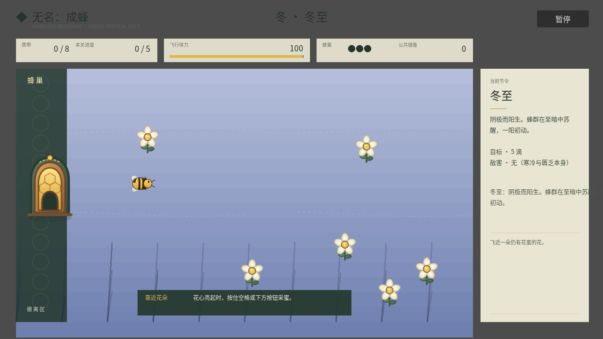

# 实际美术落地标准 v0.2

状态：2026-08-26 画风门禁重新打开；v3 深色矿物套色推荐已被 Alan 否决，当前记录待审阅的 v4 “明亮生态动画 × 蜂巢地标”，不把概念图冒充游戏画面。

## 决策

本作不转为像素风。2026-08-24 的“缝制布艺贴花主体 + 毛毡微缩体积”只保留为已验证失败与历史生产假设，不再冒充已通过的最终画风。

当前分为两层：

- **已锁定技术边界**：1280×720 高分辨率、严格俯视的连续旋转角色、独立透明交互层、低噪背景、轮廓与动作共同表达状态；剪纸、像素滤镜、毛毡玩偶、儿童布书和贴纸拼装不进入生产；
- **待确认 v4 候选**：以高明度清亮地表、受控鲜明色差、清楚外轮廓、极少内部线和一致软阴影统一世界；蜂蜡金只用于蜂巢核心、蜜、花粉和状态结果。1280×720 是更大滚动地图中的视口，蜂巢是暖亮节奏节点，核心状态优先由蜂身、目标、蜂巢和交互发生处表达；常驻界面只保留最小角落查询层。

候选比较、否决记录和证据边界见 [`LAUNCH_ART_PRODUCTION_PLAN.md`](LAUNCH_ART_PRODUCTION_PLAN.md) 的 v3／v4 节。Alan 明确通过 v4 门禁 A 之前，不据此批量替换资产。

概念样图只回答投影、轮廓、有限色、细节预算、局部体积与情绪，不能直接裁切成资产。每个实际资产必须有透明背景、固定视角、明确显示尺寸和状态要求，并进入 Godot 实机验证。

## 为什么不选像素风

当前工程使用 1280×720 高分辨率布局、连续旋转移动、矢量中文 UI 与程序化粒子。转像素风不是“给现有图加滤镜”，而是必须同时重定逻辑分辨率、整数缩放、摄像机、角色尺寸、动画帧率、字体、HUD、粒子与全部敌我资产。它会丢弃现有候选图价值，却不会自动降低总工作量。

像素风只有在团队明确愿意整体重做视觉管线，并先完成一张原生低分辨率实机切片后才可重新讨论；当前不进入生产。

## 资产技术标准

| 项目 | 标准 |
| --- | --- |
| 工作格式 | 优先可编辑分层源文件；可使用 SVG 或透明高分辨率位图模块，最终必须能拆出轮廓、明暗、蜂蜡反馈和动画状态 |
| 视角 | 可连续旋转的移动单位使用严格俯视；真正三分之四视角只用于不旋转建筑，或在另行批准 4／8 向角色帧后使用 |
| 玩家显示尺寸 | 约 58×42 px；主体在 100% 游戏缩放下必须一眼可辨 |
| 普通花显示尺寸 | 花冠约 28–36 px；高价值花通过轮廓和动作而非仅换色区分 |
| 普通敌害 | 24–48 px；轮廓必须先说明追击、偷取、跳跃或压迫行为 |
| Boss | 普通敌害至少 1.8 倍，并有独立蓄力、失律、恢复轮廓 |
| 纹理 | 小尺寸不画绒毛、密集针脚或写实微纹理；场地中心／边缘生态／交互物按约 1∶2∶4 分配细节 |
| 描边 | v4 使用炭蓝／深青绿外轮廓，不用纯黑；内部线只保留解释结构与动作的少数组，不使用蚀刻、排线、点描和满屏颗粒边 |
| 阴影 | 两档明暗与轻微软投影共用同一方向；蜂蜡反馈可以增加局部体积，不得烘成带背景矩形的图片 |
| 状态可读性 | 颜色之外还需形状、缩放、动作或粒子反馈 |
| 信息构图 | 携带在蜂身、目标在同形实体／寻迹、蜂巢状态在蜂巢、结果在交互处优先表达；顶部／右侧不得用大块常驻文字重复世界已经说清的信息，但全部结算条件必须从开局可查询 |
| 地图视口 | 1280×720 不再等于未来完整地图；路径与生态延伸出屏外，单位保持真实尺寸，离屏危险必须预告，常驻 UI 目标占屏不超过约 8% |

## 首个垂直切片顺序

1. 玩家蜂：飞行锚点与全项目材质尺度；
2. 一朵普通花和一朵高价值花：验证采集目标层级；
3. 蜂巢与卸蜜反馈：验证安全区和资源归属；
4. 教学蚊虫：验证敌我轮廓与危险距离；
5. 春季地表模块：最后铺环境，防止背景先抢走交互物层级。

每一步必须在游戏实际截图中检查 100% 缩放、运动、季节色和 UI 同屏效果。通过后才生产同类批量资产。

## 首轮生成验证结论

- 毛毡高细节玩家蜂：像商品玩偶，缩小后绒毛、腿与缝线成为噪声，否决；
- 简化布艺位图玩家蜂：轮廓方向正确，但输出把透明棋盘格烘进图片，不能作为生产文件；
- 因此采用“生成图提供造型参考 + 可编辑 SVG/分层文件负责最终资产”的混合流程。

## 引擎切片 v1（2026-08-24）



截图由 `godot/tests/art_snapshot.gd` 加载真实 `main.tscn`、进入冬至首关并从游戏视口保存，不是概念图或后期合成图。

已验证：

- 玩家蜂在约 58×42 px、持续旋转条件下仍能辨认朝向；
- 蜂巢入口与实际安全区边界对齐，开始具备“家”的空间锚点；
- 普通花从程序化圆形替换为有花冠、蜂蜡花心、茎叶结构的独立资产；
- 透明织物覆盖层能保留节令底色，同时减少纯渐变占位感。

仍未通过最终品质：

- 地表仍缺少前中后景模块与局部生态聚落，画面较空；
- 小尺寸花的织物质感弱，普通花与高价值花需要在同屏运动中继续验证；
- 蜂巢尚无卸蜜、呼吸、衰弱动画；敌虫仍是程序化占位；
- 该图只作为 v1 视觉回归基线，不作为 Steam 商店截图。

运行快照：

```bash
godot --path godot --script res://tests/art_snapshot.gd -- --output=/tmp/nameless-art-snapshot.png
```

快照需要可用显示驱动，不能使用 `--headless`。
