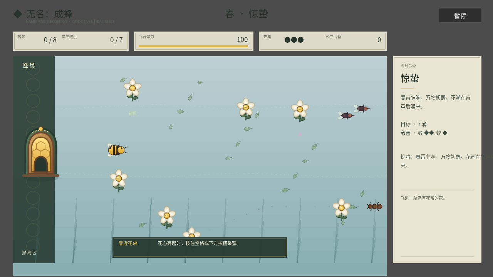
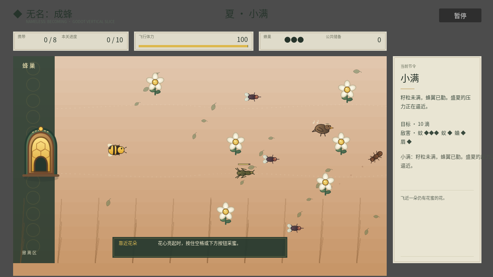
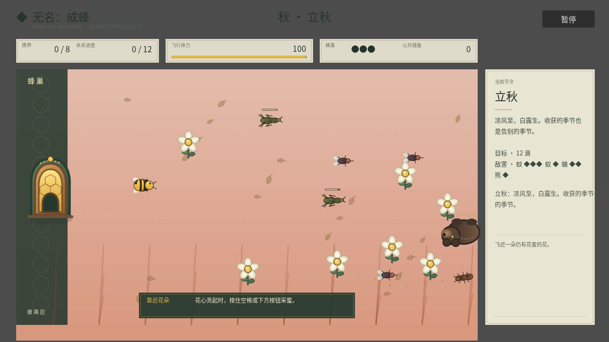
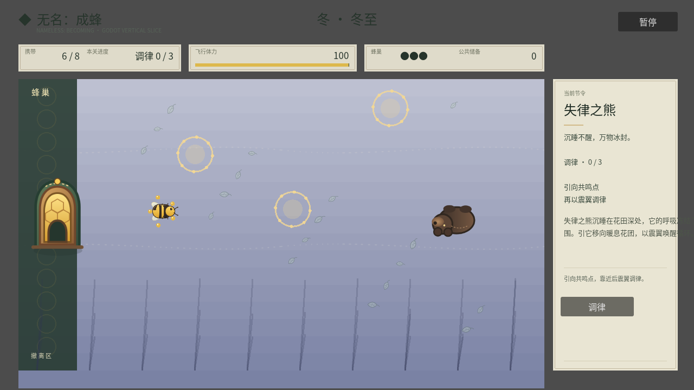

# 实际美术落地标准 v0.1

状态：2026-08-24 首个引擎资产验证中；本标准约束生产，不把概念图冒充游戏画面。

## 决策

本作不转为像素风。实际游戏采用：

- 主表现：清楚、扁平、便于动画的缝制布艺贴花；
- 体积与氛围参考：毛毡微缩场景，但细节密度至少降低一半；
- 蜂蜡：玩家、花蜜、花心、奖励和能量高光；
- 浅色植鞣革：蜂巢设施与 UI 承载面；
- 刺绣线：归巢、花粉传递、风向和危险轨迹，只在信息成立时出现。

概念样图只回答材质、色温与氛围，不能直接裁切成资产。每个实际资产必须有透明背景、固定视角、明确显示尺寸和状态要求，并进入 Godot 实机验证。

## 为什么不选像素风

当前工程使用 1280×720 高分辨率布局、连续旋转移动、矢量中文 UI 与程序化粒子。转像素风不是“给现有图加滤镜”，而是必须同时重定逻辑分辨率、整数缩放、摄像机、角色尺寸、动画帧率、字体、HUD、粒子与全部敌我资产。它会丢弃现有候选图价值，却不会自动降低总工作量。

像素风只有在团队明确愿意整体重做视觉管线，并先完成一张原生低分辨率实机切片后才可重新讨论；当前不进入生产。

## 资产技术标准

| 项目 | 标准 |
| --- | --- |
| 工作格式 | 优先可编辑 SVG 或分层源文件；Godot 导入后作为纹理使用 |
| 视角 | 与游戏一致的俯视三分之四视角；角色默认朝右，由引擎旋转 |
| 玩家显示尺寸 | 约 58×42 px；主体在 100% 游戏缩放下必须一眼可辨 |
| 普通花显示尺寸 | 花冠约 28–36 px；高价值花通过轮廓和动作而非仅换色区分 |
| 普通敌害 | 24–48 px；轮廓必须先说明追击、偷取、跳跃或压迫行为 |
| Boss | 普通敌害至少 1.8 倍，并有独立蓄力、失律、恢复轮廓 |
| 纹理 | 小尺寸不画绒毛与密集针脚；只保留大色块、主接缝和少量材质颗粒 |
| 描边 | 深褐、深绿或靛蓝，不用纯黑统一描边 |
| 阴影 | 轻、软、统一方向；不得把资产烘成带背景矩形的图片 |
| 状态可读性 | 颜色之外还需形状、缩放、动作或粒子反馈 |

## 首个垂直切片顺序

1. 玩家蜂：飞行锚点与全项目材质尺度；
2. 一朵普通花和一朵高价值花：验证采集目标层级；
3. 蜂巢与卸蜜反馈：验证安全区和资源归属；
4. 教学蚊虫：验证敌我轮廓与危险距离；
5. 春季地表模块：最后铺环境，防止背景先抢走交互物层级。

每一步必须在游戏实际截图中检查 100% 缩放、运动、季节色和 UI 同屏效果。通过后才生产同类批量资产。

## 首轮生成验证结论

- 毛毡高细节玩家蜂：像商品玩偶，缩小后绒毛、腿与缝线成为噪声，否决；
- 简化布艺位图玩家蜂：轮廓方向正确，但输出把透明棋盘格烘进图片，不能作为生产文件；
- 因此采用“生成图提供造型参考 + 可编辑 SVG/分层文件负责最终资产”的混合流程。

## 引擎切片 v1（2026-08-24）


截图由 `godot/tests/art_snapshot.gd` 加载真实 `main.tscn`、进入冬至首关并从游戏视口保存，不是概念图或后期合成图。

已验证：

- 玩家蜂在约 58×42 px、持续旋转条件下仍能辨认朝向；
- 蜂巢入口与实际安全区边界对齐，开始具备“家”的空间锚点；
- 普通花从程序化圆形替换为有花冠、蜂蜡花心、茎叶结构的独立资产；
- 透明织物覆盖层能保留节令底色，同时减少纯渐变占位感。

仍未通过最终品质：

- 地表仍缺少前中后景模块与局部生态聚落，画面较空；
- 小尺寸花的织物质感弱，普通花与高价值花需要在同屏运动中继续验证；
- 蜂巢尚无卸蜜、呼吸、衰弱动画；敌虫仍是程序化占位；
- 该图只作为 v1 视觉回归基线，不作为 Steam 商店截图。

运行快照：

```bash
godot --path godot --script res://tests/art_snapshot.gd -- --output=/tmp/nameless-art-snapshot.png
```

快照需要可用显示驱动，不能使用 `--headless`。

## Demo 美术生产首轮完成（2026-08-24）

本节的“完成”指关键玩法对象已退出几何占位并进入统一、可编辑的生产管线；不表示已经通过外部玩家审美验证，也不表示截图达到 Steam 宣传品质。

| 类别 | 实现状态 | 实际反馈 |
| --- | --- | --- |
| 玩家蜂 | 已接入布艺贴花 SVG | 飞行翼动、急转拉伸、无敌高光、寻迹光环 |
| 花 | 普通/高价值两套轮廓 | 花冠、蜂蜡花心、茎叶、价值光环、休眠/压平状态 |
| 蜂巢 | 已接入入口资产 | 靠近呼吸、储备蜜点、卸蜜扩散光环与蜜粒 |
| 普通敌害 | 蚊、蚁、油葫芦、画眉、熊全部接入 | 朝向、惊退/噤声/蓄力/跳跃/吞蜜状态保留 |
| 失律者 | 四类 Boss 复用对应物种资产并放大 | 各自移动轮廓、危险预告、音符、调律环与命中标记保留 |
| 四季环境 | 节令渐变 + 织物覆盖 + 季节生态叶片 | 春绿、夏深绿、秋赭、冬霜白随真实节令数据变化 |
| 携蜜风险 | 已进入世界内显示 | 最多五滴蜜环绕玩家，不读 HUD 也能感到负重收益 |
| HUD/弹层 | 顶栏、侧栏、教学与主弹层增加轻缝线 | 保留中文可读性，不用厚重皮革压过场景 |

### 四季真实运行基线

以下均由 `main.tscn` 实际运行生成，不是概念图：









开发者自测结论：敌我与高价值交互物在 100% 缩放下可区分，视觉媒介已经可以覆盖完整 Demo；仍需 Alan 审阅运动画面，并由独立外部玩家验证“是否显得廉价/幼态”“危险是否足够清楚”“四季是否像不同生态而不只是换色”。在这些证据出现前，上述图片只作为开发基线。
