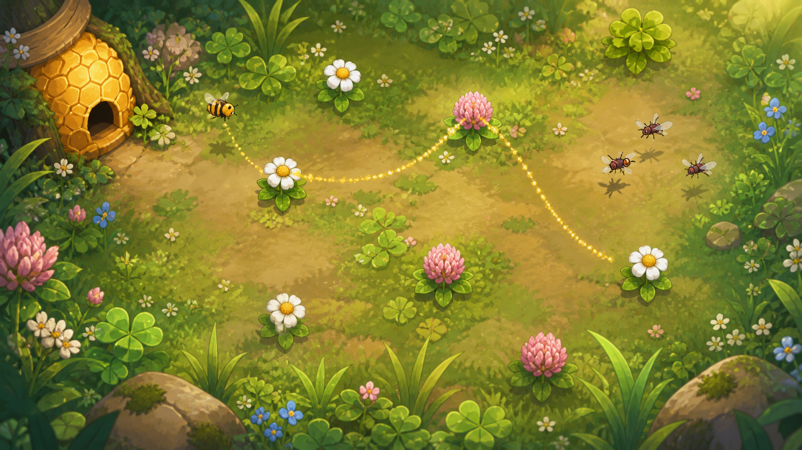
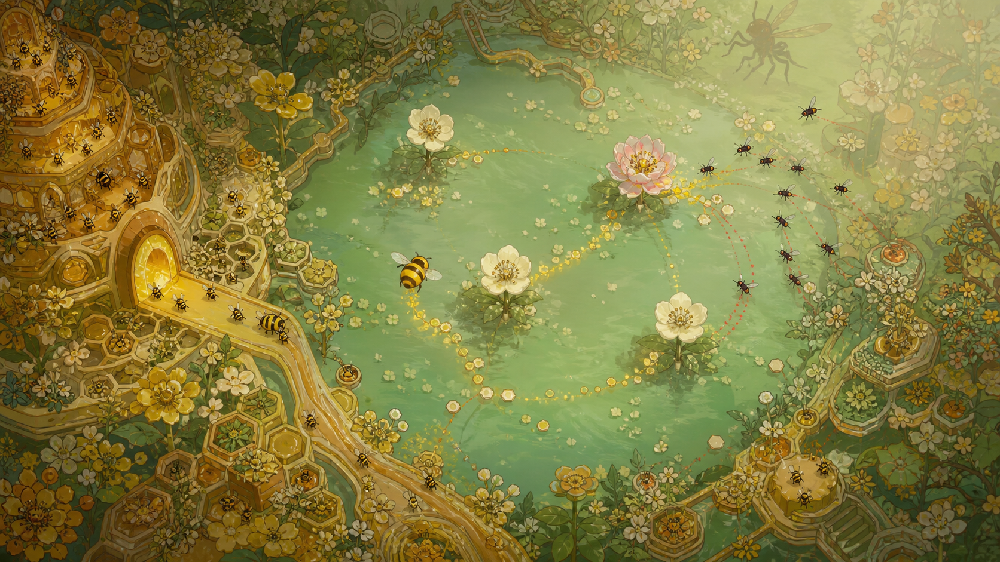
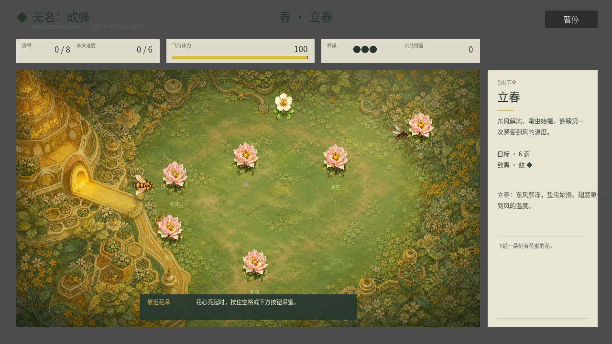
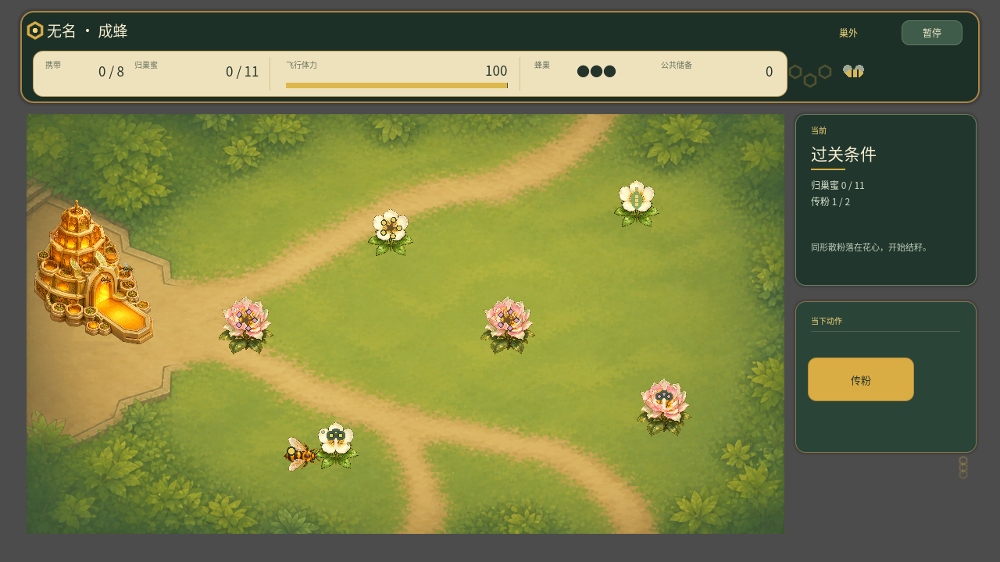
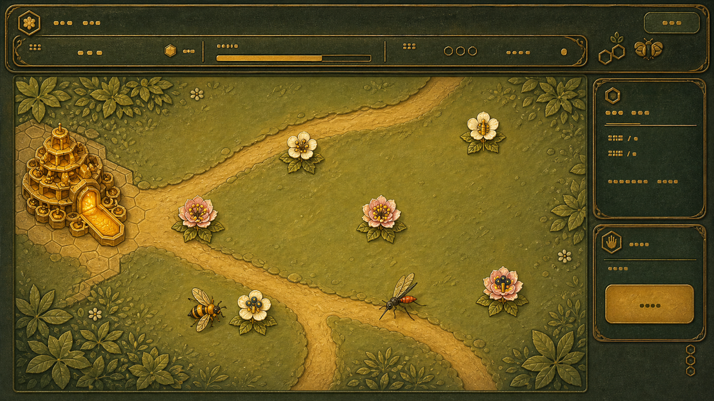
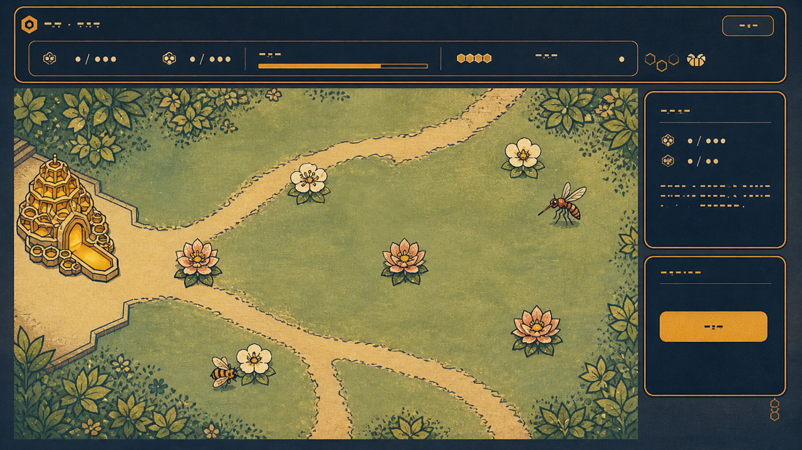
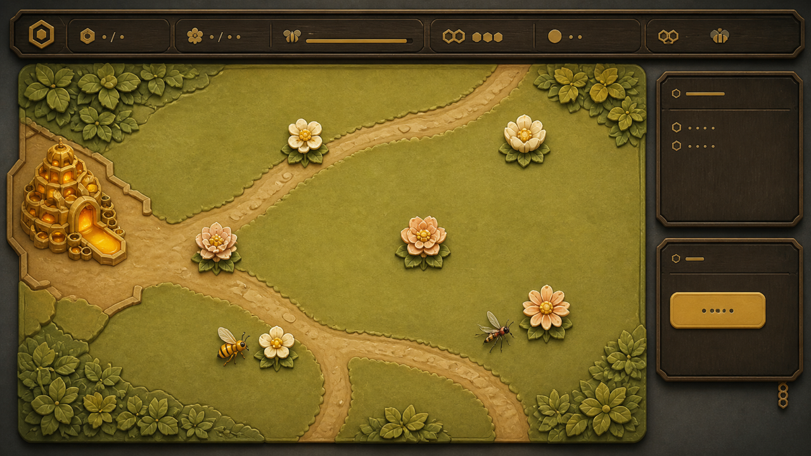
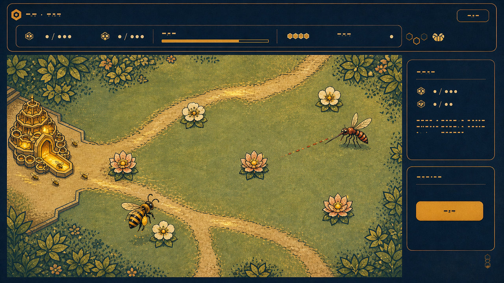

# 《无名：成蜂》正式上线美术生产计划 v1

初版：2026-08-24；本次更新：2026-08-26
状态：**当前没有通过审阅的美术候选。v3 已因配色、线噪与构图被否决；2026-08-26 Alan 又正式否决了 v4／v5 的地图与海报执行：两图明暗失控且互不统一，颜色脏，像照片转手绘只做到一半；没有明确情绪和艺术抽象，无效细节很多，旧有的蚊子、画眉等角色设定没有被继承，海报还把花蜜画成从蜜蜂腹端滴落。扩大地图与游玩时间、让蜂巢承担类似篝火的关卡亮点仍是产品意图，但不构成对任何现有画风、地图数量、角色造型或宣传图的批准。v4／v5 图片只保留为失败证据，不再作为审阅候选或生产输入。**

> 当前玩法、美术路由与验收边界以 [`../PLAYER_FEEDBACK_ACTION_PLAN_2026-08-24.md`](../PLAYER_FEEDBACK_ACTION_PLAN_2026-08-24.md) 为准。本文只负责美术生产，不得用旧四关、旧授粉或固定总时长重新定义产品结构。

## 一、目标与边界

目标不是继续美化原型，而是建立一套可以支撑 Steam 商店、预告片和公开 Demo 的实际游戏美术：玩家不读说明也能识别自己、目标、危险、路线与反馈；截图本身像一个完整世界；资产能够拆层动画并在 Godot 中稳定运行。

本轮明确不做：

- 不沿用被否决的贴纸式 SVG、毛毡玩偶或儿童布书质感；
- 不做剪纸、丧葬、祭祀或黑红民俗恐怖语汇；
- 不把概念图直接当游戏截图或最终资产；
- 不在春季代表切片通过审阅前批量制作四季、四 Boss 和 Steam 胶囊；
- 不用像素滤镜把现有高分辨率资产伪装成像素风。

## 二、方向实验记录

### v1：通用手绘花田（未通过）

- 场景是有前景、中景、路径和生态聚落的真实花田，不再是纯色面板；
- 角色和交互物保持简化、夸张、可动画，但不幼态卖萌；
- 自然纹理只服务空间与季节，不能淹没 40～60 px 的玩法主体；
- 花粉链、花蜜转移、风向和危险预告使用有明确生态来源的世界内动作、叶片运动和轨迹，不依赖说明文字；
- HUD 退居边缘，只保留携蜜、体力、蜂巢储备和当前阶段，不与场景争夺注意力。



该图使用现有春季实机截图作为空间结构参考，由内置图像生成工具生成。Alan 审阅结论：**太普通、没有特点，而且没有采用此前讨论形成的项目身份。**

失败原因不是此前讨论失效，而是提示中过度纠偏：为了排除剪纸、贴纸和幼态感，同时排除了蜂蜡、植鞣革、刺绣与微缩文明等既有辨识语言，只留下“成熟手绘自然花田”，因此得到一张通用的商业插画。该图只保留为失败对照，不进入灰盒或资产生产。

### v2：随四时呼吸的蜂族城邦（已进入实现，独立审美门禁仍待记录）



v2 恢复并强化此前已经形成的五项核心身份：

1. **高度文明化的蜂族社会**：蜂巢不是道具，而是能看到共同劳动、育幼、储存与交通的微缩城邦；
2. **撤离即回家**：安全区是明亮、有人等待的社会空间，花田越远离蜂巢越不确定；
3. **无名→成蜂**：玩家的行动通过授粉链、共同资源和归巢路线连接花、蜂群与其他个体；
4. **材料有语义**：蜂蜡只承载生命与能量，植鞣革/蜂巢浮雕承载蜂群秩序，刺绣式轨迹承载运动与联系，自然纤维只作为环境层；
5. **节气内化**：春/木/角通过向上分枝、萌芽、展开、上行路径和开放节奏体现，不出现季节标题或文化装饰标签。

该张 v2 图仍是生成式方向实验，不是实机截图或最终资产。它影响了后续实机切片，但 Alan 对当时候选的“可以”只批准整体整改方向，不能倒推为这张概念图、`57aefc4` 实机美术或全部美术已逐项通过。信息密度、蜂巢占幅和角色缩小后的辨识度仍要用实机动态证据验证。

### 2026-08-26 旧概念参考继承审计（撤销 AI 自动过滤）

**证据边界：** Alan 提供的旧概念中包含地主蚊子、油葫芦容器怪、三弦鸟精等明确的拟人化与个性化身份。此前文档把这些内容过滤成通用的“口器、跳跃、声音”动作规则，并把职业、器物与舞台特征统称为“不带回的字面设定”；这是 AI 的自行删减，不是 Alan 的批准。原始完整对话与全部设定图目前没有完整归档在仓库，因此不能反向假装已经恢复全文，也不能继续自动删除。

从现在起，每个角色都必须先填写“必须保留／可以艺术化转译／提议废止／证据缺失”四栏继承表，并由 Alan 确认后才能进入造型。已知事实、AI 提案和待恢复旧设不得混写；详细账本见 [`character-visual-canon.md`](character-visual-canon.md)。v3、v4、v5 均未通过，不能再把任何一套表现路线写成这些角色的默认承载方式。

角色设计仍以现实生态为骨架，但现实事实不是抹平 IP 身份的理由。下一轮的工作命题暂称 **“有情的生态寓言”**：

> 真实物种骨架 + 已确认的旧角色身份 + 行为夸张 + 共同生活痕迹 + 节律光色；删改任何旧设都要逐项说明，而不是整类过滤。

| 旧参考 | 已确认可继承的方法 | 被 AI 过滤、必须恢复核对的身份层 |
| --- | --- | --- |
| 僵尸装束野猪 | 大块轮廓、重量感、正侧背与多状态一致性 | 该参考是否对应现有熊尚无证据；僵尸、符纸、官服等元素不能自动映射，也不能借此补写熊设定 |
| 油葫芦容器怪 | 身体结构说明功能；后腿压缩、起跳、落地停顿形成三拍 | 容器身体、油的语义、旧技能和个性表达须回看原设逐项决定，不得只剩一只通用跳虫 |
| 地主蚊子 | 长口器作为行动轴；吸取前后腹部重量与飞行姿态变化 | 地主身份、西装／皮草／烟斗／钱袋、收租与剥削讽刺是旧设组成，须恢复核对，不得被“不要廉价拟人”整类删除 |
| 三弦鸟精／画眉 | 声音成为空间轨迹；阶段变化同时改姿态、轮廓和节拍 | 三弦、长袍、舞台姿态、节律与精怪身份须恢复核对；不能把角色降成远景鸟形剪影 |
| 蚁城与蚁后 | 交通、储存、修补、照料、休息等生活痕迹让场景有温度 | 蚁城社会与蚁后身份是否进入当前范围待确认，AI 不再代替 Alan 作整类废止 |
| 二十四节气色卡 | 季节可通过明度、饱和度、光影与运动密度连续变化 | 阴阳消长的抽象象征、节气文字和色卡表现须分别讨论，不能只做四季换色，也不能擅自塞回 HUD |

旧参考进入当前游戏时必须经过玩法翻译，但“翻译”不等于“净化成通用动物”。主角、老师傅、蚊子、油葫芦、画眉和熊都要先恢复各自继承表，再用轮廓、姿态、动作和受控道具形成角色身份。任何细节必须服务角色、生态、路线、动作或情绪中的至少一项；否则删除。

#### 此前角色化力度 A/B（已暂停）

此前计划在 v4 表现系统通过后比较“生态克制／寓言强化”，但 v4 已被否决，且这种单轴 A/B 会再次把具体旧设压缩成“拟人化力度”。该 A/B 暂停；先恢复角色继承，再决定每个角色自己的艺术化幅度，不再用一把比例尺处理所有物种。

确认过的世界观禁区仍然有效：不直接拼贴旧图，不擅自扩充怪物名单，不以人脸贴昆虫、统一像素滤镜或一套黑红危险色代替设计。地主、三弦、容器身体等旧身份不再列入整类禁用；是否保留、如何转译，必须由角色继承表逐项决定。

### 春季实机切片 v1



该图由 Godot `main.tscn` 实际运行生成，不是概念图合成。春季普通关已接入独立背景、玩家蜂、普通花、授粉花与蚊虫 PNG；蜂巢城邦、路径和边缘生态位于背景层，角色与交互物保持独立运动。接入路由以玩家实际经历的授粉玩法组（`flower_set: spring`）为准，不再依赖旧节气字段，避免袭扰玩法误用春季画面。当前仍保留原型 HUD 与教学文字，因此只证明视觉身份已经进入游戏，不代表整套上线美术完成。

### 四季实机纠偏 v2


该图是 Godot 四个代表节点的真实运行快照拼图，不是生成式概念图。针对“背景花哨、模糊、与角色及花不统一”和“不知道空圈是什么”，本轮完成以下接线：

- 背景改用 `godot/assets/art/launch/spring_field_v2.png`：删除烘焙在底图中的大蜂巢、大花、单位、圆环和 UI，降低中央草地纹理与景深噪声，保留清楚的道路和边缘生态；
- 蜂巢改为独立前景资产，画面入口、碰撞边界与归巢落点统一在左侧同一锚点；落巢通道、储蜜格变亮和卸蜜活动用于说明“这里是家”，不再由背景中的静态大图暗示；
- 四季机制的常驻空圈分别改成**已开放花上的花药／同型开放柱头／绿色结籽体**、成熟或破裂种核、可点亮的蜂蜡暖点；只有寻迹或攻击生效时才允许短暂显示范围线；
- 花朵使用独立透明 PNG 和统一接地阴影，不再用模糊彩色光圈说明品类。

四组花型以玩家经历的 `flower_set` 路由，不依赖界面显示“春夏秋冬”：

| 玩法组 | 普通花 | 高价值／机制花 | 资产 |
| --- | --- | --- | --- |
| 春／授粉 | 白色单瓣春花 | 粉色重瓣授粉花 | `flower_common_v1.png`／`flower_high_value_v1.png` |
| 夏／袭扰 | 红色木槿 | 向日葵 | `summer_hibiscus_v1.png`／`summer_sunflower_v1.png` |
| 秋／留种 | 紫菀 | 菊花 | `autumn_aster_v1.png`／`autumn_chrysanthemum_v1.png` |
| 冬／暖点 | 山茶 | 蜡梅 | `winter_camellia_v1.png`／`winter_wintersweet_v1.png` |

春季两种名称是项目内部的可读造型语义，不冒充严格植物学鉴定；夏秋冬使用明确物种轮廓。当前截图能证明 8 个映射和透明资产已进入引擎，不能证明玩家在 60～80 px、运动和战况干扰下已经稳定识别。

### v3：正式画风重开（2026-08-26，推荐已否决）

本轮先从最新 `main` 生成真实 1280×720 春季快照，再只改变画风、不改变花田／HUD 的基本空间关系。这样可以单独比较造型语言，而不是让三张构图、信息量和完成度都不同的概念图互相竞争；同时也意味着这一轮**没有回答 HUD 是否应该继续集中在顶部与右侧**。



这张图属于**实现事实与开发者快照**：能证明当前背景、蜂巢、玩家、花、授粉状态和 HUD 已在真实场景同屏；不能证明画风已通过。视觉审计得到四个根因：

1. 背景、花、角色和蜂巢像不同写实素材分别转成手绘，再由深色图形 UI 包住，缺少统一的抽象规则；
2. 场景中心、边缘植被、花器官和蜂巢都在争夺细节预算，远近与交互层级主要靠尺寸硬撑；
3. 蜂巢有建筑，没有足够的共同劳动痕迹；玩家蜂与敌害有物种外形，却没有由行为动词塑造的姿态；
4. “布艺／毛毡／皮革”被当成表面材质目标，反而遮住了最先必须确定的投影、轮廓、明暗和动画语法。

#### 三路同构图候选

**A · 蜂蜡蚀刻浅浮雕**



- 优点：材质身份强，蜂巢与 HUD 很统一，商店缩略图有辨识度；
- 风险：全屏同质金绿会疲劳，容易像金属桌游面板；浅浮雕纹理的批量生产与动画成本偏高。

**B · 矿物色套色版绘**



- 优点：严格俯视、轮廓清楚、留白稳定；角色、花、地形和 UI 可以共用有限色、套色边与两档明暗，最适合单人分层生产；
- 风险：若没有局部体积和蜂群活动，可能退化为静态生态图谱或复古桌游插图。

**C · 蜂蜡微缩舞台**



- 优点：空间、触感和暖意最直接，蜂巢像一个可进入的地方；
- 风险：即使主动降细节，仍容易像高级桌游／手游棋盘；角色转向、状态帧、四季模块和光影统一的成本最高。

#### 原始反馈复核：三张候选未覆盖界面构图

`playtest-NB-20260825-6412D7BA.json` 的逐字反馈包含：“提示什么的放在最右侧、上侧是不是不是一个很好的设计，是否可以简约设计到画面中”。它来自 Alan 对历史 `Main` 的局部自测，不是独立玩家证据，也不是允许自动删除全部文字或结算条件的实现指令；但它确实是本轮美术讨论的直接输入。

现有 A／B／C 与推荐图故意保留“顶部紧凑 HUD＋右侧窄情境栏”，目的是隔离画风变量。该控制方法对比较造型系统有效，却不能被倒推为旧界面构图已经获批。此前方案把“整体美术未达宣传／发售水准”纳入门禁，却没有让这条更具体的构图建议改变下一步交付，属于遗漏。修正后的门禁拆为两部分：

1. **A1 · 表现系统**：比较 A／B／C；当时专家启发式推荐“矿物色套色版绘 × 局部蜂蜡浅浮雕”，现已被 Alan 直接审阅否决；
2. **A2 · 信息构图**：在同一推荐表现系统、同一世界状态下，比较现有界面壳与“世界内主表达＋最小可查询界面”的版本。A2 通过前，不制作 Godot 正式美术样板。

#### 评分与推荐

评分只代表本轮**专家启发式评审**，不是 Alan 审美结论，更不是独立玩家证据。

| 方向 | 玩法可读性 30 | 成年感与情绪 20 | 项目身份 15 | 四季演化 15 | 单人生产 15 | Steam 传播 5 | 合计 |
| --- | ---: | ---: | ---: | ---: | ---: | ---: | ---: |
| A 蜂蜡蚀刻 | 26 | 16 | 15 | 11 | 10 | 5 | **83** |
| B 套色版绘 | 28 | 17 | 14 | 14 | 14 | 4 | **91** |
| C 微缩舞台 | 27 | 14 | 12 | 13 | 8 | 5 | **79** |

当时的专家启发式推荐以 **B 套色版绘**为主系统，只从 A 借用“蜂蜡只出现在生命／能量反馈”的局部体积，不采用 A 的全屏浮雕，也不采用 C 的完整微缩棋盘。精修样板如下；Alan 已否决其配色、线条层级与构图，不能继续称为当前推荐：



该轮曾提出八条规则，以下只作历史归因。严格俯视、世界先说和真实尺寸验证仍可继承；深靛／橄榄有限色、套色颗粒与固定单屏构图不再继承。第 4 条对帽子／道具的整类禁令和第 5 条把角色压成通用行为公式的做法，也已被本轮角色继承审计覆盖，不能再用来删除地主蚊子、三弦鸟精或油葫芦容器身份：

1. **投影先于材质**：可连续旋转的角色必须使用严格俯视轮廓；真正三分之四视角只允许用于不旋转建筑，或改做 4／8 向角色帧后重新立项；
2. **一套边缘**：环境、角色、花、敌害和 UI 共用靛青／深绿套色轮廓、有限色和两档明暗，不再拼贴不同渲染完成度；
3. **蜂蜡是动词**：只给入口、蜜、花粉、体力、卸蜜和调律结果增加半透明体积；常态地表不铺蜂蜡；
4. **人情味来自动作与生活痕迹**：巢口搬运、点亮的储蜜格、磨损的落脚路、玩家略弯触角和工作姿态；禁止帽子、人脸或人类身体；
5. **敌害由行为动词造型**：蚊＝前刺／追踪，蚁＝低重心／路径，油葫芦＝折腿／爆发，画眉＝停驻／诱骗，熊＝宽面／碾压；Boss 在常态轮廓上失衡，不另做恶魔皮；
6. **细节预算 1∶2∶4**：场地中心最低、边缘生态中等、交互物与角色最高；纹理只在边界和状态变化处出现；
7. **概念图必须缩回实机**：推荐图把玩家蜂放大得超过目标尺寸，只表达角色化倾向；正式切片仍从约 58×42 px 起测，最终靠动态与轮廓通过，不靠概念图放大。
8. **世界先说，界面再查**：携带状态优先落在蜂身，去向优先由同形目标与寻迹连接，蜂巢储备／受损优先落在蜂巢，成功或拒绝优先在交互发生处完成三拍反馈；顶部／右侧不得继续用大块常驻文字承担这些主表达。暂停、无障碍文字和所有会阻止结算的条件仍必须从开局可查询，世界内化不得重新制造隐藏门槛。

#### v3 门禁结论

v3 的 A1 表现系统与 A2 固定单屏构图均未通过。现有图片仍可作为失败归因和制作成本记录，但不得继续进入 Godot 动态样板。

### v4：明亮生态动画 × 蜂巢地标（2026-08-26，已否决）

[失败证据：v4 明亮大地图与蜂巢节点方向稿](concepts/spring-bright-hive-checkpoint-direction-v1.png)

v4 曾尝试用明亮大色面、局部视口和暖色蜂巢纠正 v3 的暗脏与固定单屏，但“调亮”替代了真正的色彩设计。Alan 的后续直接审阅表明：地图过亮，色彩仍脏且缺少专业的对比组织；画面像照片转手绘做到一半，细碎植被和装饰没有围绕玩法重点被艺术抽象。它与随后偏暗的海报也没有共享明度层级、色相家族、边缘处理、纹理尺度或光照逻辑，因此不能再作为画风母版。

v4 中仍可保留的只是产品与读取假设，而不是视觉结论：`1280×720` 可以是更大滚动地图的局部视口；蜂巢可以承担类似篝火的安全、休整与方向亮点；可从初代 PVZ 学习统一场地、局部对比、功能轮廓和少文字的方法。不得借用 PVZ 的角色、格线、路线结构、UI 或具体资产，参考边界见 [`../decisions/ADR-001-pvz-reference-boundary.md`](../decisions/ADR-001-pvz-reference-boundary.md)。地图尺寸、节点服务与时长仍以 [`map-evolution.md`](map-evolution.md) 为准。

### v5：世界总览与主海报（2026-08-26，已否决）

以下两张图不再嵌入展示，只作为失败证据保留：

- [失败证据：过亮且细节失控的五地图总览](concepts/rejected-five-map-world-atlas-overbright-v1.png)
- [失败证据：腹端滴蜜且偏暗脏的主海报](concepts/rejected-key-art-tail-drip-v1.png)

这两张生成图不能证明任何画风、角色造型或宣传构图已经成立。其结构中关于连续家园、四季生态和蜂巢节点的讨论可以单独继续；“5 张地图／13 个主场景／18 种花”仍只是开发建议，等待 Alan 确认，不能由失败总览图锁定。

#### v5 失败归因

1. **生态错误直接破坏观感**：海报把金色液滴画在蜜蜂腹端，既不是正常的采蜜／交蜜表达，也会被直读成排泄。花蜜负载应通过口器—蜜胃—口对口交接或蜂房卸载关系表达；腹端禁止出现蜂蜜、金色液体或“装饰性滴落”。授粉时蜂身散粉也不能与后足花粉筐混为同一种状态。
2. **角色继承被 AI 擅自删除**：地主蚊子、油葫芦容器怪、三弦鸟精／画眉等旧设被压缩成通用动作规则，随后又在海报提示中降成远景剪影。结果不是“受控拟人化”，而是把项目已经讨论过的 IP 身份抹平。先恢复 [`character-visual-canon.md`](character-visual-canon.md) 的继承账本，未确认前不得再画群像海报。
3. **地图与海报不像同一款游戏**：地图过亮、海报过暗，两者色相、明度、轮廓、阴影、纹理和抽象尺度没有共同母版。干净不等于过曝，情绪不等于压黑；两种极端都不能代替统一的色彩组织。
4. **“照片转手绘一半”不是成品风格**：写实比例、随机自然微细节和生成式光影被保留，角色与地形却只局部卡通化，导致材质、边缘和空间逻辑互相冲突。
5. **没有情绪主句**：地图只陈列区域，海报只堆叠角色、季节、蜂巢环和装饰光效，没有用一个关系动作让玩家先感到“归巢／责任／诱惑／共同体”。
6. **缺乏合理艺术抽象**：细节没有经过“角色、生态、路线、动作、情绪”五项用途筛选。不能服务其中任一项的花、叶、纹理、粒子、光斑和轮廓线都属于无效细节，必须删去。

#### 下一轮不是 v6 海报，而是前置设计门禁

生产顺序固定为：

```text
角色继承表
→ 黑白剪影
→ 三阶明度
→ 有限色主样帧
→ 100% 实机动态
→ 从通过的实机母版派生地图／海报
```

有限色主样帧必须先锁定地图、角色和未来海报共用的造型语言、抽象尺度、明度阶数、色相家族、边缘处理、纹理尺度、阴影方向和光照逻辑。样帧只允许一个情绪主句与一个关系动作；三秒盲读若只能得到“亮／暗／忙／好看”，即为失败。完整硬门禁见 [`ART_IMPLEMENTATION_STANDARD.md`](ART_IMPLEMENTATION_STANDARD.md)。上述顺序任何一步未通过，都不批量制作花卉、四季地图、Boss 三联立绘或商店素材。

### 蜂巢与蜂群分工决策

- 统一锚点：卸蜜、回血和冬季取暖共同使用巢门矩形 `Rect2(34, 350, 176, 120)`，归巢落点为 `(150, 410)`；左侧其他高度不再是隐藏的蜂巢竖条；
- 蜂巢活动：储备提高会点亮更多巢房，交蜜会短暂增强入口活动，受损会改变蜂巢色调；
- 蜂群角色：先以三种色调和巢口活动表现侦察蜂、采蜜蜂、守卫蜂三类同种工蜂，而不是新增可玩物种；寻迹时侦察蜂离巢，真实卸蜜时采蜜蜂穿过落巢通道，袭扰发生时守卫蜂停在巢口。这是世界反馈动画，不冒充具备独立寻路和战斗决策的完整 AI；
- 决策依据：现阶段“不同物种”若没有独立操作、资源取舍和成长路线，只会增加名词与资产量。先验证玩家能否从蜂群活动读出一个活的社会；若三类角色仍同质，再为有独立玩法价值的蜂种立项。

## 三、生产门禁

```text
角色继承表
→ 黑白剪影
→ 三阶明度
→ 有限色主样帧
→ 100% 实机动态
→ 地图／海报
```

每个门禁只回答一个问题：

| 门禁 | 必须回答 | 通过证据 | 停止条件 |
| --- | --- | --- | --- |
| A 角色继承 | 主角、老师傅、蚊子、油葫芦、画眉、熊的旧设哪些必须保留、可转译或废止？ | Alan 确认的逐角色继承表；事实、旧设、AI 提案分栏 | 旧身份又被压成通用动物，或 AI 擅自补写／删除设定 |
| B 黑白剪影 | 不靠颜色、台词与背景，每个角色的身份、重心与玩法动词能否区分？ | 同比例黑白剪影表与关键动作剪影 | 必须靠服装纹理、特效或名字才能认出 |
| C 三阶明度 | 一个代表场景能否先读到情绪主句、玩家—蜂巢—目标／危险关系？ | 只含暗／中／亮三阶的缩略构图；320×180 与灰度复核 | 只有“很亮／很暗／很忙”，或地图与角色争抢重点 |
| D 有限色主样帧 | 场景、角色、UI 与未来宣传图是否共用一套抽象、色彩、边缘、纹理和光照逻辑？ | 一个春季代表帧及其色板／边缘／阴影规范 | 过曝、压黑、脏色、全屏色罩、半照片转绘或无效微细节 |
| E 实机动态 | 真实尺寸运动中，角色、采蜜、授粉、受击与归巢能否由画面读懂？ | Godot 100% 缩放的 30 秒无说明录像；所有粒子标明来源 | 缩小后糊成噪声，必须读文字，或出现腹端滴蜜等生态／视觉误读 |
| F 地图／海报 | 通过的实机母版能否派生为同一游戏的地图与宣传图，同时保留一个明确情绪？ | 同母版地图图解、海报草图与实机截图并排复核 | 地图与海报明暗、画法或角色身份不一致，或靠堆细节伪造完成度 |

方向通过与完成度通过分开判断；开发者自测和 AI 推演不能代替 Alan 审美判断或外部玩家证据。

## 四、春季代表切片资产包

第一批只制作能构成一场完整游戏的最小资产，不画装饰性全集。

| 资产包 | 交付内容 | 动画/状态 |
| --- | --- | --- |
| 环境底层 | 草地、裸土路径、低矮植被、边缘前景、3 类生态聚落 | 风动两档、危险区压暗 |
| 玩家蜂 | 严格俯视分层角色 | 飞行、采蜜、急转、受击、负重、归巢 |
| 花 | 普通花、高价值花、同型给粉花／受粉花 | 开放花药、开放柱头、采集、枯竭、柱头受粉与结籽；授粉不生成花蜜 |
| 蜂巢节点 | 严格俯视锚点、暖区地面、储备反馈；主巢／野外层级待 D0 | 休眠、接近、休整、卸蜜、衰弱、恢复；未决服务不提前做 |
| 敌害 | 蚊虫与春季 Boss | 巡游、发现、蓄力、攻击、惊退、失律、恢复 |
| 世界反馈 | 口器交蜜／蜂房卸载、蜂身散粉、风、路线、危险预告 | 每个粒子记录来源、动作和消失条件；腹端不出现蜂蜜或金色液滴 |
| HUD | 最小查询入口、情境反馈、可展开条件层；具体位置待统一主样帧和可用性验证 | 常驻占屏目标不超过约 8%；键鼠/手柄可读，中文不压场景 |

源文件必须保留分层；角色默认沿移动轴构图，任何允许引擎旋转的资产都必须先通过 0°/90°/180°/270° 视角检查。最终导出使用透明 PNG/WebP 或适合 Godot 的精灵表；概念图不直接裁切。

## 五、排期与责任

2026-08-24 制定的日期窗口现已暂停，不能在 v4／v5 被否决后沿旧日程直接做灰盒美术或正式资产。重新估时必须等下列门禁逐项通过；地图结构研发可以继续做无风格的功能灰盒，但不能借灰盒倒逼画风。

### 阶段 1：角色继承表

- Codex：把主角、老师傅、蚊子、油葫芦、画眉与熊按“必须保留／可转译／提议废止／证据缺失”归档，并标明生态事实与玩法事实；
- Alan：确认旧设身份，必要时补充仓库中缺失的旧对话或设定图；
- 交付：一份确认过的角色继承账本，不生成新海报。

### 阶段 2：黑白剪影 → 三阶明度

- 先比较角色轮廓与关键动作，再用暗／中／亮三阶组织一个春季代表场景；
- 不上材质、不做装饰纹理、不用生成式光效掩盖构图；
- 交付：同尺度角色剪影表、3～6 张三阶明度缩略图，只选一个情绪主句继续。

### 阶段 3：有限色主样帧

- 给选中的三阶构图建立有限色、统一边缘、统一阴影方向与统一纹理尺度；
- 地图、游戏角色、UI 和未来海报都必须能从这套母版派生；
- 交付：一张 1280×720 春季代表帧与一页渲染规范；未通过前不生产五地图总览或宣传图。

### 阶段 4：100% 实机动态

- 用最低必要资产接入玩家蜂、两类花、蜂巢与蚊子，完成采蜜、授粉、急转、受击、负重与归巢反馈；
- 交付：100% 游戏缩放下 30 秒无说明录像、真实截图与粒子来源清单；
- 至少 3 名陌生玩家验证目标、危险、情绪和归巢，不进行口头教学。

### 阶段 5：地图／海报与四季扩产

只有代表场景动态通过，才从同一母版派生地图图解、关键立绘和主海报；只有春季完整切片通过，才复制到夏、秋、冬。共用玩家蜂、蜂巢骨架、粒子系统和 HUD，不为 24 节气制作 24 套互不相干的画风。

若首批资产仍未通过，立即停止后续批量生产，只修一个代表场景并重新做动态审阅；是否缩减公开 Demo 必须根据当前 24 节点节奏与外部试玩证据另行决策，不由本美术计划自动决定。

## 六、Codex 能做什么，Alan 需要提供什么

Codex 负责：角色继承账本、视觉目标与规范、分阶段样板、资产拆分方案、Godot 接入、动画状态机、特效、HUD 实现、自动截图、测试、版本管理、PR 和生产进度维护。角色继承、三阶明度与主样帧未通过前，不再直接生成群像海报。

Alan 后续只需要：

1. 先审阅逐角色继承表，确认地主蚊子、油葫芦容器怪、三弦鸟精／画眉以及其他旧设中哪些身份必须原样保留、哪些允许艺术化转译；v4／v5 已否决，不再要求从两张失败图中二选一；
2. 若采用次级蜂巢节点，首轮灰盒建议先只验证导航、短暂安全、有限休整和地图信息；节点数量、服务边界、休整数值、Q、力竭、退出与是否需要会话内检查点都仍待确认，存档、复活、传送、刷怪和商店均不默认加入；
3. 在不看教学文字时指出蜂巢节点、当前携带、下一目标、危险方向、返程路径，以及给粉花／受粉花；
4. 若仍能访问此前 ChatGPT 对话或原始设定图，可补入仓库缺失的角色细节；缺失项必须保持“待确认”，Codex 不自行发明；喜欢或讨厌的商业游戏截图仍可用于补充审美边界，但不是开工前置条件；
5. 若后续采用外包画师，确认预算与版权要求。未确认前不擅自产生外部支出。

## 七、上线验收标准

- 真实实机截图在去掉标题后仍能被识别为同一款游戏；
- 玩家、普通目标、高价值目标和危险在 1 秒内可区分；
- 四季首先由生态、形状、光线和运动区分，而不是显示“春夏秋冬”文字；
- 所有主要动作都有预备、发生、结果三个视觉阶段；
- 1280×720、1080p 与 Steam 缩略图尺寸下均保持关键轮廓；
- 商店截图、预告片镜头和胶囊图只从通过门禁的真实资产与真实构建产生；
- 未经授权的第三方素材、生成内容来源和许可记录完整可追溯。

## 八、样板生成记录（不是当前材质规范）

### v5 世界总览与主海报失败记录

- 模式：Codex 内置图像生成／编辑；没有调用外部图像 API。项目只归档最终选定迭代，生成器默认目录中的中间图不复制进仓库；
- 世界总览：以 v4 明亮局部视口为风格输入，从零重组为“中央主蜂巢 + 四向野外”的完整鸟瞰；提示曾把层级锁为五张地图、每个野外区三组大场景、主巢最大、次级节点从属，并删除字面篝火。该图因过亮、脏色、无效细节、半照片转绘和缺乏情绪／抽象被否决，现仅以 [失败证据](concepts/rejected-five-map-world-atlas-overbright-v1.png) 保留，1254×1254；
- 主海报：以 v4 与世界总览为风格输入，核心提示是“满载主角身体转向蜂巢、眼神与触角回望最后一朵花；活的蜂巢共同体；四季生态弧；蚊／油葫芦／画眉／熊只作次级剪影；背景为 24 格蜂房与两条不闭合消长弧”。“只作次级剪影”正是旧角色身份消失的直接生成原因；所谓负载纠正也没有通过视觉 QA，最终图仍在腹端出现三滴金色液体，并混淆蜂身散粉与后足负载。该图因生态错误、偏暗脏、无情绪和与地图画风不统一被否决，现仅以 [失败证据](concepts/rejected-key-art-tail-drip-v1.png) 保留，1024×1536；
- 共同排除：人类身体和服装、字面篝火、巨大 UI、文字／Logo、PVZ 角色或资产、暗靛面板、蚀刻线噪、塑料手游高光、冬季普通花海；
- 证据边界：两图只证明这条生成与审阅路径失败，不能定义真实地图比例、地图数量、角色设定、负载解剖、正式画风或 Steam 胶囊。

### v4 明亮大地图／蜂巢节点失败记录

- 工具：Codex 内置图像生成／编辑；失败方向图归档为 `concepts/spring-bright-hive-checkpoint-direction-v1.png`，1280×720；
- 研究输入：EA 官方初代 PVZ 画面与 George Fan 2012 GDC 分享，只抽取明亮统一场地、高局部对比、功能轮廓、少文字和避免噪声的方法；未把第三方截图作为输出素材拼贴；
- 第一轮从零生成明亮滚动地图局部视口、蜂巢节点、三条外延路线、最小角落 UI、玩家、两类花与蚊虫；
- 第二轮以第一轮为编辑目标，只纠正严格俯视、蜂巢高度和细节层级：蜂巢压成低矮俯视蜂房，减少小花／石块／边缘装饰，缩小蚊虫并增加中央低噪空间；
- 共同要求：高明度黄绿地表、暖白路径、蜜金蜂巢、珊瑚／深紫危险、炭蓝外轮廓，88% 以上世界画面，无顶栏、右栏和底条；路径必须延伸出屏外；
- 共同排除：PVZ 角色／脸／草坪格子／平行路线／左屋右敌／卡槽／阳光／铲子／UI／字体、暗靛大面、橄榄旧化、蚀刻排线、满屏颗粒、桌游／微缩盘面、字面篝火、Logo 与水印；
- 证据边界：该图已被后续直接反馈覆盖，只保留局部视口与蜂巢节点的产品假设；其过亮处理、颜色组织、纹理与绘制方式均不能作为生产规范，也不定义地图尺寸、节点服务、时长、存档、复活或玩家接受度。

### v3 正式比较生成记录

- 工具：Codex 内置图像生成／编辑；
- 共同输入：最新 `main` 真实快照 `screenshots/spring-art-direction-baseline-2026-08-26.png`，角色为编辑目标与空间／UI 参考；
- 共同构图要求：1280×720、严格俯视、顶部紧凑 HUD、右侧窄情境栏、左巢右险、分叉路径、同数量级的玩家／花／蚊；只改画风，不靠改变构图赢得比较。顶部／右侧布局仅是 A1 控制变量，不能作为 A2 或最终 HUD 规范；
- A 提示核心：成熟 2D 蜂蜡蚀刻浅浮雕，深绿／褐色雕刻边、两档明暗、金绿主调，蜂巢与 UI 同材质；
- B 提示核心：成熟矿物色套色版绘，5～7 个受控色、靛青雕刻边、边缘颗粒与中央留白，角色由俯视行为轮廓而非拟人配件表达；
- C 提示核心：低高度蜂蜡微缩舞台，哑光蜂蜡／矿物色木／压制叶纤维、统一顶光、低微纹理、禁止景深；
- 推荐版提示核心：以 B 为编辑目标，只增加稀疏巢口劳动与点亮储蜜格、玩家工作姿态与轻微非对称、蚊虫前刺追踪姿态，并将半透明蜂蜡严格限制在生命／能量反馈；
- 共同排除：写实素材转手绘、通用奇幻花园、满屏密纹、毛毡／毛绒／儿童布书／贴纸拼装、剪纸、像素、塑料手游、帽子／人脸／人形蜂、民俗恐怖、景深、Logo 与水印。

以上是方向样板提示集，不是资产生产提示。正式资产必须重新按透明分层、真实尺寸、状态帧和连续转向分别定义，不能从整张样板裁切。

### v1 通用手绘花田生成记录

下列提示词只记录当时为某张方向图做的排除实验。它不能覆盖 `ART_IMPLEMENTATION_STANDARD.md` 当前记录的技术边界；其中对布艺、毛毡、皮革或其他材质的取舍只属于当时实验，不自动恢复为生产规范。

- 工具：Codex 内置图像生成；
- 输入：`demo-art-spring-v1.png`，仅作为构图与摄像机参考；
- 输出：`spring-commercial-gameplay-target-v1.png`；
- 核心提示：成熟手绘自然主义 2D、真实可玩画面、模块化轮廓、春季生态、蜂巢锚点、两类花、蚊虫与授粉链；
- 当时该张方向图的排除词：剪纸、毛毡、布艺贴花、玩偶、贴纸、儿童绘本、像素滤镜、塑料手游质感、恐怖和文字 UI。其中对毛毡／布艺贴花的全盘排除已被后续项目身份纠正，不再是当前规范；当前只排除幼态玩偶、儿童布书和简单贴纸化的失控用法。

### 四季实机纠偏 v2 生成与资产记录

- 工具：Codex 内置图像生成；所有输出均在进入游戏前转为项目内独立 PNG 并检查真实 Alpha；
- 背景输入：现有春季实机底图；核心提示为“保留俯视游戏空间和道路，移除烘焙蜂巢、花、角色、圆环与 UI，中央低细节、边缘生态清楚，无景深模糊或雾化”；输出为 `godot/assets/art/launch/spring_field_v2.png`；
- 花朵提示组：每次只生成一个精确物种或春季项目花型，沿用当前精致手绘游戏精灵质感，要求在 60～80 px 可辨、完整轮廓、无道具、无投影、真实透明背景；若首轮出现伪棋盘格，再以背景提取修正；
- 项目输出：`godot/assets/art/seasonal/` 下木槿、向日葵、紫菀、菊花、山茶、蜡梅 6 个新资产，与既有春季白色单瓣／粉色重瓣 2 个资产组成 8 种映射；
- 证据边界：生成记录能追溯资产来源，Alpha 检查能证明透明边缘，Godot 快照能证明接线；三者都不能代替 Alan 对画风统一、清晰度和审美方向的通过结论。
