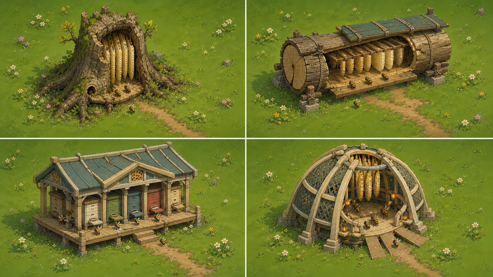

# 蜂巢生态原型与建筑转译 v1

状态：**2026-08-26 研究衍生的结构候选，未获 Alan 定稿。** 本文只回答蜂巢可以从哪些真实形态与建筑项目中学习，以及这些结构怎样转译成游戏地标。下列概念图用于比较外轮廓、入口、承重、巢脾与共同体活动；它不是正式画风母版，也没有批准地图、海报、主次蜂巢数量或节点机制。

## 1. 先纠正造型根因

上一版蜂巢同时使用了暖棕／蜜金、圆团逐层变小、盘旋沟纹、湿亮高光和滴落物。这组视觉语法即使被称为蜂巢，也会先读成软便、泥团或软冰淇淋。

现实蜂巢更稳定的结构语法是：

> 容纳结构 + 平行巢脾 + 蜂路间隙 + 明确入口／开放落点 + 群体活动

六边形是巢脾内部的局部秩序，不应该自动变成整座建筑的外轮廓，更不能铺满所有表面。

## 2. 自然界与人工养殖原型

| 原型 | 现实中最值得学习的部分 | 游戏转译 | 主要风险 |
| --- | --- | --- | --- |
| 树洞／岩腔多脾巢 | 保护性空腔、小入口、数片垂直且近似平行的巢脾、巢脾间蜂路 | 树皮或岩木外壳；一道清楚负形裂口；入口附近露出 3～5 片浅色巢脾；守卫、扇风、接收形成秩序 | 只剩树桩，蜂巢身份不足；必须同时出现巢脾和有组织蜂流 |
| 开放悬垂单脾巢 | 一片巢脾悬于树枝或岩檐下；工蜂在表面形成活的保护幕，并出现同步波动 | 横梁 + 薄平面 + 蜂幕；适合远野奇观、异种蜂群或季节转场 | 严格俯视会缩成细线；开放筑巢蜂种未必等同本作主角蜂种 |
| 中国传统竹篓／圆桶／中空木段 | 外壳是竹、木与绳结，不是蜡团；常置于檐下或干燥背风处 | 横置中空木段、端面年轮、绑扎、支脚、浅雨棚、小入口 | 竖放圆桶若再加层叠暖棕纹，仍会回到旧问题 |
| 顶栏式蜂箱 | 长水平箱体；蜜蜂从直条顶栏向下筑脾；检查时不必拆毁整个巢 | 低矮长屋、清楚顶栏、向下悬脾、共同卸载长廊；扩建沿水平方向发生 | 直接照搬会像人类农具，需通过蜂群岗位和比例重建 IP |
| Langstroth 框式蜂箱 | 可移动垂直巢框、明确层件、箱缝、把手、底座与顶盖 | 用结构层和模块接缝表达成长；新增巢框或开间比堆一层软团更可信 | 直接复制会成为普通农业箱；不应只把矩形箱换成六边形箱 |
| 有屋顶的模块蜂房 | 屋顶与深檐保护成排蜂箱；落脚板、正面识别与维护通道形成共同空间 | 屋檐、柱架、共同前廊、少量模块开间；每个入口承载守卫、卸载、修补或换班 | 不能照搬特定地区宗教图案；正面图案应换成本作角色和四季经历 |

联合国粮农组织资料区分了开放单脾与暗腔多脾两类筑巢方式，并记录巢脾上部储蜜、其下依次出现花粉和育幼区；这说明“蜜”主要是内部功能分区，不应变成外壳滴液或软团轮廓。[FAO 蜜蜂筑巢资料](https://www.fao.org/4/x0083e/x0083E02.htm)

Utah State University 的养蜂资料把 Langstroth 概括为可移动垂直巢框，把顶栏式蜂箱概括为带木制顶栏的长箱；两者分别提供“模块化维护”和“水平长屋”两种清楚的人工结构逻辑。[USU 蜂箱类型资料](https://extension.usu.edu/beekeeping/research/thriving-hives-the-apiary-beekeeping-essentials)

中国地方养蜂史料记录过竹编圆篓、木制圆桶以及檐下／向阳干燥背风放置方式。它能支持木段、竹编、雨棚和支脚等本土材料线索，但不要求照搬竖直圆桶的外轮廓。[重庆市地方志办公室：忠县蜂蜜](https://dfz.cq.gov.cn/zqlswh/ntcp/202407/t20240705_13352026.html)

若要继续做近距离实物研究，北京中国蜜蜂博物馆有养蜂史、蜂具、标本、模型和活蜂观察箱，可作为后续实地取材入口；出发前需按官方提示确认开放情况。[北京市文物局：中国蜜蜂博物馆](https://wwj.beijing.gov.cn/bjww/362771/362773/546601/index.html)

## 3. 建筑界可学习的代表元素

| 项目 | 可学习的建筑关系 | 本作该怎样用 | 不该照搬什么 |
| --- | --- | --- | --- |
| Kew Gardens「The Hive」 | 被抬起的开放格构、中心空腔、从花田进入的路径；真实蜂群振动驱动灯光与音乐 | 把人口、储蜜、危险和季节状态变成稀疏光点与声音节拍；结构围绕一个共同空腔呼吸 | 17 米金属装置的密集零件、完整球体、霓虹能量塔 |
| Snøhetta「Vulkan Beehives」 | 雕塑外壳保护内部传统蜂箱与监测设备；外壳和工作核心是两层系统 | 外部承担地标与天气保护，内部保留可信巢框；升级时开外壳模块、增加内部巢框 | 暖棕六边形高塔和全表面蜂窝纹样 |
| University at Buffalo「Elevator B」 | 外部塔架、内部可下降维护的蜂群舱、穿孔护板和可观察底部 | 使用“承重架—悬置核心—地面聚集区”；升降可成为维护或季节仪式 | 全钢冷硬质感、密集孔洞、把基地做成工业监狱 |
| 斯洛文尼亚彩绘蜂箱板传统 | 正面板既帮助区分蜂箱，也承载民间故事、历史与习俗 | 每个模块只用一个大符号或角色事件，形成可积累的 IP 记忆 | 直接复制宗教人物、当地历史画面或做成杂乱微型插画墙 |

Kew 官方说明该装置位于野花草甸中，1000 盏 LED 会随真实蜂群振动发光，音乐也随活动响应；真正值得学习的是“蜂群状态驱动空间反馈”，而不是金属蜂窝外形。[Kew Gardens：The Hive](https://www.kew.org/kew-gardens/whats-in-the-gardens/the-hive)

Snøhetta 明确把 Vulkan Beehives 描述为包住传统蜂箱和监测设备的防护外壳；这支持“地标外壳与真实工作核心分层”的方法。[Snøhetta：Vulkan Beehives](https://www.snohetta.com/projects/vulkan-beehives)

Elevator B 的六边形蜂群舱可以下降供维护与观察，提供了比“贴蜂窝纹”更有用的机械关系。[University at Buffalo：Elevator B](https://www.buffalo.edu/news/releases/2013/06/037.html)

斯洛文尼亚政府资料说明彩绘蜂箱板具有辨识蜂箱和记录民间故事的双重作用；本作只学习“识别面承载共同体记忆”，不复制其具体文化图像。[GOV.SI：Stories from beehive panels](https://www.gov.si/en/news/2020-12-06-stories-from-beehive-panels/)

## 4. 第一轮结构创作

四个画面按左上、右上、左下、右下排列：

1. **树洞多脾结构**：生态来源最清楚，适合自然形成的巢穴或次级节点候选；轮廓依靠树根、裂口和浅色平行巢脾。
2. **横置木段／顶栏长箱**：兼有传统材料与人工可维护结构；适合生产、卸载或可扩建节点候选，升级沿长度发生。
3. **带檐模块蜂房**：当前开发侧最推荐继续探索的主蜂巢母结构；屋顶、前廊和岗位活动最容易表达“家”和“有人等你回来”。这只是推荐，仍待 Alan 选择。
4. **开放响应式蜂巢亭**：适合把蜂群状态、节气转换和安全感做成光声变化；更适合作为主结构的高潮状态或宣传镜头，不建议单独承担全部生态设定。

开放悬垂单脾没有塞进四案主基地比较：它的真实轮廓很强，但物种归属和俯视可读性风险更大，先保留为野外特殊地标候选。

这张图是生成式结构概念，不是实机截图。它借用了当前讨论中的干净中间调和手绘游戏表现来帮助比较，但配色、材质、角色比例、细节密度和最终渲染方法均未通过正式画风门禁。

## 5. “类似篝火”的正确来源

类似篝火的感受不来自火焰、黄色光圈、发光蜂蜜或另造名称，而来自玩家靠近后发生的共同体动作：

- 远处先看见入口方向、返巢蜂流和有人值守的轮廓；
- 接近时危险声部减弱，扇风、守卫换班、修补和接收蜂的节拍变清楚；
- 卸载时由其他工蜂真正接手，巢脾或房间只在内部局部变暖；
- 受损时不是整体变黑，而是岗位减少、入口变窄、修补带中断；
- 恢复时工蜂重新占位、声音恢复、内部亮房逐格增加。

## 6. 永久造型门禁

任何蜂巢候选在进入地图前必须同时通过：

1. **64 px 黑色剪影测试**：不得出现上窄下宽的软锥、三至五层圆团、盘旋沟纹或卷曲尖端；
2. **结构点名测试**：至少能指出承重／外壳、入口或开放落点、巢脾、落脚区、负空间中的三项；
3. **材料测试**：树皮、端面年轮、竹篾、干木、石基、蜡片和蜂胶缝必须各自可辨，不能统称为暖棕色泥；
4. **蜜色限制**：琥珀色只在少数内部储蜜格或活动灯点出现；外壳无滴液、湿亮包浆和蜜浆塑形；
5. **六边形限制**：只在真实巢脾或少量结构节点出现，不做整屋轮廓和全表面壁纸；
6. **共同体测试**：至少有一组守卫、扇风、卸载、修补、换班或育幼动作证明这里是蜂群生活空间，而非静物建筑。

## 7. 下一轮只解决一个选择

先由 Alan 判断四案中哪些值得保留，以及主蜂巢更偏“自然空腔”“横向长屋”“带檐共同蜂房”还是“开放响应式建筑”。选择前不再把地图、海报和蜂巢同时精修；选择后再做同一结构的黑白剪影、三阶明度、四季状态和真实游戏尺寸验证。
