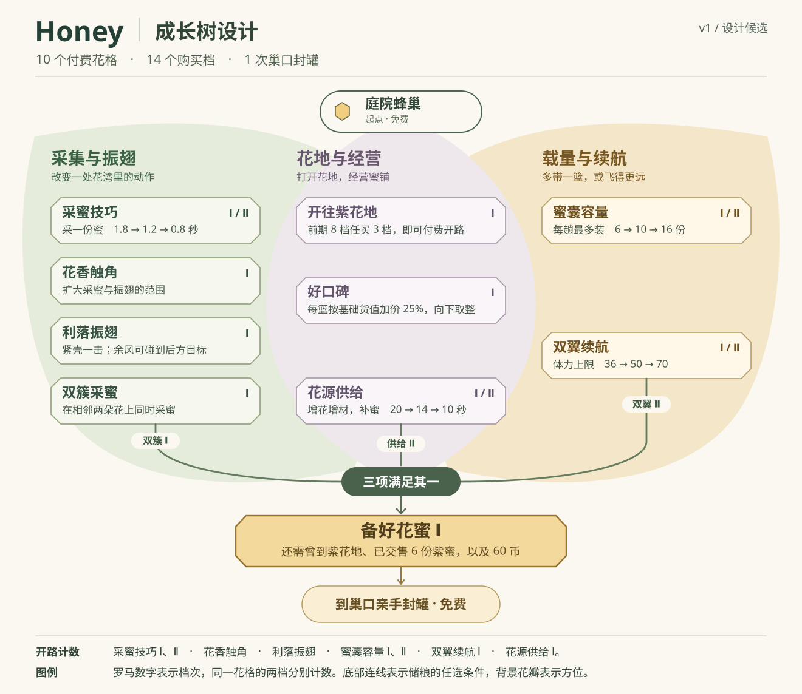

# Honey 成长手册 v1

**设计稿 · 2026-11-25 · 覆盖 Honey 首作当前的庭院、池岸和紫花地，从新档到首次封罐及完成后回访；这一整段可由 Demo 承载。** Alan 已确定游戏称为 Honey，Demo 上线前仅 Alan 本人具备试玩条件，本轮不安排试玩。以下树形、价格和新行为由 Codex 提案，以 0.32 为对照，供制作评审。[首作 GDD](swarm-flight-gdd.md#lean-nectar-first-game) · [原作完整研究](../research/shelldiver-skill-tree-study.md) · [M3 设计条目 #373](https://github.com/alanthssss/nameless-becoming/issues/373)

一只刚出门的小蜂，可以拿第一篮蓝蜜学会更快地采，也可以先撑大蜜囊。熟悉池岸后，有人会找两朵挨得近的花，有人会在采满后继续绕去远岸取绒，有人会记住一朵花补蜜的时间，绕一圈再回来。**这三种蜂都能为巢里备好储粮。**

## 整棵树长什么样

保留 **10 个付费花格、14 个购买档**。庭院是免费起点，封罐是场景动作。左边四格管手上怎样采、怎样扇；右边两格管能带多少、能飞多远；中间四格管花地、交易和储粮。两档的格子只有一个位置，花瓣上两颗种子分别表示已买第几档。中央罐从第一次翻书起就可见，三条通往它的路分别对应双簇、远行和繁盛。三个方向都可买，任选一项就足以满足储粮的能力条件。

| 《龟龟潜海记》提供的证据 | Honey 的取舍 | 玩家会怎么用 |
|---|---|---|
| 正式版 241 格、800 档；269 条有效前置默认只需来源格买过一档。110 个多档格中 86 个格内同价 | 一档即可横向展开。手册用 10 格容纳 14 档；只有动作确实再变一次，才让一格占第二档 | 4 币学轻巧后，可以立即去看振翅和花源，也可存钱再学熟练 |
| 10 贝能买两档氧气或一个随身格；终局图中 267 条可见线段与 269 条有效前置只重合 253 对端点 | 采蜜、取材、携带、续航与补蜜各有作用场合。单前置、任选、累计三档与世界条件分别显示 | 装满返巢看蜜囊；半路耗尽看双翼；回访时花还是空的看供给 |
| 五处外端汇向吊床，在村里亲自躺下才结束。吊床的 10Q 占整树贝壳开价约 96.8% | 巢口有实物终点，汇合条件改成三选一。最后一单 60 币，占本案全树 261 币的约 23% | 擅长一条路线即可封罐，其他格子仍有继续探索的用途 |

上表的金额占比只比较直接标价。两款游戏的币值、产率与所需游玩时间各自核算。[原作正式版前置](../research/shelldiver-atlas/windows-prereqs.csv) · [原作正式版 800 档](../research/shelldiver-atlas/windows-rank-prices.csv)

## 逐档规则

币、纤、脂分别是金币、池岸纤维、紫花地树脂。新档三项都是 0。买一档在庭院书台成功结算一次；同格第二档须先拥有第一档。表内每项都有稳定购买 ID，存档按购买 ID 记录。数据文件中的 requires_all 要全部满足，非空的 requires_any 只需满足一个，两组同时存在时都要通过；世界条件和币材另算。[结构化数据与条件](honey-growth-tree-v1.json)

| 花格／档 | 购买 ID | 买之前要有什么 | 币 | 纤 | 脂 | 玩家得到什么 |
|---|---|---|---:|---:|---:|---|
| 采蜜技巧 I · 轻巧 | `gather1` | 开局 | 4 | 0 | 0 | 采一份蜜从 1.8 秒减至 1.2 秒。花旁的采集圈更快走完 |
| 采蜜技巧 II · 熟练 | `gather2` | 轻巧 | 11 | 2 | 0 | 每份 1.2→0.8 秒，适合连续扫过相邻花 |
| 花香触角 | `reach` | 轻巧 | 16 | 3 | 0 | 采蜜半径 100→155、振翅距离 150→205 游戏单位。隔路的第二朵花更容易纳入范围 |
| 利落振翅 | `beat` | 轻巧 | 8 | 2 | 0 | 紧穗或紧树皮 2 击→1 击；提议增加一次让蚊、顺势扇开后方一株成熟种穗的机会 |
| 双簇采蜜 | `twin` | 熟练＋触角＋已开紫花地 | 19 | 0 | 3 | 同时采范围内的两朵花。回到池岸，沿花对穿过便能同时推进两朵的采集 |
| 蜜囊 I · 舒展 | `bag1` | 开局 | 6 | 0 | 0 | 载蜜 6→10 份；蜜囊外形变大，满囊仍可顺路取材 |
| 蜜囊 II · 丰收 | `bag2` | 舒展 | 19 | 3 | 0 | 载蜜 10→16 份；能利用更长的连续花路，体力仍由双翼决定 |
| 双翼 I · 轻盈 | `wings1` | 轻巧、舒展任选一项 | 9 | 2 | 0 | 体力上限 36→50；决定是现在回家，还是先到下一株紧穗 |
| 双翼 II · 远行 | `wings2` | 轻盈＋已开紫花地 | 29 | 4 | 2 | 体力上限 50→70；可为远岸和返程多留余量 |
| 花源 I · 萌发 | `supply1` | 轻巧 | 8 | 1 | 0 | 每区开放花位 16→24、材料位 3→4；采空后的补蜜 20→14 秒 |
| 花源 II · 繁盛 | `supply2` | 萌发＋已开紫花地 | 30 | 3 | 2 | 每区花位 24→36、材料位 4→6；补蜜 14→10 秒。旧花路可以走成回环 |
| 开往紫花地 | `meadow` | 池岸可买的八档中已买任意三档 | 30 | 0 | 0 | 庭院出发处出现第二个目的地；紫蜜与树脂首次可得 |
| 好口碑 | `market` | 已开并到过紫花地，累计已交售至少 1 份紫蜜 | 12 | 0 | 0 | 每篮基础售价加 25%，逐篮向下取整；售卖收据分列基础价和加价 |
| 备好花蜜 | `reserve` | 已到过紫花地、累计已交售 6 份紫蜜、双簇／远行／繁盛任一 | 60 | 0 | 0 | 书台付款备好储粮，巢口出现待封蜜罐；飞过去交互封好，完成 Demo |

**开图计数的八档**是轻巧、熟练、触角、利落振翅、舒展、丰收、轻盈双翼、萌发。同格买两档就计两次。例：轻巧＋振翅＋萌发正好 3/3；轻巧＋熟练则是 2/3。书上在购买前写出“购买后，紫花地准备 2/3 → 3/3”。紫蜜累计售出数只加实际交售的份数；达到六份后可继续消费已赚的币，也无需为封罐另交六份实物。

**相对 0.32 的改动。** 双簇 29→19 币，远行 25→29 币，繁盛从 18 币＋3 纤＋1 脂调到 30 币＋3 纤＋2 脂，好口碑 30→12 币。其余十档价格沿用。开图区将先前不计数的振翅、萌发列入；双簇与远行在详情显式写出紫花地前置。三选一的末端、待封罐状态和余风是新增设计。现版总账为 273 币／20 纤／6 脂，本案为 **261 币／20 纤／7 脂**。现有规则来源见[庭院经济](../../prototypes/swarm-flight/nectar_harvest_model.gd)和[地区模型](../../prototypes/swarm-flight/region_game/model.gd)。

## 玩家为什么会买这一项

**第一次回家。** 按正常返巢带回 6 份蓝蜜举例，卖得 6 币。买轻巧余 2，接下来取蜜变快；直接买舒展余 0，下一趟可以多背四份，也可以留钱。走轻巧路线，第二趟再卖 6 份蓝蜜才有 8 币。若两趟合计已拾两份纤维，可在利落振翅和花地萌发之间选；双翼仍差 1 币。若第一趟只带回 3 份，也会先看到“轻巧还差 1 币”，可以马上再出门。树不预设固定趟数。

**一个花湾，三种解法。** 第一朵蓝花旁有争花小蚊，第二朵斜后方有一株紧穗。初访时，蜂可绕去另一朵、等蚊离开，或先驱蚊再转向扇穗。买振翅后，若从侧边切入，第一次命中的蚊先让位，后方成熟种穗再弹开；蜂自己飞近才接到纤维。双簇路线在这一处找两花同时采集的角度，双翼路线把这里当去远岸的中途站，萌发路线在返程时绕回第一朵。

- **余风第一版参数为设计假设。** 先在原振翅扇区内对视线可达的争花蚊和可振开的资源选最近目标；同距时先资源，再按各自固定 ID。第一目标为争花小蚊时才判第二目标；从首目标沿风向量取 60 游戏单位、与出手方向夹角不超过 20°，选有视线且仍成熟的最近一株池岸种穗，同距按固定来源 ID。原出手正面与距离判定用于第一目标，余风从第一目标向前计算，障碍可截断两段。一击最多处理一蚊一穗。命中总共扣原有 2 体力，沿用 0.55 秒重复间隔；空挥、只有一个目标、松键、隔墙、穗已掉绒都能正常收束。不开第二次扣费或第二次掉绒。紫花地继续靠近开皮再拉脂。
- **物件反馈。** 蚊让花后提议保留 2.2 游戏秒空档，蜂已在花旁时，能容纳基础采集的 1.8 秒。每次争位只打断接触到的那朵，已积的采蜜进度保留。命中顺序由蚊翻身、穗头弹动和绒落点表现；减少动态时用姿态、宿主开合和掉落位置传达先后。绒沿用至多 24 单位的漂移、42 单位拾取距离和 12 秒消散。松开的树脂仍须在 64 单位内采 0.8 秒。候选参数可用两个特定站位校核几何。[现版场地与交互](pond-violet-map-resource-design.md#nectar-wing-bay)
- **供给和风险。** 供给影响下一趟的可用位置，16／24／36 是可出现花的地点数，同时成熟的数量要看现场。材料从空位到成熟的有效区内时间按档为 44／30.8／22 秒；花蜜计时和花本身的花期分别走。蓝蜜按每份 1 币，紫蜜每份 3 币，两地材料独立入袋。正常回巢保留全部；耗尽救援按颜色分别向下取整留半蜜，材料保留。货值、蜜囊、体力是三种不同的限制。

0.32 已有一组可对照的开发模型结果。共同试验钱包是 9 币＋2 纤，四种选择、四条路线、四个种子共 64 趟。紧穗一次出手省 0.56 秒与 2.34 体力；四花单程所有选择都带回 4 蜜，绕回首花时只有萌发带回 5 蜜；四花后再去远岸，只有轻盈双翼四次都带 4 蜜＋1 纤正常返家，其他三组同路线遇救带回 2 蜜＋1 纤。这是候选保留前三项价差的依据。余风、三条结局路线的实际趟数及玩家偏好仍是待验证设计。[原始 64 趟](../research/shelldiver-atlas/nectar-choice.csv)

## 钱包、机会成本与结局

以下是从零开始的可行购买顺序。纤维可以在开图前从池岸采得，树脂只在开放紫花地后取得。三路均须进紫花地并实际卖过六份紫蜜。表中总价含开图和储粮，不含可选投资；进过某地、持有某档与背包里已有某种材料分别判断。

| 只走一种专长 | 购买顺序与逐笔金币 | 含终点的合计 | 中途得到的回报 |
|---|---|---|---|
| 找花对 | 轻巧 4 → 熟练 11 → 触角 16 → 开图 30 → 双簇 19 → 储粮 60 | **140 币／5 纤／3 脂** | 三次动作成长正好开图。转入两花并采，适合沿着密花段回铺 |
| 跑远岸 | 轻巧 4 → 舒展 6 → 轻盈 9 → 开图 30 → 远行 29 → 储粮 60 | **138 币／6 纤／2 脂** | 蜜囊与航程先获益，第二级双翼把远端取材纳入可返的飞线 |
| 绕花圈 | 轻巧 4 → 舒展 6 → 萌发 8 → 开图 30 → 繁盛 30 → 储粮 60 | **138 币／4 纤／2 脂** | 萌发提前获益；能利用回访与新花位的路线才会吃满繁盛的收益 |

三条单专长路线的最低直接币价只差 2 币，纤维和树脂的需求有意不同。开图最低直接币价是 **48 币**，例中萌发路线同时耗 1 纤；可以先买振翅，花同样的币但用 2 纤。真实采集时间会随返程、空跑、育花与自选购买变化。若直接选最便宜组合就能结束整局，想看的是玩家在此前有没有实际用过自己的专长。后续调整先查它值不值得用，再动门槛币价。

**差 2 币，不代表要飞同样多趟。** 以下统一按表中次序、普通回巢、材料及时获得来算：开区前优先卖满篮蓝蜜，能开图就开；开区后只售紫蜜，不买口碑，并把开图后钱包里的零钱带进下一段。采花对路线开区前须付 61 币，蜜囊还是 6 格，11 个满篮共得 66 币、账上余 5。全程要花 140 币，之后还需至少 25 份紫蜜、5 篮，合计 16 篮。跑远岸、绕花圈都先买轻巧再买舒展，前两篮各 6 份、随后四篮各 10 份，共得 52 币。两路开区费用分别是 49、48 币，余 3、4 币，各自后段标价 89、90 币，扣除余额都还需挣 86 币，即 29 份紫蜜、3 篮，各合计 9 篮。它们是理想装载算例，营地距离、蜜量、材料和提前折返决定实际趟数。

爱采花对也可以做一个更实惠的选择：先用 6 币买舒展，再买轻巧、熟练，三档开图，随后补触角、双簇和储粮。全程 **146 币／5 纤／3 脂**。开区前六篮蓝蜜合计 6＋5×10＝56 币，付完 51 币余 5；后段还要付 95 币，补足 90 币恰好是 30 份紫蜜、3 篮。在这组理想算例里，**多花 6 币买蜜囊，反而把 16 次交付缩到 9 次**。因此首次满囊返巢，收据只需写“返巢时 6/6”；成长格并排写出舒展的“下趟可带 10 份”。玩家自己决定当时为何掉头。等有实际路线时间后，再判断需要调的是容量、开图价还是花路的摆法。

**好口碑是可算清的选修。** 首次紫蜜交售后开放。新价 12 币，逐篮加价为 `floor((蓝蜜＋3×紫蜜)/4)`。最理想还要交售 48 币基础货值才能回本。六份紫蜜一篮，基础 18 币、加价 4 币，三篮回本；若每篮只售三份蓝蜜，加价始终取整为零。详情可直接写“上篮基础价 18，这项会多得 4”。刚好差最后 12 币备粮时，留着钱也是有意义的决定。

**亲手收尾。** 复用现有庭院的储蜜罐和伙伴庆祝反馈。巢口储蜜罐始终有一个固定可见的位置。书台满足条件后列出“60 币，备好花蜜”，只在保存成功后扣款并切为“待封罐”；回到庭院看到罐口放好的盖子，走近按原交互键封存，才进入完成画面。两次动作可跨次启动。重复交互不会再扣币、再发蜜或重播首次奖励。付费前若已交售第六份，手册当场更新；交售累计绝不拿来二次扣货。完成后仍可回两区采集并补买其余成长。

## 手册、存档与交接

**手册第一次打开就给方向。** 显示两项可存钱买的首购、左右两翼与中轴的轮廓、紫花地地点以及巢口的空罐。远端格可看名字、用途和一个世界位置，当前焦点优先显示可买的下一档。选格时才高亮真实前置；双簇明列“熟练＋触角＋开紫花地”，双翼 I 明列“轻巧或舒展”，紫花地明列“8 档中任买 3 档”，终点明列“探索、售蜜、任选专长、60 币”。缺材料显示差额及来源，如“还差 1 纤维 · 去池岸扇开种穗，靠近接绒”。手柄、键盘和鼠标读到相同详情；切换焦点不购买，购买后焦点停在原格。颜色之外用实心种子、空种壳、锁与文字区分已买、可买、差价、欠前置四态。

**购买和保存共用一套结果。** 只在庭院书台检查下一未买档、地点和币材；先计算候选状态，成功保存后再显示扣款、地标或新花位。连续两次确认同一档只扣一次；锁定格或保存失败保持原钱包并说明原因。两档格的进度提示和真实购买使用同一计数。场地成长在下趟建场时生效，暂停／冷读期间不得凭空增加蜜或材料。

**给已有 0.32 存档的规则。** 保留所有已购 ID、币材、已开放目的地和交售计数；改价不补扣或退款，已完成直接映射成“已封罐”。历史两区档外层 v2 中的供给档和内层 profile v5 的其他档先合并校验，再计算八档计数；新格式需能表达“已备粮、待封罐”。旧档按旧版规则读，再迁入新模型；新档按新模型验证，转换失败保留原档。例：`gather1 + beat + supply1 + meadow` 是合法的新开图区状态；仅校验旧 profile 会错判。旧的“完成＝拥有 reserve”须在新格式拆开，否则会吞掉封罐动作。[现行存档入口](../../prototypes/swarm-flight/region_game/model.gd) · [购买保存顺序](../../prototypes/swarm-flight/nectar_harvest_main.gd)

| 制作检查点 | 可据此作的决定 |
|---|---|
| ① 数据与手册 | 用 14 条购买记录核对 HUD、详情和保存的价格；没到紫区的状态不可花树脂；同格两档按两次计；任一专长可达储粮。按本稿数据穷举得到 973 种可达已购档组合（含空集），其中开区前 101 种。从空集开始，每轮给所有合法购买各加一项，同一个已购 ID 集合只计一次。枚举假设后续可获得相应物资、到访并完成交售；数字只比较购买结构。 |
| ② 同湾动作与路线 | 技术样段用普通输入依次检查正对蚊＋后方穗、偏角、隔障、目标空缺和连续输入。一次有效出手至多改两个不同目标状态，只付一次体力；采蜜、接物与真实入袋分别可核。以同地形同供给重跑已知路线，记录击数、携回数和回巢体力。 |
| ③ 封罐与冷续 | 分别从未开区、已开区不足六紫、已备粮未封、历史已完成四种状态重开；核储粮只扣一次、旧档无倒退、待封能继续、封完仍可出门。 |
| ④ Demo 反馈 | 上线前由 Codex 做静态、模型及运行技术检查。这一轮不安排任何人的试玩；Alan 日后若自行玩，他的体验意见单独记录。公开 Demo 上线后，用玩家主动留下的评论、问题或录像按版本归纳“上趟为何回来、买了什么、下趟改走哪里、在哪里看不懂”。只有带版本和可复现动作的报告才用于定位规则；零星评论保留原话或准确转述，没有总体分母不推算比例。 |

**先改哪一处。** 反馈若集中在“买了振翅，门上的数字为何没动”，查计数或提示；若数得清却没理由换飞线，查池岸花湾的站位与供给；若三条路都明白却只剩长时间攒最后 60 币，先查实际交售收入和玩家还在做哪些事，再调储粮价。第一轮制作可按①→②→③各自技术验收。要采用哪些候选价格、是否把余风与封罐纳入可玩版本，由 Alan 在设计评审时决定。产量及排期沿原有[制作指针](solar-term-campaign-production-spec.md#production-now)和[成本检查点 #211](https://github.com/alanthssss/nameless-becoming/issues/211)复核。

首次封罐后，原两区、三种专长和未购格继续开放。若公开 Demo 反馈显示同一张图已有足够多的路线发现，以封罐作为本版完整收尾。将来出现新的可采对象或场所时，先写清它会让哪一次出手、接物或返程发生变化，再决定挂到已有花格的下一档，还是确实需要新花格。首作后段目前没有另立关数、地区数或通关时长。
