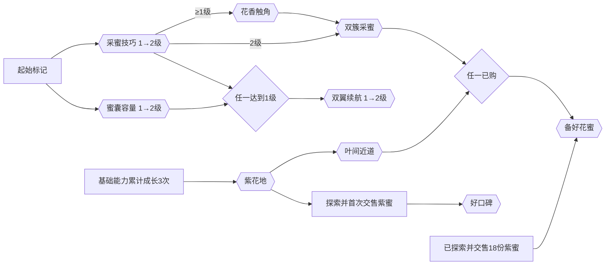

# 采蜜小店：抽象成长树 MVP 定稿与扩展方向

版本：NH-GT-v1，2026-11-02。关联：[GDD §13.7](swarm-flight-gdd.md#nectar-harvest-mvp) → [M3](https://github.com/alanthssss/nameless-becoming/milestone/3) → [#273](https://github.com/alanthssss/nameless-becoming/issues/273)；产品与成本仍由 [#211](https://github.com/alanthssss/nameless-becoming/issues/211)承接，执行状态只见[唯一 Now](solar-term-campaign-production-spec.md#production-now)。

## 1. 定稿的含义与体验目标

Alan 已确定：成长树保持抽象，仅自然借用蜂巢的六边形、排列与连接元素，不具象为蜂巢建筑、蜂房扩建或储蜜设施。Alan 本轮要求形成 MVP 定稿及后续扩展方向；Codex 据此确定下列第一版实施规则。定稿表示实现时有明确依据，**不表示这些参数经过真人平衡验证，也不表示已经改动 0.19**。

本版只验证一个问题：玩家能否根据上一趟“采得慢、装不下、飞不远”的体验，选择下一项成长，并期待一次能力变化或新花地。保留采集→回程出售→成长→再出发的循环，一张地图、两片花地和现有故事。效率增长本身是有效奖励；每次购买不必创造新操作。

最终结构：**3 个功能区域、8 个升级节点＋1 个阶段成果节点，共 12 次付费升级；另有 1 个免费的起始标记。** 速度、容量、续航各占一个两级节点；其余各一级。整体可以沿六边形网格舒展，不规定六向等长、满环或六条主枝。节点是能力图标，不代表场景中的真实蜂房。中央起始标记只表达当前角色，阶段成果放在下方独立收束位置，不以蜂巢建设解释图形。

现有 0.19 是三列各四项、12 个单次购买项。本版将其重组，不增加货币、第三地区、经营等待、转生或同伴系统；后续扩展按第 7 节进入，不预先铺满占位节点。

## 2. 节点、等级与购买规则

金币成本和效果沿用 `main@bb14eb4` 的 0.19 初值，目的是先比较结构变化。它们是首轮实现参数，不是最终平衡承诺。基础参数：采集 5 份/秒、蜜囊 18 份、续航 85 点、采集半径 100 世界单位；蓝蜜单价 1、紫蜜单价 3。紫蜜沿用内部 `rose` ID。

| 显示节点 / 区域 | 每级效果（绝对值） | 每级金币 | 新购买条件 | 保留的购买 ID |
| --- | --- | --- | --- | --- |
| 采蜜技巧 / 采集 | 5→7.5→11 份/秒，2 级 | 12 / 32 | 一级无前置；二级需一级 | `gather1`, `gather2` |
| 花香触角 / 采集 | 半径 100→155，1 级 | 48 | 采蜜技巧≥1级 | `reach` |
| 双簇采蜜 / 采集 | 同时采集范围内最多两朵，1 级 | 85 | 采蜜技巧=2级 **且** 花香触角已购 | `twin` |
| 蜜囊容量 / 出行 | 18→30→48 份，2 级 | 18 / 55 | 一级无前置；二级仅需一级 | `bag1`, `bag2` |
| 双翼续航 / 出行 | 85→110→145 点，2 级 | 25 / 75 | 一级需采蜜技巧≥1级 **或** 蜜囊容量≥1级；二级仅需一级 | `wings1`, `wings2` |
| 紫花地 / 花路与收益 | 开放现有第二片花地，1 级 | 90 | 基础能力累计购买≥3次 | `meadow` |
| 叶间近道 / 花路与收益 | 开通现有双向近道，1 级 | 65 | 紫花地已购 | `shortcut` |
| 好口碑 / 花路与收益 | 每笔售卖增加25%，按原规则向下取整，1级 | 90 | 紫花地已探索 **且** 累计交售紫蜜≥1份 | `market` |
| 备好花蜜 / 阶段成果 | 本阶段完成，仍可继续采蜜/购买，1级 | 180 | 紫花地已探索 **且** 累计交售紫蜜≥18份 **且**（双簇采蜜已购 **或** 叶间近道已购） | `reserve` |

“基础能力购买次数”只计 `gather1/2`、`bag1/2`、`wings1/2`、`reach`、`twin`，每个 ID 计一次，最大8；不消费这些次数。它不是新增经验或货币。紫花地详情始终显示“基础能力成长 x/3”；已购紫花地不再被重新锁定。

所有表中条件与“人在收购点、金币足够、未到该节点满级”同时满足才允许购买。没有互斥路线、随机效果或洗点。等级只显示下一次的费用与前后值；每次确认只买一级，不因按住/双击连续买满。满级节点仍可查看，不可扣费。累计交售条件使用历史记录，不再次扣紫蜜；救援丢失及未交售的货物不计。

关键变化：解除蜜囊/双翼交替硬链；范围不再要求先买满速度；双采保留明确的速度＋范围组合；售价不再依赖近道；完成不要求好口碑或全树。旧名称“一簇接一簇”改为直接表达效果的“双簇采蜜”，存档 ID 不改。

## 3. 关系与节奏

下图是规则图，**不是最终空间排版**。并行能力的效果互补不画成硬前置。

预期体验顺序是“首选→分叉→组合/区域→阶段完成”，购买顺序不唯一：

1. **首趟：只面对采蜜技巧或蜜囊容量。** 初始18份满载蓝蜜价值18，可买12金币的技巧，或18金币的容量。玩家先得到一次可观察的效率改善。
2. **初步成长：开启续航和邻近支线。** 容量与续航可分别投入；同一节点第二级提供小步积累。紫花地始终作为可见目标，前三次基础成长有明确去向，不要求平均点满各区。
3. **中段：双采与新花地形成两种吸引力。** 双采改善现有花簇采集，紫花地提供高价值花蜜；玩家可以先做其中一项。花朵布局必须提供可同时覆盖的两朵，避免能力只在文字上有效。
4. **远区：近道改善往返，好口碑提供继续积累的投资。** 开花地时预告锁定的好口碑，紫蜜首次出售后满足购买条件；阶段目标所需18份进度持续可见。完成前至少购买双采或近道其中一个，避免完全跳过本版能力/路线变化。
5. **收束：可在未买全树时备好花蜜。** 完成反馈不关闭存档、不自动新周目；返回游戏后可继续采集和补齐可选升级。未买满不显示为失败或缺星。

初值的静态算例：全树12次购买合计775金币；近道完成路径可为技巧1＋容量1＋续航1＋紫花地＋近道＋阶段成果，累计支出390；双采路径可为技巧1/2＋触角＋双采＋紫花地＋阶段成果，累计447。它们是购买规则/算术检查，**不是模拟收入、最优路线或游戏时长**，不包括救援损失、路线与采集差异。

好口碑90金币、额外25%收入的理想回本需360基础售值，逐笔向下取整时可能更多；它定位为持续采蜜的长期投资，非强制通关税。首轮若玩家普遍没有继续目标且跳过此项，先调整费用/出现时机或移到扩展内容，不靠加长结尾攒钱使它“有用”。本版不承诺总游玩分钟数，也不把三次购买当成固定三趟。

## 4. 界面与信息揭示

- **布局：** 三个有标题的功能区域采用六边形节点和留白；起始标记居中，采集在左、出行在右、花路与收益在上，阶段成果在下。节点使用本作手绘图标与柔和边缘；连线/状态的辨认优先，不采用实体蜂房、储蜜填充动画或强烈霓虹棋盘。无需严格贴边铺砖，避免邻接被误读为解锁条件。
- **初次打开：** 显示起始标记、技巧、容量，以及锁定的紫花地与阶段成果地标；阶段成果详情可提前读到要求。首次购买后显示双翼续航；技巧一级后显示触角；触角购买后显示双采，若技巧未满则写明缺少哪一级。紫花地购买后显示近道和好口碑，好口碑未满足交售时显示明确锁因。已揭示节点永久保留，不能因缺钱消失。
- **等级与状态：** `0/2、1/2、2/2`配清楚文字；未满足前置显示锁和缺项，前置满足但缺钱显示差额，可购显示按钮，已满级显示勾选。颜色只作辅助。焦点详情同时显示效果前后值、每级价格、全部条件及进度；不把价格失败掩盖前置失败。
- **连接语义：** 普通依赖画箭头；双采处标“同时满足”，双翼及成果条件标“任选其一”；区域累计成长、交售数量在详情显示条件条，不画八条交叉线。纯效果互补通过详情短句说明，例如“采得更快，也会更快装满”。
- **操作：** 鼠标点击只选中，再点详情中的购买按钮；键盘 Enter 确认单次购买，松开后才允许下一次。Tab/Shift+Tab依表格顺序循环所有已揭示的付费节点，包含锁定/满级节点；上下在当前区域内循环，左右按采集→出行→花路收益→阶段成果循环区域并恢复该区上次焦点，没有历史则首个可见节点。根标记不参与购买焦点。Esc返回上一界面，无购买副作用。
- **镜头与尺度：** 默认显示全部当前已揭示节点，购买不自动抢走焦点；新增节点短暂提示即可。缩放/拖动为补充，960×600下仍须靠默认布局＋详情完成所有购买；最低节点点击区域48逻辑像素、正文18逻辑像素，放不下时允许面板滚动，不缩小文字硬塞。布局具体坐标由实施时原生读图检查确定。
- **反馈：** 成功显示本次改变，失败保持金币/等级不变并说明原因；完成反馈独立一次。升级树打开时不推进野外模拟，沿用收购点安全购买；其他菜单、输入、体力和存档规则沿§13.7。

## 5. 保存兼容与实施边界

合并显示节点不合并或重命名已有购买 ID。`owned`仍记录12个既有ID，显示等级由拥有对应ID派生；不同时存一份可能不一致的等级表。原来拥有第二级的合法档保持原效果、花地与货物。购买使用现有候选快照→成功持久化→提交状态的事务，不吞金币、不重复发效果。

**新购买门槛不能反过来否定合法旧档。** 旧档可能只买一次能力就已开紫花地，或在首次交售紫蜜前已买好口碑。实施时引入明确的v2兼容读取：先按冻结v1规则验证旧档，再原子迁移，保留原字节备份；已拥有的紫花地/好口碑作历史授权继承，不强赠成长、不追扣金币、不撤回效果。v2以`legacy_owned`记录迁移时合法的既有ID，新的购买仍按本表验证；新建v2档该列表为空，后续购买不能往例外清单添加ID。历史授权必须贯穿后续出售、购买、候选快照校验、再次保存与冷启动，不能只在首次读档时临时豁免。读取和迁移不触发再次出售、刷新花源、补满体力或重放完成奖励。

v2必须允许“容量2已购、续航尚未买”等新合法组合；不能沿用旧交替链的加载断言。新旧重复ID、未知ID、缺少同节点一级却拥有二级、负数与非有限数仍拒绝；`legacy_owned`必须是当前`owned`的无重复子集，且满足冻结v1静态前置，不能当作任意解锁开关。损坏档不覆盖原档；写失败不提交迁移；v1回退使用保留备份，禁止拿新v2覆盖旧客户端。旧0.18旅程存档不参与迁移。具体备份路径在实现Issue冻结并按实际读取器测试，本稿不改磁盘或发布新包。

## 6. 实施验收与设计复查

NH-GT01：9个付费显示节点/12次购买与免费根点分清，所有成本/绝对效果、单级确认、满级行为一致。

NH-GT02：逐条验证AND/OR、3次成长边界、紫蜜1/18边界；可分别走近道/双采完成路线，阶段完成无需好口碑或全购，无环路/永久穷困。静态可达不代替实际往返验证。

NH-GT03：容量与续航新购买顺序、旧早开花地/早买口碑、旧已完成、损坏/写失败、暂停/退出冷续全覆盖；历史授权不被追验新门槛，旧旅程字节不变。

NH-GT04：960×600和1280×800下鼠标/键盘可访问所有已揭示节点，锁因/级数/价格/效果可读；购买不抢焦点、不连点误购，完整动态画面风格统一。双采确有可用花簇、近道确实改变路线。HUD只给阶段缺项或玩家选中的目标，不再把可选好口碑写成必须购买的主线。

NH-GT05：记录至少两种购买顺序的完整实际过程，再由Alan或陌生玩家体验。观察购买理由能否对应刚才的瓶颈、首个升级效果是否被察觉、是否知道下一目标、有没有无目标攒钱、好口碑是否显得无用。样本有限时只归纳问题，不推断市场或平均时长。任一基础问题出现先修本段，停止添加节点。

本轮文档验收仅为规则一致性、依赖可达、源码基线核对、独立只读复核和本地链接/差异检查；运行时、存档迁移、原生UI与真人节奏均尚未按本稿验证。上述NH-GT01–05是后续实现验收，不会因为文档PR合并而通过。

## 7. 后续扩展方向与进入条件

以下确定扩展顺序和原则，不是本轮开发授权、完整24关的新映射或自动排期；沿原Now选下一增量，不另列动态任务队列。

| 顺序 | 确定的扩展方向 | 首个可验证增量 | 进入与保留条件 |
| --- | --- | --- | --- |
| A：先深化现有成长 | 延长已有能力的小支线，增加有组合价值的特殊节点 | 在已出现的真实瓶颈上增加1个关键能力及少量等级；如双采后的花簇选择/连采收益 | NH-GT01–05无基本阻断，玩家确有继续成长意愿；下一趟可看出作用，不以重复小加成凑节点 |
| B：再连接资源与地区 | 地区带来新的采集目标，少量专属资源参与少数关键升级 | 一处新采集情境＋一种有独特用途的资源＋对应成长入口；候选可从原世界花粉/露珠选择 | 必须交代获取动作、消耗出口、旧资源用途和保存；玩家能说明为何去那里，缺料不永久锁死，不让每个节点都收多种材料 |
| C：再加入伙伴与生产协作 | 缓解已经体验过的重复劳动，让玩家腾出注意力探索 | 一个同伴承担一项清楚工作，例如有限搬运或收集辅助 | 主动采蜜循环已成立；同伴有可见作用、上限与代价，不退化为无操作等待；每个新增功能有独立成本评估 |
| D：最后组织更长程的成长 | 各地区形成可辨认的能力组合和阶段收束，保留主干位置 | 根据已验证地区组织下一段成长图；复用稳定节点ID，扩展区域可折叠 | 与原24关内容/范围及商业约束正式对齐；不因图可以扩张就承诺无限内容或指数膨胀 |

全阶段坚持：不为六边形补齐六类系统；不要求所有分支等长；重要节点提前预告，不把关键功能藏在无关前置后；优先让能力互补，少加硬性购买税；单一阶段可在未全购时结束。互斥职业、转生清零、随机词条和独立建造系统均不纳入当前扩展方向，若以后有真实需求另作决定。

## 8. 决定、依据与下一检查点

- 决定者：Alan确定抽象表达与参考方向，授权本轮定稿；Codex负责本稿具体规则和实施交接。选择9显示节点/12次购买是本轮设计决定，不声称Alan已逐项验收数值。
- 理由：以已有资产和能力重排，先解决强制交替、阶段目标混入收益链、购买理由和信息量；保留首趟明确二选一及两种阶段完成路线。放弃六条对称长枝、实体蜂巢建造与MVP立即增加材料系统。
- 事实依据：[现有模型](../../prototypes/swarm-flight/nectar_harvest_model.gd)、[现有UI](../../prototypes/swarm-flight/nectar_harvest_ui.gd)、[0.19证据](../../prototypes/swarm-flight/review-evidence/2026-11-02/nectar-mvp/README.md)。Shelldiver只作方法参考：[官方介绍](https://store.steampowered.com/app/3862670/Shelldiver/)的采集/出售/材料成长，以及[开发者关于逐步揭示的答复](https://steamcommunity.com/app/3862670/discussions/0/691994366768692802/)。不把对方销量或AI分析当本作体验证据。
- 下一检查点：本稿交付后，下一次成长树实施批次由Codex按NH-GT01–05交一个可玩结果；本轮不自动开始。复查触发：首次升级无感、选择明显失效、区域门槛导致无目标往返、好口碑长期被忽略、界面读不懂或合法旧档失败。结构可维持，费用/门槛按证据修订并留版本记录。
- 商业边界：本轮仅设计归档、无新增采购/图像生成，200＋40小时不重置，主动/计费/历史累计及可靠剩余未知，自动化PAUSED。观察区间与PR/CI读回保留在#273；不把设计定稿当产品接受或全作扩产依据。

## 9. UI20实施授权与界面范围（2026-11-02）

Alan接受本定稿，并授权界面参照Shelldiver更新一版可玩MVP。沿M3 #275–279实施，原#273保留设计完成记录；上述“待实施/本轮不自动开始”是定稿时的历史状态，当前执行只见Now。

UI20采用：场内紧凑资源栏＋独立续航/蜜囊条、上下文交互提示；回巢页清楚列本趟蓝/紫蜜、总售价与交付按钮，交付后可进入成长或继续出发；成长页以抽象六边形网络为主体，右侧固定详情/购买区，左上资源、顶部阶段进度、下方键位。售卖与成长分屏，Esc由成长回收购点再回游戏，避免所有操作挤在一屏。标题/暂停/完成共用视觉语言。参考信息层级与操作流程，不复制对方像素资产、海洋题材或五角星布局；沿本作手绘图标/柔和绿色与暖金色。

按1280×800参考布局和keep比例适配960×600、1280×800及宽屏留边；主要交互区域用容器/锚点安排，成长图内部采用相对画布布局。初版使用现有素材与程序化UI形状，无新增图像采购。鼠标/键盘为本批实际支持设备；手柄未经实现测试不作支持声明。NH-GT01–05与NH-C01–08仍需当前版本证据，不因沿用0.19资源而直接通过。
