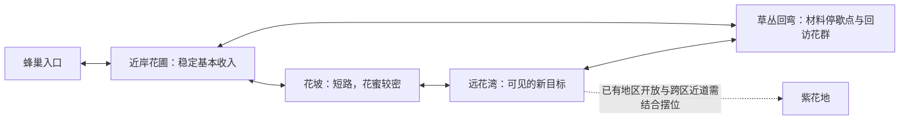

# 雨来之前：采蜜与蜂舞 Steam Demo 制作规格

SD-v1.1，2026-11-04（以下新增反馈裁定优先于原SD-v1历史规格）。Alan明确当前阶段从MVP转为准备Steam发布的Demo，首批平台macOS。GDD§13.9 / M3，产品与成本承接#211；唯一执行指针在production Now。本稿在实现与检查过程中补齐，不把未完成内容记成现状。

体验目标：生活区形成可记住的生活场所；外出有资源与风险选择；返家能看见收获和成长；灯球舞台把地点选择、蜂舞通信与转场连成一个可辨认仪式。保留既有经济与旧档，不靠无意义NPC或额外货币制造复杂度。

授权范围：Shelldiver元素/成长图/排布/数值/交互研究；灯球传送点与单舞/群舞转场；生活区空间、功能和状态深化；手绘资产/交互表现及专业美术评审手册；macOS Demo产品壳、设置、结束收束、来源/署名与Steam发布材料；完整验证及候选交付。

事实边界：公开资料没有给出的Shelldiver内部算法/数值不补造；来源、观察、推导和本项目参数分列。蜂舞基础参考真实摆尾/回环，拟人扩展按用户偏好研究蔡徐坤的动作方向，以项目自制动画实现并保存来源/发布审查事项。专业美术手册供评审，不声称已经得到专家认可。

发布边界：本轮完成可玩的macOS候选与可审查发行材料；Steamworks账户/AppID、平台上传与Valve审核状态只按实际回执填写。已知历史记录尚无本作AppID，先完成不依赖账户的发布准备；不虚构上线或可上传身份。

成本：预计本轮2–3小时含研究、生成等待、验证与集成；观测起点2026-11-03 03:02:18 UTC（此前本轮上下文读取未独立计时）。200＋40小时边界保持，主动/计费/累计/可靠剩余未知，无新增采购，自动化PAUSED。

验收：舞台/光效/舞蹈在原生运动中清楚且支持简化动画；切区/失败保存/暂停/失焦/跳过保持稳定状态；生活功能各有用途且可单独抵达；成长/全程/迁移旧档无倒退；美术手册有实际截图、规格、来源和可批注问题；Demo候选经既有NH-C01–08及本轮新增Demo检查，Steam外部未完成项显式列出。

## 本轮冻结的玩法与空间决定

生活区逻辑宽1920、高800，镜头跟随范围0–640；从左到右为蜜铺(260,540)、成长书屋(650,480)、花路观测台(1110,440)、蜂舞广场(1530,555)，安全出生点(840,575)，与功能点保持独立距离。四点100像素内E，按最近明确功能处理；每次出行不要求访问所有点。保留旧v3庭院位置（仍在合法范围），不改财富/成长/花源/敌人格式。庭院不耗续航，花路观测不提供新货币。扩大空间用于功能区与视觉层次，不添加强制往返任务。

蜜铺以货架罐数/阶段对白回应累积售卖；成长书屋继续抽象六边形树，说明当前瓶颈与下一项收益；观测台显示蓝/紫花资源、价值、敌人差异、避雨/返程与已访记录；广场承接选区、舞蹈及出发。主线以第一次交付→基础成长→紫花地→备好花蜜→庭院庆祝形成收束；这些状态复用已持久化事实，不重复建任务存档。陌生玩家15–25分钟体验是待验证目标，不通过强制等待/涨价凑时长。

### 灯球与动作

所有主要地区出入口与近道都用同一家族的叶藤支架、镜片灯球和花瓣木台表达传送功能；锁定时熄光、显示原因，激活时金绿柔光在台面流动。灯球与藤架真实悬挂，灯光不掩盖敌人/花源/HUD。基础转场约2秒：聚拢/起步→摆尾和交替回环→光幕遮切/保存→目的地落定；默认同伴人数随既有成长进度从单舞到小群舞。不是实际蜜蜂具有传送能力的科普断言，而是本作幻想。

按Space可跳过剩余表演；设置“简化动画”保留短淡变与地点信息，关闭追逐光束/摇摆/群体回环。切区提交仍为一次原子保存；跳过、失焦、退出、读档不能刷趟/补货/丢货。短动画也不跳过必要保存验证。拟人动作槽提供项目自制的摆肩/侧步小组合，按Alan指定方向参考蔡徐坤相关舞蹈；发布素材中不导入现成歌曲、艺人肖像或第三方视频。可扩成可收集的社交舞，但不影响效率/解锁或成为强制付费项。

### Demo产品与艺术交付

保留9付费节点/12级已接受成长规格，研究结论先说明边际收益/前置和后续分支，任何本轮数值调整必须另列前后值及验证。产品壳补设置、控制说明、来源/署名、明确Demo结束及继续探索。macOS首发；Steam App/Depot/审核与Apple签名公证按实际状态列项，不用本地导出冒充Steam可发布。美术手册基于调整后原生画面，分已实现/待评审/后续方向；包含可编辑来源、资产规格、色值/笔触/光线、动效时间轴、交互状态与专家问题表。

## 实现检查点与后续顺序

上述四功能庭院、镜片舞台、单舞/小群舞、侧步动作槽、跳过/简化、设置与Demo收束已接入0.22；三张预生成素材的源与哈希可追溯。外出经济/怪物数/花源刷新保持0.21规则。具体数值与原作不确定性见Shelldiver研究；不把原作“30+升级Demo”机械转换成本作节点数量。

后续扩展按“可感知的限制→一个改善选择→新区域/资源用途→世界反馈”推进：先经真实首玩确认往返和采集时间构成，再决定是否调整速率/容量；有消费用途再增一种地域材料；有经营吞吐选择再增队列/自动化；舞蹈扩成可替换动作资源，逐帧角色动画优先由专业美术评审确定。六边形仅作抽象布局语言，不变成建蜂巢玩法。

当前验证、成本/中断区间、LV01–10与未完门禁统一见[0.22构建回执](../production/nectar-demo-022-build-receipt.md)。PR #300；Mac锁屏导致实际导出入口测试未完成，暂不打通过NH-C门禁的试玩候选包；暂无Steam AppID/签名公证/平台审核。

## 2026-11-04 十条试玩反馈修订（SD-v1.1）

GDD§13.9 → M3 → #301–304；产品/成本仍为#211。本节是本版规则与理由，执行状态只看Now和GitHub。Alan明确要求修改，Codex负责实现/内部验证，下一检查点是新版整包体验；技术/AI复核不等于Alan接受。

1. **蜜铺只修新增罐子。** Alan澄清店铺整体造型满意，截图因应用重启丢失；问题是交付后出现的椭圆线条罐与原画罐不同。保留原蜜铺PNG和整体造型，以原画罐生成同款透明素材替代程序椭圆，逐格贴合两层原货架。原意仍是通过货架存货体现交售成果，每累计6份增加一罐，最多6罐；罐是成果表现，不是可再次出售的库存。整体改店的初始误判及一次未采用生成保留在成本记录，不作为用户要求。
2. **移除成长树旁的假风花。** 原先按成长数增加1–4朵，意在庭院繁茂；它没有玩法，却使用可用风花外形。删除该装饰循环，避免向玩家承诺不存在的交互。
3. **观测台合并到出发选择。** 原版只是静态花路说明，没有独立观测行为或决策收益，不应占一个单独跑去的地址。资源/每花产量/单价/晴雨放在灯球目的地选择，操作/刷新/耗尽规则放在暂停手册。取消实体观测台，不为了给它找用途额外加系统。
4. **返回落在灯球。** 从池岸、紫地或救援返回庭院，落点均为(1080,555)，不在成长树附近；正常返回保留所带花蜜。
5. **三点同屏。** 蜜铺(390,540)、成长书屋(760,500)、灯球(1080,555)，庭院镜头固定1280宽；售卖→成长→出发不穿越额外说明设施。飞行速度不变，两段中心间普通飞行理论约1.62秒/1.41秒（忽略加减速，是几何估计，非真人耗时）。可以跳过成长直接出发。书本中心、交互半径、临近提示一致；蜜铺仅一个返回按钮。
6. **按单花收获重调经济。** 下表是本作新设定，不宣称原作内部参数。成长实际花费售蜜所得金币，仍不直接扣花蜜。

| 参数 | 0.22 | 0.23 |
|---|---:|---:|
| 每朵蓝/紫花产量 | 12 / 16份 | 1 / 1份 |
| 采集速度（初始/一级/二级） | 5 / 7.5 / 11份每秒 | 1 / 1.5 / 2.2份每秒 |
| 蜜囊容量 | 18 / 30 / 48 | 6 / 10 / 16 |
| 蓝/紫单价 | 1 / 3金币 | 1 / 3金币 |
| 采集一级/二级 | 12 / 32金币 | 4 / 11金币 |
| 范围/双采 | 48 / 85 | 16 / 29 |
| 容量一级/二级 | 18 / 55 | 6 / 19 |
| 续航一级/二级 | 25 / 75 | 9 / 25 |
| 紫地/近道/口碑/储粮 | 90 / 65 / 90 / 180 | 30 / 22 / 30 / 60 |
| 储粮要求交售紫蜜 | 18份 | 6份 |

每区仍7朵，花量不靠扩场堆叠。初始一囊需6朵；一级容量可采完整一区，二级可跨两区合计14朵。采空或想返程都可回家，不要求每趟填满容量；二级容量的边际价值仍需真实体验检验。首次满囊6金币可买采集一级或容量一级；模型两分支路线、实际输入路线和库存守恒分开验证。

**v4存档换算：** v1–v3先经冻结旧模型完整验证，原字节备份，再原子写入；金币/累计交售/每种携带份数均按旧值÷3向上取整，已购、完成、趟数不清零。混色独立取整若超新容量，保留两种非空资源并以整包售价差额找零（含口碑取整）；找零不计真实交售。旧已空花仍空，非空花变1份；旧敌对状态归一温和巡游，庭院旧位置落回灯球。保存失败保留原文件及备份，未知/坏档拒绝；旧旅程完全独立。

7. **材料启发先保留为具体候选。** 官方对象是水母：泡泡枪捕获后售卖；激光处理垃圾、晶石、蘑菇供升级。可借鉴“花蜜→交易，树脂→某项设施/能力”，树脂来自树干渗出点、停稳刮取，区别于花心持续采蜜；先出现明确用途再投放。当前用户问启发，没有将完整材料系统作为本轮实现要求，本版不增加第二货币或强制素材清单。[官方资料](https://store.steampowered.com/app/3862670/Shelldiver/)
8. **Demo生物改温和。** 不再预警、追击、接触扣续航，也不用冲刺驱赶；保留区域活动与每趟生态状态。原作有电/爆炸水母描述，不能断言完全无危险，但没有证据支持我们这种追击蚊必须存在。取舍仍来自续航、容量、花位和局部细雨；不修改旧飞行旅程的生物规则。
9. **减少常驻文字。** 删除下一步大卡、地点趟次与长操作行；成长目标移入暂停，靠近可用功能才显示短E/F提示，采蜜/满载为短状态。保留保存错误等必要反馈。
10. **HUD集中。** 金币、携带和续航统一在左下同一状态卡，以图标+数字+条显示，悬停可解释；不再分散到三处。1280×800与960×600均检查。原作HUD本轮未成功取得新的交互观察，不把我们的排布声称为逐像素复刻。

参考边界：一手资料没有完整原作精确价格/掉落表，也没有本轮成功实玩Shelldiver。新增材料仍是候选；没有降低全作24关或商业质量要求，Steam外部门禁未完成。

## 2026-11-04 动作与材料迭代（SD-v1.2，实施验收中）

Alan的两张0.23实机截图是本轮问题证据：采蜜过程不清、花源静止、蚊子无互动、续航85过宽、成长面板文字过多。Codex按授权实现 #306–309，原画风与蜜铺保持，以下为待运行验证的设计值，不冒称Shelldiver精确数值。

- 花蜜每花仍1份；按住E约1.8秒完成，升级缩至1.2/0.8秒。花心旁显示实时填充与蜜滴图标，蜜蜂有持续用力动作、花头受力和完成回弹；中断保留该花部分进度。空花收拢，18秒有效野外时间后长出花苞再开花；每趟有限花位按种子生成细微位置变化，暂停不推进、存档不重置刷新。
- 蚊子保留无主动攻击。Q/右键短促振翅，近距命中产生退让与掉落：池岸携带纤维，紫地携带树脂（拟人游戏创作，不宣称真实蚊子产物）。须多次命中后抖落，材料有实物飞出与靠近拾取；掉落前后与库存完整保存，不能反复读档复制。材料独立于蜜囊，直接用于成长。
- 初始体力36，双翼成长50/70。悬停0.6/秒、移动1/秒、采蜜额外1.3/秒，振翅2/次，冲刺4/次，雨中额外1.8/秒。试验目标为初始一囊返程有明显余量压力，升级后同路线余量显著提高；需普通输入路线与故意耗尽实测，不能以公式证明好玩。
- 成长保留原分支，新增振翅强度节点；升级效果以秒/份、容量、体力和材料图标表达，先显示具体当前→下一档，再给一行必要前置。去掉大段重复条件与固定解释。
- 转场先核查参考实机，采用实际观察支持的结构并明确本作改编。蜂舞、视觉收拢、隐藏切换、落点展开为同一动作；跳过只缩短表现，保存失败不扣资源、不切错地区。

验收：模型/存档守恒、普通输入的采集/材料/购买/两地区/返程/耗尽、连续动态画面及小窗口UI、实际导出冷续、独立复核后再生成NH-C01–08候选。预算与真人体验边界沿#211；本节不是已验收结果。

## 2026-11-07 地图路线与动态供给（候选讨论，未实施）

关联GDD§8.1/13.9 → M3 → [#322](https://github.com/alanthssss/nameless-becoming/issues/322)，研究沿#313、产品判断沿#211。Alan指出现版缺少地图/路线设计，并提供观察：Shelldiver水母从下方生成，以不同速度和停歇向上游。本节把这项用户观察转成设计候选；本次没有重新播放或控制实机，不声称查明原作刷点、速度公式和完整生成算法。新想法保持候选，不启动运行实现、不改变已交付0.25或正式24关范围。

**本轮验收与结论边界。** 约10分钟讨论目标为查明现状、给出空间连接与资源行为、解释取舍、列最小验证；不是交付新地图。主张“稳定花群＋会穿行停歇的携料生物”值得有限原型，未得到Alan采纳或真人验证。玩家主要采蜜对象仍扎根；花期轮换不能等同移动水母带来的追逐与拦截。若主要乐趣要变成追移动目标，需另行选择核心采集对象。

### 现状为什么没有路线选择

核对main `9d2ea70`的`nectar_harvest_model.gd`：每区7个固定花位，按趟次仅x±25/y±28微扰；每花1份、同区有效18秒再开，出庭院时整区重建。池岸可移动x400–1720/y160–650，镜头横移仅400–440；运动主要被矩形边界限制，并没有以树干/灌丛等实体组织分岔。`nectar_encounters.gd`只在锚点附近约34×16范围巡游、最高50px/s，并无“入口→停歇点→出口”路线。现有支持与地标改进解决了画面连接和识别，尚未形成空间决策。

已核对量尺：普通飞行230px/s；采集半径100→155；每份采集1.8→1.2→0.8秒；容量6→10→16；体力36→50→70。0.25已知路线中，容量一级后仍采6份、续航一级后采7份；只能支持检查瓶颈转移，不能证明真人会这样走。现池岸晴天，雨耗在紫花地；不能凭叶棚外观宣称池岸长路省体力。

### 推荐的空间骨架

连接示意不代表比例、坐标或已采纳几何：

- A教会采蜜、归家与识别空花；第一条短环应能取得一次基础成长的资源并留返程余量，不要求首次冒险走完整图。
- B与D都可到C。B适合花蜜目标与赶路；D提供携料生物停歇点、另一批花及回访机会，长度与实际收益必须一起核算。晴天D不能用“省体力”做假差异；在有雨的紫花地，较长遮蔽路是否省体力另按雨暴露时间测量。
- C让人先从分岔处看见目标，再选择深入；体力低可沿短路退出，仍有余量则经D补材料或采已再开的花。目标是去回有不同判断，不是为了强迫绕圈。
- 路线靠飞行高度内可见的树干/密灌核心形成；水面、低草可飞越，叶棚可穿且只承担遮雨。画面轮廓与碰撞同一依据，不能在背景上画路后让蜜蜂任意直切，也不能用隐形墙阻止飞越池水。
- 地形、入口、花圃与生物停歇点保持可记忆。随机只作用于花圃内部开放状态、资源入场间隔及有界行为差异；不每趟搬走主路。现有近道为池岸↔紫花地，不能不说明就改成新回家传送点。

### 生成、移动、停歇与变化如何对应

| 层 | 进入与生成 | 移动／停歇 | 给玩家的选择 |
| --- | --- | --- | --- |
| 基础花群 | 固定根位长苞、开放、采空、蓄蜜；近岸保证可理解的基本供给 | 根不漂移，花头只做有连接的摆动；基础开放花不突然倒计时消失 | 可靠收入、学习停留采集、决定采哪一片 |
| 回访花群 | 分区错峰进入蓄蜜/开放，开放前有花苞和颜色提示 | 可采状态在不同花圃之间变化；不让全图一起开、一起空 | 继续深入还是绕回，返程是否顺路再采；花期是供给节奏，不伪装成移动目标 |
| 携料生物 | 从可看见的草丛/林缘通道进入，沿预设路线穿行，取材后离开或完成路线离场 | 从“锚点小幅往返”改成“行进→减速→落在植物歇点→再起飞”；慢游长歇与快游短歇先做两型 | 现在追、在前方截、先采一朵再等它落下，或放弃绕行 |

携料层复用现有Q振翅、纤维/树脂及成长用途；不增加花粉货币、不把花粉当花蜜售卖、不增加主动追击伤害。携料蚊的来源仍是现有幻想设定，不作生态事实。差异速度与停歇要由轮廓/飞行姿态预告，基础型在当前能力下可取得；不能靠随机瞬移、突然折返、无提示加速制造难度。移动层改变材料采集，不假称已经把主要花蜜循环改成追逐游戏。

### 供给必须跟地图一起调

1. 每条生物路线有来源、出口、同时在场上限、补入间隔、可投放材料预算。数量/速度/停歇分别调，先不随机叠加所有变量；无库存的生物不能反复刷材料。
2. 候选采用保存的探险活动时钟：暂停和庭院不推进；切区保留各区状态，回区按探险活动时间结算。出庭院不再无条件给全图重发库存，读档不重掷来源/资源。此处明确不同于现0.25出发整区刷新，若采用须处理存档兼容与救援后资源可获得性，尚未实施。
3. 等候不是免费：当前悬停0.6体力/秒，空等18秒耗10.8，相当于初始36的30%；花期应对齐“采邻花/去另一停歇点再回来”的有效行程。允许短暂等待判断，不能把唯一有效走法设计为原地耗体力等条。
4. 首屏不能无限刷成支配策略，也不靠硬禁止回家解决；用各路实际产出/行程/停留成本比较“入口短返、环路、原地等”三种策略。早期失误返回仍应有恢复资源的路径。
5. 容量升级要有同趟可够到的更多花；续航升级可多走一个支路并返回；范围与双采要有真实站位/花群间距可用；振翅成长缩短抓取停歇机会所需动作。只改面板或花位微扰不算成长兑现。

### 如后续选择实验，先验证什么

Codex负责在这一候选被选为实验后给出一处入口、一个双路环、两组花期和两种生物行动的有限可玩样件；不是本次自动开工。先做准确比例的空间与碰撞，再接入动态供给，最后补美术。第一版不同时新增货币、天气、商店流程或更多地区。

- 规则：两路有不同的蜜/材料/移动成本；当前飞行与冲刺都不能绕过需要实体构成的岔路；每个可见通道真能走，每条深入路线有可读返程；暂停、换区、回家、救援、冷续不复制资源、不把玩家留在无资源且不可恢复的局面。
- 原生观察：入口可辨、下一目标可见；生物在可见入口进入并在具体植物处停，提示与实际取材机会一致，花/蜂/反馈不互相挡；回程出现已预告的花源变化。
- 体验假设：陌生玩家能说出选B或D的理由；有人选择拦截而非全程追随；升级后实际增加可选行程或操作方式。记录路径与玩家解释，不能以AI按既定路线通过代替。
- 反例：若短路一直收益更高、在入口等生物一直最优、绕路只增加空飞，或者玩家必须等满18秒，方案不成立；先改路线/供给关系再考虑扩图。具体速度、停歇秒数和几何距离尚未定稿，不能给尚未测量的数值贴平衡结论。

**决定与下一检查点。** Alan给出的地图问题和原作观察已采纳为研究输入；Codex推荐上述候选，是否采用及“移动目标是否成为主要采集”尚未决定。下一检查点只在原#322讨论空间图与动静分工，不自动启动实验；原#211继续承接产品与成本。当前只核读源码/研究并独立评议，没有新游戏运行、模拟、玩家实验或美术产物。新增采购0、200＋40小时控制不重置、主动/计费/累计/可靠剩余未知、自动化PAUSED；首个明确时钟北京时间2026-11-07 07:30:52，之前上下文读取不完整计时，收口时段在#322记录。
