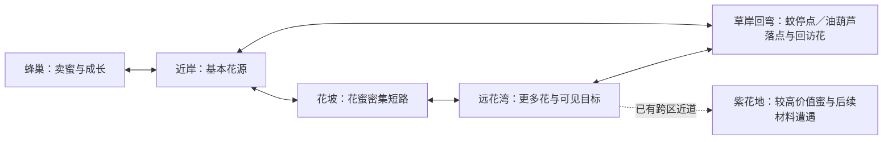

# 雨来之前：采蜜与蜂舞 Steam Demo 制作规格

SD-v1.1，2026-11-04（以下新增反馈裁定优先于原SD-v1历史规格）。Alan明确当前阶段从MVP转为准备Steam发布的Demo，首批平台macOS。GDD§13.9 / M3，产品与成本承接#211；唯一执行指针在production Now。本稿在实现与检查过程中补齐，不把未完成内容记成现状。

体验目标：生活区形成可记住的生活场所；外出有资源与风险选择；返家能看见收获和成长；灯球舞台把地点选择、蜂舞通信与转场连成一个可辨认仪式。保留既有经济与旧档，不靠无意义NPC或额外货币制造复杂度。

授权范围：Shelldiver元素/成长图/排布/数值/交互研究；灯球传送点与单舞/群舞转场；生活区空间、功能和状态深化；手绘资产/交互表现及专业美术评审手册；macOS Demo产品壳、设置、结束收束、来源/署名与Steam发布材料；完整验证及候选交付。

事实边界：公开资料没有给出的Shelldiver内部算法/数值不补造；来源、观察、推导和本项目参数分列。蜂舞基础参考真实摆尾/回环，拟人扩展按用户偏好研究蔡徐坤的动作方向，以项目自制动画实现并保存来源/发布审查事项。专业美术手册供评审，不声称已经得到专家认可。

发布边界：本轮完成可玩的macOS候选与可审查发行材料；Steamworks账户/AppID、平台上传与Valve审核状态只按实际回执填写。已知历史记录尚无本作AppID，先完成不依赖账户的发布准备；不虚构上线或可上传身份。

成本：预计本轮2–3小时含研究、生成等待、验证与集成；观测起点2026-11-03 03:02:18 UTC（此前本轮上下文读取未独立计时）。200＋40小时边界保持，主动/计费/累计/可靠剩余未知，无新增采购，自动化PAUSED。

验收：舞台/光效/舞蹈在原生运动中清楚且支持简化动画；切区/失败保存/暂停/失焦/跳过保持稳定状态；生活功能各有用途且可单独抵达；成长/全程/迁移旧档无倒退；美术手册有实际截图、规格、来源和可批注问题；Demo候选经既有NH-C01–08及本轮新增Demo检查，Steam外部未完成项显式列出。

## 本轮冻结的玩法与空间决定

生活区逻辑宽1920、高800，镜头跟随范围0–640；从左到右为蜜铺(260,540)、成长书屋(650,480)、花路观测台(1110,440)、蜂舞广场(1530,555)，安全出生点(840,575)，与功能点保持独立距离。四点100像素内E，按最近明确功能处理；每次出行不要求访问所有点。保留旧v3庭院位置（仍在合法范围），不改财富/成长/花源/敌人格式。庭院不耗续航，花路观测不提供新货币。扩大空间用于功能区与视觉层次，不添加强制往返任务。

蜜铺以货架罐数/阶段对白回应累积售卖；成长书屋继续抽象六边形树，说明当前瓶颈与下一项收益；观测台显示蓝/紫花资源、价值、敌人差异、避雨/返程与已访记录；广场承接选区、舞蹈及出发。主线以第一次交付→基础成长→紫花地→备好花蜜→庭院庆祝形成收束；这些状态复用已持久化事实，不重复建任务存档。陌生玩家15–25分钟体验是待验证目标，不通过强制等待/涨价凑时长。

### 灯球与动作

所有主要地区出入口与近道都用同一家族的叶藤支架、镜片灯球和花瓣木台表达传送功能；锁定时熄光、显示原因，激活时金绿柔光在台面流动。灯球与藤架真实悬挂，灯光不掩盖敌人/花源/HUD。基础转场约2秒：聚拢/起步→摆尾和交替回环→光幕遮切/保存→目的地落定；默认同伴人数随既有成长进度从单舞到小群舞。不是实际蜜蜂具有传送能力的科普断言，而是本作幻想。

按Space可跳过剩余表演；设置“简化动画”保留短淡变与地点信息，关闭追逐光束/摇摆/群体回环。切区提交仍为一次原子保存；跳过、失焦、退出、读档不能刷趟/补货/丢货。短动画也不跳过必要保存验证。拟人动作槽提供项目自制的摆肩/侧步小组合，按Alan指定方向参考蔡徐坤相关舞蹈；发布素材中不导入现成歌曲、艺人肖像或第三方视频。可扩成可收集的社交舞，但不影响效率/解锁或成为强制付费项。

### Demo产品与艺术交付

保留9付费节点/12级已接受成长规格，研究结论先说明边际收益/前置和后续分支，任何本轮数值调整必须另列前后值及验证。产品壳补设置、控制说明、来源/署名、明确Demo结束及继续探索。macOS首发；Steam App/Depot/审核与Apple签名公证按实际状态列项，不用本地导出冒充Steam可发布。美术手册基于调整后原生画面，分已实现/待评审/后续方向；包含可编辑来源、资产规格、色值/笔触/光线、动效时间轴、交互状态与专家问题表。

## 实现检查点与后续顺序

上述四功能庭院、镜片舞台、单舞/小群舞、侧步动作槽、跳过/简化、设置与Demo收束已接入0.22；三张预生成素材的源与哈希可追溯。外出经济/怪物数/花源刷新保持0.21规则。具体数值与原作不确定性见Shelldiver研究；不把原作“30+升级Demo”机械转换成本作节点数量。

后续扩展按“可感知的限制→一个改善选择→新区域/资源用途→世界反馈”推进：先经真实首玩确认往返和采集时间构成，再决定是否调整速率/容量；有消费用途再增一种地域材料；有经营吞吐选择再增队列/自动化；舞蹈扩成可替换动作资源，逐帧角色动画优先由专业美术评审确定。六边形仅作抽象布局语言，不变成建蜂巢玩法。

当前验证、成本/中断区间、LV01–10与未完门禁统一见[0.22构建回执](../production/nectar-demo-022-build-receipt.md)。PR #300；Mac锁屏导致实际导出入口测试未完成，暂不打通过NH-C门禁的试玩候选包；暂无Steam AppID/签名公证/平台审核。

## 2026-11-04 十条试玩反馈修订（SD-v1.1）

GDD§13.9 → M3 → #301–304；产品/成本仍为#211。本节是本版规则与理由，执行状态只看Now和GitHub。Alan明确要求修改，Codex负责实现/内部验证，下一检查点是新版整包体验；技术/AI复核不等于Alan接受。

1. **蜜铺只修新增罐子。** Alan澄清店铺整体造型满意，截图因应用重启丢失；问题是交付后出现的椭圆线条罐与原画罐不同。保留原蜜铺PNG和整体造型，以原画罐生成同款透明素材替代程序椭圆，逐格贴合两层原货架。原意仍是通过货架存货体现交售成果，每累计6份增加一罐，最多6罐；罐是成果表现，不是可再次出售的库存。整体改店的初始误判及一次未采用生成保留在成本记录，不作为用户要求。
2. **移除成长树旁的假风花。** 原先按成长数增加1–4朵，意在庭院繁茂；它没有玩法，却使用可用风花外形。删除该装饰循环，避免向玩家承诺不存在的交互。
3. **观测台合并到出发选择。** 原版只是静态花路说明，没有独立观测行为或决策收益，不应占一个单独跑去的地址。资源/每花产量/单价/晴雨放在灯球目的地选择，操作/刷新/耗尽规则放在暂停手册。取消实体观测台，不为了给它找用途额外加系统。
4. **返回落在灯球。** 从池岸、紫地或救援返回庭院，落点均为(1080,555)，不在成长树附近；正常返回保留所带花蜜。
5. **三点同屏。** 蜜铺(390,540)、成长书屋(760,500)、灯球(1080,555)，庭院镜头固定1280宽；售卖→成长→出发不穿越额外说明设施。飞行速度不变，两段中心间普通飞行理论约1.62秒/1.41秒（忽略加减速，是几何估计，非真人耗时）。可以跳过成长直接出发。书本中心、交互半径、临近提示一致；蜜铺仅一个返回按钮。
6. **按单花收获重调经济。** 下表是本作新设定，不宣称原作内部参数。成长实际花费售蜜所得金币，仍不直接扣花蜜。

| 参数 | 0.22 | 0.23 |
|---|---:|---:|
| 每朵蓝/紫花产量 | 12 / 16份 | 1 / 1份 |
| 采集速度（初始/一级/二级） | 5 / 7.5 / 11份每秒 | 1 / 1.5 / 2.2份每秒 |
| 蜜囊容量 | 18 / 30 / 48 | 6 / 10 / 16 |
| 蓝/紫单价 | 1 / 3金币 | 1 / 3金币 |
| 采集一级/二级 | 12 / 32金币 | 4 / 11金币 |
| 范围/双采 | 48 / 85 | 16 / 29 |
| 容量一级/二级 | 18 / 55 | 6 / 19 |
| 续航一级/二级 | 25 / 75 | 9 / 25 |
| 紫地/近道/口碑/储粮 | 90 / 65 / 90 / 180 | 30 / 22 / 30 / 60 |
| 储粮要求交售紫蜜 | 18份 | 6份 |

每区仍7朵，花量不靠扩场堆叠。初始一囊需6朵；一级容量可采完整一区，二级可跨两区合计14朵。采空或想返程都可回家，不要求每趟填满容量；二级容量的边际价值仍需真实体验检验。首次满囊6金币可买采集一级或容量一级；模型两分支路线、实际输入路线和库存守恒分开验证。

**v4存档换算：** v1–v3先经冻结旧模型完整验证，原字节备份，再原子写入；金币/累计交售/每种携带份数均按旧值÷3向上取整，已购、完成、趟数不清零。混色独立取整若超新容量，保留两种非空资源并以整包售价差额找零（含口碑取整）；找零不计真实交售。旧已空花仍空，非空花变1份；旧敌对状态归一温和巡游，庭院旧位置落回灯球。保存失败保留原文件及备份，未知/坏档拒绝；旧旅程完全独立。

7. **材料启发先保留为具体候选。** 官方对象是水母：泡泡枪捕获后售卖；激光处理垃圾、晶石、蘑菇供升级。可借鉴“花蜜→交易，树脂→某项设施/能力”，树脂来自树干渗出点、停稳刮取，区别于花心持续采蜜；先出现明确用途再投放。当前用户问启发，没有将完整材料系统作为本轮实现要求，本版不增加第二货币或强制素材清单。[官方资料](https://store.steampowered.com/app/3862670/Shelldiver/)
8. **Demo生物改温和。** 不再预警、追击、接触扣续航，也不用冲刺驱赶；保留区域活动与每趟生态状态。原作有电/爆炸水母描述，不能断言完全无危险，但没有证据支持我们这种追击蚊必须存在。取舍仍来自续航、容量、花位和局部细雨；不修改旧飞行旅程的生物规则。
9. **减少常驻文字。** 删除下一步大卡、地点趟次与长操作行；成长目标移入暂停，靠近可用功能才显示短E/F提示，采蜜/满载为短状态。保留保存错误等必要反馈。
10. **HUD集中。** 金币、携带和续航统一在左下同一状态卡，以图标+数字+条显示，悬停可解释；不再分散到三处。1280×800与960×600均检查。原作HUD本轮未成功取得新的交互观察，不把我们的排布声称为逐像素复刻。

参考边界：一手资料没有完整原作精确价格/掉落表，也没有本轮成功实玩Shelldiver。新增材料仍是候选；没有降低全作24关或商业质量要求，Steam外部门禁未完成。

## 2026-11-04 动作与材料迭代（SD-v1.2，实施验收中）

Alan的两张0.23实机截图是本轮问题证据：采蜜过程不清、花源静止、蚊子无互动、续航85过宽、成长面板文字过多。Codex按授权实现 #306–309，原画风与蜜铺保持，以下为待运行验证的设计值，不冒称Shelldiver精确数值。

- 花蜜每花仍1份；按住E约1.8秒完成，升级缩至1.2/0.8秒。花心旁显示实时填充与蜜滴图标，蜜蜂有持续用力动作、花头受力和完成回弹；中断保留该花部分进度。空花收拢，18秒有效野外时间后长出花苞再开花；每趟有限花位按种子生成细微位置变化，暂停不推进、存档不重置刷新。
- 蚊子保留无主动攻击。Q/右键短促振翅，近距命中产生退让与掉落：池岸携带纤维，紫地携带树脂（拟人游戏创作，不宣称真实蚊子产物）。须多次命中后抖落，材料有实物飞出与靠近拾取；掉落前后与库存完整保存，不能反复读档复制。材料独立于蜜囊，直接用于成长。
- 初始体力36，双翼成长50/70。悬停0.6/秒、移动1/秒、采蜜额外1.3/秒，振翅2/次，冲刺4/次，雨中额外1.8/秒。试验目标为初始一囊返程有明显余量压力，升级后同路线余量显著提高；需普通输入路线与故意耗尽实测，不能以公式证明好玩。
- 成长保留原分支，新增振翅强度节点；升级效果以秒/份、容量、体力和材料图标表达，先显示具体当前→下一档，再给一行必要前置。去掉大段重复条件与固定解释。
- 转场先核查参考实机，采用实际观察支持的结构并明确本作改编。蜂舞、视觉收拢、隐藏切换、落点展开为同一动作；跳过只缩短表现，保存失败不扣资源、不切错地区。

验收：模型/存档守恒、普通输入的采集/材料/购买/两地区/返程/耗尽、连续动态画面及小窗口UI、实际导出冷续、独立复核后再生成NH-C01–08候选。预算与真人体验边界沿#211；本节不是已验收结果。

## 2026-11-07 双采集核心、怪物遭遇与地图路线（设计讨论稿，未实施）

关联GDD§8.1/13.9 → M3 → [#322](https://github.com/alanthssss/nameless-becoming/issues/322)，研究沿#313、产品判断沿#211，产物沿[Draft #323](https://github.com/alanthssss/nameless-becoming/pull/323)。Alan要求分析两类目标/两工具，随后指出此前怪物设定未进入当前游戏，并询问花蜜与怪物材料能否对应Shelldiver贝壳与材料。本次恢复怪物遭遇作为材料来源的设计可能；Codex撤回上一稿“环境材料点取代怪物材料”的优先推荐。以下为可审阅推荐，不把询问记成全部细节已批准，也不启动运行实现；0.25与正式24关范围不变。

**本轮验收。** Alan随后明确“对应学习，不要过度设计”，并要求详细设计采蜜/振翅及成长。本轮约10分钟只细化两动作的对象、输入、作用、反馈、收获与已有成长；核对原作证据和源码，给出最小可验证规则。前轮角色/地图讨论保留作上下文，不追加货币改造、救援惩罚、第三工具或更多怪物。以下仍是设计稿，无本轮运行/玩家证据。

### 原作与资源对应

[官方说明](https://store.steampowered.com/app/3862670/Shelldiver/)确认水母是气泡枪捕获后售卖的主要商品；垃圾/晶体/蘑菇等通过激光拆解，材料用于装备、潜艇等成长。[开发者答复](https://steamcommunity.com/app/3862670/discussions/0/691994648689835927/)确认LMB气泡枪、RMB Plasma Gun（等离子枪），两者可按住，后者须先购买。既有官方预告看到离散气泡弹体与连续光束，不能误写成原作气泡必须逐次点击。

既有录像首趟4只售40币、购买第二工具20币，第三趟用20材料买货架；15:57–16:13商品FULL仍采材料177→310，见[事件记录](../research/shelldiver-fullplay-checkpoint.md)与[增量核算](../research/shelldiver-increment-2026-11-05.md)。支持“两来源/两用途共享一趟预算”，不证明所有材料无上限、所有目标固定不动或某种统一损失比例。工具错用、精确恢复/刷新仍未控测；本轮无新视频播放。

| 经济职责 | Shelldiver | 本作沿现有蜜铺的对应 |
| --- | --- | --- |
| 可出售的主要收获 | 水母 | 采得的花蜜 |
| 通用支付资源 | 出售所得贝壳 | 卖蜜所得金币；可以统称“花蜜收入”，但不能与未售蜜囊当同一个余额 |
| 定向成长材料 | 垃圾/晶体/蘑菇等处理所得 | 不同怪物遭遇取得的纤维/树脂等；对象可以与原作不同 |

**可行结论：花蜜收入＋怪物材料完全能承担两条成长资源线。** 不必为照搬原作把怪物材料换成环境矿点。每项成长须写清消耗的通用资源、特定材料及取得途径，不能用两种颜色的通用积分冒充两套循环。

若Alan所指是“花蜜本身直接像贝壳一样支付”，另一种简化也可行：采得花蜜→返家存为可用花蜜→支付成长，取消另一个金币余额。它会同时改变蜜铺的售卖职责、价格与旧金币迁移；这次不替用户决定删掉既有售卖循环。当前推荐先保留卖蜜换钱，让怪物材料循环成立。两种经济方案不能在实现中混用，不能同一份花蜜既卖钱又直接支付升级。

### 旧怪物设定在哪里，现版缺了什么

[原始需求回溯S13/S14](original-requirements-recovery-20261019.md)记录Alan亲自提出蚊子、油葫芦、野猪、画眉，并要求角色/Boss鲜活、有人味；熊替代野猪当时是讨论，不能追写成最早定案。[旧五类行为稿](enemy-phenology.md)后来形成追踪、路径、爆发、欺骗、碾压，但已标明历史边界；固定物候、夺蜜、幻花与统一调律不能整包恢复。

[较新世界元素](swarm-flight-world-elements.md#creatures)已将这些转为蚊占位、蚁沿实体搬运、油葫芦压腿/跳跃/停顿、画眉声源和大动物重量。旧`godot/scripts/main.gd`有多类更新逻辑，不能声称“从来没实现过”。**缺口是这些没有完整进入当前nectar Demo。** 同一物种的普通个体与命名角色应区分，不把已友好的角色直接变为可重复刷材料对象。

核对main `9d2ea70`：`nectar_encounters.gd`只有池岸1只/紫地2只蚊，均在锚点34×16附近巡游，最多50px/s；模型禁止其伤害玩家，Q自动选最近者，2/3次后分别掉2纤维/1树脂。材料已用于成长，但区别主要是次数与掉落。每区7固定花位仅x±25/y±28微扰、每花1份、同区18秒再开、出庭院重建；池岸x400–1720/y160–650、镜头400–440，矩形边界也没有构成路线。

### 采蜜与振翅：对应学习后的动作规格

**设计抓手。** Shelldiver的工具各自有可见作用链：气泡弹体接近/命中水母→捕获收获；光束接触材料→受作用/碎裂→材料散出。泡/光束的形态、目标反应与产出彼此一致，玩家才知道升级在改善什么。这是基于官方预告与实机记录的分析，不是断言原作模拟真实物理。两工具都可按住，差异不应被简化为“一定点按对一定长按”。

我们对应两种动作：**近花连续取蜜**和**短促振翅形成阵风、使目标退让/材料松脱**。采蜜来自花；材料必须在怪物身上/携带物上先可见，振翅作用后才脱落。现有Q仅扣命中次数再生成材料的机械关系还不够；需要把来源和作用过程画清。原始角色沿用，携带理由是游戏设定，不追加生理学解释或独立加工系统。

#### A. 采蜜：选中 → 连续取蜜 → 入囊

1. **怎么开始。** E/左键按住、花有蜜且在作用范围内即可工作；只给将要采集的花一个轻轮廓/花心提示。默认最近一朵，开始后保持目标，直到采空、离开范围或松手再选择，避免每帧被略近花抢走。双采取得后保持至多两朵有效目标，空位才补选。
2. **玩家做什么。** 靠近目标、维持可采距离、决定何时移向下一朵；普通飞行可以调整位置，不锁角色，也不自动把玩家拉到花上。松键或离开立即停止，已经取得的部分进度保留在该花；蓄力/冲刺期间停止采蜜。这些连续采集/保留进度规则已有，稳定目标是新提案。
3. **为什么看起来像采蜜。** 蜂身体和口器朝花心，花头发生小幅有连接的受力，花心处显示简短进度；少量蜜滴沿花心到口器的短路径，完成时一次清楚的蜜滴入囊、轻响与数量变化。花采空后收拢，不能仅让数值加一而花仍显得满蜜。口器姿态、进度与真实目标位置一致，不用长光束把采蜜画成激光。
4. **距离的已知风险。** 现版100/155像素内可隔空取蜜，不能说已经实现口器接触。本轮以现值作对照起点，不预定新增更远等级；原生比例若仍像远程吸管，就须收短实际作用距离并联动复核`reach`收益，而不是只加粒子遮掩。严格贴花、自动靠近或把`reach`改成纯感知均未决定，本稿不偷偷更改它们。
5. **节奏与费用。** 保留现有1.8→1.2→0.8秒/份。只有真实取蜜时增加1.3体力/秒，另叠加当前移动/悬停/雨耗；没花、空花、蜜囊满均不收取采蜜额外费用。满蜜囊停止取蜜并给短提示，仍可移动和振翅。
6. **双采怎么表达。** 仍是一次处理两朵近邻花，两处目标与进度都清楚；表现为快速交替取蜜/收拢两处蜜滴，不能把两条永久长管连在蜂嘴上。实际收益只在两朵花同时处于有效范围、有库存且蜜囊能装下时成立；只剩一格时按稳定顺序收一份，另一花保留未兑现进度。

#### B. 振翅：朝向 → 一阵风 → 命中反应 → 材料拾取

1. **怎么操作。** 仅野外且菜单/暂停未占用输入时，Q/右键点按打出一阵；推荐按住可按0.55秒间隔重复，松手停止，避免要求不停点键。这是对当前“只响应按下边沿”的简化改进候选，不是当前已实现。每次只重新判断一个可作用目标，不储存松手后的攻击队列。
2. **作用到谁。** 右键用鼠标方向，Q用最近移动朝向（尚未移动则用当前朝向）；同时按住时右键方向优先，预亮与判定使用同一来源。前方宽松扇区内自动选最近目标并预亮；不要求精确点在虫身上。有效触发当帧判定并结算，短风纹和受击同步表现，不新增飞行弹体/追踪或抵达二次判定；先试现有150像素作用长度、左右各60度；实体遮挡不穿透，背后目标不被无形命中。一阵只作用一只，风纹收束到该目标，不画成会击中整圈的爆炸波；没有目标时给短无效反馈且不扣额外费用。
3. **可见因果。** 蜂先有可读的振翅发力→短阵风到目标→目标随风偏移/整理姿态、携带材料松动→达到要求后松开材料并退开→材料落出→靠近收取→库存增加。前几次要有松动反应，不必每次都出完整掉落；不能在命中时先给库存、随后又拾取一次。
4. **节奏与代价。** 以当前每次2体力、0.55秒冷却、普通目标需2次、较牢目标需3次作为对照。现有24像素击退、0.42秒停顿也先保留；不要因强度成长再次倍增击退，把怪物越打越远。取够材料即离场，同一个体只产出一次。
5. **移动和停歇自然形成机会。** 蚊悬停/横移，油葫芦预告落点/跳跃/停歇；玩家更容易在稳定位置命中。撤回上稿“只有落地窗能作用、跳跃免疫”的硬门槛：只要物体实际在范围、方向与视线内就可命中。先以移动轨迹制造差异，不加弱点条或反应考试。
6. **拾取和反馈。** 保留完成后物件出现、至少0.3秒后且靠近85像素自动拾取，纤维/树脂数量与库存一致。命中声、脱落声、入包声职责不同；采蜜是轻而连续的节奏，振翅是短促、有停顿的节奏。普通取材不加全屏震动、长硬直或大白闪，也不让特效遮住下一次目标运动。

**两键与移动。** 有效振翅优先于同帧采蜜，0.18秒短动作内暂停取蜜（待测初值），之后如果主键仍按住可恢复；0.55秒冷却只限制下一阵风，不锁采蜜或普通飞行。无效振翅不打断采蜜。蓄力/冲刺不能同时振翅、没有延迟排队；每次只扣一次费用/登记一次作用。两动作共同消耗现有续航，不另开弹药、热量或连击资源。

#### C. 成长沿着动作变好，不重做成长树

| 方向 | 原作可核对的依据 | 本作当前节点／效果 | 玩家应直接感到什么 |
| --- | --- | --- | --- |
| 完成更快 | Bubble Damage、Plasma Damage节点都有直接画面；原作精确耐久/时间函数未知 | `gather1/2`：1.8→1.2→0.8秒/份；费用沿4币、11币＋2纤维 | 同一花更快采完、同样续航能多做事；动画节奏与进度同时变快 |
| 单次作用更强 | 原作两工具各有Damage成长；不能机械把百分比当击数比例 | `beat`：每次作用1→2，8币＋2纤维 | 2次目标变1次、3次目标变2次，每个完整目标各少耗一次的2体力。要在下一只同类身上直接看见次数变化 |
| 够得更远／更容易站位 | Plasma Range II记录到射程成长，具体像素与叠加公式未控测 | `reach`当前同时采蜜100→155、振翅150→205；16币＋3纤维 | 两个实际范围各自预览、各自说明，不能成长卡只写采蜜却暗中加振翅。这次先公开已有双效果，不另建节点；采蜜距离自然性仍按A4复核 |
| 同时处理更多 | 原作后期有多效果画面，但未确认各项来源；不以此冒称对应某个确切技能 | `twin`已有1→2花、29币＋3树脂 | 玩家会选择两花重叠的站位；同一时间最多双份，但受花位/库存/蜜囊限制，不能宣称整体收入必然翻倍 |
| 一趟做得更多 | 原作背包/氧气与工具资源共同限制探险 | 现有蜜囊6→10→16、续航36→50→70 | 支撑两个动作与返程，是公共成长，不再给两动作各加一套容量条 |

1.8→1.2秒是在相同单份产出下少用1/3采集时间、理想采集速率提高50%；1.2→0.8同理。只算额外采蜜消耗，每份2.34→1.56→1.04体力，未包含移动/悬停/雨耗；这是现有公式的算术，不是实测平均每趟收益。`beat`的收益则跨越整数击数门槛，不是声称所有目标都快一倍。

原作还有Bubble Strike首发收益、Bubble Critical Chance等已记录节点，说明成长可延伸到操作方式；本轮不照搬暴击、连锁、首击、穿透或完整树级数。先让已有“速度、强度、范围、双采”每买一次都在同一对象上可比较。保留当前价格作为对照，不由一个节点截图外推原作全级价格，也不宣称本作已平衡。

#### D. 最小验收

- 对同一花按住、松开、重新进入、移动经过，目标不抖动换来换去，进度/效果与真实入囊一致；满载不虚耗采蜜体力，双采最后一格不丢另一花进度。
- 对同一类怪物比较成长前后2→1、3→2次；按住不是逐帧触发，空处/背后/遮挡不误扣或隔空产材；两键、蓄力/冲刺组合不重复结算。
- 先看一段连续动作：玩家能指出“在采哪朵／打哪只，为什么有效，材料从哪里来”；清楚区分命中、完成、拾取三个时刻。规则自测不能替代这项原生观察。
- 体验只验证升级后是否能察觉变快/少打一下、两动作是否清楚且顺手；不借这个样件扩大地图或发明第三循环。采蜜距离自然性仍是明确未解决项，不能在未看实际尺度前写通过。

### 两条循环怎么改变成长、地图和返程

- 初段近岸安全花源可支持基础收入；先看见4币采蜜、6币蜜囊等选择。材料需求在成长节点中可预见，纤维来源在基础能力可往返处，不能用材料锁住获取它的基础动作。树脂来源安排在已开放区域，不反向卡住到该区的前置。
- 花蜜与材料不是分别玩两张孤立小图：同一趟可采花、判断怪物窗口、取材、返家。满蜜囊时主采集停止，仍可用剩余续航取材；低续航时绕开遭遇直接回家。每个小怪的出现、停歇与离场都要让“现在追、提前拦、先采一朵、放弃”至少有两项有效选择。
- 成长继续由金币＋具体材料共同支撑：采蜜效率/蜜囊改善收入，振翅强度/作用范围改善对抗取材，续航允许接入更远支路。不是所有升级一律要求所有材料，也不是让怪物随玩家永久等比例变强。
- 当前0.25材料不占蜜囊、拾取即保留，救援不扣材料。本次不把改变救援惩罚作为恢复怪物的前置；上一稿“材料当趟入库、救援留一半”仍未采纳，降为需另评估的经济提案。样件要比较正常返家与故意脱力的收益/耗时，确有支配策略再选择代价；不混淆已入库与未售花蜜。

空间连接示意（未定比例/坐标）：

B适合挣钱/快速返家；D有材料目标、拦截停点与回访花。怪物不能都与花逐个重叠，也不能都塞主路迫使清怪。两路应在分岔处读得出目的，用树干/密灌核心真实组织飞行路线，水面/低草可飞越、叶棚可穿。池岸晴天，较长路不能靠画叶棚假称省体力；紫地才比较实际雨暴露。近道仍连接池岸↔紫地，不冒充回家传送。

### 来源、动态供给与存档

- 扎根基础花保证可理解收入，回访花群错峰蓄蜜/开放，有花苞颜色预告。它们仍不等同移动水母，主要商品追逐没有因新增怪物材料而自动成立。
- 怪物来源/路径/停点/出口与区域材料绑定；蚊的悬停与油葫芦的落地窗给不同机会。每个个体有稳定ID、剩余材料、受作用进度和一次掉落标记；取材后离场，不能无限抖包；再进入的是来源系统的新个体。
- 候选探险活动时钟在暂停/庭院不推进，切区保留并按同一时钟结算；补入需满足间隔、并发上限与区域预算，不在玩家身上或镜头中央凭空生成。预算/冷却待样件配置，出庭院/读档不能无条件重发全图。环境材料可作为补充，暂不再加第三套常驻采集动作。
- 当前悬停0.6体力/秒，原地等18秒耗10.8/初始36的30%；停歇与补入要与采邻花/另一停点的时间配合，不把守点空等做成唯一有效策略。入口安全和基础花恢复必须让失误后仍可继续。
- 将来若采用新物种/供给，旧币、蜜、材料余额和已购能力原值保留；旧蚊ID、部分命中与未拾取掉落先完成旧趟，不强行改造成油葫芦；新来源从下一趟开始，迁移版本只执行一次、保留旧文件备份。不会借新设计追溯扣除旧材料。

### 下一检查点与验收

Codex负责将本稿给Alan评议；下一可玩实验边界若获选，先用蚊与油葫芦两个代表、一个双路环、既有两种材料验证行为差异，再补手绘表演。无需先塞全角色/Boss，也不把讨论变成自动实施。

1. 玩家能说出花蜜收入与材料的不同用途；同一份花蜜不能重复出售/支付，成长来源不形成循环锁。
2. 玩家对蚊可选择接近/拦截，对油葫芦可预测落点以便命中；停歇是空间机会，不是强制无敌期。绕行也必须可行，怪物差异不要只剩命中次数。
3. 花蜜目标与材料目标实际改变路线；满蜜囊仍能取材，低续航能绕开返回，不能迫使每次清场。
4. 同帧双键、窗口前后、背向/遮挡、冲刺、受作用进度、重复载入/掉落拾取均不重复结算；暂停、切区、返家与冷续供给一致。
5. 角色轮廓、准备动作、材料携带与落地支撑在实际尺度可读；AI规则审计不能替代这些实机观察，也不能证明好玩。

**结论边界。** 用户原设定作为依据恢复，当前推荐“花蜜收入＋怪物遭遇材料”，环境取材保留为可选补充；具体物种掉落与直接花蜜货币化尚未被用户定案。只有源码/历史资料核对和独立AI只读审计，无本轮运行、模拟、真人体验或新美术。采购0、200＋40小时不重置、主动/计费/累计/可靠剩余未知、PAUSED；时间与远端回执沿原#322，不另建队列。
