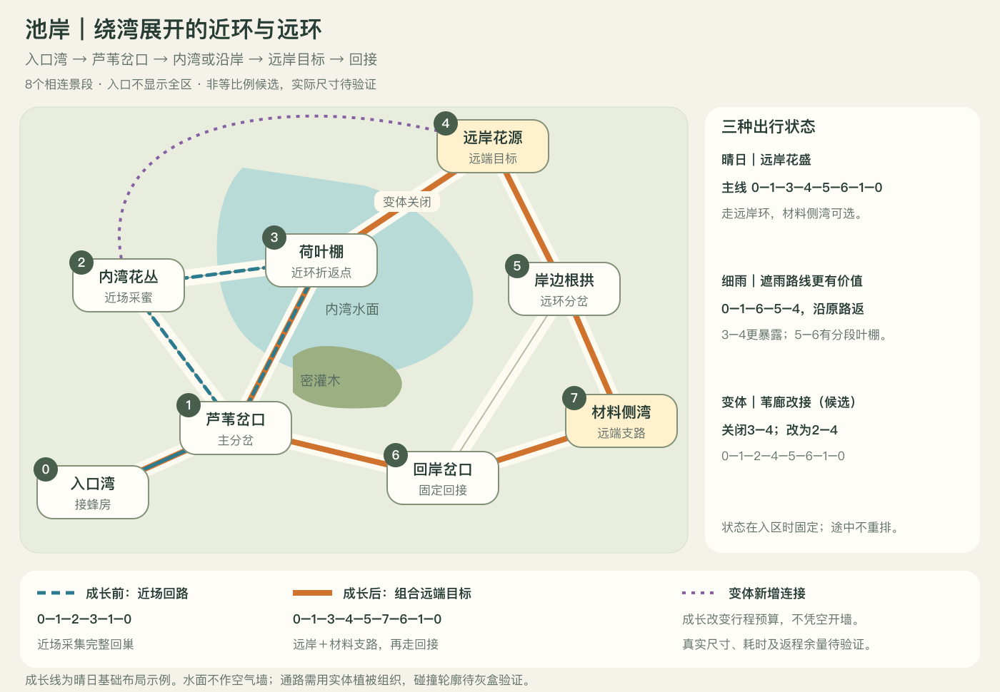
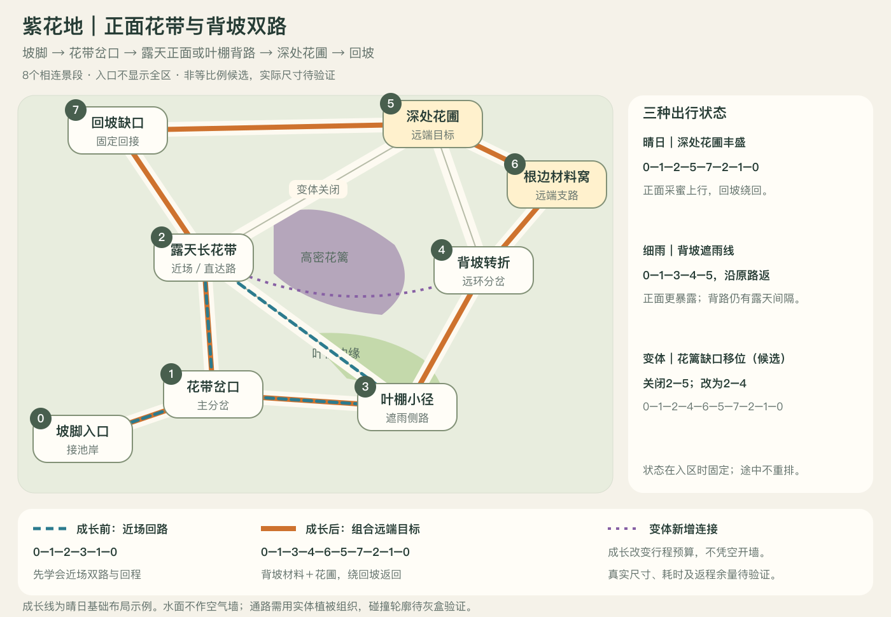

# 池岸与紫花地：区域内部地图候选

2026-11-09；GDD§8.1／§13.9 → M3 → [#322](https://github.com/alanthssss/nameless-becoming/issues/322)，沿 Draft PR336。只用[既有地图研究](../research/exploration-map-atlas.md)及[现行采蜜规则](nectar-steam-demo.md)，未追加网页、视频或原作研究，未改游戏。

## 设计结论

把现有两个小采集场扩成**各8个相连景段，近场小环＋远端大环＋可选材料支路**。一个编号代表具有空间形状、视线或行动差异的景段，不是一朵花或一个任务点；入口不能同时看完整区，远端目标通过连续镜头与遮挡逐步揭示。图为关系明确的空间草图，不是碰撞图或等比例灰盒。

- 解决小：入口、分岔、近场、过渡、远端和回接都有独立空间，远端跨越多个景段；长度从行动预算推导，不用长空路凑面积。
- 解决不变：稳定入口、地标和返程骨架；晴日／细雨改变路线代价与收益，另给一种局部通路变体候选，改变实际连接。
- 图例：蓝虚线为成长前，橙实线为成长后，紫点线为变体新增连接。成长线均以晴日基础布局为例，不与变体同时叠用。

## 池岸：围绕内湾，形成远岸环

| 结构 | 明确路径 |
|---|---|
| 近环 | 1→2→3→1；0是出入区口 |
| 远环 | 1→3→4→5→6→1 |
| 材料支环 | 5→7→6→5 |
| 分岔／远端 | 1选择内湾或沿岸，5选择回接或材料；4、7是远端目标 |
| 三种状态 | 晴日走远岸采蜜环；细雨偏向1→6→5的分段遮雨线；苇廊变体将3–4改为2–4 |

近场侧重开阔花丛与叶棚，远端经过沿岸转折和根拱，再见远岸花源。5–6的叶棚为局部分布，雨中仍有露天间隔；不能宣称整条路线免耗体力。

## 紫花地：正面花带与背坡双路

| 结构 | 明确路径 |
|---|---|
| 近环 | 1→2→3→1；0是出入区口 |
| 远环 | 1→3→4→5→7→2→1 |
| 材料支环 | 4→6→5→4 |
| 分岔／远端 | 1选露天花带或叶棚路，4选直达花圃或材料；5、6是远端目标 |
| 三种状态 | 晴日正面采蜜、绕回坡返回；细雨偏向叶棚背路；花篱变体将2–5改为2–4 |

正面以长花带与开阔视线组织采蜜，背坡以转角、实体花篱和分段叶棚组织路径。两侧在远端汇合，回坡缺口成为可记忆的返程地标。

## 状态与成长边界

三种状态是**可比较的对照方案**，不是三个必须轮换的游戏日，也不是现有实现。天气、花源收益与布局变体是独立轴；不把“下雨”解释成植物位置突然变化。局部变体只在入区时选择，途中不重排，固定回接不消失；是否采用地形变体及其世界连续性仍待验证。

开始时由入口景物和可读提示预告当趟状态。不能只调整采集物数量：细雨需改变两路的续航代价，布局变体需改变一条实际连接。收益及环境状态持续多久、何时刷新均待验证，不在本轮新增经济或刷新规则。

成长沿现有36→50→70体力与6→10→16容量，假设从近环单目标扩展到远端＋材料组合；所有新路径预算待验证。体力升级不凭空开墙，也不保证最高成长一趟采完整图。初期能朝远端探路，是否值得满载往返由实际行动成本决定。

**水面不阻挡飞蜂。** 通路必须由已有可成立的实体灌木／花篱、遮挡和目标组织；图上连线不是空气墙，细部碰撞轮廓待灰盒验证。新增节点不要求新工具、货币、战斗或传送。

## 灰盒验收候选

Codex下个检查点沿#322验证两区内部布局；本次只交图，不启动实现。验收重点：

1. 近环有可完成的基础采集与返程余量；中途可折返，远端不靠单向落差困住玩家。
2. 从入口无法一眼读完整区；到远端至少经历两次空间揭示，每段有采集、观察或路线选择，不堆纯飞行距离。
3. 两种天气在同一能力下产生不同的合理路线；局部变体改变一次实际分岔，任一状态所有已开放目标仍有返路。
4. 成长前后玩家可组合的目标不同；地图像素、屏数、行程耗时与返程余量均由运行验证，不从这张图估算。

决策人Alan，Codex负责图稿与后续验证。重审触发：飞蜂可直接穿越所有分路、远端仅增加空飞、所有状态同一路径最优、成长使整图失去取舍。整体世界和全作内容目标沿原规格保留；本图不完成产品门禁。

## 本轮记录

源图为同目录 `region-map-drafts/pond.svg`、`violet.svg`；JSON保存节点、边、路线与变体差异。图形由本地SVG渲染并逐张检查，没有使用新竞品素材。工作记录从北京时间14:02:20起，之前读取未完整计量；墙钟不等于主动或计费工时。200＋40小时控制、累计／可靠剩余未知、采购0、自动化PAUSED保持。技术校验与AI复核不等于实际玩家体验。

收口检查时间：2026-11-09 14:06:26 北京时间。两区各2种布局全节点连通、各5条路线闭合；两份JSON/SVG可解析，文内本地链接、diff及14项文档／素材契约通过。两图已本地渲染并逐张检查；限定独立AI复核的成长图例意见已修正。未做运行碰撞、预算、乐趣或真实玩家验证，CI以PR状态为准。
