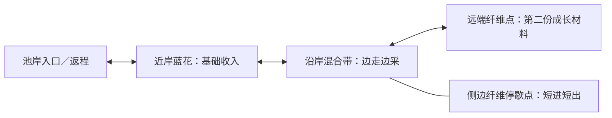
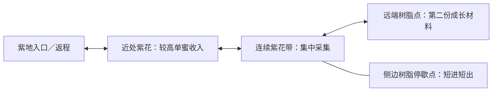

# 池岸与紫花地：无天气的地图与资源生成设计

2026-11-10；GDD§8.1/13.9 → M3 → [#322](https://github.com/alanthssss/nameless-becoming/issues/322)，沿Draft PR336。Alan最新方向：先去除天气设计，用现有Shelldiver资料明确地图与资源生成。本轮交设计，灰盒改动/完整走图在下一实现检查点接续；未改运行包、未增加美术或调研。

## 设计决定

**固定、容易记住的采集场，沿一个方向逐步深入；每趟变化交给资源位置、采空与补充，成长改善采集和带回能力。** 玩家只判断：现在缺花蜜还是材料，继续采还是回家。

本轮方案取消天气消耗、避雨路线、多回环、通路改接及布局状态选择。保留现有采蜜、振翅取材、续航、蜜囊和返程。材料在主方向旁形成一个短暂偏离，不单独围成一环。原8景段图与灰盒保留为历史证据，不继续沿它们增加节点。

## 从现有Shelldiver资料借鉴什么

| 已有证据 | 本作采用的关系 |
|---|---|
| 冰区有亮室→暗廊→下一室口→原路返回；火山区为主横带＋下探岩沟，C036–045/C055–057 | 清楚的深入方向和可认回的入口；有收益才偏离主方向，不要求绕圈返程 |
| 地区卡分列水母与地区材料；满商品后还能采材料，C008–011/C028–035/C046 | 花蜜用于收入，纤维/树脂用于成长；蜜囊满后是否继续取材是自然选择 |
| Biodiversity、Faster Waters、Crystal Master分别影响spawn rate、arrive速度、单次掉落，C078–081 | 供给与采集效率是可以区分的成长维度；这一版先沿用现有采集/容量/续航成长，不新增供给成长分支 |

来源为[11月5日既有观察](../research/shelldiver-increment-2026-11-05.md#刷新节奏还受到成长影响)、[系统研究](../research/shelldiver-systems-deep-dive.md)、[现有地图图解](../research/exploration-map-atlas.md#shelldiver选择目的地在当地完成短途采集)。400米重入时至少一个采空原位仍空，不能声称原作离区全部重置；随机地形、具体生成点、补充秒数和上限仍未知。**下面的生成表是本作改编，不是Shelldiver算法。**

## 两区内部地图

图表示资源沿深入方向的排列；近、中、远三带共享连续可飞空间，靠地形弯折与地标自然过渡。

- **固定骨架。** 池岸沿湾岸向前，紫地沿花坡向前；入口、两处转折和远端位置不因趟数变化。任意位置都能原路撤回，水面仍可飞。既有目的地开放规则不变，本轮不新增世界区域或强制跨区长途。
- **压缩空路。** 首轮尺度候选：入口至远端沿主方向约1600–2200px，可飞宽约450–700px；以现有230px/s为输入，最终由采集往返预算调整。相邻资源簇之间正常飞行约1.5–3秒；侧边材料偏离主方向约1–2秒。若连续5秒只在穿通道，优先缩短这段或让目标直接临路，不能靠堆路标填空。
- **远端有明确用途。** 近场能挣钱，中段能取第一份材料，远端保证本区第二份材料。是否再走一段取决于当前成长缺口；例如已有缺2纤维的成长，深入可在同一趟凑齐。树脂是否足够某项成长仍按已有费用与库存计算，不承诺一趟买到升级。远端附带花源，方便成长后兼采。

以上尺寸、间距与供给量均为原型假设，尚未测量新版。目标是减少空飞并保持两次空间揭示，不能用矩形面积或趟时单独宣布“地图够大”。

## 资源生成：一张供给表、两种补充节奏

复用当前灰盒每区16份初始花蜜、2个携料目标的量级，重新分散到途中；这是实验供给，不直接修改正式Demo经济。每朵花仍产1份，材料沿当前振翅/掉落/拾取规则。

| 资源带 | 花蜜初始可采数 | 材料目标 | 出现规则 |
|---|---:|---:|---|
| 近场 | 4（两簇，各2朵） | 0 | 首簇固定在入口可看见的位置，另一簇紧接深入方向 |
| 中段 | 6（两簇，各3朵） | 1 | 花簇沿主方向分布；携料者在侧边短口袋，进入中段时看得见其位置 |
| 远端 | 6（两簇，各3朵） | 1 | 携料者有固定生境范围，花源围绕目标与来路分布 |

池岸表内花蜜为蓝蜜、材料为纤维；紫地为紫蜜、树脂，沿用现有售价/用途和携料者命中门槛。两区首先用资源用途与处理效率区分，空间结构保持同样容易理解。

1. **新趟填充。** 从庭院新出发时确定两区本趟资源记录。地形与资源种类不变；除首簇外，每簇从所属资源带少量已审核的锚点中选择位置。总量固定，避免坏种子没有材料。锚点须在可飞区域，动作可触及，花簇不互相遮没；不把资源散到额外远路上。
2. **花蜜补充。** 提议把正式Demo已有的“采空后18秒本区游玩时间再蓄满1份”恢复到新实验；单花最多1份，满花不积累隐藏库存。暂停/失焦/离开本区不推进，采空位置保留；尚未采空的花保留部分采集进度，采空后进度归零，补满后需重新采集。18秒是本作已有规则，非原作事实；若守着近花等比继续深入更划算，优先调整花间距/补充周期，暂不增加第二套天气或导演系统。
3. **材料补充。** 每区两名携料者，本趟各只掉落一次；材料实际拾取后才入账，蜜囊满不影响取材。既有停歇/短距离活动限制在出生生境内，采过的个体状态可辨认。本趟不新增携料者，回庭院开启下一趟才补充，远端第二份不会被随机抽掉。
4. **回头与重入。** 同趟回头、切区、暂停或存档恢复，都保留同一资源位置、库存、掉落及蓄蜜进度，不重新抽取。重进区域不能刷出一整套资源。只有从庭院开始新趟才重建初始供给；这条是本作选择，未宣称原作相同。独立灰盒以“结算后再出发”代替庭院新出发；中途退出结束本趟，再出发新建供给，暂停恢复不重建。正式Demo已有野外切区仍算同趟；这轮灰盒不新增跨区功能。

**每趟改变的幅度要小。** 能认出旧地形、材料所在资源带和返程方向，同时可看到这一趟花簇偏左或偏右；不承诺每趟都有全新路线。该方案把重复出行的主要动力放在资源需求与成长效率上。

## 成长前后怎样改变一趟

| 阶段 | 同一地图中的可选目标 |
|---|---|
| 初始：36体力／6容量／1.8秒每蜜 | 近场挣钱；需要材料时少采蜜，尝试中段或远端。远端没有新增硬锁 |
| 中期：50体力／10容量及已有动作成长 | 更容易把中段材料与一囊蜜组合，不必每趟只做一件事 |
| 后期：70体力／16容量／0.8秒每蜜及双采等 | 在不改供给的同种子下对照：能否取远端材料并兼采沿途，返回时余量增加 |

本轮不让升级自动移动资源、提高门槛或增加资源种类；先测清现有成长是否改变采集范围与组合。原作供给成长有证据，但是否引入本作留待出现明确供给瓶颈后判断，不提前新增升级树分支。

## 下一实现与验证检查点

Codex下一轮将本规格落实到独立灰盒，再完整走图；本轮没有新版实现或试玩。自动规则检查覆盖各带保证量、位置可达、单花上限/补充、材料仅掉一次、重入不刷新与同种子成长对照。原生验证按两区各做初始挣钱、初始取材、成长兼采三趟，另走回头看补充；记录连续无事件飞行最长段、实际收获、返程余量及是否有原地等候。

继续条件：玩家能直接看出深入与返程方向；远端材料确有取用目的；升级后可兼做更多目标；旧长空路被压缩。待真人判断：是否想再出发、轻量资源位置变化是否足够。若远端仍只是多飞一段拿同样东西，先重看资源用途和摆放，不再扩路网。

设计人Codex、产品决定人Alan。#322/M3保持开放；既有世界/雨天图改列历史，原作生成缺口不触发新调研。本轮从北京时间13:08:06记录；200＋40小时控制保持，主动/账单/历史累计/可靠剩余未知，采购0、图像调用0、自动化PAUSED。本地14项文档/素材契约、文内链接、图围栏和diff检查通过；限定复核无阻断，已补未采空进度/补满归零与独立灰盒新趟边界。未运行新版地图、未验证图形渲染或玩家体验；最终CI读回沿#322/PR336。
