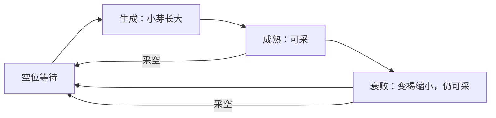

# 池岸与紫花地：无天气的地图与资源生成设计

2026-11-10；GDD§8.1/13.9 → M3 → [#322](https://github.com/alanthssss/nameless-becoming/issues/322)，沿Draft PR336。Alan最新方向：先去除天气设计，用现有Shelldiver资料明确地图与资源生成。初稿交设计；Alan随后授权在本轮实现独立灰盒并完整走图，执行沿#343–346，记录见[灰盒回执](../production/region-greybox-receipt.md)。不增加美术或调研。

## 设计决定

**固定、容易记住的采集场，沿一个方向逐步深入；每趟变化交给资源位置和错开的生成、成熟、衰败、再生，成长改善采集和带回能力。** 玩家只判断：现在缺花蜜还是材料，继续采还是回家。

本轮方案取消天气消耗、避雨路线、多回环、通路改接及布局状态选择。保留现有采蜜、振翅取材、续航、蜜囊和返程。材料在主方向旁形成一个短暂偏离，不单独围成一环。原8景段图与灰盒保留为历史证据，不继续沿它们增加节点。

## 从现有Shelldiver资料借鉴什么

| 已有证据 | 本作采用的关系 |
|---|---|
| 冰区有亮室→暗廊→下一室口→原路返回；火山区为主横带＋下探岩沟，C036–045/C055–057 | 清楚的深入方向和可认回的入口；有收益才偏离主方向，不要求绕圈返程 |
| 地区卡分列水母与地区材料；满商品后还能采材料，C008–011/C028–035/C046 | 花蜜用于收入，纤维/树脂用于成长；蜜囊满后是否继续取材是自然选择 |
| Biodiversity、Faster Waters、Crystal Master分别影响spawn rate、arrive速度、单次掉落，C078–081 | 供给与采集效率是可以区分的成长维度；这一版先沿用现有采集/容量/续航成长，不新增供给成长分支 |

来源为[11月5日既有观察](../research/shelldiver-increment-2026-11-05.md#刷新节奏还受到成长影响)、[系统研究](../research/shelldiver-systems-deep-dive.md)、[既有地图图解](https://github.com/alanthssss/nameless-becoming/blob/ea222221544ff86cf50b98ebb7f27d7862cf3794/docs/research/exploration-map-atlas.md)。400米重入时至少一个采空原位仍空，不能声称原作离区全部重置；随机地形、具体生成点、补充秒数和上限仍未知。**下面的生成表是本作改编，不是Shelldiver算法。**

## 两区内部地图

图表示资源沿深入方向的排列；近、中、远三带共享连续可飞空间，靠地形弯折与地标自然过渡。

- **固定骨架。** 池岸沿湾岸向前，紫地沿花坡向前；入口、两处转折和远端位置不因趟数变化。任意位置都能原路撤回，水面仍可飞。既有目的地开放规则不变，本轮不新增世界区域或强制跨区长途。
- **压缩空路。** 首轮尺度候选：入口至远端沿主方向约1600–2200px，可飞宽约450–700px；以现有230px/s为输入，最终由采集往返预算调整。修订后相邻资源簇170px，正常飞行约0.8秒；侧边材料偏离主方向约1–2秒。若连续5秒只在穿通道，优先缩短这段或让目标直接临路，不能靠堆路标填空。
- **远端有明确用途。** 近场能挣钱并有一处材料，中段临路一处、分岔两处，远端两处材料形成集中目标。是否再走一段取决于当前成长缺口；例如已有缺2纤维的成长，深入可在同一趟凑齐。树脂是否足够某项成长仍按已有费用与库存计算，不承诺一趟买到升级。远端附带花源，方便成长后兼采。

当前五节点主路约2060px、通路宽520px、侧袋长380px；资源密度和生命周期为本作实验参数。目标是减少空飞并保持两次空间揭示，不能用矩形面积或趟时单独宣布“地图够大”。

## 资源分布与生命周期（14:07 用户反馈后的修订）

Alan实玩指出0.2.x花过稀、生成与衰败不可见，材料分布与循环薄弱。旧16花/2材与“采空18秒补蜜、材料同趟一次”方案被本节替代；旧包和实走记录保留，不能当作修订版验收。只增加资源密度与状态循环，不增路线、天气、物种或管理系统。

| 分布 | 花 | 材料 |
|---|---|---|
| 近、中、远连续主路 | 12个小簇，每簇3朵，共36个资源位；簇距170px，横向展开，入口起即可见 | 近段1、中段临路1、短分岔2、远端2，共6位 |
| 新趟 | 从所属生境审核锚点选位；相位按簇和个体错开，可复现成熟和衰败，各段保底可采 | 固定生境，小范围停歇/移动；相位错开，远端正常抵达时可取 |
| 成长对照 | 保留同种子，可比较同一供给和初始相位；成长不自动增加资源 | 蜜囊满仍可取材，拾取成功才计入收获 |

- **花：** 空位6秒→生成4秒→成熟18秒→衰败6秒→空位。单朵最多1份蜜，没有隐藏库存；采空即进入等待，部分采集进度保留到采空或自然衰败结束。错开相位，防止整条路同时枯萎。
- **材料：** 空位18秒→生成4秒→成熟22秒→衰败6秒→空位。成熟/衰败可用原振翅动作打落；落地保留12秒，实际拾取后入账并进入空位，未拾取则消失后再生。原伤害门槛和材料用途不变；不再限每趟一次。
- **状态可见：** 小芽/小方框逐步长大；盛开/实心方块可采；将谢变褐缩小并显示剩余弧；空位保留轮廓和再生进度。材料明确标生长中、Q取材、将败、拾取或再生中。仍是灰盒符号，没有新美术资产。
- **时间边界：** 只推进本区活动时间；暂停、失焦、保存退出均冻结。保存并冷续保持相位、时长、库存、部分采集进度及落地物，不能用重开窗口刷新。结算或明确结束后新出发才重建供给。v3独立保存，保留v2实验包与数据，不读正式Demo档。

这些秒数是本作可调试参数，不是Shelldiver算法。先验证画面是否连续有采集目标、返回时能看到已采位置的新状态；不能只用刷新事件数量宣布体验成立。

## 成长前后怎样改变一趟

| 阶段 | 同一地图中的可选目标 |
|---|---|
| 初始：36体力／6容量／1.8秒每蜜 | 近场挣钱；需要材料时少采蜜，尝试中段或远端。远端没有新增硬锁 |
| 中期：50体力／10容量及已有动作成长 | 更容易把中段材料与一囊蜜组合，不必每趟只做一件事 |
| 后期：70体力／16容量／0.8秒每蜜及双采等 | 在不改供给的同种子下对照：能否取远端材料并兼采沿途，返回时余量增加 |

本轮不让升级自动移动资源、提高门槛或增加资源种类；先测清现有成长是否改变采集范围与组合。原作供给成长有证据，但是否引入本作留待出现明确供给瓶颈后判断，不提前新增升级树分支。

## 下一实现与验证检查点

Codex已按后续授权进入独立灰盒实现和完整走图；最终实现与验证状态以[灰盒回执](../production/region-greybox-receipt.md)为准。自动规则检查覆盖各带保证量、位置可达、单花上限/补充、自然生成/衰败、掉落过期和同趟再生、重入不刷新与同种子成长对照。原生验证按两区各做初始挣钱、初始取材、成长兼采三趟，另走回头看补充；记录连续无事件飞行最长段、实际收获、返程余量及是否有原地等候。

继续条件：玩家能直接看出深入与返程方向；远端材料确有取用目的；升级后可兼做更多目标；旧长空路被压缩。待真人判断：是否想再出发、轻量资源位置变化是否足够。若远端仍只是多飞一段拿同样东西，先重看资源用途和摆放，不再扩路网。

设计人Codex、产品决定人Alan。#322/M3保持开放；既有世界/雨天图改列历史，原作生成缺口不触发新调研。本轮从北京时间13:08:06记录；200＋40小时控制保持，主动/账单/历史累计/可靠剩余未知，采购0、图像调用0、自动化PAUSED。初稿设计检查属于历史；修订版实现、原生验证与CI见灰盒回执，沿#343–346，不以文档或旧包通过替代新版验收。

2026-11-10 0.2.x历史前置验证（不代表本次生命周期修订）：模型已发现初始紫地同时拿两材料会返程耗尽，失败保留；初始专程拿远端一材料可返回，成长综合取16蜜+2材料可返回。原验收的“初始取材”不等于保证一趟凑齐所有升级材料，模型测试已明确区分一材与贪取两材，原生走图仍须核实。
