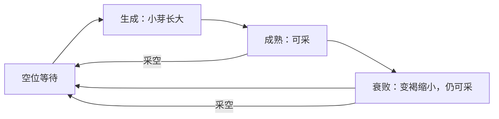

# 池岸与紫花地：无天气的地图与资源生成设计

## 2026-11-23：地图疏密、混合视角与关键互动反馈候选

**11月23日后续决定。** Alan已批准排期实施下文的池岸局部样段，执行与原生结果沿[制作规格 Now](solar-term-campaign-production-spec.md#production-now)及#322。以下为决定前的设计记录。

 Alan反馈地图太空，询问是否沿用俯视并利用多重透视丰富景深，要求采集、售卖等关键环节有更精彩的动效。沿GDD[§8.1](swarm-flight-gdd.md#visual-production-rules)/§12/§13.9 → [M3](https://github.com/alanthssss/nameless-becoming/milestone/3) → [#322](https://github.com/alanthssss/nameless-becoming/issues/322)。本节由Codex提出并负责验证设计，Alan保留整体视觉与体验判断；归档不代表视角改制、全图重做或美术量产已获承诺。以下11月10日规则是历史设计与实验记录，当前运行规则以最新GDD与回执为准。

### 核查到的现状

- 基线为main `09dc997`。池岸TileMap试做0.1.1是独立的9花/1材料片段，不能代表正式两区16花/3材→24/4→36/6的成长密度。既有[回执](../production/region-greybox-receipt.md#pond-shore-natural-20261123)已记录中央草地均匀、灌木重复。本次查看原始`fork-1280.png`及岔口/远岸既有图，未运行新版游戏或新增真人试玩。
- 图上主要是大面积同频率地纹、相近大小的花和岸边重复灌木。**“缺少中尺度景物、疏密分组和可辨地点”是依据静态画面的设计诊断**，不将其说成已经通过玩家实验的根因。边界做圆润解决了拼块感的一部分，不能独自承担整张地图的构图。
- GDD§13.9的2026-11-04 SD-v1.3已记录Alan提出“伪俯视地面配侧视花与物件”；当前[池岸绘制](../../prototypes/swarm-flight/pond_tilemap/view.gd)按根部/地面锚点排序并绘制接地阴影。已有基础可继续深化，无需为本候选更换移动规则。
- [共享反馈](../../prototypes/swarm-flight/nectar_harvest_view.gd)已有约0.42秒蜜滴吸入、0.36秒材料吸入、飘字和0.24秒采蜜回弹；[区域表现](../../prototypes/swarm-flight/region_game/view.gd)已有朝花靠近、轻摆和进度弧。购买/解锁有泛用庆祝。因此问题应表述为反馈触感和完成感不足，不能写成完全没有动效。
- [售卖事务与事件](../../prototypes/swarm-flight/nectar_harvest_main.gd)目前主要触发提示音、总结文字和UI刷新，缺少卸货到入账的连续可见演出；`commit_candidate()`先成功保存再派发事件，是新表现必须保留的边界。

### 地图：先组织场所，再填充细节

保留清楚的深入主方向和一个短材料岔口。每个地点同时承担一种行动用途和一个可记忆轮廓，不增加迷宫、天气机制或新的资源种类。

| 地点候选 | 玩家在这里做什么 | 主要画面组织 |
|---|---|---|
| 入口草岸 | 认清回程，拿到近处花蜜 | 开阔低纹理地面、现有返程标记、少量蓝花；归路始终可辨 |
| 弯岸采集带 | 连续采集，向前看见下一处地点 | 花围绕草色/湿土变化成簇；疏密交替，保留清楚飞行空间 |
| 岔口与材料湾 | 看见材料目标，决定短进短出 | 斜向芦苇/低草组框出侧湾，纤维载体保持原有规则；材质线索不能冒充新可采资源 |
| 远岸收束 | 到达远端目标并转回 | 岸石与低矮花群形成独特轮廓，提供终点感；不再接无目的长通道 |

填景顺序为大色块→中尺度组景→少量小细节：先用浅土、湿岸、草色、树影打破同一块绿色；再用岸石、低草、芦苇、枯叶形成组景；最后补少量水纹、落叶和经过时的轻摆。轮廓与植物连接遵循原手绘标准，避免同一灌木等距排一圈。

视觉密度与资源供给分开。优先用不可采且辨识明确的低对比景物丰富画面；不为填满屏幕提高花蜜产量或提前抹平花地繁盛成长。可采花保持更清楚的形状、颜色和状态反馈；空地留作飞行、转弯和看清目标的空间。若实际一段路只有长时间空飞，应压缩距离或移动有用途的目标，再评估装饰，不能拿景物数量代替行动内容。

布局受现有试做边界约束：当前只支持单连通、无孔陆地与固定资源锚点，先不加池中岛、内洞和桥上桥下通行。低草、落叶和地面水体不应被随手变成蜜蜂的障碍；本试做岸外现有通行限制只是实验事实，全图推广前须按R03另核视觉与飞行规则，不能以装饰修订悄悄固化或改变它。

### 视角：继续混合投影，补足前后层次

推荐继续俯视可玩地面、侧视角色和花草。侧视物件、前后遮挡、视差是不同手段，可以组合，但要共享地面落点、光向与比例；同一可玩平面不能上半屏突然缩成远景。

| 层次 | 处理 | 边界 |
|---|---|---|
| 岸外背景 | 降低对比、饱和度和细节；仅非交互景物可尝试轻微视差 | 背景不得伪装成可达目标，视差不作用于碰撞物或资源 |
| 可玩地面 | 连续草地/湿土/水岸色块、接地投影 | 与可走边界同源，镜头移动时不滑动 |
| 角色与物件 | 统一短茎、石块顶面和侧面、根部排序 | 保持现有真实交互点，蜂经过前后关系可信 |
| 近处枝叶 | 少量用于画面边缘和局部框景，遮住蜂或目标时退让/淡出 | 不长时间遮挡玩家、资源状态、提示与返程标志 |

工程声明Godot 4.6；本轮没有运行本地引擎，未核其安装版本。现有手工y排序可以继续使用；官方[CanvasItem排序说明](https://docs.godotengine.org/en/stable/classes/class_canvasitem.html#class-canvasitem-property-y-sort-enabled)与[2D视差说明](https://docs.godotengine.org/en/stable/tutorials/2d/2d_parallax.html)支持这类表现能力，但API存在不代表本项目效果已完成。首轮先验证构图、阴影和遮挡，再决定是否需要视差；不预先承诺转3D或给全画面套模糊。

### 动效：让动作的对象、过程与结果连起来

以下时长为起调假设，需按现有采蜜速度与连续操作调整，不更改实际采集耗时和交易时机。小动作围绕接触点，较强反馈留给一趟收获与成长；统一蜜金、叶绿和现有手绘笔触。

| 事件 | 建议的连续反馈 | 强度与取消规则 |
|---|---|---|
| 开始采蜜 | 蜂朝向花心，身体轻探；花瓣/花茎短暂受力；保留清楚进度 | 普通采集低强度，不震屏、不停游戏；换目标/松手回到静态，保留原进度规则 |
| 一份蜜完成 | 花瓣轻回弹→一滴蜜沿短弧进入蜜囊→蜜囊轻鼓→对应数量一次弹动，配短滴答 | 完成尾段约0.25–0.45秒，可与继续采下一朵重叠，不强制等待；按事件真实数量显示 |
| 材料脱落与拾取 | 振翅命中先给携料者局部反应，材料脱离/落地；靠近拾取才吸入并更新材料数 | 命中、脱落、拾取分开，未拾取不能播放入账成功；连续输入不叠成光团 |
| 蜜囊刚满 | 蜜囊一次轻弹、短满载音、容量满格和归路提示短暂强调 | 只在到满这一刻提示；不要持续抖动，不能暗示材料也不能再取 |
| 售卖成功 | 提交成功后，货物由蜜囊移向蜜铺现有罐口，罐中液面短升/罐身轻晃；蜜金光点收进金币栏，对应增量短显 | 总演出约0.6–0.9秒，按少量成组表现而非每份排队；余额和可购买状态立即按已提交真值生效，不等动画结束 |
| 购买成长 | 成长节点展开，明确强调得到的能力图标与本次变化 | 以所得能力为中心，降低泛用粒子干扰；只在购买成功后播放 |

售卖的“金币飞到栏里”只呈现已完成交易，绝不二次加钱；材料沿原规则保留，不随花蜜误播售出。离开/关闭面板或中断演出后立即显示真实最终值，已成交不回滚也不重播交易；快速连点、空货或保存失败不出现虚假成功动画。普通采集完成也按真实事件去重。已有减少动态设置继续生效，以静态强调和清楚数字保留结果；帧率与连续输入不能被演出牺牲。

### 下一实验检查点与本轮边界

建议Codex下一次在“池岸岔口→材料湾”先做一段可玩对照，并将同趟采蜜→返庭院→售卖接上反馈。先有完整局部样段再决定推广；本次只形成候选，不把未实施样段记为完成。实施可沿原#322拆成约10–15分钟的源组景、交互表现、原生验证切片，估算须包含实际检查与集成；没有开始的切片不另建动态队列。

验收同时覆盖：同机位前后图的主次/疏密；960×600与1280×800持续移动时目标、蜂与返程可辨；双向经过和遮挡退让；可采与装饰区别；重复采集、双采/加速、满载仍取材、售卖连点/中断/空货/写档失败；实际收益与旧版一致、减少动态设置有效。适用[Alan实玩经验R01/R02/R03/R06/R07/R09/R10/R13](commercial-product-requirements.md#rain-playtest-review)，其中R10只借用“结果有可见回应”的原则，不把历史帮助反馈当作本次售卖接受证据。

Alan在样段上判断“能认出地点、想靠近观察、操作结果有触感且不烦”；若新增前景遮挡目标、场景更杂或售卖拖慢重复操作，Codex先减层/缩短/重新分组，不扩整图。以上为待验证假设；本轮验证仅源码、历史静图、官方能力文档与设计一致性，没有新版原生运行、真人趣味或性能结论。设计候选保持Draft，M3/#322/#211开放；采购0、图像生成0，累计/可靠剩余未知，200+40小时与自动化PAUSED不变。

---

2026-11-10；GDD§8.1/13.9 → M3 → [#322](https://github.com/alanthssss/nameless-becoming/issues/322)，沿Draft PR336。Alan最新方向：先去除天气设计，用现有Shelldiver资料明确地图与资源生成。初稿交设计；Alan随后授权在本轮实现独立灰盒并完整走图，执行沿#343–346，记录见[灰盒回执](../production/region-greybox-receipt.md)。不增加美术或调研。

## 设计决定

**固定、容易记住的采集场，沿一个方向逐步深入；每趟变化交给资源位置和错开的生成、成熟、衰败、再生，成长改善采集和带回能力。** 玩家只判断：现在缺花蜜还是材料，继续采还是回家。

本轮方案取消天气消耗、避雨路线、多回环、通路改接及布局状态选择。保留现有采蜜、振翅取材、续航、蜜囊和返程。材料在主方向旁形成一个短暂偏离，不单独围成一环。原8景段图与灰盒保留为历史证据，不继续沿它们增加节点。

## 从现有Shelldiver资料借鉴什么

| 已有证据 | 本作采用的关系 |
|---|---|
| 冰区有亮室→暗廊→下一室口→原路返回；火山区为主横带＋下探岩沟，C036–045/C055–057 | 清楚的深入方向和可认回的入口；有收益才偏离主方向，不要求绕圈返程 |
| 地区卡分列水母与地区材料；满商品后还能采材料，C008–011/C028–035/C046 | 花蜜用于收入，纤维/树脂用于成长；蜜囊满后是否继续取材是自然选择 |
| Biodiversity、Faster Waters、Crystal Master分别影响spawn rate、arrive速度、单次掉落，C078–081 | 供给与采集效率是可以区分的成长维度；这一版先沿用现有采集/容量/续航成长，不新增供给成长分支 |

来源为[11月5日既有观察](../research/shelldiver-increment-2026-11-05.md#刷新节奏还受到成长影响)、[系统研究](../research/shelldiver-systems-deep-dive.md)、[既有地图图解](https://github.com/alanthssss/nameless-becoming/blob/ea222221544ff86cf50b98ebb7f27d7862cf3794/docs/research/exploration-map-atlas.md)。400米重入时至少一个采空原位仍空，不能声称原作离区全部重置；随机地形、具体生成点、补充秒数和上限仍未知。**下面的生成表是本作改编，不是Shelldiver算法。**

## 两区内部地图

图表示资源沿深入方向的排列；近、中、远三带共享连续可飞空间，靠地形弯折与地标自然过渡。

- **固定骨架。** 池岸沿湾岸向前，紫地沿花坡向前；入口、两处转折和远端位置不因趟数变化。任意位置都能原路撤回，水面仍可飞。既有目的地开放规则不变，本轮不新增世界区域或强制跨区长途。
- **压缩空路。** 首轮尺度候选：入口至远端沿主方向约1600–2200px，可飞宽约450–700px；以现有230px/s为输入，最终由采集往返预算调整。修订后相邻资源簇170px，正常飞行约0.8秒；侧边材料偏离主方向约1–2秒。若连续5秒只在穿通道，优先缩短这段或让目标直接临路，不能靠堆路标填空。
- **远端有明确用途。** 近场能挣钱并有一处材料，中段临路一处、分岔两处，远端两处材料形成集中目标。是否再走一段取决于当前成长缺口；例如已有缺2纤维的成长，深入可在同一趟凑齐。树脂是否足够某项成长仍按已有费用与库存计算，不承诺一趟买到升级。远端附带花源，方便成长后兼采。

当前五节点主路约2060px、通路宽520px、侧袋长380px；资源密度和生命周期为本作实验参数。目标是减少空飞并保持两次空间揭示，不能用矩形面积或趟时单独宣布“地图够大”。

## 资源分布与生命周期（14:07 用户反馈后的修订）

Alan实玩指出0.2.x花过稀、生成与衰败不可见，材料分布与循环薄弱。旧16花/2材与“采空18秒补蜜、材料同趟一次”方案被本节替代；旧包和实走记录保留，不能当作修订版验收。只增加资源密度与状态循环，不增路线、天气、物种或管理系统。

| 分布 | 花 | 材料 |
|---|---|---|
| 近、中、远连续主路 | 12个小簇，每簇3朵，共36个资源位；簇距170px，横向展开，入口起即可见 | 近段1、中段临路1、短分岔2、远端2，共6位 |
| 新趟 | 从所属生境审核锚点选位；相位按簇和个体错开，可复现成熟和衰败，各段保底可采 | 固定生境，小范围停歇/移动；相位错开，远端正常抵达时可取 |
| 成长对照 | 保留同种子，可比较同一供给和初始相位；成长不自动增加资源 | 蜜囊满仍可取材，拾取成功才计入收获 |

- **花：** 空位6秒→生成4秒→成熟18秒→衰败6秒→空位。单朵最多1份蜜，没有隐藏库存；采空即进入等待，部分采集进度保留到采空或自然衰败结束。错开相位，防止整条路同时枯萎。
- **材料：** 空位18秒→生成4秒→成熟22秒→衰败6秒→空位。成熟/衰败可用原振翅动作打落；落地保留12秒，实际拾取后入账并进入空位，未拾取则消失后再生。原伤害门槛和材料用途不变；不再限每趟一次。
- **状态可见：** 小芽/小方框逐步长大；盛开/实心方块可采；将谢变褐缩小并显示剩余弧；空位保留轮廓和再生进度。材料明确标生长中、Q取材、将败、拾取或再生中。仍是灰盒符号，没有新美术资产。
- **时间边界：** 只推进本区活动时间；暂停、失焦、保存退出均冻结。保存并冷续保持相位、时长、库存、部分采集进度及落地物，不能用重开窗口刷新。结算或明确结束后新出发才重建供给。v3独立保存，保留v2实验包与数据，不读正式Demo档。

这些秒数是本作可调试参数，不是Shelldiver算法。先验证画面是否连续有采集目标、返回时能看到已采位置的新状态；不能只用刷新事件数量宣布体验成立。

## 成长前后怎样改变一趟

| 阶段 | 同一地图中的可选目标 |
|---|---|
| 初始：36体力／6容量／1.8秒每蜜 | 近场挣钱；需要材料时少采蜜，尝试中段或远端。远端没有新增硬锁 |
| 中期：50体力／10容量及已有动作成长 | 更容易把中段材料与一囊蜜组合，不必每趟只做一件事 |
| 后期：70体力／16容量／0.8秒每蜜及双采等 | 在不改供给的同种子下对照：能否取远端材料并兼采沿途，返回时余量增加 |

本轮不让升级自动移动资源、提高门槛或增加资源种类；先测清现有成长是否改变采集范围与组合。原作供给成长有证据，但是否引入本作留待出现明确供给瓶颈后判断，不提前新增升级树分支。

## 下一实现与验证检查点

Codex已按后续授权进入独立灰盒实现和完整走图；最终实现与验证状态以[灰盒回执](../production/region-greybox-receipt.md)为准。自动规则检查覆盖各带保证量、位置可达、单花上限/补充、自然生成/衰败、掉落过期和同趟再生、重入不刷新与同种子成长对照。原生验证按两区各做初始挣钱、初始取材、成长兼采三趟，另走回头看补充；记录连续无事件飞行最长段、实际收获、返程余量及是否有原地等候。

继续条件：玩家能直接看出深入与返程方向；远端材料确有取用目的；升级后可兼做更多目标；旧长空路被压缩。待真人判断：是否想再出发、轻量资源位置变化是否足够。若远端仍只是多飞一段拿同样东西，先重看资源用途和摆放，不再扩路网。

设计人Codex、产品决定人Alan。#322/M3保持开放；既有世界/雨天图改列历史，原作生成缺口不触发新调研。本轮从北京时间13:08:06记录；200＋40小时控制保持，主动/账单/历史累计/可靠剩余未知，采购0、图像调用0、自动化PAUSED。初稿设计检查属于历史；修订版实现、原生验证与CI见灰盒回执，沿#343–346，不以文档或旧包通过替代新版验收。

2026-11-10 0.2.x历史前置验证（不代表本次生命周期修订）：模型已发现初始紫地同时拿两材料会返程耗尽，失败保留；初始专程拿远端一材料可返回，成长综合取16蜜+2材料可返回。原验收的“初始取材”不等于保证一趟凑齐所有升级材料，模型测试已明确区分一材与贪取两材，原生走图仍须核实。
