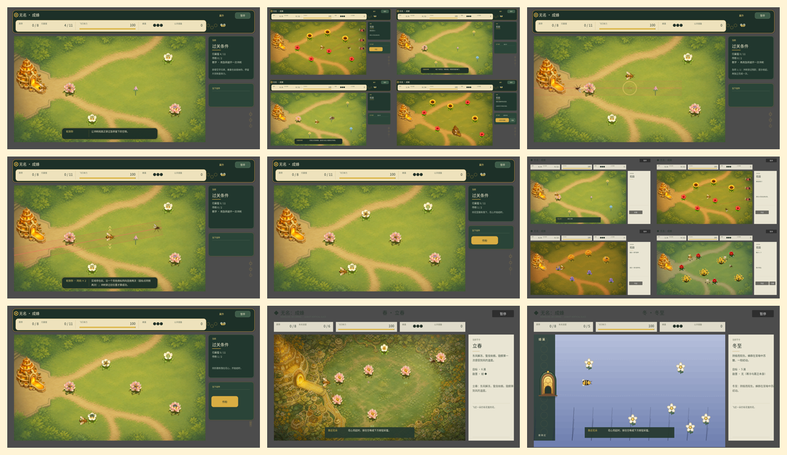

# 画面总览与审阅图集

状态：**2026-08-26 建立并更新。当前没有通过审阅的美术候选。** 本页是查看项目全部主要画面证据的单一入口。每张图必须先看标签：**实机截图、历史实机、生成式概念、宣传构图、失败证据**不能互相代替。v4／v5 地图与海报已被 Alan 正式否决，不再嵌入展示或参与候选比较。

## 1. 先回答：现在是不是总在一屏

是。当前战役只有一张固定 `Main` 花田，玩家在同一个 `1280×720` 视口里的世界矩形活动；没有 `Camera2D` 跟随。24 个节气节点是在同一屏重新布置花、敌害和机制对象，不是 24 张地图。

未来方向是局部镜头跟随 + M／Tab 发现地图；完整结构、数量与生态层见 [`world-season-ecology-framework.md`](world-season-ecology-framework.md)。这项未来方向尚未实现。

## 2. 当前仓库实机画面



这张拼图汇总 `docs/design/screenshots/` 在 2026-08-26 之前的 9 张引擎截图／拼图，其中包含多个历史版本；它方便快速扫视，不代表九张都是当前构建同一提交的状态。

| 画面 | 证据性质 | 用途 |
| --- | --- | --- |
| [春季当前方向审阅基线](screenshots/spring-art-direction-baseline-2026-08-26.png) | 实机开发者快照 | 检查当前固定单屏、旧 HUD、蜂巢、玩家、花和授粉状态同屏 |
| [四组季节玩法](screenshots/seasonal-gameplay-v2.png) | 实机开发者拼图 | 对比同一固定空间里的授粉、袭扰、留种、暖点与 8 种花纹理 |
| [交付／老师傅／中继巢](screenshots/delivery-hud-mentor-relay-v1.png) | 实机开发者拼图 | 检查交蜜、老师傅活动与立夏中继巢 |
| [授粉条件与生态反馈](screenshots/pollination-conditions-ecology-v1.png) | 实机开发者截图 | 检查给粉、携粉、同型柱头、成功／拒绝状态 |
| [急转教学](screenshots/evade-causal-teaching-v1.png) | 实机开发者截图 | 检查锁线和因果示范 |
| [急转成功](screenshots/evade-causal-success-v1.png) | 实机开发者截图 | 检查旧位置、侧移和敌害穿越 |
| [完成条件卡](screenshots/completion-card-no-overlap-v1.png) | 实机开发者截图 | 检查文字不重叠；不代表信息密度已通过 |
| [春季正式资产接入切片](screenshots/spring-launch-slice-v1.png) | 历史实机快照 | 追溯蜂族城邦资产接线 |
| [冬季布艺历史切片](screenshots/textile-art-slice-winter-v1.png) | 历史实机快照 | 已降级画风的实现记录，不是当前方向 |

当前缺口：标题、暂停、成长、完整胜负页、独立 B01 和未来地图页尚未进入这张一页式实机总览，因此不能称为“完整产品全部画面”。

## 3. 当前美术状态：退回前置设计

当前没有“待审地图”或“待审海报”。被否决的两张图只在第 6 节以文本链接保留，不再以内嵌大图占据审阅入口。结构讨论与美术通过必须分开：扩大地图与时间、让蜂巢承担类似篝火的亮点仍可继续讨论；五张地图、十三个主场景、十八种花仍是开发建议，不因失败总览图而自动成为产品定案。

本轮生产顺序固定为：

```text
角色继承表
→ 黑白剪影
→ 三阶明度
→ 有限色主样帧
→ 100% 实机动态
→ 地图／海报
```

其中角色继承必须先恢复此前讨论过的地主蚊子、油葫芦容器怪、三弦鸟精／画眉等个性设定；AI 不得再把它们自动过滤成通用动作或远景剪影。有限色主样帧必须同时约束地图、角色、UI 与未来宣传图的造型语言、艺术抽象、明度阶数、色相家族、边缘、纹理、阴影和光照；未通过实机动态前，不再制作群像海报。

## 4. 后续每轮必须补齐的画面矩阵

| 组 | 最少画面 | 当前状态 |
| --- | ---: | --- |
| 世界鸟瞰 | 1 | 无当前美术候选；旧生成图已否决，结构灰盒未实现 |
| 主场景 | 建议 13 | 数量待确认，无当前画风样板 |
| 节气状态条 | 24 | 有数据，无统一视觉状态条 |
| 季节机制关键帧 | 4 × 3 拍 | 有部分实机，尚未按准备／发生／结果统一 |
| Boss | 4 × 3 态 | 有实机行为；旧拟人设定待恢复，无通过的三联立绘 |
| 主角 | 6 态 | 海报造型已否决；先做继承表与黑白剪影 |
| 主流程 UI | 标题、地图、暂停、成长、胜／负 | 当前未形成完整图集 |
| 宣传图 | 总海报 + 四季 + 蜂巢群像 | 无当前候选；只能从通过的实机主样帧派生 |

## 5. 重新捕捉当前 Main

`godot/tests/art_snapshot.gd` 从真实 `main.tscn` 捕捉画面，不能在 `--headless` 下运行。示例：

```bash
"/Applications/Godot 2.app/Contents/MacOS/Godot" \
  --path /Users/alanthssss/Documents/ChatGPT/nameless-becoming/godot \
  --script res://tests/art_snapshot.gd -- \
  --stage=19 \
  --state=winter_route \
  --output=/tmp/winter-route.png
```

当前显式状态包括 `completion_card`、`drink_honey`、`pollination_ecology`、`dual_carry_sense`、`transfer`、`mismatch`、`mentor_sortie`、`mentor_defense`、`mentor_evade`、`relay_hive`、`tutorial_attack`、`tutorial_success`、`summer_raid`、`autumn_seed`、`winter_route` 和 `boss_window`，另有默认 `tutorial`。它只捕捉 Main，不能冒充全产品自动截图。

## 6. 历史／否决方向

以下图片只用于记住失败原因，默认折叠，避免审阅时误把旧方案当候选：

<details>
<summary>展开历史概念图列表</summary>

- [v4／v5 五地图总览失败证据](concepts/rejected-five-map-world-atlas-overbright-v1.png)：过亮但不干净，色彩脏、对比组织不专业；随机自然细节太多，像照片转手绘只做到一半，没有情绪主句和合理艺术抽象；
- [v4／v5 主海报失败证据](concepts/rejected-key-art-tail-drip-v1.png)：整体偏暗脏，与地图不像同一款游戏；蜜蜂腹端三滴金色液体会被直读成排泄，生态与海报表达都不成立；地主蚊子、油葫芦、三弦画眉等旧设又被降为无身份剪影；
- [明亮局部视口 v4](concepts/spring-bright-hive-checkpoint-direction-v1.png)：只保留“滚动局部视口／蜂巢节点”的产品假设；过亮色彩、纹理与绘制方式已被后续反馈覆盖，不是画风母版；
- [通用手绘花田 v1](concepts/spring-commercial-gameplay-target-v1.png)：太普通，缺少项目身份；
- [蜂族城邦 v2](concepts/spring-commercial-gameplay-target-v2.png)：保留“活的共同体”，不继承过密细节；
- [蜂蜡蚀刻 A](concepts/spring-style-candidate-a-wax-etching-v1.png)、[矿物套色 B](concepts/spring-style-candidate-b-mineral-print-v1.png)、[微缩舞台 C](concepts/spring-style-candidate-c-wax-miniature-v1.png)：三路表现试验；
- [v3 推荐](concepts/spring-style-recommendation-mineral-wax-v2.png)：已因不够干净明亮、线噪与构图不符被否决；
- [冬季剪纸](concepts/winter-cut-paper-direction-v1.png)、[毛毡 v1](concepts/winter-felt-diorama-direction-v1.png)、[毛毡 v2](concepts/winter-felt-diorama-direction-v2.png)、[布艺贴花](concepts/winter-textile-applique-direction-v1.png)：历史材质路线，均非当前推荐。

</details>

这次否决形成永久门禁：花蜜不得从腹端滴落；所有粒子必须说明来源、动作与消失条件；地图、实机和海报必须共享一套渲染母版；干净不等于过曝，情绪不等于压黑；不能服务角色、生态、路线、动作或情绪的细节一律删除。完整规则见 [`ART_IMPLEMENTATION_STANDARD.md`](ART_IMPLEMENTATION_STANDARD.md)，角色旧设继承见 [`character-visual-canon.md`](character-visual-canon.md)。
