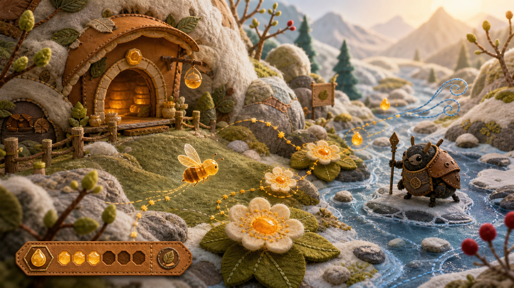
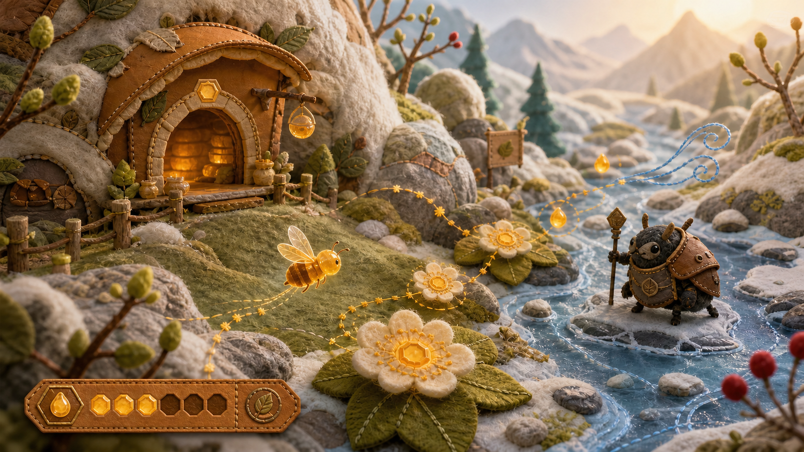
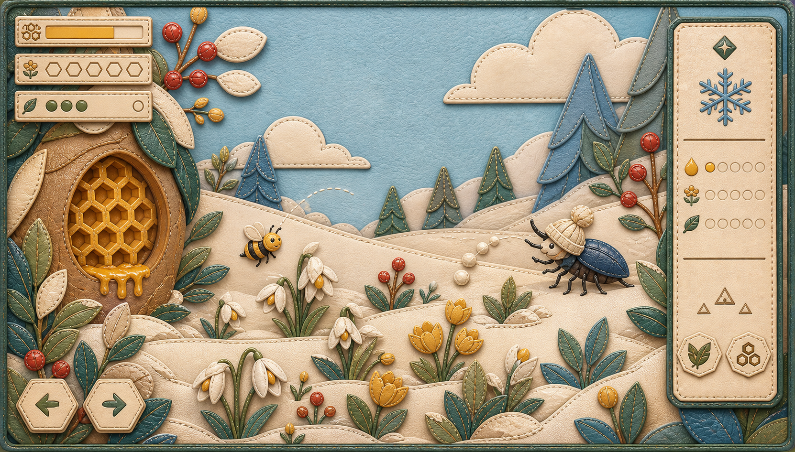
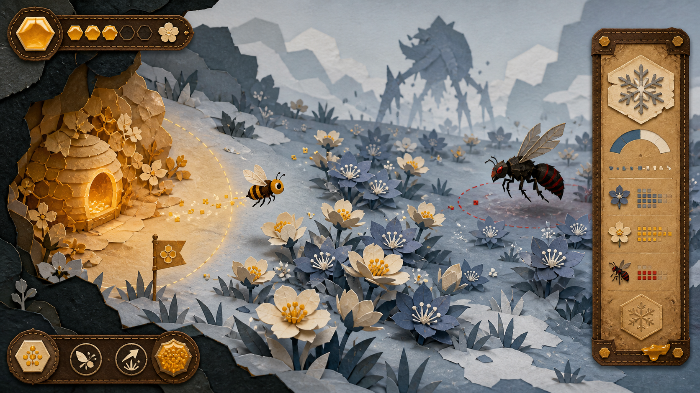
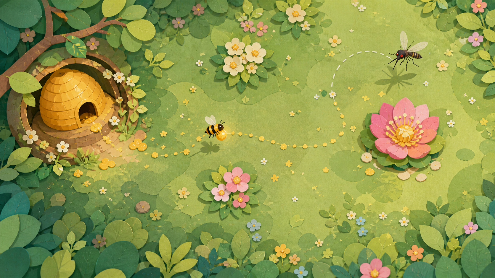

# 正式试玩版视觉与音乐方向 v0.3

状态：四季实机与 8 轨音乐已接入；2026-08-25 授粉视觉模型已纠偏并通过开发者回归，PR #76 秋季探索／Boss 又通过 Alan 最终等响度盲听替换门禁。其余视觉、完整八轨、长期耐循环与实机混音仍待 Alan／独立玩家复核；禁止把自动测试或局部 A/B 外推成整体验收。

## 1. 设计母题

一句话：**一座随四时呼吸的微缩蜂原。**

玩家看到的世界由织物、毛毡、叶脉、蜂蜡和浅色植鞣革构成；蜜蜂、花与失律者保持夸张、清楚、略带幽默的轮廓。危险不靠写实恐怖，而靠比例、节奏、动作和色温变化表达。

### 剪纸候选状态纠正（2026-08-24）

剪纸是早期并列候选之一，现已近乎抛弃，不是主造型方法。2026-08-20 同批生成过毛毡立体场景、缝制布艺贴花与纸片方案，但仓库只留下纸片图，造成决策记录失真。现恢复非剪纸候选并禁止把纸片图作为当前基准。

当前优先比较两条路线：毛毡/织物微缩立体场景，以及更扁平、更易动画化的缝制布艺贴花。两者都必须保持明亮、自然、温暖、有生命力；不得使用黑红祭祀、纸人、符咒、丧葬或民俗恐怖语汇。

## 2. 从 PVZ 借鉴什么

借鉴：

- 一眼可辨的轮廓；
- 造型直接说明行为；
- 可爱与危险同时成立；
- 少读文字也能理解；
- 动画强调蓄力、命中、恢复；
- 音乐随战况加层，而不是频繁换歌。

不借鉴：

- 植物/僵尸的具体比例、五官与表情；
- 草坪格子、卡槽、阳光资源等界面结构；
- 原曲旋律、和声进行、标志性 theremin/音色组合；
- 文案语气、角色命名和笑点。

## 3. 视觉系统不是只有颜色与材质

正式美术需要同时确定以下维度：

| 维度 | 本项目建议 |
| --- | --- |
| 轮廓语言 | 蜂与花圆润、敌害尖锐或失衡；Boss 轮廓先于细节可辨 |
| 比例 | 玩家蜂头胸腹夸张，翅膀承担速度；Boss 比普通敌害至少大 1.8 倍 |
| 视角 | 维持侧俯视单屏，所有交互热点落在清楚平面层 |
| 边缘 | 主体使用织物贴花切边；柔软生命用圆弧，失律者用断裂/偏心轮廓 |
| 材质 | 环境织物/毛毡、生命与能量蜂蜡、蜂群设施/UI 植鞣革、运动轨迹刺绣；单个对象必须有主材质 |
| 明暗 | 蜂巢偏暖亮，远花偏高彩，危险区压暗但不丢轮廓 |
| 纹理密度 | 背景低、可交互物中、Boss 高；避免全屏同等颗粒 |
| 描边 | 深色非纯黑描边，粗细随层级，不采用统一像素黑边 |
| 动画语法 | 6～10 帧关键姿态、明显预备动作、短暂夸张形变、快速回稳 |
| 表情/拟人 | 保留昆虫结构，只在眼神、触角、姿态上拟人，不做人形蜂 |
| 图标 | 优先蜂巢、翅、蜜滴、花粉等世界内符号，避免通用科技 UI 图标 |
| 字体 | 标题偏宋/刻印感，数值与操作保持高识别；不牺牲中文 Web 字形覆盖 |
| 特效 | 花粉、蜜滴、纸屑、蜡光四类基础粒子统一构建反馈 |
| 可访问性 | 关键状态同时使用颜色、形状、运动和文字，不能只换季节色 |

## 4. 织物、蜂蜡、皮革与刺绣如何取用

### 织物与毛毡：环境主材质

- 负责地形、积雪、云、叶片和远景，以纤维方向区分风与季节；
- 优点是温暖、有生命感，冬季也不会因纸张阴影产生祭祀或焦枯联想；
- 风险是全屏柔软导致碰撞边界模糊，可交互物必须以轮廓、蜂蜡高光和运动补足。

### 蜂蜡：生命与能量材质

- 负责玩家蜂、蜂蜜、可采花心、奖励与季节能量；固态蜡偏哑光，薄蜡可透光，液态蜜负责流动反馈；
- 蜂蜡是本作的识别性材质，但不能铺满环境，也不能呈现为塑料或糖果；
- 发光强度表达交互价值与状态，常态不滥用高亮。

### 植鞣革：蜂群文明与界面结构

- 负责蜂巢设施、HUD 承载面、图鉴、装备和暂停层；
- 使用浅色植鞣革、窄包边、压印与少量缝线，避免深棕旧账本质感；
- 蜂群制造、储存及资源系统中的规则多边形统一使用正六边形；自然物与液滴不强行六边形化。

### 刺绣：运动与联系

- 负责飞行轨迹、风向、花粉传递、归巢路线和警戒提示；
- 刺绣线只在信息成立时出现，不能退化为常驻装饰花纹。

### 像素：辅助数字纹理

- 可用于节气刻度、小图标、花粉闪烁、轨迹采样点；
- 不作为人物主风格，除非未来做完整低分辨率原型并重新制定尺寸、动画帧率、字体和摄像机规则；
- 禁止把高分辨率角色简单套像素滤镜来伪装成完整像素风。

## 5. 四季造型与色卡连接

| 季节 | 五行 | 五音中心 | 造型倾向 | 材质变化 |
| --- | --- | --- | --- | --- |
| 春 | 木 | 角 | 向上、分枝、萌芽、展开 | 纤维清晰、嫩叶毛毡、边缘湿润 |
| 夏 | 火 | 徵 | 放射、膨胀、热浪、群聚 | 高彩织物、蜂蜡变软、纤维舒展 |
| 秋 | 金 | 商 | 切割、收束、下垂、结籽 | 少量金属箔、干燥织纹、边缘锐利 |
| 冬 | 水 | 羽 | 包裹、回旋、凝结、留白 | 半透明蜡层、冷色毛毡、霜粒覆边 |
| 蜂巢/季间 | 土 | 宫 | 中心、承载、层叠六边形 | 蜂蜡、浅色植鞣革、压纹织物 |

### 5.1 当前实机的可读实体与花型映射（2026-08-24 构建快照）

底图统一使用清晰、低噪的 `spring_field_v2.png`，夏、秋、冬通过光线、热纹、落叶和霜层改变氛围。蜂巢、角色、花和机制实体均从背景拆出，使用独立可运动层；背景不再烘焙大蜂巢、大花、单位、圆环或 UI。

| 玩法组 | 两种花型 | 不靠文字的机制实体 |
| --- | --- | --- |
| 春／授粉（已否决） | 白色单瓣春花、粉色重瓣授粉花 | 旧构建的实体雄蕊、蜂腿花粉、闭合→展开花苞；仅作历史快照，不再是目标方案 |
| 夏／袭扰 | 木槿、向日葵 | 有翅劫掠者、移动偷蜜路线、赃蜜返回 |
| 秋／留种 | 紫菀、菊花 | 最后一滴前暂停、饱满种核、成熟种头或破裂种荚 |
| 冬／暖点 | 山茶、蜡梅 | 蜂蜡灯体、逐个点亮、蜂群抱团与远端路线恢复 |

这里的核心规则不是“每季换一层颜色”，而是玩家必须看见一个实体经历前置、行动、结果。此前用来表示目标的常驻空圈已经退出四季机制；寻迹范围、冲锋线等临时动作信息可在动作成立时短暂出现。

蜂巢入口、碰撞边界和归巢落点统一到左侧同一锚点。蜂群先用侦察、采蜜、守卫三类角色蜂表现同一物种内部的分工，不增加没有独立操作与资源取舍的新物种；是否需要新蜂种，等角色分工在实际运动中仍不可读时再评估。

### 5.2 授粉视觉的已批准替代模型（2026-08-25，实现状态以最终回归为准）

Alan 直接复核指出：关卡完成条件不清楚；授粉目标被隐藏，显示后又与普通花近乎同形；“携粉碰花苞 → 花开并回蜜”也不符合已批准的生态因果。这是 Alan 对当前构建的直接反馈，不是独立外部玩家证据；外部玩家证据仍为 0。

> **已开放的花药 → 蜜蜂身上松散可见的花粉 → 同一可见花型的可接受柱头 → 结籽。**

| 阶段 | 视觉要求 | 禁止表达 |
| --- | --- | --- |
| 给粉花 | 整朵花已开放；花药以外展轮廓、粉质质感与轻微散落说明“可取粉” | 用闭合花苞、空圈或仅有文字标签代替花药 |
| 蜜蜂携粉 | 花粉以松散颗粒附在身体多个接触面，飞行时有少量脱落，让玩家在运动中看出“已取粉” | 只显示背包图标，或把花粉做成蜂腿上一块不变的色斑 |
| 受粉花 | 与给粉花共享明确的花瓣／花型身份，但柱头用与花药不同的中心轮廓、受粉姿态与表面反光表达“可接受”；从关卡开始起可见 | 隐藏后才生成，或让柱头与花药同形只换小色点 |
| 成功授粉 | 柱头出现已受粉状态，随后由种房或种子轮廓表达“进入结籽” | 花瓣瞬间打开、花蜜发光回满，或当场生成一朵新花 |

兼容性要通过“同一可见花型”让玩家预先规划，器官角色则通过“开放花药 vs 可接受柱头”不同形辨认。寻迹可以增强已存在的线索，但不得决定授粉目标是否存在。

完成条件与世界反馈必须互相校验：若结籽会阻止关卡结算，HUD 从关卡开始起显示独立的“结籽 `x/y`”，世界中每个已结籽实体与数字一一对应；若结籽不是必做项，则不得暗中拦截结算。最后一项已列条件达成时必须立即出现结算反馈。

## 6. 音乐系统

### 6.1 五音不是五个西方大调标签

宫商角徵羽首先作为五声音阶中的结构与主音重心。可以借用固定音级关系（宫、商、角、徵、羽），但不把传统对应机械等同于某个西方 key。每季通过主音、句尾落点、节奏密度、音域和配器形成性格。

### 6.2 已实现的 8 首编曲

8 首共享 `C-D-E-G-A` 五声音高场，以春 E、夏 G、秋 D、冬 A 作为句尾重心，归巢可回到共同的 C；共享动机不等于共享伴奏。每首使用独立整数小节结构与编曲：

| 音轨 | BPM／拍号 | 风格、情绪与听觉特征 | 玩法用途 |
| --- | --- | --- | --- |
| 春·探索 | 104／4-4 | 木质室内民谣；`3+3+2` 分枝脉冲、开放句尾，短笛式转音只在句间掠过；轻快、好奇、向上 | 找开放花药、身上携散粉、给同型花柱头授粉结籽 |
| 春·Boss | 148／4-4 | 翅拍 breakbeat、截短的春季终止式、短促 flam 军鼓；敏捷、紧迫、不拖沓 | 蚊吸取后的短暴露与调律窗口 |
| 夏·探索 | 116／4-4 | 切分 funk、短促 clav／闷音、问答动机与更明确的 bass 拨弦；热、忙、群体协作 | 劫掠蜂出现、偷蜜、逐只惊退 |
| 夏·Boss | 172／4-4 | stop-time punk；高速鼓组推进后突然抽空，笛式音色只在停顿后作标点；冲动、粗粝 | 蟋蟀跳跃—落地—停顿的节奏 |
| 秋·探索 | 124／4-4 | 16 小节 amber-circuit electro-funk；K 的半拍低音、阶梯 hook 与问答骨架贯穿全段，Q 只留下开头两处稀疏 seed pickup，每四小节有明确呼吸 | 松手看种核，再决定采尽或留种 |
| 秋·Boss | 128／4-4 | 16 小节 post-punk dub 诱引骨架；Z 全程存在并在 9 小节完整主导，T 只在 7 小节作 stop-time industrial 反句／末段收束，dub 回声使用有限 tap | 寻迹区分真身与假回声 |
| 冬·探索 | 108／6-8（附点四分音符=72） | 温暖稀疏脉冲、明确静默与两次箫式气息；寒冷、克制、互相支撑 | 体温下降、逐个点亮蜂蜡暖点 |
| 冬·Boss | 96／4-4 | half-time rock，重拍按“冲锋—静默—碰撞”组织；沉重、坚定 | 熊冲锋、撞暖花与暴露窗口 |

其中 funk、punk、post-punk／dub 和 half-time rock 是为了让四组身体节奏真实分开，不是给原有缓慢和弦换流派标签。春探索／Boss、夏探索／Boss等成对保留短动机亲缘，但鼓点、速度、拍号或停顿结构必须足以承担不同局面。

第三轮编曲统一补强 kick 起音、flam snare、开／闭 hi-hat、写定 bass 线和短促高八度拨弦瞬态；这些声部必须有休止，不能重新形成持续“呜呜”底。民乐元素只作为少量合成手势：春探索笛式转音约占 4.4% 时长、夏 Boss 笛式标点约 2.6%、冬探索箫式气息约 6.9%。旧秋探索约 8.6% 的二胡式滑音因“猫叫”错读和后续 A/B 否决已退出正式版本；PR #76 秋探索不再使用该手势。它们不是采样或真实器乐录音。

### 6.3 当前音乐状态接线

- 普通节点播放所属玩法组的探索母带；四个 Boss 分别播放对应 Boss 母带；
- 归巢保留当前探索主题，仅降低音量并轻微柔化，不切回另一首 Boss 音乐；
- Boss 调律进度只改变存在感，不再用全局降调制造“逐步恢复”；8 个母带均按写定速度和音高、`pitch_scale = 1.0` 播放；
- 当前交付是 8 个完整循环 WAV，不是四层可独立混音的 stems。此前提出的采集／危险／归巢动态分层仍是后续候选，不得描述为已实现。

### 6.4 “一直呜呜响”的根因与修正

旧生成器同时做了三件会堆叠低频的事：根音低八度 pad 保持超过一个小节；`string` 振荡器额外混入 `sin(phase × 0.5)`、即基频一半的人工次谐波；Boss 播放统一使用 `pitch_scale = 0.94`，把整轨连速度一起压低。因此听到的不是一个神秘和弦，而是常驻低八度、半频次谐波和全局降调叠加后的持续低频占位。

新生成器删除所有 `0.5×` 振荡器成分，不再铺常驻三和弦 pad，低音改为有起音、收音和休止的写定音符；Boss 保持原速原调。蜂巢模式仍可小幅柔化探索音乐，但与旧 Boss `0.94` 降调不是同一机制。

### 6.5 自动分析与证据边界

8 轨均为 44.1 kHz 双声道、整数小节渲染，时长 22.326～30.968 秒。自动分析从每轨采样 64 段 4096 点 Hann FFT，得到：

- 频谱质心：428～994 Hz；
- 40～250 Hz 能量占比：旧版 64.4%～91.5%，本版 15.8%～57.6%；低中频持续占用率：旧版 8 轨均为 100%，本版 17.2%～59.4%；
- 活跃动态范围：3.64～11.00 dB；
- 同季探索／Boss 频谱余弦相似度：旧版 0.949～0.970；本版春 0.622、夏 0.811、秋 0.777、冬 0.614，均低于 0.92 回归门槛；
- 循环接缝：8 轨均为 -120 dBFS；自动回归全部通过。

这些数字只能证明文件不是同一轨复制、旧持续低频没有按原结构复发、循环和格式符合技术门槛。PR #76 最终 A/B 另行证明 Alan 在探索与 Boss 两组均选择新版秋季候选，但不能说明选择理由，也不能替代四组气质配对、长期耐循环、游戏内混音或外部玩家盲听。

## 6.6 交付界面与世界角色的统一语法（2026-08-24）

- 顶部、右侧情境卡、暂停入口和底部教学条统一使用深苔色外壳、蜂蜜金状态、蜂蜡内托盘与低对比植鞣革边线；不再把三个白色表格卡和一块办公侧栏拼在世界外面。
- HUD 只保留资源、飞行状态、蜂巢状态、当前唯一动作，以及所有会阻止结算的条件和各自进度。世界反馈能表达的季节、节气、敌害状态不回流为长篇说明；但“世界里能看见”不能成为隐藏结算门禁的理由。
- 老师傅复用玩家蜂的角色化大形与材质语法，用银灰翼与靛青标记作次级身份差异；不得把“写实昆虫加滤镜”继续当作轮廓目标，也不得靠帽子、人脸或人类身体制造廉价拟人。中继巢复用低重心主蜂巢的包裹／承载语法，缩小、压暗并配独立落脚区；两者都必须通过姿态、运动和生活痕迹表达角色，而不是引入另一套贴纸语言。
- 1280×720 仍是 HUD 的参考画布；PR #65 已接入等比安全框，并用自动回归覆盖 1920×1080、1440×900 与 1024×768。该实现不是任意宽高比的世界重排或手机正式适配，真实原生触屏与未覆盖系统缩放仍需设备验证。

## 7. 下一轮人工验证要求

首轮“单画面＋单音乐状态转换”要求已经被本轮四季实机和 8 个母带覆盖；下一道门禁不再是继续生成数量，而是人工判断：

- 在 1280×720、100% 缩放和真实运动中，分别指出蜂巢、普通花、高价值花、危险与季节机制实体；
- 不用寻迹、不看教学文字，指出同一可见花型的开放花药与可接受柱头，并通过身上散粉和结籽状态复述完整授粉因果；
- 开局后不操作，请玩家复述所有会阻止结算的条件；达成最后一项后检查结算反馈是否立即出现；
- 隐去季节名，让玩家按花型、环境运动和行为说出四组差异，不要求说出文化术语；
- 盲听 8 轨，记录同季探索／Boss区分率、四组气质配对、最不舒服的音色和耐循环时长；
- Alan 的画风与音乐审阅、外部玩家可读性测试分别记录，不能互相冒充。

## 8. 2026-08-20 候选图恢复与重新定级

以下三张非剪纸候选曾与纸片图在同一轮生成，但当时没有提交进仓库。恢复它们是为了还原选择过程，不等于已经选择其中一张。

### A. 毛毡微缩立体场景

优势：温暖、有生命力、蜂巢和自然环境的空间关系强。风险：细节密度与制作成本高，需要简化为可动画、可复用的模块。

### B. 缝制布艺贴花

优势：轮廓清楚、材质统一、较易拆成 2D 动画层。风险：过度平整时会像儿童布书，需要用光影、动作与生态细节提升年龄感。

### C. 纸片方案（淘汰候选）

状态：近乎抛弃，仅保留为历史比较材料，不得作为当前资产生产基准。

## 9. 2026-08-24 春季纸艺图（错误延续，已停用）

本图源于错误的剪纸主方向记录。它未接入游戏，现停止使用，仅作为“错误决策如何被延续”的归档证据，不得作为 Steam 截图、当前概念图或后续生成参考。
