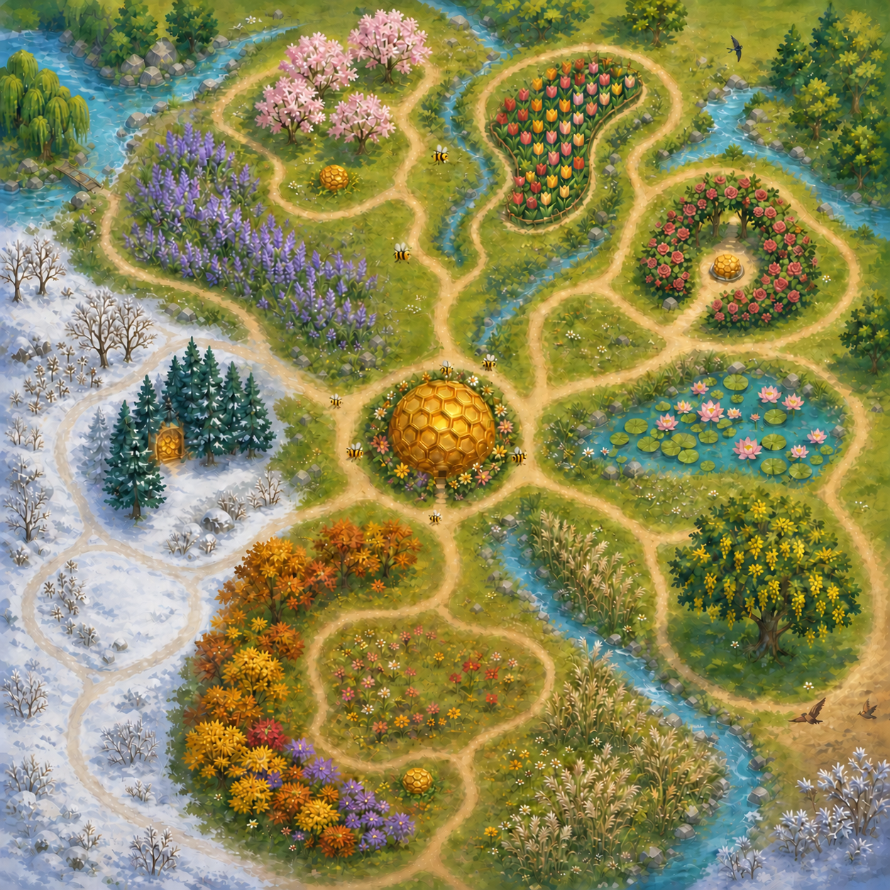

# 世界、四季生态与 IP 美术框架 v1

状态：**2026-08-26 产品／美术方向决定，尚未实现。** 本文回答地图、场景、季节、节气表达、花卉名册、季节玩法泛化、网络趣味、角色 IP 与关键海报的统一结构。当前构建仍是同一张固定单屏花田；本文中的长地图、镜头、地图页、花卉资产、角色立绘和新节点服务均不得写成已经进入游戏。

## 1. 一句话结论与数量

> 做 **1 个连续家园、5 张可加载地图、13 个主场景、4 季、24 个节气状态、18 种可辨花卉身份**；只让 12 种花承担完整玩法状态，其余 6 种作为顺义花展／园林地标。四季共享基础操作，但各自保留一个不能被别季替代的完成动词。

| 层级 | 决定数量 | 准确定义 |
| --- | ---: | --- |
| 世界 | 1 | 一个受顺义湿地、鲜花港、花博会主题公园与北京近自然绿地启发的虚构蜂群家园 |
| 可加载地图 | 5 | 1 张中央主蜂巢地图 + 4 张相连的野外地图；这是生产／加载边界，不是五个互不相干的世界 |
| 主场景 | 13 | 主蜂巢 1 个；每张野外地图 3 个有独立生态构图与地标的场景，共 12 个 |
| 功能分区 | 20 | 每张野外地图复用 5 种布局职责：巢口、低险、机制分路、高险收益、当季高潮；它们不是 20 套独立美术 |
| 季节 | 4 | 春、夏、秋、冬；蜂巢是跨季共同体，不增加“第五季” |
| 节气状态 | 24 | 每个节气是一组物候、天气、光线、路线和生态活动参数，不制作 24 张地图 |
| 花卉身份 | 18 | 12 种完整交互花 + 6 种景观地标花；同一植物可跨季延续，不能硬切换 |
| 蜂巢地标 | 5 | 1 个主蜂巢 + 每张野外地图 1 个次级蜂巢节点；主次功能严格不同 |

该图由 Codex 内置图像生成／编辑工具制作，是**生成式世界结构实验**，不是地图文件、实机截图、正式资产或已经验证的路线。它只锁定“中央家园 + 四向野外 + 每区三组生态场景 + 主巢最强地标”的读取方法；花朵密度、路径长度、节点位置和地图比例仍须在灰盒里重算。

## 2. 当前为什么总在一屏，以及以后怎样看全地图

### 当前实现事实

- 战役只有一张 `Main` 花田，世界边界固定在 `Rect2(34, 146, 970, 538)`；
- 玩家被限制在这块矩形内，主场景没有 `Camera2D`；
- 24 个推进节点只在同一块花田重生成花、敌害和机制对象；它们不是 24 张地图；
- 当前截图工具能捕捉 `Main` 的 17 个预设状态，但尚未覆盖标题、暂停、成长、全部胜负页和独立 B01，因此还没有“一键穷举全部产品画面”。

### 未来玩家查看方式

1. **正常游玩是局部镜头。** `1280×720` 继续是视口，镜头跟随玩家并在移动方向留少量前视；地图不再被压缩进一屏。
2. **M／Tab 打开发现地图。** 单机中全屏暂停，显示已走过的区域、主蜂巢、已激活蜂巢节点、当期生态事件和玩家位置；未发现区域只显示柔和轮廓，不泄露花、敌害或 Boss。
3. **不常驻完整小地图。** 常驻角落只保留回家方向、当前携带和危险预告；需要整体判断时主动展开地图，避免新 UI 再次占满上侧和右侧。
4. **地图页不等于传送页。** 首轮原型中查看地图不改变位置；快速传送、退出续玩和复活仍是单独决策，不能从“像篝火”自动推出。

### 制作与审阅方式

统一从 [`visual-atlas.md`](visual-atlas.md) 查看三类证据：当前实机截图、被否决／历史概念、当前结构与宣传方向。后续每次评审只更新一页：

- 1 张完整鸟瞰图；
- 13 张主场景缩略图；
- 24 节气状态条，不为每个节气伪造一张独立场景；
- 4 个季节机制关键帧、4 个 Boss 暴露帧、标题／暂停／成长／胜负等 UI 状态；
- 所有图片必须标记“实机、灰盒、概念或宣传构图”，不能混成一组冒充完成度。

## 3. 五张地图与十三个主场景

四张野外地图是同一主蜂巢周围的四个方向性生态区。它们各有一个最强活跃季，但在相邻季仍可回访；这样才能看到花谢、结籽、枯茎、积雪与再萌发，而不是四张互不相干的季节皮肤。

| 地图 | 3 个主场景 | 生态与视觉主句 | 当季玩法职责 |
| --- | --- | --- | --- |
| 中央主蜂巢 | 蜂巢内外共同体（1 个） | 储蜜格、育幼暖光、修补、卸蜜、守卫换班和蜂流随 24 节气改变 | 唯一完整交蜜、节点结算、季间成长与叙事家园 |
| 北／春 · 湿园 | 早花湿地、山桃花林、郁金香台地 | 水位回升、柳枝展开、早花从低处向外连成路 | **连接**：花药 → 蜂身散粉 → 同型柱头 → 结籽 |
| 东／夏 · 风廊 | 月季长廊、百合／湿地地标、荆条藿香旱热坡 | 开放、高亮、风路和敌害入口形成双前线 | **中断与回防**：远花收益和守巢时机互相抢占 |
| 南／秋 · 种坡 | 菊／紫菀花海、百日菊波斯菊种原、露水苇草归途 | 花量下降，种子、风和露水把视线向内收束 | **放弃与留种**：最后一滴迫使玩家决定带走还是留下 |
| 西／冬 · 霜林 | 休眠河岸、常绿防风林／蜡梅暖窗、裸露霜雪归途 | 大片安静负空间、枯茎方向和蜂群聚拢替代花海 | **接力与抱团**：用有限储蜜逐段建立暖路再归巢 |

每张野外地图的 5 个功能分区固定为：

1. 主巢口／进入区：给方向和当期生态预告；
2. 低险区：复习基础采集与当季动词；
3. 机制分路：两条路线形成真正的顺序或返程取舍；
4. 高险收益侧袋：高价值资源和撤离风险同时提高；
5. 当季高潮区：复用该季地标失律化，不另造一张无关 Boss 世界。

## 4. 蜂巢怎样承担类似篝火的作用

本文不给它另起简称。第一轮结构原型采用 **1 主 + 4 次**：

- **主蜂巢**：完整交蜜、节点结算、季间成长、蜂群叙事和长期状态只在这里发生；它是真正的家。
- **次级蜂巢节点**：每张野外地图最多一个，只提供远处导航、短暂安全、有限休整和已发现地图信息；不自动交蜜、不结算、不快速传送、不刷新敌害，也不替代冬季暖点。
- **视觉层级**：主蜂巢至少在尺寸、蜂流、亮房数量、声音与入口活动上比次级节点高一档；次级节点不能像五个等价的家。
- **生态说明**：现实蜜蜂是以蜂群巢穴为中心的采集者。次级节点属于游戏化夸张，世界观应明确为蜂群维护的临时蜡房／旧巢庇护点，不能在图鉴中冒充真实蜂群会普遍经营多个等价主巢。
- **仍待灰盒验证**：有限休整究竟恢复多少、是否消耗公共储备，以及当前 Q 归巢在长地图中保留、限距还是改写。未验证前不加入持久存档、复活或传送。

## 5. 二十四节气与阴阳消长

节气不能只换色，也不能靠巨大阴阳图和标题解释。采用三层同步表达：

| 层 | 阳增长时 | 阴增长时 |
| --- | --- | --- |
| 地图构图 | 路径向外分枝、视野打开、远区活动增加 | 路径回卷、遮蔽和安静空间增加、路线向巢与庇护点聚拢 |
| 自然生态 | 萌动、开花、访花、争夺和远行逐渐增多 | 结籽、迁回、露霜、落叶、蛰伏和蜂群结团逐渐增多 |
| 蜂群活动 | 蜂流外放、巢门交换频繁、育幼和修补向外展开 | 蜂流内收、储蜜格与保温动作集中、声音和动作密度降低 |

阴不是失败，阳也不是奖励；它们是扩张与收束的两种生存组织方式。

### 抽象象征：二十四格蜂巢环

可以做抽象象征，但只作为生态变化的总结，不代替生态本身：

- 外圈恰好 24 个蜂房格，对应 24 节气；当前格点亮，不出现数字和节气大字；
- 两条不闭合弧围绕中心种核：暖琥珀弧向外展开，冷蓝紫弧向内收束；缺口始终给出“家”的方向；
- 春分／秋分两弧相衡，夏至外展最大，冬至内收最大；失律时弧线打结、逆流或闭死，调律后重新打开；
- 只进入蜂巢入口、地图／暂停页、节气转场、季末高潮和海报，不做常驻巨型 HUD；
- 这是描述性名称，不给它另编一个世界观怪名。

北京绿地物候研究表明，同一物种初花时间会随地点与城市热环境变化；因此节气应定义“窗口和趋势”，不应把每朵花锁死在公历某一天。

## 6. 十八种花：花展地标与蜜蜂资源分开

数量决定为 **18 种可辨美术身份**：12 种做完整交互状态，6 种只做场景地标。这样既能读出顺义地方性，又不会让单人项目为每一种展陈花制作开放、采集、枯竭、授粉、结籽、风雨和四季状态。

### 12 种完整交互花

| 花卉身份 | 主要出现窗口 | 玩法位置 | 生态／制作边界 |
| --- | --- | --- | --- |
| 二月兰 | 3 月下旬—4 月下旬 | 春季低强度恢复性花海 | 顺义汉石桥有明确花期记录；适合早春群落，不画成高价值单株 |
| 连翘 | 3 月下旬—4 月 | 春季短花期授粉走廊 | 访问密度影响后续结实，可表现风雨压缩窗口 |
| 山桃 | 3 月下旬—4 月 | 早春高价值爆发窗 | 花期短，降温和风雨改变可用时段 |
| 风信子 | 4 月—5 月 | 春末紧凑补给点 | 能提供花蜜／花粉；保持真实花序，不与葡萄风信子混型 |
| 开放花心月季 | 5 月—10 月 | 夏秋跨季长线补给 | 与重瓣景观月季明确分型；不能把所有月季都写成优质蜜源 |
| 荆条 | 6 月—8 月 | 盛夏耐旱主蜜源骨架 | 北京适生／华北研究依据，不冒充鲜花港专属花卉 |
| 藿香 | 6 月—9／10 月 | 芳香型夏季长线资源 | 可用风、湿度和遮阴改变产量 |
| 百日菊 | 5 月—9 月 | 夏秋通用停靠花台 | 开放花盘适合多类访花者；后期进入留种状态 |
| 波斯菊 | 夏末—秋季 | 秋季种原和风路 | 花盘清楚、结籽反馈强，承担跨季过渡 |
| 宿根鼠尾草 | 5—6 月、修剪后 9—10 月 | 花筒与访花者匹配／复花窗口 | 不同品种花筒和糖量不同，不能只按颜色判价值 |
| 开放花盘菊花 | 8 月—11 月 | 越冬前最后一轮储备 | 与重瓣展菊分型；开放花盘和花密度影响访问 |
| 蜡梅 | 12 月—翌年 3 月 | 偶发暖日气味信标／稀有事件 | 北方深冬多数时间结团，绝不能承担稳定冬季采蜜经济 |

### 6 种场景地标花

| 花卉身份 | 主要出现窗口 | 只承担什么 |
| --- | --- | --- |
| 郁金香 | 3 月下旬—5 月 | 鲜花港式春季视觉时钟、远处路线地标；不预设为主蜜源 |
| 葡萄风信子 | 3 月下旬—4 月下旬 | 春季台地边缘的蓝紫色节奏带 |
| 百合 | 6—7 月 | 鲜花港式盛夏视觉锚点；没有本地证据前不设高补给值 |
| 重瓣大花月季 | 5—10 月 | 花博会主题公园式长季景观焦点；与开放花心资源型分开 |
| 重瓣展菊 | 9—10 月 | 秋季节庆／高潮构图，不把重瓣密集花盘当优质蜜源 |
| 马鞭草 | 夏末—秋季 | 秋季远景色带、风和种子方向提示 |

现实花期有重叠：月季、百日菊、波斯菊和鼠尾草会跨越人为季界。游戏中应让上一季的花逐步衰退、下一季的花逐步接管，而不是过关后瞬间全场换花。鲜花港冬季年宵花属于温室展销；除非未来明确增加温室地图，否则兰花、多肉、仙客来等不能算户外冬季蜂源。

## 7. 四季玩法要深绑定，但只绑定“完成动词”

答案不是全锁死或全泛化。采用 **70／20／10** 的内容预算：

- 70% 是该季独有的路线结构、完成动词和高潮；
- 20% 是相邻季的预告或后果，让生态连续；
- 10% 是所有季节共享的飞行、采集、寻迹、急转、携带、体力与归巢语法。

原则是：**泛化基础操作，不泛化胜利条件。**

| 季节 | 独有完成动词 | 必须改变的地图决策 | 可以外溢到别季 | 不能泛化的部分 |
| --- | --- | --- | --- | --- |
| 春 | 连接 | 给粉花和同型柱头分居不同路线，迫使配对和折返 | 其他季可看见花粉、结籽和简单授粉反馈 | 不能让四季都成为同色配对作业 |
| 夏 | 中断／回防 | 首次卸蜜后袭扰进入，远花收益和回防时机互相冲突 | 其他季可有偷蜜或危险预告 | 只有夏把卸蜜时机和航线清空设为主门槛 |
| 秋 | 放弃／留种 | 最后一滴前停采，采尽或留下会永久改变该地块 | 晚夏可预告种荚，初冬可看到留下的种核 | 不能让所有资源都附带道德化二选一 |
| 冬 | 接力／抱团 | 有顺序地点亮暖路，远行依赖前一段安全岛 | 其他季有体力、天气和普通休整 | 通用蜂巢节点不能替代冬季暖链或免除其资源成本 |

这样做的好处是玩家只学一套操作，却能明确复述四种不同的季节经验；坏处是每季都要有真实地图后果和独立高潮，不能只复用数值。首轮只做春季 `2×2` 视口灰盒验证，再复制到其余三季。

## 8. 拟人化、个性化与 IP 识别

此前“不要廉价拟人”不能继续被执行成“所有拟人化都禁止”。正式规则改为：

> **真实物种骨架 + 一个生态事实 + 一个玩法动词 + 一个性格矛盾 + 一个可循环反应。**

允许：比例与轮廓夸张、明确眼神方向、触角手势、口器／后腿／尾羽的表演、翅缘磨损、负重姿态、群体关系和固定动作节拍。

避免：完整人类身体、整套职业服装、随便戴帽子、把人类脸直接贴到昆虫上，以及与生态／玩法无关的装饰堆叠。目标不是“写实昆虫加表情”或“人穿昆虫皮”，而是能从行为一眼认出角色。

### 主角固定识别点

- 左触角末端轻微内卷，右触角向目标外指；
- 右前翅后缘有一个小缺口，淡青透明翼；
- 蜜黄／炭黑主色，后足花粉筐在负载时显示暖橙；
- 招牌姿态是“身体朝家，眼神与一根触角仍回望远花”；
- 空载、携蜜、携粉、低体温、急转、归巢六态必须保持同一剪影身份。

### 首批稳定角色控制在 8—10 个

主角、老师傅、侦察／采蜜／守卫三类同种工蜂、蚊、油葫芦、画眉、熊，再预留蚁作为普通生态角色；不为 24 节气各造一只吉祥物。蚊和油葫芦主要是物候／行为寓言，图鉴不能冒充真实捕食关系。

每个角色进入生产前做四个测试：黑色剪影可认、三色缩略可认、32 px 图标可认、软周边化后不靠文字仍可认。若拿掉名字和场景就认不出，则还不是 IP 角色。

## 9. 网络趣味怎样做得好笑又不过时

借用的是《小丑牌》那类“基础规则简单、意外组合能产生可分享瞬间”的传播思路，不复制其牌面、台词或网络梗。网络趣味分两层：

- **80% 正史层**：无字也能懂的贪心、超载、假装没事、导航重算、起床气、集体沉默和有人等你回来；这些动作永久属于角色。
- **20% 可替换传播层**：低频字幕、节日文案、社区配字和短视频音频独立于核心规则，热度过去可以替换，不改角色设定和存档。

可用的原创反应模板：

- 主角满载仍回头：“再采一朵就回。”
- 守卫蜂接货：“你先交蜜，我核一下。”
- 油葫芦落地僵住：“一切都在计划中。”
- 蚁线路被打断：“路线重算中。”
- 蚊吸饱下坠：“不是针对你，我对谁都吸。”
- 熊遮住归途：“再睡五分钟。”

这些句子只用于低频反应和运营素材，不能进入新手教学、强制反复播放或替代玩法反馈。每个角色优先制作 1—2 秒透明背景反应循环和一个清楚停顿帧，给玩家配字空间；不引用第三方表情包造型、热歌歌词、明星或商标梗。

## 10. 关键立绘、海报与闪光时刻

该图由 Codex 内置图像生成／编辑工具制作，是**宣传构图与角色识别实验**，不是最终商店胶囊、角色资产或实机镜头。它验证主角—家—远花的三角主句、四季环、活的蜂巢共同体、四位失律者剪影和二十四格蜂巢环能否共处；蜂的后足负载、转身弧线、具体物种比例和画面微细节仍须在正式角色设定表中纠正。

首批宣传资产顺序：

1. 主海报“满载仍回望”：标题页、商店首图和项目总叙事；
2. 四张季节海报：连接、回防、松手、接力各自只有一个视觉主句；
3. “有人等你回来”蜂巢群像：突出共同体与周边角色；
4. 四位失律者常态／失律／调律后三联立绘，不做普通愤怒头像；
5. 主角六态和老师傅／三类工蜂分工组图，直接服务头像、图鉴、表情和周边。

必须捕捉的实机闪光时刻包括：蜂身真实载粉、同型柱头结籽、第一次卸蜜点亮巢房同时触发夏季袭扰、秋花最后一滴前停手、留下的种核在归巢后成熟、第一个冬暖点打开下一段路、四位 Boss 各自暴露、最终熊醒来后 24 格蜂巢环重新打开，以及卸蜜时其他工蜂真正接手。

## 11. 实施顺序与停止条件

1. 先做春季一张 `2×2` 视口灰盒、镜头跟随、发现地图和一个次级蜂巢节点；
2. 同一灰盒只接 1 个主角、2 种完整交互花、1 种地标花和 1 个蚊，验证真实尺寸和低噪层级；
3. 通过后扩到春季 3 个主场景，再复制四张野外地图的功能分区；
4. 12 种完整交互花按状态表生产，6 种地标花只做必要风动／花期变体；
5. 最后才制作四季海报、Boss 三联与商店素材；宣传图不能倒逼未通过的实机资产。

停止条件：多屏只增加空跑；主巢和次级节点一秒内分不清；季节仍只能靠换色识别；角色放到 32 px 就失去身份；花展地标被误写成稳定蜜源；或网络趣味比核心动作更抢注意力。

## 12. 现实依据与证据边界

### 顺义／北京官方资料

- [顺义区概况：暖温带大陆性半湿润季风气候、四季分明](https://www.beijing.gov.cn/renwen/bjgk/sygk/sy/202604/t20260402_4573414.html)
- [花博会主题公园（后沙峪）](https://yllhj.beijing.gov.cn/ggfw/bjsggml/zlgy/syq/202206/t20220615_2741720.shtml)与[北京国际鲜花港（杨镇）](https://www.beijing.gov.cn/renwen/rwzyd/lyjq/3A/bjgjxhg/202210/t20221021_2840777.html)是两个不同地点，文案不得混称
- [北京市园林绿化局 2026 花期地图](https://yllhj.beijing.gov.cn/ztxx/jcyyshj/shdt/202603/t20260324_4564424.shtml)：顺义二月兰、郁金香、月季、百合等地点与花期的主要官方依据
- [鲜花港 2026 郁金香活动](https://www.beijing.gov.cn/fuwu/bmfw/sy/jrts/202604/t20260401_4571604.html)与[鲜花港 2025 菊花活动](https://www.beijing.gov.cn/fuwu/bmfw/sy/jrts/202509/t20250909_4194585.html)：地方景观身份依据

### 生态与物候资料

- [北京城市绿地蜜粉源植物—传粉者网络研究](https://www.cje.net.cn/CN/10.13292/j.1000-4890.202506.023)：记录 204 种蜜粉源植物与 141 种传粉者；本地、多年生、低养护和近自然植物对网络稳定性重要
- [北京城市绿地木本植物初花物候研究](https://pubmed.ncbi.nlm.nih.gov/36048247/)：初花时间随地点与城市热环境变化，支持“节气窗口”而非固定日期
- [月季花型与蜜蜂吸引力研究](https://pmc.ncbi.nlm.nih.gov/articles/PMC6306157/)：支持开放花心资源型与重瓣景观型分开
- [华北荆条花蜜与访花昆虫研究](https://pmc.ncbi.nlm.nih.gov/articles/PMC7319155/)：支持盛夏耐旱蜜源骨架
- [佛罗里达大学冬季蜂群管理资料](https://ask.ifas.ufl.edu/publication/IN1006)：北方冬季蜂群主要依靠储蜜与结团，支持冬季不做普通花海采集

官方花展资料只能证明地点、花期和景观身份；外地或实验研究只能支持生态机制推断。所有物种收益、花期波动和访花关系最终都必须标注“本地记录、近缘外推或游戏化设定”，不能把艺术创作冒充顺义实地生态调查。
