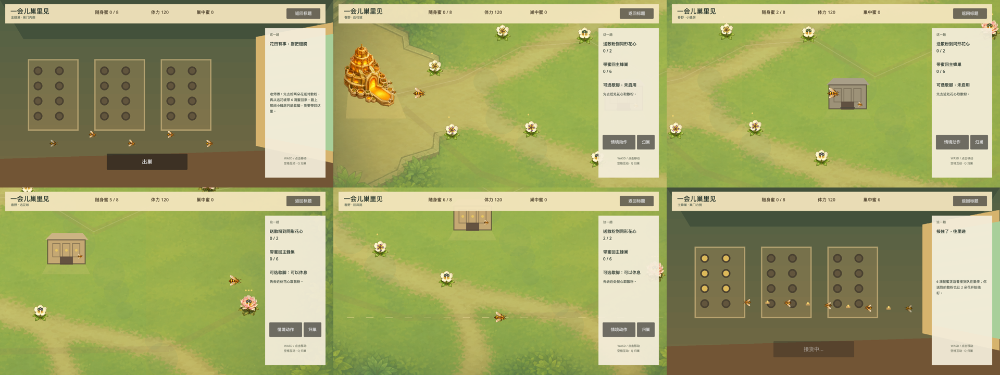

# 春季往返世界基础 v1

状态：**2026-08-26 已实现的首个产品纵切；开发者自测通过，Alan 实机验收与独立外部玩家证据均仍为 0。** 本文记录本次实现事实和后续边界，不替代尚在 Draft PR #93 中审阅的地图／蜂巢美术研究，也不把一条纵切冒充完整成品。

本纵切采用产品展示名《一会儿巢里见》，替代未在玩法里成立的旧展示名和“再采一朵”的单一采蜜问句。仓库目录、产品 ID、包文件 stem 与历史文档中的旧名称暂时保留，以免破坏构建和证据追溯；玩家可见的标题页、Web 外壳、导出应用名和新试玩材料统一使用新名称。

本实现 PR 不以尚未合并的 Draft PR #97 为代码或文档祖先；它只落地本轮再次确认的大地图、蜂巢休整、场景切换、多种花田工作和温暖日常语气。蚊庄主花牌事故、完整 N01 因果和首次返巢标题卡仍作为下一张内容 PR，避免把世界基础与整套剧情审阅混在一起。

## 1. 这次交付什么

普通启动页的主按钮现在进入《一会儿巢里见》的第一条真实往返路线：

```text
主蜂巢巢门内侧
→ 淡入春季大地图
→ 近区从两型花药取得散粉
→ 中区把散粉送到同形柱头，让两朵花开始结籽
→ 远区取得完成交付所需的花蜜
→ 可花一滴随身蜜打开小蜂房，停稳后有限休息
→ 两朵花结籽后可利用下方原有的回风路返程
→ Q 或自行飞回唯一主蜂巢，停稳交货
→ 切回巢门内侧，由接货蜂把蜜逐只往里传
```

这条路线同时验证用户点名的三个缺口：

- **大地图**：春野边界为 `2140×1180`，大于四个旧 `970×538` 世界区的总面积；角色保持原显示尺寸，摄像机只显示局部；
- **类似篝火的蜂巢节点**：野外小蜂房有休眠、打开和有限休息状态，但不是火焰、魔法圈或第二个家；
- **场景切换**：主蜂巢门槛和春野是两张独立 `PackedScene`，由持久会话根切换，携蜜结算、蜂巢储备和旅程标记不归地图节点所有。



上图来自 Godot 4.6.2 的真实运行时快照，证明场景和状态能够渲染；它不是最终美术通过，也不替代实际操作验收。

## 2. 可玩路线

| 区域 | 玩家工作 | 路线作用 |
| --- | --- | --- |
| 主巢门槛 | 听老师傅一句出勤说明；返程时看接货队实际传递花蜜 | 把“出发／回来”变成生活场景，不建可漫游巢内地图 |
| 近区 | 采四朵低蜜花，蜂身出现两型散粉 | 给传粉提供可见来源；近花总蜜量不足以完成交付 |
| 中区 | 把两型散粉分别送入同形开放花心 | 让两朵花开始结籽；传粉不增加或消耗花蜜 |
| 小蜂房 | 玩家主动花一滴随身蜜打开；停稳后恢复至体力上限的 65% | 在去远区前后提供节奏锚点；不能交货、结算或改变 Q |
| 远区 | 两朵远花各有 4 滴蜜 | 让完成 `6` 滴交付必然包含真实远行，而不是只在巢口重复采集 |
| 回风路 | 下方原有回风始终为向左飞行提供顺风；两朵花结籽后会出现更明显的路线缝线 | 用已完成的“送粉”工作开放路线提示，形成回环而非原路空跑；不是结籽制造了风 |

首趟携带上限仍为 `8`。小蜂房燃料和主巢目标使用同一批守恒花蜜；地图共提供 `12` 滴，因此选择休息不会使路线数学上无解。

## 3. 主巢与小蜂房边界

| 能力 | 主蜂巢 | 野外小蜂房 |
| --- | --- | --- |
| 方向地标 | 是 | 是，层级更低 |
| 安全停留／恢复 | 完整恢复 | 只恢复至上限 65% |
| 交付花蜜 | **唯一交付点** | 否 |
| 完成旅程／场景结算 | 是 | 否 |
| Q 归巢目标 | 是 | 否 |
| 存档、复活、传送、刷怪、商店 | 本纵切均未实现 | 均未实现 |

小蜂房使用低矮横向蜂房轮廓、可见巢框、落脚板和一只整理落点的工蜂；它不复刻高大的主巢，也不使用字面火焰。当前造型仍是使用现有资产与程序绘制完成的可玩表现，不是已通过的最终美术。

## 4. 场景与状态架构

- `journey.tscn`／`JourneyGame`：持久会话、HUD、转场遮罩和唯一状态写入者；
- `hive_threshold.tscn`：不可漫游的浅层巢门内侧与接货演出；
- `spring_field.tscn`：可卸载的大地图、Camera2D、花、玩家、传粉和小蜂房；
- `JourneyAreaRouter`：稳定区域 ID 到编译期场景的白名单；未知区域直接拒绝；切换后 AreaHost 始终只有一个活动场景；
- `JourneyState`：以递增 journey token 接受一次返巢结算；同一个 token 重复提交不会复制蜂蜜。

旧 `Main` 的 24 节点循环仍保留为回归基线。它被嵌入自动测试时继续走旧 `start_game()`；在实际导出／编辑器主场景中，标题按钮才切换到新旅程。这样没有复制现有完整四季规则，也没有为了第一张地图一次性重写 4,000 多行旧集成脚本。

## 5. 明确未做

- 五张地图、十三场景或一主四次级节点等尚未确认的精确数量；
- 四季全部迁入新会话根、二十四节气重排和四位邻居事件；
- 进行中存档、检查点、力竭复活和退出续玩；
- 可漫游巢内地图、快速传送、商店、任务图鉴或多个等价主巢；
- 敌害与屏外攻击；首纵切先验证“采蜜之外的传粉工作、距离、休整和返程”，下一内容切片再接蚊庄主花牌事故；
- 剧情框架中的首次返巢标题卡揭示；本纵切先用产品包装标题标识构建，N01 再实现“越过门槛、被接住后出现标题”的叙事时机；
- 最终地图、角色、蜂巢动画、动态音乐和宣传级镜头。

体力归零在本纵切只会失去加速和采蜜能力，仍可慢慢飞到主巢或已打开的小蜂房；没有自动回血、失败、复活或传送。应用／浏览器失焦时花田输入和体力消耗会冻结，回到窗口后再继续。旧产品名对应的本地存档目录没有迁移到新展示名，本纵切本身也没有进行中存档，页面不承诺继承旧 `Main` 进度。

## 6. 证据等级

### 已实现事实

- 两张产品区域场景和持久路由已进入 Godot 运行时；
- 春野超出旧单屏边界，Camera2D 可到达远花；
- 同形传粉复用现有 `PollinationMechanic`，不会凭空制造花蜜；
- 小蜂房复用受控休整规则，不会改变主巢交付；
- 返巢 token、区域白名单、场景唯一实例、摄像机安全框、远花可达、两处结籽结果、非主巢不可交货及主巢单次结算均有自动回归。

### 开发者自测／启发式判断

- 本地真实渲染快照已检查巢门、近区、中区、远区、回风路与返巢接货六种状态；
- 近／中／远目标和回风路在静态画面可分辨；这只是开发者检查，不证明实际飞行节奏有趣；
- 字体子集已按所有运行时文本重建，并由字形扫描测试验证。

### 尚无证据

- Alan 尚未在真实操作中确认地图大小、飞行时长、休整价值、返程风路、可爱程度或画面方向；
- 独立外部玩家仍为 0，不能声称玩家已经读懂同形传粉、知道小蜂房不能交货，或觉得返巢温暖；
- 当前路线不能代表完整产品内容量、价格、Steam 转化或发布准备度。

## 7. 下一步顺序

1. Alan 实机走完同一条路线，记录总时长、空飞占比、是否主动使用小蜂房、是否找到回风路，以及返巢是否真的像“回家”；
2. 在这张地图上接入蚊庄主花牌事故和 N01 的老师傅／接货因果，不另造第二套剧情系统；
3. 另立决策明确力竭、退出与续玩边界，再决定是否需要安全节点存档；本纵切不从“小蜂房像篝火”自动推出存档或复活；
4. 依次迁入夏季追回花蜜、秋季收蜜与留种、冬季续暖，而不是复制四张换色地图；
5. 最后才确定地图总数、场景生产边界、统一美术、音频、外部试玩和发布收口。
