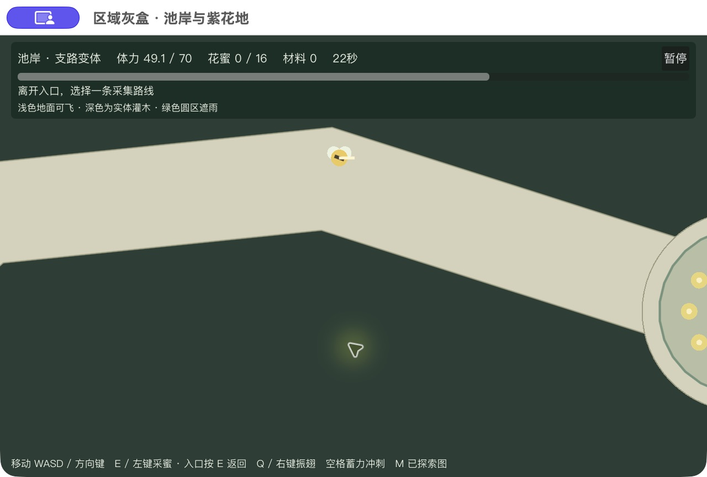
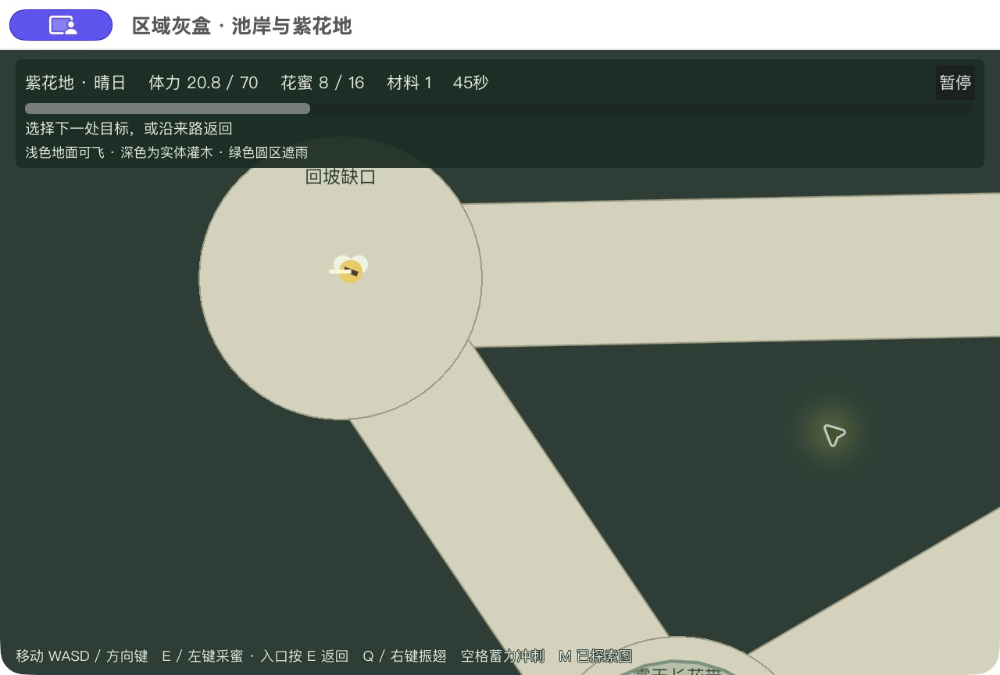
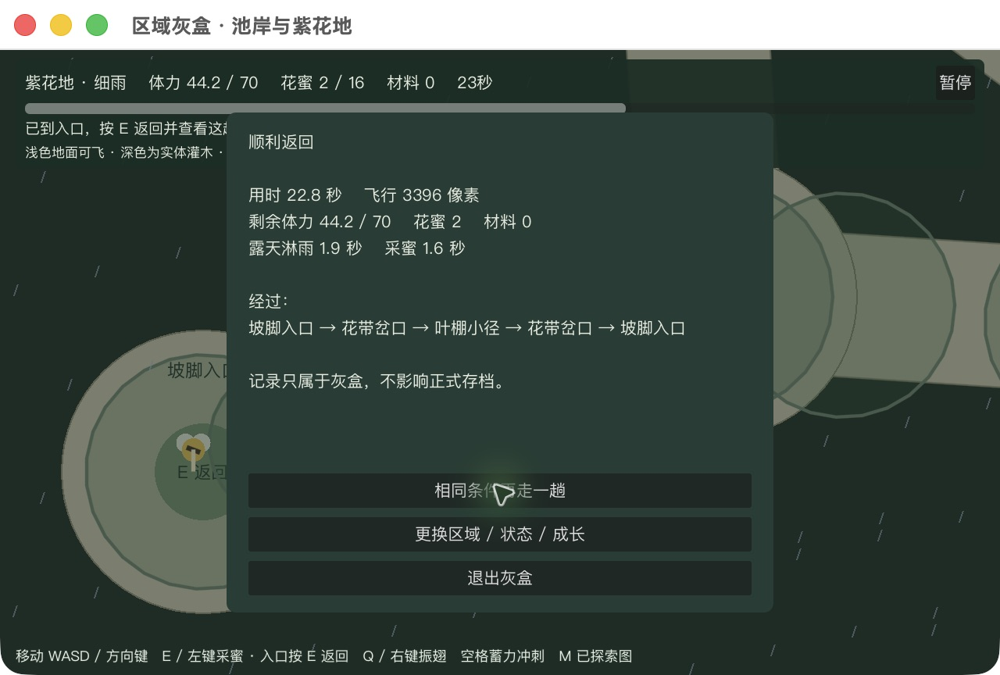
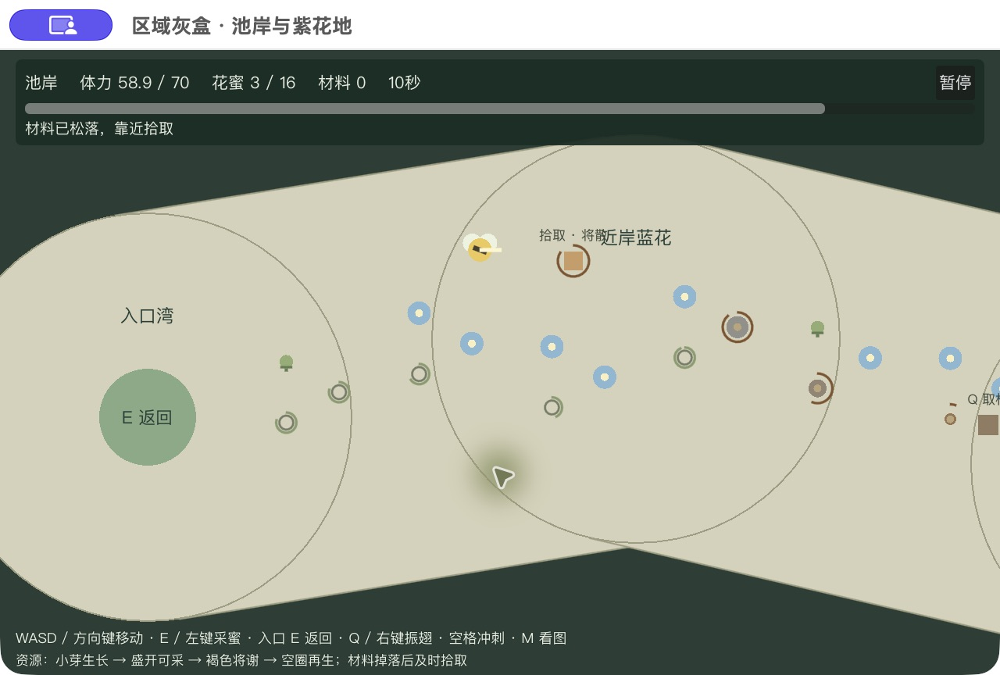
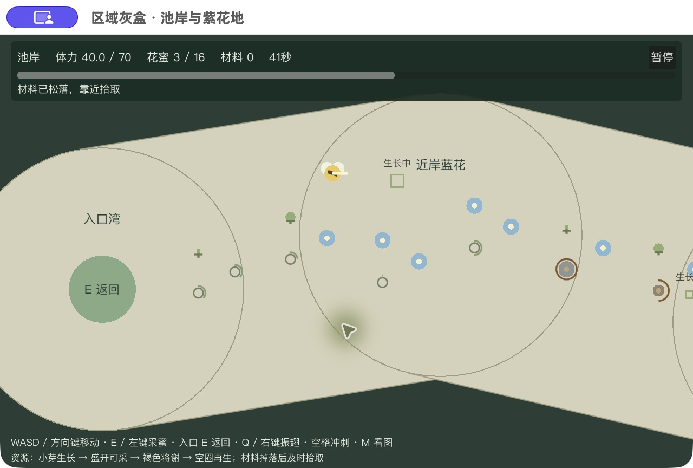
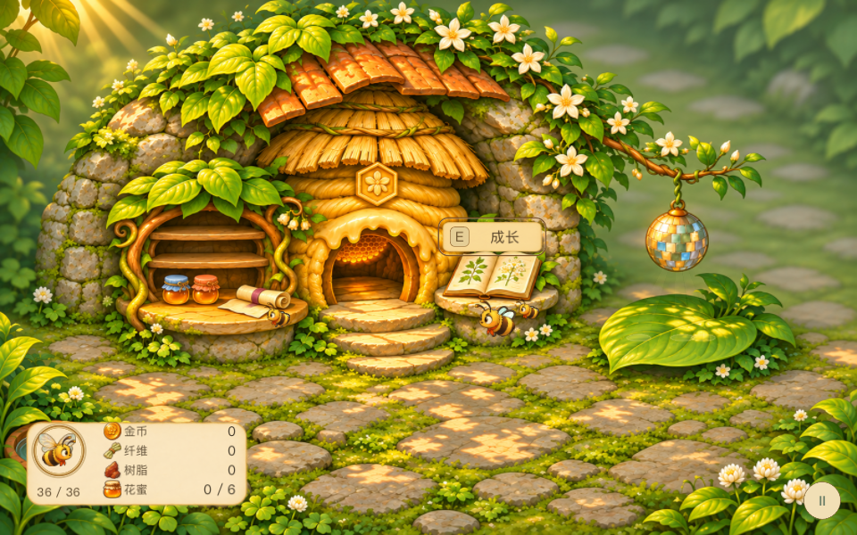

# 池岸与紫花地：可玩灰盒回执

2026-11-09；GDD§8.1/13.9 → M3 → 父[#322](https://github.com/alanthssss/nameless-becoming/issues/322)，实施#338／#339，验证交付#340。Alan授权把两张内部图做成可玩灰盒，先验证空间与出行，不细化美术、不追加研究。设计输入为[两区内部图](../design/pond-violet-interior-maps.md)，源图提交bcf38cc；运行基线ea4db61。

> 最新修订与结果见本文末尾[庭院视觉反馈修订](#courtyard-feedback-20261111)。下文早期版本属于历史证据。

## 原型问题与取舍

问题：多景段、近远回路、不同条件能否让玩家在一次出行中选择不同目标与返路，并随成长扩展可经营范围？本轮为隔离实验，可保留数据与几何代码；未验证的地图和刷新假设不替换正式Demo。

保留条件：入口不能看到远端；真实分岔可绕行回接；不同状态有可行出行及可测路线差异；成长后能组合远端花源与材料。调整条件：必须穿墙才能通行、初始没有可回来的短途、绕遮雨路没有收益、连续空飞没有信息。乐趣与首次读路能力须由真人试玩判断。

## 已实现

- 两区各8景段，节点圆半径180px、通道半径90px；源图按3.2倍起始尺度落地。池岸约2888×2072px（变体高2312px），紫花地约2904×2104px；1280×800镜头跟随，逐段揭示。
- 可见深色灌木为实体，浅色景段/通道可飞；圆与胶囊的并集同时用于绘制和碰撞。水面不作为墙。近环、远环与材料支环保留，变体真实关掉一边并打开另一边。
- 出发前选区域、晴日/细雨/布局变体、成长前/后；一次出行不重排。移动、采蜜、振翅取材、冲刺、返回/耗尽、暂停、再来一趟和条件切换均可操作。M只显示实际走过的轨迹及已到地标。
- 复用现行成长规格：36/70体力、6/16容量、1.8/0.8秒每蜜，以及150/205振翅范围和普通目标2/1次振翅；速度230、冲刺500与现有消耗保持。地图灰盒的材料点是中立静态标记，未据此验证生物移动/生态。
- 原正式Demo入口和存档代码未修改。打包到独立命名空间`BeforeTheRain-RegionGreybox`；仅有灰盒JSONL出行日志，不读正式存档。花源在开始一趟时重置，本趟不再生，是便于比较的实验条件，不宣布正式刷新规则。

## 实测与修正

以下均为**已知路线的模型执行**：调用与游玩相同的step，逐帧移动/采集，途中不写位置、体力或库存。不是真人探索，不计玩家读路、犹豫或迷路时间。[36条摘要](evidence/region-greybox/routes-summary.json)，完整轨迹/失败前后对照的本机路径与哈希见[清单](evidence/region-greybox/manifest.json)。

| 样本 | 池岸 | 紫花地 |
|---|---:|---:|
| 初始晴日近环，带回3蜜 | 24.62秒，余6.94体力 | 26.38秒，余5.17体力 |
| 成长后晴日远环，8蜜＋2材料 | 39.05秒，余22.01 | 44.38秒，余16.77 |
| 初始雨天短往返，采1蜜 | 16.60秒，余9.41 | 15.58秒，余12.16 |
| 成长后雨天同目标采1：直达 | 24.88秒，余25.74 | 27.05秒，余19.56 |
| 同条件改走遮雨路 | 33.67秒，余31.94 | 32.42秒，余33.55 |

首轮初始雨天短途均耗尽；池岸绕棚反而不划算。只调整可见叶棚：入口加分段棚、主遮雨链约88%中心线覆盖且保留露天缝、节点局部棚。体力、速度、尺度、收获及成长预设未随此修正改变。绕棚现在以更多时间换更少消耗。初始雨天完整近环采3、成长后雨天完整远环8蜜＋2材仍可能耗尽，保留失败；玩家需要选择短途或放弃附加目标。

技术判断：连通和预算差异成立，晴日初始近环余量偏紧，真人首次辨路可能需要进一步调整尺度或内容间距。暂不扩大地图，不调正式经济。

## 验证覆盖

- Godot 4.6.2：地形3461项、模型1236项、UI77项均0失败；原采蜜规则146项0失败。所有状态连通、移动防穿、关边实际阻挡、无非相邻通路暗交叉；采集/容量/振翅/冲刺、返回/耗尽、暂停及配置切换检查通过。
- 已知路线探针36样本，成功和耗尽全部保留。一次探针typed Array赋值错误产生的v1数据已标无效，未用于结论；修后重跑v2与最终样本。
- 原生普通输入：池岸晴日成长后走入口→分岔→内湾→叶棚→分岔→入口，34.11秒/4810.2px，带回3蜜、余36.32体力（运行90b0de6）。发现浅地HUD对比不足和停采后提示残留，修正后冻结d77eab4并重跑模型/UI检查。
- 最终d77eab4独立包：紫花地雨天成长后走入口→分岔→叶侧→分岔→入口，22.76秒/3396px，带回2蜜、余44.19，露雨1.91秒；实际到达变体分岔并观察关/开边。初始雨天一次操作撞墙后放弃、0蜜，保留失败记录，不能当作初始路线成功。完整状态/成长组合依靠上述模型执行，未冒充全部原生走通。
- 最终包冷启动、暂停/重试/配置切换、1280×800与960×600内容视口检查通过，已留在出发设置界面。首次通用Mac导出因缺ETC2/ASTC格式失败，保留日志；补导入格式后成功独立导出并实际启动。
- 独立AI限定复核发现打包脚本/生成配置未冻结：已增加脚本与提交字节一致校验，以及两份配置哈希；不把这种检查当玩家体验。

| LV01–10 | 本灰盒结论与边界 |
|---|---|
| LV01 重复作用 | 技术有近/远/材料不同目的和状态成本；整段是否重复待玩家 |
| LV02 舒缓衔接 | 原生连续移动观察镜头逐段揭示；空飞感与首次方向感待真人 |
| LV03 攻击时机 | 不适用：中立静态材料标记，无战斗 |
| LV04 冲刺落点 | 冲刺碰撞防穿通过；自然松键转向的玩家体验待验证 |
| LV05 收集衔接 | 路线探针实际取蜜/材料并返回；不等于首次发现顺畅 |
| LV06 体力取舍 | 雨短途、成长扩展、遮雨绕行均有实际测量；首玩余量待验证 |
| LV07 因果发展 | 同动作通过两路/远端/变体组合；没有新增工具 |
| LV08 读图与视觉一致 | 浅色通路与深色实体边界共用几何，遮雨圈对应实际范围；原生通行/墙体与两视口HUD检查通过，非美术验收 |
| LV09 失败与中断可靠 | 暂停/失焦/耗尽/重试检查通过；独立实验不迁入旧坐标、不读取正式存档；最终包冷启动回到选择页 |
| LV10 完整体验 | 待Alan及独立玩家，不能以自动路线关闭 |

## 2026-11-09 原生完整走图复盘

Alan要求先完整走几趟，再简短判断大小、空飞、状态/成长换路；随后指出相对Shelldiver的借鉴方向是否变复杂。沿GDD§8.1/13.9→M3→#322，**本轮只试玩/归档，游戏与包字节未修改，无新增美术或竞品研究**。

冻结包d77eab4，macOS/Godot4.6.2、1280×800，Codex通过原生键鼠操作；无传送/补体力/改库存。两区各四组从入口出发到返回或耗尽，另一次窗口中断废弃，全部保留。[逐趟摘要](evidence/region-greybox/playtest-20261109/native-summary.json)、[原始JSONL](evidence/region-greybox/playtest-20261109/native-sessions.jsonl)、[截图清单](evidence/region-greybox/playtest-20261109/manifest.json)。编号对应图稿地标。

| 样本 | 实际经过 | 秒／结果 | 蜜＋材／余体力 |
|---|---|---:|---:|
| P1 池岸初始晴 | 0-1-2-3-1-0 | 32.62／返回 | 3＋0／0.41 |
| P2 池岸成长晴 | 0-1-3-4-5-7-6-1-0 | 51.75／返回 | 8＋1／12.91 |
| P3 池岸成长雨 | 0-1-6-5-4-5-6-1 | 66.29／耗尽 | 1＋0／0 |
| P4 池岸变体 | 0-1-2-4-5-6-1-0 | 53.30／返回 | 1＋0／18.86 |
| V1 紫地初始晴 | 0-1-2-3-1-0 | 33.07／返回 | 2＋0／1.47 |
| V2 紫地成长晴 | 0-1-3-4-6-5-7-2-1-0 | 58.32／返回 | 8＋1／7.53 |
| V3 紫地成长雨 | 0-1-3-4-5-4-3-1-0 | 42.57／返回 | 1＋0／21.18 |
| V4 紫地变体 | 0-1-2-4-5-7-2-1-0 | 44.18／返回 | 1＋0／26.88 |

**证据限制。** 0位真人、一个已知地图的AI操作者；按段暂停观察，分轴按键会增加路程，截图和未及时暂停的停留仍计时。P3返程偏航、碰撞12.86秒并增加观察停留，不能据耗尽断言正常遮蔽路不可行；P2-interrupted在窗口中断后45.84秒废弃，不用于路线比较。原生各组收获不同，因此总耗时不能直接归因为天气/成长；同目标成本对照只引用前文既有模型样本。两趟远环实际各拾取1材，未把计划2材写成完成。

**观察与判断：**

1. **已摆脱一屏小场地，但仍像短回路练习场。** 远端须连续移动、转折才揭示；本轮初始近环约33秒、成长远环约52–58秒。认为探索层次仍薄是本轮设计判断，不是玩家喜好结论，也没有竞品新计时对照。
2. **空飞是明确问题。** 实走P4新增外侧通道时，连续十多秒主要是移动/转弯；V2深处花圃→回坡缺口约7秒持续横飞，沿途无新采集或分岔。下图分别为实际经过的外通道与返路尽头。静态核查所有通道无独立采集点，远花源仍是同种蜜、同动作，仅份数由近处4/叶侧2增至10；材料另有2个静态标记。分岔、避雨和返程地标仍有导航作用，不将所有非采集节点说成无用。
3. **状态能改路线，尚未证明会自发换路。** 两变体新2–4边均实际通过；雨天选择了遮蔽返路，V3全趟仅露雨4.07秒。但这些是有目的的对照走法。既有同目标模型中，成长后直达/遮蔽都可返回；绕棚有成本收益，却非必选。静态最短路分析还显示，变体最短远端路改走已有背路，新2–4长边本身并非最短。
4. **成长扩的是收获组合预算。** 本轮从近场2–3蜜扩至远端8蜜＋1材，确有实际作用；通路、移动速度和目标种类不随成长改变。初始已能朝远端走，不能写成升级后才解锁远端。初始近环余量很紧，本轮分轴输入也放大了消耗，数值调整需隔离复测。

**建议，尚未实施：** 当前复杂度主要加在8景段、多回环和改接路网上，沿途行为没有相应丰富。相对本项目想借鉴的简明出行方向，判断偏复杂；这是对本方案的评估，不是对Shelldiver全地图复杂度的新增事实比较。下一轮优先简化为“一个清楚的深入方向＋一个有收益的分岔＋一个远端目标”，压缩纯连接段；先证明远端值得去，再决定是否需要材料独立成环或布局改接。天气保留同一骨架上的取舍，成长保留深入与带回更多的作用；不以加美术或继续拉长地图解决。

辅助源码/旧模型分析见[限定复核](evidence/region-greybox/playtest-20261109/greybox-trip-metrics.md)，与上述新原生操作分开。决策人Alan；Codex本轮仅交证据与建议，M3/#322不因走通而关闭。重审触发：同目标、不增加路网的下一版能否让远端多一次有价值的选择，并减少最长无事件段。

本轮计时从北京时间16:10:05，原生结束16:28:58；其后归档/CI另计，最终墙钟见本机同目录integration-closeout.json及#322。约19分钟至原生结束，包含暂停/观察，不是主动或账单工时；200＋40小时、累计/可靠剩余未知、采购0、图像调用0、自动化PAUSED保持。建议进入简化方向评议，未自动扩大范围。

## 使用与成本

源码启动：`Godot --path prototypes/swarm-flight res://region_greybox/greybox.tscn`。本机独立包由`tools/package_region_greybox.py`从冻结提交生成；入口与存档命名空间独立，包清单记录运行依赖、打包器、生成配置和ZIP哈希。

本机入口：`/Users/alanthssss/LocalGames/region-greybox-0.1.0/启动灰盒.command`。最终运行/打包器提交`d77eab409e68b604382a805af44ce62322b8dcd5`；ZIP SHA256 `2034f74c049f9821411af83161182b095df74f3fbda3d6e8a8022dde7a5c2ac4`。完整13文件依赖与配置校验见包内`source-manifest.json`，原生图与真实出行日志见上述证据清单。后续证据文档提交不改变这个运行身份。

记录起点北京时间14:10:11；之前上下文读取未计量。200＋40小时控制保持，历史累计/主动/账单/可靠剩余未知，新增采购0、图像调用0，自动化PAUSED。本轮先完成可玩的内部实验，不推进正式M3验收；是否保留尺寸/变体应据本包试玩判断，未自行扩大预算或全作范围。

## 2026-11-10 · 固定地图与资源生命周期

GDD§8.1/13.9 → M3 → #322；#343地形、#344资源/成长、#345原生观察、#346独立包与集成。Alan授权去天气、多余回路并实现资源补充，随后实玩指出“花的分布太稀少了，而且没有生成和衰败；其他材料的分布和生成衰败也很弱”。因此0.2.x保留为中间实验，本批继续按[修订设计](../design/pond-violet-map-resource-design.md)完成0.3.0，不用旧版走通代替反馈修正。

### 中间版0.2.x：真实记录与被否定点

运行0.2.0冻结`9e0a63982fce1768dd2d2c2b50507286bfc36af2`；0.2.1冻结`7735bcda4172b0cb323e2cee6cfc002e4b966dd7`，运行依赖只改main.gd的菜单措辞/HUD，不改地形模型。13条原生记录：11次返回、2次条件选择未生效后主动中断；返回中2次没有取得计划材料，故只有9条目标成功。全部为已知地图的AI原生输入，分段暂停观察，没有传送/补能/改货物；0位外部玩家。Alan的资源稀疏反馈是产品负责人反馈，与AI走图分开记录。

| 区域／目标 | 初始结果 | 成长兼采结果 |
|---|---|---|
| 池岸挣钱／远材 | 20.48秒带6蜜；专程19.82秒带1材 | 36.17秒带16蜜+2材，余24.07体力 |
| 紫地挣钱／远材 | 20.72秒带6蜜；最终对照21.15秒带1材 | 最终对照36.71秒带16蜜+2材，余19.34体力 |

池岸原始第4/5条、紫地第12/13条为同种子成长对照。第2/3条材料尝试空手返回，日志分别只有1次命中和0次命中，原因未确认，不能称鼠标取材已原生验证；后来定向Q成功也不消除这两条记录。第6/9条是自动化菜单条件未生效，实际起跑条件与计划不同，保留为中断样本。紫地第11条回访：同花id0/1在2.32秒采空、20.33秒补满、21.13秒再采，23.03秒带4蜜返回；池岸成长途中实际保存退出、冷启动继续并带16蜜+2材返回。

结论限于0.2.x：主方向约2060px、约两屏的紧凑场地，仍不能当成大型探索区。成功兼采出行的最长“附近无可采目标”飞行为2.30–3.75秒，但满载回程仍有9.41–10.40秒连续未交互飞行；该无目标指标会把满蜜囊旁的花算作目标，故另报未交互飞行。0.2.x仅6簇16花/2材，生成只是采空后补满、材料本趟一次，确实未满足用户持续资源变化的目标。

[完整原始13趟](evidence/region-greybox/resource-20261110/native-sessions-02x.jsonl) · [逐趟口径与失败](evidence/region-greybox/resource-20261110/native-metrics-02x.json)。0.2.0规则检查1304地形/1573模型/42UI通过；32模型路线保留初始贪取失败，属于模型，不是真人或原生操作。日志与旧包manifest同目录保存。

### 0.3.0修订验收

保留固定五节点与一条短分岔，花16→36、6→12簇，材料2→6；实现花和材料的生成、成熟、衰败、空位再生，以及材料落地12秒过期。相位错开，各段初始保底可采；暂停/失焦/冷续保持整个资源状态。所有参数是本作实验设计，没有新增Shelldiver研究或宣称复刻其算法。独立v3存档与旧包保留，正式Demo未改。

规则、原生完整往返与可见生命周期已验证，证据如下。最终CI/集成状态以权威#346、PR和本机包内integration-closeout.json读回为准，不由本文代签。

### 修订版实测与结论

0.3.0运行冻结`783f05ed1384a384de51e44dfc9becb0f690593c`，原生Mac/Godot4.6.2、1280×800，七趟全部返回。键盘普通输入，分段暂停观察；0位外部玩家，不用已知路线操作代替Alan的新版本接受。

| 实走样本 | 活动秒 | 带回蜜＋材 | 余体力 | 最长无目标／未交互飞行秒 |
|---|---:|---:|---:|---:|
| 池岸初始挣钱 | 20.48 | 6＋0 | 7.31 | 0／2.51 |
| 池岸初始远材 | 24.45 | 0＋1 | 9.60 | 0／9.99 |
| 池岸成长兼采 | 48.68 | 16＋3 | 11.26 | 0.68／8.27 |
| 紫地初始挣钱 | 20.94 | 6＋0 | 6.49 | 0／3.15 |
| 紫地初始远材 | 24.61 | 0＋1 | 8.12 | 0／9.37 |
| 紫地成长兼采 | 59.74 | 16＋2 | 3.05 | 0.70／9.73 |
| 池岸生命周期回访 | 76.27 | 7＋2 | 9.21 | 0／3.12 |

池岸第2/3、紫地第5/6为同种子初始/成长对照；挣钱与成长不是同目标计时实验。P3在分岔首次未取到材料，远端后回访成功，且中途保存退出再冷启动，16蜜/3材与资源相位保留后完成返程。V3方向修正和观察停留较多，近材未取到，实带2材、余量较紧；不能把模型3–4材写成实走收获。V2一次控制工具超时，游戏已暂停，恢复后沿同一趟返回；未删除或补写日志。

**生命周期是实际运行变化。** 第7趟同一材料id0于7.80秒被打落，19.80秒过期且没有入账，37.80秒进入生成，41.80秒成熟，45.74秒拾取第一份；随后63.75秒再次生成、67.76秒成熟、73.14秒拾取第二份。花id0/1在4.84秒采过，51.90/52.71秒再次采集；id4也重复采到。画面对应掉落倒计时、空位、逐渐长大的芽、成熟可采，天然花源也持续衰败/再生；暂停不推进，冷续不重建。76秒是专门等待循环的验证，不是推荐每趟时长。

[七趟原始日志](evidence/region-greybox/lifecycle-20261110/native-sessions-030.jsonl) · [摘要与事件时间](evidence/region-greybox/lifecycle-20261110/native-summary.json)。对应截图在同目录native；下图是原生画面，不是美术设计图。

结论：资源密度与活动变化已补上；主路约2060px、两屏左右，**地图仍偏紧凑**。成长实走由6蜜或1远材扩到16蜜＋2–3材，能力作用明确。附近没有可采目标的最长飞行降至本次样本0–0.70秒，但满载返程仍有约8–10秒未交互飞行；加密资源没有自动解决返程活动问题。暂不为此新增回环、天气或美术，下一判断由Alan在可玩包上评估密度和重复出行是否够用。

本地布局2004、最终模型3166、UI42、文档/素材契约14项通过。32条普通输入模型路线24返回、8初始贪取多目标耗尽；成长四条返回16蜜＋3–4材。第一次模型在紫地1202守着衰败材料等待，58秒耗尽，原始JSON保留；只修改模型走法为当前采不到就继续沿路找，不修改资源或体力来保证通过。局部规则单测可能直接布置状态，完整路线和原生操作没有位置/能量/库存写入，三类证据分开。

原生发现掉落过期后顶部仍保留“靠近拾取”，最终0.3.1仅修正过期提示和版本号，布局/生成/衰败/采集数值不改；运行冻结`8dc527b5fa2490564a56b33a357415233ad116d9`，最终包路径`/Users/alanthssss/LocalGames/region-greybox-0.3.1`。定向模型和UI已在提示修订后通过，最终导出已原生复验：落地物消散后显示“落地材料已消散，可寻找其他成熟材料”，随后完整返回；此趟故意不拾取，25.41秒空手返回，余14.45体力，不能算额外兼采样本。见[最终复验](evidence/region-greybox/lifecycle-20261110/final-smoke.json)。0.1.0、0.2.x、0.3.0包与证据均保留；不是正式Demo或SF-R23成品候选，不发布。

### LV01–10与边界

| 项 | 本批结果 |
|---|---|
| LV01 重复作用 | 资源连续分布承担采集；错相与衰败让当前可取对象变化。仍是同类动作，未宣称玩法种类增加 |
| LV02 过渡 | 沿途资源密度改善；满载长返程仍待产品判断，明确保留8–10秒问题 |
| LV03 攻击预告 | 不适用，无敌对战斗或攻击机关 |
| LV04 冲刺落点 | 冲刺规则未改；原有边界普通输入检查保留，新通路的碰撞/滑移技术检查通过，未宣称新版冲刺手感得到玩家验证 |
| LV05 收集跟随路线 | 两区实际沿主路/分岔/远端取物返回；目标朝向与靠近拾取仍需操作，漏取原样记录 |
| LV06 体力取舍 | 初始短程与一远材可返回，成长带更多；紫地原生余3.05偏紧，模型8次初始贪取失败保留 |
| LV07 交互发展 | 从采花到结合分布材料、判断成熟/衰败/返回；只验证此采集场，不代称完整关卡或整作发展 |
| LV08 可读性 | 四相大小/颜色/弧线与材料状态词在原生画面可辨；发现过期提示残留并修复。纯几何占位，没有新增美术或美术验收 |
| LV09 中断 | v3独立身份，暂停/失焦/磁盘快照保持相位；P3真实冷续后带原货物返回。旧v2包/档保留不迁坐标 |
| LV10 证据 | Alan对0.2.x的否定、0.3原生AI操作、模型/规则检查分别记录；新包仍待Alan判断，不批量扩产 |

### 成本与执行边界

主批从2026-11-10 05:35:06 UTC记录，资源反馈修订从06:07:35 UTC；最终结束、CI等待与清理时钟写入包内integration-closeout.json并回写#346/#322。可观测墙钟包含读取、编写、导出、暂停观察与等待，不能当主动或账单工时。协作实现06:08:26–06:14:53 UTC（约6分27秒）独立记录，不用并行倍率换算成本；此前地形/复核区间沿本批#343–346保留。主动/计费/历史累计/可靠剩余均未知，200＋40小时不重置；新增现金采购0、图像调用0、自动化PAUSED。只收口已授权反馈修订；M3/#322/#211保持OPEN，不将灰盒交付算产品里程碑完成。后续仅依据Alan反馈复议资源密度、回程用途和体力余量，不自动扩大制作范围。

限定复核：主线程读取生命周期/恢复/分布源码并指出固定采数驱动等待问题；协作者独立复核主UI/打包及逐趟事件和哈希，06:31:04–06:31:38 UTC完成最终只读核对，未见阻断。13个运行依赖、生成配置、ZIP、启动器与打包器分别匹配0.3.0/0.3.1冻结提交；两版运行差异只是一行过期提示与版本标签。

## 2026-11-10 · 两区完整版 0.28.0（被反馈修订的开发历史）

**授权与范围。** Alan认可资源版方向并要求完整版本、美术与交互反馈。沿GDD§8.1/13.9 SD-v1.7→M3→#322，拆分#348真实成长/保存、#349手绘场景、#350完整原生验证、#351候选集成；唯一执行在Now。保留灰盒0.3.1的固定五节点、36花/6材和错相生命周期，无天气、多环、临时成长开关。复用已认可庭院/成长/收购/蜂舞/合成音效；移除失去用途的叶间近道后12项有效成长。新模型以既有v5经济验证器和独立区域快照组成版本化保存，不替换旧包/存档。

**实际开发验证。** 模型46项、区域界面22项、旧规则146项、旧动作94项、旧存档迁移15414项、旧UI73项通过；包装55项包含新产品配置与缺证拒包。旧UI第一次误用fixed-fps使真实时钟防连点16项失败，按原用法无fixed-fps复跑73/0；不能删除失败历史。初次区域渲染发现短材茎自交和shader helper内置纹理限制，已修后22项无渲染错误。独立读码发现持E飞回入口绕过保存交易，已改为return_requested→候选提交，并覆盖失败写入。开发版原生首趟27.19秒带回3蜜，不能替代最终源证据。

**美术复验状态。** 前两版裁图铺地在原生场景出现硬岸线、悬水叶根、镜像大叶与重复草纹，未作为通过。沿原Issue修正支撑、软岸与茎，并生成专用草/水两张手绘地纹；新版本仍需原生两尺寸、交互前后和运动复核。生成来源与允许复用范围见region_game/art-provenance.json；没有追加竞品研究。

**当前门槛。** 新区域合同保留NH-C01–08方法、全部媒体/保存/独立复核质量要求，仅按用户指令改掉天气/多回路/近道条件。默认旧版包装行为不变，新入口使用regions产品配置。尚未取得最终原生/冷续/导出/独立证据，不提前打候选包、不关闭Issue、不宣称M3或24关完成。

**成本。** 首个明确记录为2026-11-10 15:14:07北京时间，预计70–120分钟含素材、验证和CI；约15分钟可检查切片，发现画面问题沿原ID返工。200+40小时不重置，主动/账单/累计/可靠剩余未知；采购0，新图像调用2，自动化PAUSED。最终耗时与覆盖在本段按实际证据回写。

### 0.29反馈修订（原批次继续）

Alan指出硬直单调岸线与过密资源，0.28原生记录仅保留历史。0.29实际地形轮廓与显示共用自然coast，花位分散到区域宽度；16/3→24/4→36/6处花/材由两级花地繁盛购买开放，下趟生效，花恢复20/14/10秒、材44/30.8/22秒。成熟/衰败和掉落寿命保持原值；共有14项真实成长，独立v2保存。模型52项及48组地区/种子/成长场景32508项检查已过；几何断言首次暴露测试脚本的Array类型错误（不是通过），修正后继续验证。原生、候选和CI待同版取证。额外25–45分钟估时，仍沿原Issue。

### 0.29限定候选与验证结果

**实际产物。** 冻结运行源`37332f16221667a46fee7066bd143eb377eda108`，原导出与最终解压app的6个文件逐一哈希相同；`tools/package_nectar_review.py --product regions`通过保留的NH-C01–08，最终ZIP SHA256 `1dcbd59eaec09278bd5b54a5f61594267c84ce09830ce1255575727462f28c40`。本机试玩入口：`/Users/alanthssss/LocalGames/nectar-regions-0.29.0/试玩/采蜜与蜂舞-Demo/开始采蜜小店.command`；完整证据在同版本`evidence/`。最终app及command均经实际启动、输入、Esc保存、进程退出、冷续和继续移动检查；两次退出前后存档字节一致，原Nectar存档哈希不变，新默认档未留下测试进度。0.27、0.3.1及失败0.28开发包保留。

**规则与场景。** 48组地区/种子/资源档位覆盖32508项、区域模型52项、自然岸线68项、区域UI24项、旧UI74项、旧灰盒3166项、包装55项通过。运行源CI[42780420591](https://github.com/alanthssss/nameless-becoming/actions/runs/42780420591)通过，包含原有迁移/动作/回归。两次新增Array条件表达式测试/渲染错误已修正并重跑，失败日志保留。部分退出仍有既有ObjectDB警告，最终原生日志无SCRIPT/SHADER ERROR。

**真实输入结果。** 新号池岸两趟分别2蜜，总计4蜜/1纤维，实际售卖购买gather1；第二趟包含中途退出和command冷续。明确授予资金/材料与八项前置的成长测试档，再经UI购买双采/振翅/繁盛：一级繁盛池岸主路→短岔→远端→返回15蜜/2纤维；二级繁盛紫花地同样路线16蜜/2树脂，随后售卖并完成储粮。两趟有效活动时间约34.83/34.24秒（暂停排除），不是普通玩家预计时长。事件量得花回补14.01–14.03/10.01–10.03秒、紫地材料约22.03秒。960窗口额外池岸自然耗尽7蜜保留3/损失4、材料不减；紫地短趟新采11蜜返回，既有3蜜仍在。最后多按Space造成额外池岸起程后停止，不计完整趟。

**美术与证据边界。** Root实际查看1280×800/960×600两区、采/芽/盛开/将谢/震落/拾取、成长/设置/手册/完成。独立AI复核全部输入/事件索引和35张原生帧，未发现阻断性基本问题；根植/对象连接及显示碰撞在限定样本内一致。紫花地明暗色块边缘仍偏硬、芦苇简化，记录为观感局限，未冒充用户接受。被动媒体5fps按真实时间保留暂停；未逐帧审阅或做音频验收。冷续command腿没有连续录像，有CUA观察与before/exited/after存档，未补造媒体。成长测试档不是从零赚取全树；初始低收益/地图是否够大和有趣仍需用户体验判断。

**LV01–10。** LV01重复花源用于收益和成长，不虚报多机制；LV02远端有收益、返途有再采，已无新增空连接，趣味未知；LV03无攻击不适用；LV04原生蓄力/安全冲刺后继续操控，几何长移动/余量测试通过，天气组合不适用；LV05两岔/远端实际拾取通过；LV06初始与成长取舍、正常返回/耗尽救援通过；LV07采集→结算→成长→储粮因果接通，整作发展未评；LV08同coast、两尺寸及反馈限定通过，观感局限保留；LV09暂停/失败写入/新身份/真实冷续与救援通过，焦点清键沿旧UI通知fixture验证；LV10源/媒体/fixture/非真人边界明确，不据此扩产24关。

**制作收口。** GDD§8.1/13.9 SD-v1.8→M3/#322/#348–351；技术候选门槛通过，PR #352待本回执同源CI及合并/清理，远端以Issue读回为准。2026-11-10 15:14:07起至本回执约82分钟墙钟，包含两张地纹、用户反馈返工、验证/等待/打包；最终集成耗时另在#211与远端收口记录，不当主动/计费工时。采购0，图像调用2，累计/可靠剩余未知，200+40小时和自动化PAUSED不变。M3/#322/#211继续开放，候选不等于产品或24关完成。

## 2026-11-11 · 庭院视觉反馈修订

**问题与范围。** Alan的三张实机截图指出：E成长不明显、场景虚实平均、蜜铺陈列黄绿单一、HUD细节画风不统一。沿GDD§8.1/13.9→M3→#322，接续#349背景、#333界面、#350验证。修改一张庭院源图和四个共享显示/交互脚本；不改地图、经济、成长条件、存档格式或采集规则。

**实际修改。** 在原图上受控编辑，主屋／书台／蜜铺／灯球／近景仍清楚，远处植被和石路降低细节、饱和度与对比并柔化。现有两罐的盖布加入蓝与珊瑚色，账本束带少量紫色；上层货架保持空白供运行时库存叠加，不新造收藏类别。生成工具为内置imagegen，一次调用；完整提示、旧源版本、输出哈希和复用边界见[来源记录](../../prototypes/swarm-flight/art/nectar-courtyard-feedback-provenance.json)。

三站的裸字改为真实纸面按钮，独立E键帽、手形指针及悬停／焦点／按下状态；鼠标和E沿既有入口，点击时复查当前地点和距离，离开范围隐藏。HUD去掉粗平绿环，改窄蜜金续航弧；头像翅膀复用已有手绘图集，纸底和资源图标保持同一材质族，低续航仍有明确数字和暖色弧线。

**验证与边界。** 最终原生定位fixture在1280×800与960×600通过69项（50个行为断言＋19个截图写入），覆盖三站click/E、Enter、真实pressed状态、离站隐藏及陈旧点击拒绝；这不是玩家探索。旧共享UI74、Demo UI23、区域UI24项全部通过。Root另用CUA在调试导出中实际移动、成长click/E、交付click/E、出发click、池岸HUD／暂停／保存退出；960下使用明确授予资金和前置成长的fixture，检查出发和紫花地HUD／暂停。原生画面清楚，没有控件遮挡关键对象；背景独立AI复核未见位置漂移或主体被误虚化。UI由作者实现、Root读码和实测，不冒称独立UI作者审查；没有新真人或完整往返/经济验证。

**失败保留。** 第一轮旧导入缓存的69/0只用于UI，不作新背景证据。新背景首轮69/6的按下/松开间夹入多帧截图，失败后无条件Esc又污染E测试；未单凭日志断言OS为唯一根因。改为记录命中/pressed/焦点及完整点击后，再遇无fixed-fps的69/2：仅持键两process帧未稳定产生跨半径位移。最终probe保持原断言，改为按住并观察实际越过半径、最多1秒后释放，69/0。失败JSON与最终输入trace全部保留。旧Demo回归初次漏必需capture-dir而exit2，按原参数补齐后23/0；一次导出误填preset名称失败，使用既有macOS Nectar Regions后成功。原先ObjectDB退出warning保留，不称全程零警告。首次CI42946240037在新增空日志末尾空行的whitespace检查退出2；将该原始日志精确编码为JSON保留换行与哈希，未改游戏或放松CI。

[机器回执与全部索引](evidence/courtyard-20261111/receipt.json)包含原生样图、50项行为断言结果及鼠标／离站输入trace、旧UI日志、连续媒体目录和fixture标记。完整5fps观察媒体在本机`LocalGames/courtyard-visual-review-20261111/evidence`；未逐帧审阅或验音频。临时调试导出仅用于开发复核，不冒称新NH-C01–08候选；旧0.29交付保持，未发布新正式包。

**结果与成本。** 本次四点改动已完成限定技术/视觉复核；最终CI、PR合并及清理以#322/333/349/350权威读回为准，M3/父#322/产品#211保持OPEN，Alan审美接受尚未取得。显式墙钟从北京时间10:12:14起，含实现、一次生成、失败修正和原生检查；初始定位未完整覆盖，最终集成时钟回写Issue，不当主动或计费工时。采购0、图像调用1且实际费用未知；200＋40小时不重置，累计/可靠剩余不可核验，自动化PAUSED。下一检查点是Alan对该局部修订的观感，不自动追加地图或机制。

## 2026-11-11 · 庭院归巢小径

GDD §8.1/13.9 → M3 → #322/#349。根据 Alan 指出的前景铺地过平、细节过密，将门阶接入向右弯的短径。近门用两块石板，近景用四片搭接叶片和接地阴影表现起伏，两侧用低纹理暖土与边缘苔地衬托小径和主屋。使用现有庭院背景资源入口。

Godot 4.6.2 原生庭院探针 69/0（50 项行为断言、19 张图）。人工查看 1280×800 和 960×600 的捕获图，核对路径连续、两侧无密集石缝、原有设施及提示位置。素材经内置 imagegen 编辑一次，[提示词、版本及校验值](../../prototypes/swarm-flight/art/nectar-courtyard-path-provenance.json)见素材记录。实际截图与探针记录保存在本机 `LocalGames/courtyard-path-review-20261111`。

- `tree-normal-1280.png` SHA-256 `ba6be8d8f129818edf351667253cfb88ea5fdb38e64bf47120b998e557f5efde`
- `tree-focus-960.png` SHA-256 `3e01bf06368ad78384733588425f225334dd0a44ba5720d204df191020916977`
- `courtyard-ui-result.json` SHA-256 `5607eefae5a499870d82be772d66cca0e6f0e678ec4c5aa1f70156f290fd4d63`

新增采购 0，图像调用费用、累计及可靠剩余投入未知。视觉反馈检查点沿 #322，集成状态读回 #349。

## 2026-11-23 · TileMapLayer 池岸与短岔试做

**范围与决定。** Alan要求先制作一段看效果，状态为实验；Codex负责实现/验证，GDD§8.1/12/13.9→M3→父#322→#355实现/#356交付。基线99bd643，独立`res://pond_tilemap/main.tscn`，不改变正式两区布局、经济/存档或24关范围。用户判定点为原生手绘观感与短岔体验，未取得产品接受。总估30–45分钟含验证/集成，以产物证据收口。

**已实现。** 两个真实TileMapLayer、共享16种岸边组合、64px格；198地面格及1305水面格，纹理保留512px世界坐标正常重复。复用region-ground/region-water及既有蜜蜂、蓝花、纤维、灌木；9花/1纤维、主路与材料短岔。画面与碰撞由同一保存格数据产生，轮廓几何采样4px，蜂身余量16px；沿当前0.29水域边界与自由飞行/采集/蓄力规则。README记录编辑器入口、限定变体及重建器会覆盖手改的约束。原素材字节不改，无生成。

**实际验证与返修。** Godot安装4.6.2.stable.official.71f334935，项目声明4.6。初次类型推断错误已修；初轮材料靠边与返程脚本漏按E的失败已修正/补正确输入。128格首图岸边过直，改64格与变化宽度后复验。独立AI复核发现暂停恢复蓄力意外释放、侧湾蓝花/纤维拥挤，两项已修；蓄力回归先充满0.45秒再暂停，不以未达阈值输入掩盖缺陷。原生8图覆盖入口/岔口/侧湾/远岸、1280×800和960×600，属于定位夹具。实际导出首次漏脚本依赖造成空白，改完整资源打包后从.app重新检查。最终运行、日志/截图哈希及集成信息见本节后续收口。

**有限检查。** LV01/02/05：主路蓝花与短岔纤维有区分，普通路线可达，独立探索感仍待Alan；LV03不适用（无攻击主题）；LV04核对高速越界/蓄力暂停；LV06沿现有初始体力，未据脚本自测宣称经济节奏通过；LV07只做地图材料实验，不代完整关卡发展；LV08两尺寸原生、接缝/根部/目标分离；LV09暂停和无存档独立重开，跨关存档不适用；LV10技术、AI图审与Alan接受分列。关联R01空间、R02画风、R06数字含义、R09分岔距离、R13正确入口；R03越水历史与0.29现行岸线边界存在设计差异，本次保持现行实现，不宣称这一体验问题已解决。

**局限与回退。** 长直岸线仍有模块感，单连通陆地/固定资源锚点为已声明支持边界；不用于岛洞、自动生成内容或全图迁移。退出独立预览即可回原版本；代码可整体回退本次PR。是否扩大采用由Alan看效果后决定，M3/#322保持开放。

**投入记录。** 根任务可观测开始2026-11-23 05:40:13 UTC（北京时间13:40:13）；包含定位、实现、原生检查/工具等待及收口，最终截止随集成记录。辅助只读13:40:38–13:42:28、13:50:33–13:51:48，与根墙钟重叠，不能相加冒充主动/账单工时。新增采购0/图像生成0，累计和可靠剩余投入未知；200+40小时控制保持，自动化暂停。继续范围仅完成该独立实验并交看效果。

**原生与技术复核收口。** 最终42项定向检查0失败（完整普通路线、岸边普通/大位移、0.45秒蓄满后暂停恢复、耗尽可见收口和R重开）；正式默认boot入口烟雾通过。实际导出.app冷启动正常，CUA普通键盘完成E取1蜜、进入侧湾、Q面向纤维两次振翅、靠近拾取1纤维并返回，显示剩余体力16；首次Q朝向不符未命中，转身后成功，按实况保留。证据为本会话原生截图与[源/原生图/包哈希清单](evidence/pond-tilemap-20261123/manifest.json)，无连续视频，不称真人首玩。两张入库原生图：[岔口1280](evidence/pond-tilemap-20261123/fork-1280.png)、[侧湾960](evidence/pond-tilemap-20261123/pocket-960.png)。8张原图、独立.app和双击启动器在`/Users/alanthssss/LocalGames/pond-tilemap-preview-0.1.0`。自测/AI复核仅放行该实验的技术交付，Alan审美和推广决定仍待进行；最终PR/CI/清理由权威Issue读回。

运行源冻结`8ac9dc215515b8bc1a633c061454f50fe523798e`，后续收口只改文档。默认入口5帧快速退出有ObjectDB未释放警告（退出0，无脚本错误），原日志保留，不将其写成零警告；独立试做42项/实际应用启动未报该警告。

首轮CI45121466556在范围检查失败：入库原生日志pack-smoke.log末尾多一个空行触发git diff --check，后续套件未运行。修正入库日志结尾规范化，完整原日志另保留LocalGames试做目录raw-logs；未删除断言、未降低门禁。

## 2026-11-23 · 池岸自然化反馈修订 0.1.1

**问题与授权。** Alan要求弱化0.1.0岸线拼块感，让池岸/岔路更自然并保持手绘画风与颜色搭配。GDD§8.1/12/13.9 → M3 → #322 → 复开#355/#356；基线10f06fa，上轮证据保留。本轮仍是独立局部实验，不扩地图/机制，不修改正式存档。Codex负责可逆实现及验证，Alan最终判断观感；不以内部通过升级全图承诺。预计25–35分钟含验证/CI/清理。

**改变与画风锁定。** 原胶囊主路和等宽直岔改为缓弯中心线、两岸不同时收放、偏心侧湾。共享16角点图块保留，32px格取代64px格；三次B样条与小幅确定性扰动从格数据生成连续地形覆盖场，显示和碰撞共用，源美术不扭曲。RF纹理只是数值几何数据，不是新美术素材。草地/水面512px世界尺度和源PNG字节不变，黄绿草地、青绿水面、蓝花与蜜蜂保持；窄泥岸降低对比，以原笔触轻微改变宽度。小型灌木/叶组沿局部内法线落地，保留空岸、岔口与材料视线。

**实际证据。** Godot4.6.2，运行源`ab8afcf17c9dbd272637e508fb8f287b33c1813f`。最终定向60项0失败，包括完整普通路线/四侧曲岸连续移动与500px快速位移、资源/植物落地、暂停蓄力/耗尽/R重开、擦除→保存→重开。8张最终原生图覆盖入口/岔口/侧湾/远岸、1280×800/960×600，属于开发者定位夹具；[1280岔口](evidence/pond-shore-natural-20261123/fork-1280.png)、[960侧湾](evidence/pond-shore-natural-20261123/pocket-960.png)供同尺度对照，上轮图保留。实际导出.app最终冷启动退出0，无脚本错误或泄漏警告；经CUA普通键盘，最终一趟采1蜜、进入弯岔Q取1纤维、沿岸返回，显示体力17；观察镜头移动无接缝/轮廓跳变。未录连续视频、0名独立玩家，不称Alan审美接受。

**复核与失败。** 一名只读AI看8图与差异，确认原长直平台感减弱、配色未漂移、根部与目标无遮挡；发现编辑器真正擦除quad会露水却保留邻格共享陆地。已修为恢复0-mask绘制支持，不增陆地角点；README明确角点Terrain笔刷才改轮廓，删除quad不是挖洞工具，并通过保存/重开回归，独立复核关闭P2。原生输入工具曾报input_required超时并重置会话，下一次读状态耗295.5秒；中断趟耗尽，不计成功。恢复后R重开并完成上面的实际返回；没有改交互规则掩盖失败。

**限定验收。** 沿上轮LV01/02/05主岔与目的可读、LV04岸边高速/暂停、LV08两尺寸画风与根部、LV09重开隔离、LV10证据分层复核；LV03无战斗不适用，LV06经济节奏未改未代验，LV07仍是地形实验不代完整关卡。R01空间、R02画风、R09岔路和R13正确入口有本轮证据；R03越水历史仍按0.29水域边界，不代解决。只支持单连通无孔陆地、固定绘制范围与资源锚点；中央草地仍较均匀，灌木种类重复，范围外编辑必须重验。

**交付与回退。** 本机`/Users/alanthssss/LocalGames/pond-tilemap-preview-0.1.1`含.app、开始试玩.command、8图和原始日志；0.1.0原包保留，退出新版即可对照。来源、源/原生图/包哈希见[manifest](evidence/pond-shore-natural-20261123/manifest.json)。PR/最终CI/合并清理与远端读回回写原#355/#356，M3/#322/#211仍OPEN。下一检查点为Alan看新版曲岸/配色后评议；不自动扩产。

**成本与继续决定。** 记录起点06:31:36 UTC（北京时间14:31:36），本段含读取/实现/返修/原生/CI等待及收尾；其中已知CUA阻塞295.5秒单列，最终截止见权威Issue与本机integration-readback.json。辅助只读区间见manifest，与根墙钟重叠，不相加冒充主动工时。新增采购0/图像生成0；主动、账单、历史累计及可靠剩余投入未知，200+40小时控制不重置，自动化PAUSED。继续只为完成本轮授权修订并交看效果，不追加商业范围。

### 2026-11-23 池岸组景与一趟采售 · 0.30.0 本机试玩

沿 GDD §8.1/12/13.9 → M3/#322，#349 景观、#350 交互、#351 原生验证与交付，接续 PR359。Alan 批准后，Codex 从 15:20 开始并行制作，预估总计 35–50 分钟含验证、返修与集成。源版本 `9f20f27e747cc83ba84dae6365a7e990ebc9d6d1`，Godot 4.6.2。可双击本机 `~/LocalGames/pond-feedback-0.30.0/开始试玩.command` 或同目录 .app，另有 60 帧采售片段与完整材料湾往返录像。此 Mac 试玩使用独立进度文件 `pond_feedback_preview_v1.json`。

- 正式庭院可进入池岸、抵达材料湾、返铺售卖。入口暖土、弯岸草色、侧湾芦穗与漂叶、远岸圆石形成四处组景。地面根点决定遮挡，蜂靠近时前景退让。独立 TileMap 试做复用同套组景；紫花地沿用原构图。[材料湾](evidence/pond-feedback-20261123/bay-960.jpg) · [TileMap 岔口](evidence/pond-feedback-20261123/fork-1280.jpg)
- 取蜜牵动花茎，蜜滴入囊，振翅落材保留茎叶，满载时回程指向亮起。蜜铺在成功交易后呈现倒蜜、罐身轻晃、金币入账，已购成长节点显示短暂光芒。减少动态保留可读结果。[采集帧](evidence/pond-feedback-20261123/harvest.jpg) · [售卖帧](evidence/pond-feedback-20261123/sale.jpg)
- Mac 最终包 960×600 从新档通过普通系统键盘出发、取 1 蓝蜜、岔入材料湾取得 1 纤维、返回并售得 1 金币，最后庭院载蜜 0、纤维 1。返程切换前最后采样体力 10.97。另一次从 .command 冷启动回到庭院，读回同一收获，原生退出码 0。全过程事件、输入、二进制/录像哈希在[验证清单](evidence/pond-feedback-20261123/manifest.json)。.app 为本机未公证的 Universal 构建。
- 1280×800 原生键盘驱动正常采售与后续开发夹具共 30 项通过（含 4 个截图），无渲染同脚本 26 项通过。覆盖提前关闭、空货重复交付、写盘失败、混蜜、减少动态、实际节点升级、双采满载与满载仍可取材。景观探针 39/0，区域地形 68/0、资源 32508/0、模型 52/0、区域 UI 24/0、旧 TileMap 60/0，文档 14/0。两个尺寸的组景定位图与录像分别保留。本次新版独立真人试玩人数为 0。完整产品、全图推广和 Alan 审美判断沿 #322/#211。
- 首轮景观脚本常量重名已修。首张材料湾小窗辨识弱，重排岸外漂叶、芦穗并移除旧版悬空装饰。最初给未开紫花地的档案直接加紫蜜，存档校验拒绝；改用合法成长开发档后复测通过。早期失败与最终通过日志均保留在本机验证目录。独立源码与截图复核无确认阻断；前景遮挡仍值得在陌生路线下试玩判断。
- LV01/02/09 延续已有线路与自由飞行，材料岔路增加可辨地标；LV05/06/08/10 据上述成功取材、余量、两尺寸及实际启动检查。LV03/04/07 涉及的攻击、冲刺出口和关卡机制排列本次沿既有规则。成长后的完整旅程沿旧回执，本次验证覆盖发生改变的表现。R01/02/03/06/07/09/10/13 的适用观察为路线、可见结果、两尺寸及真实入口。预算控制 200+40 小时，新增采购/图像生成 0，累计/可靠剩余未知，自动化 PAUSED。旧版本可从原安装目录启动。

### 2026-11-23 · 采集花园 0.31.0

Alan 在 0.30.0 试玩反馈中认可动效略有改善，认为地图与景深看不出直观改动，收集区画风和细节与游戏割裂。沿 GDD §8.1/12/13.9 → M3/#322 复开 #349 与 #351。原画以实际庭院为参照，以相机覆盖的 2680×1550 世界和真实岸线定构图。暖陶罐、石岸厚度、水面倒影和近处香蒲区分池岸的路段。紫花地用冷林荫和树根拱口区分主路与取材岔路。两种花的新花冠随花期、拉动和茎叶一起变化。运行冻结为 `39ce439d4511a53bd66bf94b812c85697e775831`。[同机位实机对照](evidence/collection-fields-031/comparison.jpg) · [池岸入口](evidence/collection-fields-031/pond-entry.jpg) · [远岸](evidence/collection-fields-031/pond-far.jpg) · [紫花岔口](evidence/collection-fields-031/meadow-pocket.jpg)。

- **实际入口。** 本机 `~/LocalGames/collection-fields-0.31.0/开始试玩.command` 启动未公证 Universal Mac 包。游戏按原有规则解锁紫花地，使用 0.30.0 专用存档。旁边的“直接试玩紫花地.command”复制已通过模型校验的开发起点到临时文件，回车开始即可看紫花地。独立预览退出后回收临时进度。原版仍在其安装目录。
- **实际运行。** 正式包使用定向系统键盘输入，新档从庭院灯球进入池岸，获得蓝蜜与纤维，再进蜜铺售得 1 金币。启动器冷续仍有 1 金币和 1 纤维。另用已解锁的开发起点，以相同输入走紫花地、取 1 紫蜜与 1 树脂、返铺售得 3 金币；另用已解锁庭院档经普通选区到达紫花地。独立预览启动器从标题进入紫花地并可正常退出。两个输入录像在包旁。[事件与校验清单](evidence/collection-fields-031/manifest.json)。
- **画面与运动。** 两区五个位置各拍 960×600 和 1280×800，共 20 张原生画面。旧版同机位证据沿 0.30.0 的种子 23 和固定相机。引擎在冻结镜头、时间和角色的同一状态下切换减少动态，池岸芦苇及紫地树拱的像素变化可测，两处地面取样稳定；另保留一段引擎内沿路飞行的开发录像。[运动取样](evidence/collection-fields-031/crown-pixel-check.json)。独立玩家对 **此版本** 的观感仍待收集。
- **返修与检查。** 首图校正右侧变形边界，移去悬空的裁切灌木，腾出池岸和紫地岔口的材料落点，并把远岸花根下的高石改成低苔岸。景深探针原生及无窗口各 90 项通过，TileMap 60 项、区域布局 68 项、资源 32508 项、模型 52 项、UI 24 项、采售与事务 26 项、文档 14 项通过。初次不定帧的反馈探针在攒够采蜜时长前已耗尽帧循环，按其 60 帧时间基准重跑通过；原始日志保存在本机。初次在旧包调试紫地输入时窗口失焦自动暂停，最终两区键盘输入成功。LV01/02 的路段识别与舒缓空间、LV05/06/08 的通行和自由采集、LV09/10 的两尺寸与实际入口有本轮凭据，LV03/04/07 的攻击、冲刺和关卡排列沿原规则。
- **来源和成本。** 6 次内建图像生成调用包含两幅场景、一张双花冠图和三处遮挡修订。[原画、生成说明与纹理配准](../art/collection-fields/prompts.json)及版本化资产保存在工程。北京时间约 16:00 起含制作、原生返修、打包、CI 及清理；最终墙钟沿 #351。新增采购 0，主动工时、模型账单和历史累计未知，200＋40 小时控制沿用。两区观感由 #322 等待 Alan 试玩判断。

### 2026-11-25 · Honey 庭院与花地的环境动感

Alan 希望次要景物也有分层的动感。沿 [GDD §8.1](../design/swarm-flight-gdd.md#visual-production-rules) → M3 / [#380](https://github.com/alanthssss/nameless-becoming/issues/380) / 父项 #322，Codex 在 0.32 正式入口的原画上划出可动部位。庭院近叶迎风、空地上有慢树影；池岸水光沿倒影走，垂柳从上方挂点摆动；紫花地的叶丛先后起伏，光斑穿过林下。相机停下时，三个场景均继续这一层表现。“减少动态”恢复局部原画。

定向检查覆盖固定机位、前后层、两档窗口、设置切换与紧凑试验场回归，共 115 项通过；场地规则 32,544 项通过。隔离新档用普通键盘采一份蓝蜜，返庭院售出一枚金币，读档余额相符，采售验证共 26 项通过。Godot 4.6.2 在该验证退出时仍报告已有的 ObjectDB 对象回收警告。原生短片用游戏 HUD 和三个开发机位呈现静候，以群晖 `Drive/游戏归档/采蜜/试玩录像/Honey-0.32/环境动感-20261125-1517` 为本批证据目录。复核中曾发现紫花地根干高光移动和池水效果边缘盖过原画，分别收窄叶丛范围并让水纹边缘渐隐。最终录像、Mac 入口以及集成时间回写 #380。

本次为开发者实机检查。北京时间 15:17 起，15:29 完成实现、本机定向回归及首次 Mac 导出，录像、CI 和合并收尾另计。新增采购 0，历史累计和 200＋40 小时控制线下的可靠剩余仍未知。继续现有 M3 成长样段，公开反馈安排沿原 Now。

### 2026-11-23 · 采集花园 0.32.0

Alan 认可 0.31.0 的场景方向，要求重新协调元素比例、系统梳理交互、展开非蜜材料。随后明确应依据现实关系做交互艺术。沿 GDD §8.1/12/13.9 → M3/#322/#349–351，具体取舍在[14 组元素核查](../design/pond-violet-map-resource-design.md#field-ecology-032)。本轮以 0.31 的 1063167 为基线，可在本机 `~/LocalGames/collection-ecology-0.32.0/` 双击“开始试玩.command”。另一个“直接试玩紫花地.command”复制已解锁的演示起点到临时进度，每次重新开始。

**同一株花。** 蜜滴液面显示资源库存，只在采蜜时出现的外围弧显示动作进度。蓝花与紫花均以现有输入逐帧驱动采前、接触、刚采完、补回一半、补足的同株比较。静帧使用固定机位和减少动态，便于辨认；连续键盘路线另附录像。普通玩家不会同时看见这五组提示。[池岸同株的五个时刻](evidence/collection-ecology-032/flower-sequence.jpg)

**实机修正。** 放大主路后，两区西侧仍有一小段能让蜂飞出屏幕；收窄入口末端，并兼容原来站在那个位置的真实旧档。池岸地面面积从约 137.0 万增至 161.2 万世界平方单位，紫花地从约 135.2 万增至 157.2 万。摄像机和鼠标瞄准取同一换算。复核树脂时发现树皮会遮住贴面的蜂，改为接触时蜂在裂口前方，路过时按根部排序。重复的屏幕底部采集提示收回，底部保留低体力和满囊的信息。早期测试用全成长蜂检验基础采速导致取样过晚，改用初始蜂；另修正极薄液面产生的退化图形。[种绒与穗壳](evidence/collection-ecology-032/pond-source.jpg) · [树脂与裂口](evidence/collection-ecology-032/meadow-source.jpg)

**两条采售路线。** 池岸从新档起，采一份蓝蜜，进岔路定向振翅两次，飞近接到一份纤维，回庭院售得一枚金币。紫花地从旧版独立解锁档出发，采一份紫蜜，两次振开岔路树皮，贴近按住收取一份树脂，回庭院售得三枚金币。两条均由本机导出程序通过普通键盘事件驱动；只有紫花地预先解锁。再次启动普通入口的材料余额和售卖结果一致，紫花临时入口亦可启动和正常退出。账本、动作、视频、生成原画和完整原生日志在本机同版本目录中。

**关卡与成本。** LV01、02 检查重复采集、取材节奏与主路长度；LV05、06 检查岔路、返回、体力和成长选择；LV08、09、10 检查闭环、不同窗口和实际入口。LV03 为无敌对攻击的场地，LV04 冲刺和 LV07 关卡编排沿旧规则。Codex 从当地 16:46 开始，本轮三次本地生成美术，新增现金采购 0，生成的实际计费未知。200+40 小时控制线继续适用，缺少完整可比累计工时，可靠剩余未知。Alan 的下一检查点是首见空蜜滴和黏性树脂时能否读懂下一步。M3、#322、#211 留待产品判断，技术检查只为本次迭代的证据。

**冻结与验收。** Godot 4.6.2，运行源 `82b9b544c9b7cd6b67ec094d5bee83153cf0b739`，Universal Mac 包。本机检查通过：区域岸线/迁移 99、场地与材料 32,544、区域经济 52、界面 24、旧灰盒 3,166、TileMap 60、同株状态原生 40、景深 90、键盘采售与事务 26、文档 14。两区五机位各在 1280×800、960×600 取样。CI 同类风控回归在本机先过基线 140 项并检出两个注入缺陷。UI 与采售测试在引擎退出时仍报告 ObjectDB 对象回收警告，最终包的两个启动脚本均正常退出。一次键盘脚本错过岔路，改用短按靠近路点后实走完成。最终商店交易及未剪切动作均可由事件日志复核，视频只裁至售出结尾。视频 29.40 秒／28.25 秒。16:46 至 17:24 的本机交付检查点约 38 分钟墙钟，含生成等待、复核、重导与键盘验证，另有之后的集成时间。这不是计费或并行主动工时。[构建哈希、来源与账本](evidence/collection-ecology-032/runtime.json)

### 2026-11-25 · Honey 0.32.1 池岸与庭院

Alan 在 0.32 看见种绒却不知道怎样取得纤维，指出蓝花压到陶瓶、回庭院时过场前停顿，并确认蜜铺从第二层货架往上失去交付提示。本轮沿 GDD §8.1/12/13.9 → M3/#322 → #376–379 做实机修订。首作成长设计仍沿原 Now。

| 玩家位置或动作 | 0.32.1 实际验证 |
| --- | --- |
| 朝种穗振翅，飞近接绒 | 掉落提示说明一团是 1 份纤维。接到才显示实收、当前库存和庭院双翼用途。新档普通键盘采得 1 纤维和 1 蓝蜜，售后保留纤维并增加 1 金币。[接绒与左下库存](evidence/honey-0321/fiber.jpg) |
| 池岸入口陶瓶 | 旧包第 8 趟已有开放蓝花压在陶瓶边上。同一旅次同一机位，修订版蓝花移到瓶下方草地。检查 128 个种子的全部 4,608 个潜在花位及可达性，5 份真实旧包模拟旅次快照恢复成功。核对花期、补蜜与其他花位。[旧包](evidence/honey-0321/jar-before.jpg) · [修订包](evidence/honey-0321/jar-after.jpg) |
| 从池岸入口按 E 回庭院 | 花地此前没有绘制庭院的起飞舞，却等了同一段前奏。M1 Pro、960×600、正常速度各一次，从按键到第一个可见收幕帧约 1,148 ms → 52 ms，第 67 帧 → 第 1 帧；恢复控制约 2.26 s → 1.13 s。提交仍在遮罩合拢后，另测减少动态、空格跳过与写入失败。 |
| 飞在蜜铺货架前 | 提示与可操作区共用柜台、侧柱和上下层货架的边界，保留柜台前方原来的范围。960×600 键盘飞到顶层右侧，再到第二层左侧，按 E 打开、交付成功。为对齐截图，六个展示罐用历史销售量夹具显示，实际出售的一份蓝蜜来自本趟采花。模型与界面另测各层左右端、空包、点提示与摊外边界。[第二层实际画面](evidence/honey-0321/shelf.jpg) |

本机入口为 `~/LocalGames/Honey-0.32.1/开始试玩.command`。运行源码冻结于 d3fa9f7，Godot 4.6.2、Universal macOS release、本机签名，PCK SHA-256 为 `37e29b3527e3f6aae00ef5eb9cfc6113e2dfa8cafc5bbe297da6257d641523b9`。最终包资源经普通输入走通接绒、采蜜、返程与交付，13 项检查通过。区域布局 109 项、场地 32,544 项、经济 52 项和区域界面 51 项通过。引擎快速退出及界面测试仍报告已有的 ObjectDB 回收警告。

北京时间 15:12 开工，15:25 完成首轮最终包键盘核验，集成等待另计。本轮无新增采购，计费工时、累计及可靠剩余未知，200+40 小时控制继续。Codex 完成内部复核，M3/#322 保持开放。

## 2026-11-25 · 成长手册里的动作插画

沿 GDD §8.1、§13.9 → M3 → [#331](https://github.com/alanthssss/nameless-becoming/issues/331)。Alan 反馈旧图中的分离翅膀和蜂身让人不适。手册现在借花园里留下的痕迹表达能力。花香向远处打着卷，气流抖落一粒草籽，暖色小径一路绕过山丘。三枚图标得到焦点时分别有一粒移动的花粉、一次前送和一束沿途移动的亮光。开启「简化动画」时使用同一幅静画。两种地图共用的 11 个节点与右页比较图取自[图集和制作记录](../../prototypes/swarm-flight/art/nectar-growth-ui-provenance.json)。

开发者从区域版庭院以 E 打开手册，使用有「采蜜技巧」两级和「蜜囊容量」一级的测试进度，在 1280×800 和 960×600 检查插画、焦点、等级点和详情。可查看[1280×800 游戏画面](evidence/collection-ecology-032/journal-actions.webp)。同版原生样式探针 253 项、标准速度手册交互 101 项及区域交互 24 项均通过。首次用加速的固定帧模式运行购买测试时有 16 项失败，购买防重依赖实际经过的毫秒，随后按 CI 的正常时钟重跑。审美反馈留给实际体验。

本机 15:08–15:20（北京时间）覆盖素材制作、实现与第一轮复核，含生成和测试等待，后续导出与集成另计。未新增采购，生成服务未取得本批分摊账单。累计人时和剩余预算仍未知，沿既有 200＋40 小时约束继续此次修订。

### 池岸第 14 趟的花与种穗间距（#383）

Alan 的截图对应初始成长档进入池岸约 30 秒后的状态。左侧 6 号花只剩茎叶，0 号种穗已经散绒，右侧 8 号蓝花仍开着。原先左花中心距穗头 33.04 个世界单位。现在左花沿原岸向左上移，中心距为 128.54，右花与种穗都在原处。池岸生成时按花冠、叶丛、种壳与绒头的占地预留 24 个世界单位；繁盛后才出现的资源也参与摆放。[同机位原图](evidence/honey-pond-spacing/before.jpg) · [修正后](evidence/honey-pond-spacing/after.jpg)

Codex 用独立存档在 Godot 4.6.2 的原生窗口复现该趟，再用导出的 Mac 包资源重走。WASD 飞近左花，按住 E 收到 1 份蓝蜜，朝种穗按 Q 并飞近落绒收到 1 份纤维。导出包与开发版的修后截图逐字节相同。布局检查 147 项通过，含连续 32 趟的全部 36 个花位和 6 株种穗，以及新旧档、错误坐标和进行中花期的回归。场地检查 32,544 项、经济 52 项、固定 60 FPS 下区域界面 53 项及存档迁移 15,414 项通过。额外抽查 256 趟，1,824 个移动的花位均可接近，与其他花的最近中心距为 105.59 个单位。无限帧率的无头界面检查曾在蜜铺移动步数处失败；固定帧率复测通过。快速退出时仍有既有的 ObjectDB 回收提示。

本机试玩入口为 `~/LocalGames/Honey-pond-spacing-review/Honey.app`，可读取原 0.32.1 庭院及途中进度。首次读取需要搬花的旧版池岸途中存档时，会先核验并保留逐字节原档备份。Universal Mac 包已本机签名并验证，PCK SHA-256 为 `c8ce553c0725aa52ea788f8f87b62b405feceab58578377c756d3a1a2b2d2878`。用玩家 0.32.1 进度的隔离副本，从签名包普通打开两次，均可选择「继续采蜜」。从第 14 趟的庭院飞往已解锁的紫花地，保存退出后在第 15 趟紫花地续玩，已购成长、金币、材料和售卖记录与原进度相符。玩家原档校验值在验证前后相同。本次为 GDD §8.1 / M3 / #322 下的场景修正与开发自测。

## 2026-11-25 · Honey 庭院成长手册六向图谱

沿 GDD §8.1、M3、[#373](https://github.com/alanthssss/nameless-becoming/issues/373) 及 [#388](https://github.com/alanthssss/nameless-becoming/issues/388)。在庭院书台按 E 打开整张图，六向共 41 格、75 档。当前 10 格的 14 档接入原有成长、报价、扣款与存档。其余 31 格的 61 档用「后续开放」标明章节、条件、计划标价和效果。起步花格保留动作对比。花粉引路、串花和落英花瀑另有独立的可操作花湾，返回后保留册中原档和倍率。

| 操作 | 键鼠 | 手柄 |
| --- | --- | --- |
| 选格、换档 | 点图标、方向键、Tab 或 Shift+Tab；点上一档／下一档或用 [ ] | 十字键或左摇杆选格，X 换档 |
| 移图、缩放、回全图 | 放大后拖动图，滚轮以指针为中心缩放；加减键、页下按钮、Home 或 0 | 右摇杆移图，LT / RT 或肩键缩放，按下右摇杆回全图 |
| 成长、预演、返回 | 按成长按钮或 Enter；在三个对应花格点击「去花湾演示」或按 P，Esc 返回 | A 成长，Y 去花湾演示，B 返回 |

全图 100%，放大上限 440%。滚轮、拖动、逐格移动、Godot 双指缩放与平移手势、缩放跟随、控制器输入、关闭再开、计划档防误买和样段返回均有引擎输入检查。触控板与手柄使用合成事件验证，两种尺寸从实际庭院场景渲染。[全图 1280×800](evidence/honey-growth-atlas/atlas-1280.webp) · [近景 1280×800](evidence/honey-growth-atlas/rank-1280.webp) · [全图 960×600](evidence/honey-growth-atlas/atlas-960.webp) · [近景 960×600](evidence/honey-growth-atlas/rank-960.webp) · [花湾](evidence/honey-growth-atlas/bay-960.webp)

Godot 4.6.2 中区域界面 94 项、区域模型 52 项、历史手册 101 项、花湾 50 项通过。目录专测遍历 41 格、75 档并核对实装价。独立离屏复核在 960×600、1280×800 和 1920×1080 分别遍历 75 档，三种窗口累计 5,043 组当前焦点与点击中心配对均命中目标。区域界面及历史手册退出时仍有既有的 ObjectDB 回收提示。真人试玩留待 Demo 反馈。

运行代码冻结于 0dbcb43，基线含 c75e7d9。用官方 macOS Pond Feedback 预设导出 Universal 0.32.1，完成本机签名、签名核验与 ZIP 完整性检查；PCK SHA-256 为 `77ef4f02a4120ecb6004701afe7821ec0acec2cbe4715e414288a926c0a3c1db`。将已解锁紫花地的真实旧档副本置于隔离的应用副本中，两个普通无参数进程从书台进入紫花地、退出后冷启动续行；两次存档均解码为第 15 趟 violet，位置从 (220,660) 到 (302.52,660)，旧有 6 项购买、3 金币与 4 纤维一致，原备份指纹未变。同时运行的另一份玩家客户端有独立进度，无法用这段时间内玩家实时存档的前后哈希推断隔离验证结果。玩家数据均未纳入发布包。
