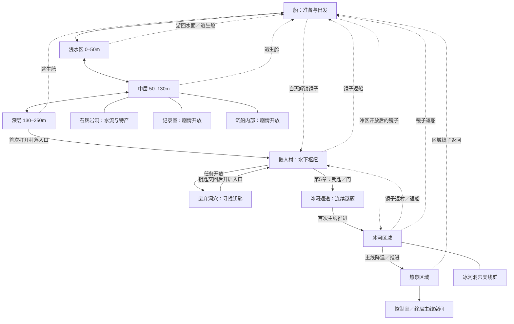
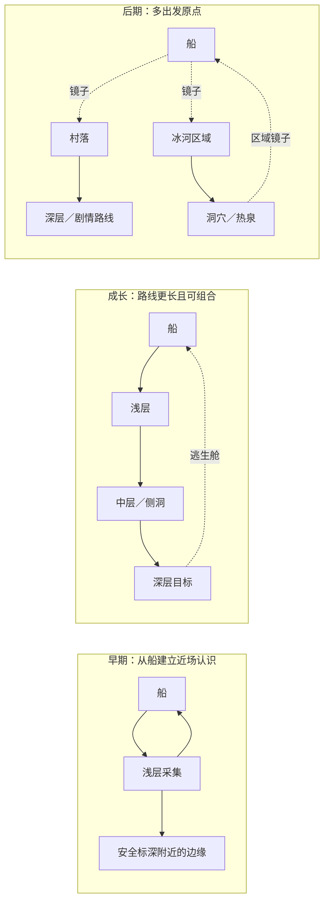

# Dave the Diver：区域网络、出行与成长研究

2026-11-09；GDD §8.1／§13.9 → M3 → [#337](https://github.com/alanthssss/nameless-becoming/issues/337)，父任务 [#322](https://github.com/alanthssss/nameless-becoming/issues/322)。本文件是地图方案的事实输入，不是本作已实现地图。主任务负责追踪器、整合方案与 PR。

研究对象以 **2023 年本体主线** 为主，辅以 2024–2025 年社区地图资料。视频没有可读构建号；社区资料也不能保证对应 2026 年全部更新。后续联动、DLC 和所有限时 Boss 房不在本次拓扑穷举范围。静态底图观察、玩家视频观察、社区文字与设计推论分别标注。数据源见 [dave-map-evidence.json](dave-map-evidence.json)。

## 1. 地图的组织单位

**结论：稳定的大区域顺序，区域内完整地形变体，独立剧情空间，以及逐步开放的出发／返回节点共同组成探索地图。** 导演 Jaeho Hwang 在 2023 年访谈中解释，团队希望让天气、水流和鱼的位置带来新鲜感，并选择有限但变化的环境来表现海洋。这个表述支持生产方向，不等于公开了随机地图算法。[D01：导演访谈](https://www.gamedeveloper.com/design/dave-the-diver)

本次实际读取 BlueMaps 社区源码快照 `63a2a42`，并打开浅层 B、浅层 C、中层 A、深层 A 四张整幅底图。地图选择器有浅层 B/C/D/E/F、中层 A/B/C/D/F、深层 A/B；这是该网站暴露的 **5／5／2 个选项**，不能相乘称为游戏有 50 种组合，也不能推断游戏逐块拼接地形。作者说明浅层 A 是一次性教学图；命名间断来自场景编号。社区 wiki 还提醒：部分主线期间可能连续使用同一布局。[D02：固定提交源码](https://github.com/chentieli/bluemaps/blob/63a2a42a42975560423ac785cd7a3bc2861af0b3/map.html)、[D03：制图者说明](https://www.reddit.com/r/DavetheDiverOfficial/comments/1col3yn/i_made_a_map_of_the_blue_hole/)、[D06：Blue Hole](https://dave-the-diver.fandom.com/wiki/Blue_Hole)

| 实际打开的底图 | 可观察的空间组织 | 证据边界 |
|---|---|---|
| Shallows B | 上方较开阔，多根高岩柱把下潜分成数条槽；下方有拱口、侧腔 | 观察整图轮廓，不由黑色开口推断碰撞通行 |
| Shallows C | 左右悬挑、岩腔和中央下潜口形成不同的绕行组织 | 不是 B 的装饰换色 |
| Medium A | 中央大岩体分开两侧下降路线；侧洞与下方沉船提供地标 | 底图不能证明玩家每趟能进入所有房间 |
| Depths A | 轮廓更封闭，有横向绕行、分叉与末端建筑节点 | 入口身份结合区域资料确认，不只靠外形命名 |

四张原始底图的地址、尺寸和 SHA-256 留在 JSON；仅本地研究缓存，未将第三方地图资产纳入游戏素材。Leaflet 的图层坐标是网页摆图坐标，**不用于换算实际游戏米数、屏数或制作工作量**。

## 2. 大区域与关键分支关系

下图是已核实资料的**宏观连接图**，不是等比例地形图。实线表示区域之间的空间连接／首次剧情路线；虚线表示传送或结束出行。首次路线和重复访问分开，尤其不把冰河通道画成可反复双向穿行的通勤主路。

| 连接或区域 | 核实的条件／作用 | 主要证据 |
|---|---|---|
| 浅层 → 中层 → 深层 | 0–50／50–130／130–250m 是前三带标签；潜水服安全标深另算 | [D06](https://dave-the-diver.fandom.com/wiki/Blue_Hole)、[D04](https://dave-the-diver.fandom.com/wiki/Equipment) |
| 中层的侧向目的地 | 石灰岩洞有水流与特产；记录室、沉船内部分别由主线打开 | [D07](https://dave-the-diver.fandom.com/wiki/Blue_Hole_Medium_Depth) |
| 村落 | 主线到达后得到镜子，白天可从船直达；它把深处变为新的出发点 | [D08](https://dave-the-diver.fandom.com/wiki/Sea_People_Mirror)、[D09](https://dave-the-diver.fandom.com/wiki/The_Sea_People_Village%27s_Trust) |
| 废弃洞穴 → 钥匙 → 冰河通道 | 第4章取钥匙，第5章开启通道；不是买更大氧气瓶便能越过 | [D10](https://dave-the-diver.fandom.com/wiki/Open_the_door_in_Glacial_Passage)、[D16](https://dave-the-diver.fandom.com/wiki/To_the_Abandoned_Cave) |
| 冰河区域 | 第6章任务给予耐寒服，镜子让船／村落直达冷区 | [D11](https://dave-the-diver.fandom.com/wiki/Explore_the_Glacial_Area)、[D08](https://dave-the-diver.fandom.com/wiki/Sea_People_Mirror) |
| 冰河区域 → 热泉 | 初期高温影响进入；主线推进后访问热泉。不同攻略对“第6章末／第7章”的分界表述不同，图用任务状态而非章节数字作为门槛 | [D12](https://dave-the-diver.fandom.com/wiki/Glacial_Area)、[D13](https://dave-the-diver.fandom.com/wiki/Hydrothermal_Vents) |
| 冰河区域洞穴群 | 既有可重访采集洞，也有任务限定房间；第二冰河洞穴不能当作永久重复采集节点 | [D12](https://dave-the-diver.fandom.com/wiki/Glacial_Area) |
| 冰湖及冷区物品变体 | 冰湖由 Lost Baby Manatee 任务打开。制图者区分冷区三组物品位置；这不是三种不同地形的证明 | [D14：原制图者攻略](https://steamcommunity.com/sharedfiles/filedetails/?id=3149602342) |
| 夜潜 | 通常只到中层；镜子只在白天工作，因此昼夜也改变可走的网络 | [D07](https://dave-the-diver.fandom.com/wiki/Blue_Hole_Medium_Depth)、[D08](https://dave-the-diver.fandom.com/wiki/Sea_People_Mirror) |

## 3. 已观察的局部出行与返程示意

按 Alan 的最新要求停止追加调研，仅用已有资料成图。主任务通过原生浏览器观察了 [Loopy Longplays 的 2023-08-07 实机](https://www.youtube.com/watch?v=stCnndmvQmE&t=450s)的下列片段；本分工接收观察记录，未独立复核截图。**实线是已有观察，虚线是尚未核验的返回示意，不能称为完整往返实证。**

对应时码：[7:30](https://www.youtube.com/watch?v=stCnndmvQmE&t=450s)、[8:25](https://www.youtube.com/watch?v=stCnndmvQmE&t=505s)、[8:30](https://www.youtube.com/watch?v=stCnndmvQmE&t=510s)、[8:55](https://www.youtube.com/watch?v=stCnndmvQmE&t=535s)、[9:05](https://www.youtube.com/watch?v=stCnndmvQmE&t=545s)、[9:25](https://www.youtube.com/watch?v=stCnndmvQmE&t=565s)。

**这一段能支持的设计判断：** 同一趟不是到目标便立刻结束；补气延长局部行程，完成计数后还继续采铜，再开始上行。不能据此认定玩家的返程动机、最后的返回方式、带回数量或完整时长。06:57–12:04 仍只是作者章节索引窗口；09:30 后未读图，不补写成事实。

## 4. 成长怎样改变探索范围

“探索范围”应画为可进入区域、可持续经营的路线、出发原点三层。**增加一圈半径不足以描述 Dave 的成长。** 以下是资料支持的能力状态，不是对同一玩家前后进行过控制实验；尚不能给出成长后多飞／多游几分钟、收益增加百分之几。

| 状态 | 区域可达性与实际行程变化 | 必须保留的限制 |
|---|---|---|
| 早期船出发 | 起始安全标深 40m；iDiver 教学给到 80m，使较深路线更可持续 | 超标深是快速耗氧，不是物理墙；40m 也不覆盖整个 0–50m 浅层 |
| 装备成长 | 150m、230m 等标深提升；氧气与载重提升使更长绕路／多目标采集更划算 | 安全标深不能直接当完整可达圆；受战斗、冲刺、负重、路线和补给影响 |
| 村落镜子开放 | 可选择从船下潜扫浅中层，或直接到村落再展开深层任务 | 原路线仍有资源理由；镜子白天生效，不解锁所有剧情门 |
| 冰河区域开放 | 新生态区、洞穴、资源与主线目的地；船／村落可直达冷区 | 耐寒服与主线状态共同参与；部分洞穴是一次性任务空间 |
| 热泉推进后 | 在已开放冷区的基础上继续进入更深一带，区域镜子提供返回 | 不能把终局门自动列为自由采集区，也不能推断所有出口随时可用 |

安全标深、气瓶和载重参考值来自 [D04：Equipment](https://dave-the-diver.fandom.com/wiki/Equipment)；“超深加速耗氧”、逃生舱返回和 UV 灯处理深层管珊瑚来自实际玩家撰写的 [D05：The Complete Diver’s Guide](https://steamcommunity.com/sharedfiles/filedetails/?id=3012589046)。数据中将门槛分成：

- **剧情门槛与局部障碍**：门、钥匙改变某条边是否开放。UV 灯能处理局部珊瑚障碍；已有玩家记录提出项链与攻击也能通过，因此不把 UV 灯写成唯一硬门槛。[D18：玩家实测讨论](https://steamcommunity.com/app/1868140/discussions/0/3805028278542280969/)
- **安全运行限制**：潜水服的标深改变耗氧风险，单独编码为 `safe_depth`，不写 `blocked_below_depth`。
- **经济／续航范围**：气瓶、载重、战斗与采集效率改变一趟值得访问的节点数量；不自动新增空间连接。
- **便利网络**：镜子改变出发原点，逃生舱缩短回程。二者不能混成“移动速度提高”。

这三幅是研究性示意，不保证图中所有路线可在一次潜水连续完成。具体出行须使用已观测样本，或明确标注为方案。

## 5. 给本作地图方案的约束与启发

以下是从上述资料得到的**设计推论**，由整合方案决定采用，不是 Dave 的原始规则，也不是本作已经实现。

1. 先画世界区域与连接，再画可完整往返的一趟。一个区域至少应承载主路、可识别岔路、回接或出口和不同目的地；扩大空白边界不能替代这些关系。
2. 把“下一片未知”放在当前活动范围之外，并留下可辨认入口。成长应带来跨地形或跨区域的新行程；不能只有同图采得更快。
3. 蜂房、邻居歇脚点、树洞或摆渡点可分别承担起点、补给、返程、远端起点。是否开放这些点会改变整趟路线，比只提高体力上限更有空间意义。
4. 路径、物种／花源、天气与任务可以分别变化。先做少量完整可辨布局，再验证每趟目标变化；不要为了“像 Dave”立即做随机生成系统。
5. 远行便利必须与近场回访理由一起设计：新出发点减少重复空跑，旧区仍由不同花期、材料、订单或邻居事件吸引回访。

## 6. 验证边界与交接

- 已做：固定提交源码读取；四张原始整幅底图视觉观察与哈希；区域／门槛交叉核对；将安全深度与硬门槛分开；宏观图与成长图；来源化 JSON。
- 已停止追加研究：局部视频记录至 09:25 上行；09:30 后返程、回船与结算未核验，路线图以虚线保留。
- 未做：运行原游戏、同存档控制实验、每个布局的碰撞与出口实测、所有侧洞或 DLC 穷举、真人访谈、成长收益测量。没有验证“5×5×2 自由组合”或精确的游戏尺寸。
- 新现金支出为 0；本分工是研究产物，未改动游戏构建。总研究投入由主任务记录；历史累计成本与可靠剩余预算仍未知，200＋40 小时控制边界不重置。

责任：Codex 主任务整合并回写 #337。本轮按 Alan 要求以现有资料简洁成图，不继续取样；完整返程、成长前后行程成本与全部地图出口作为明确未完项保留。方案得到 Alan 的产品判断之前，不把研究图升级为全作量产承诺。
