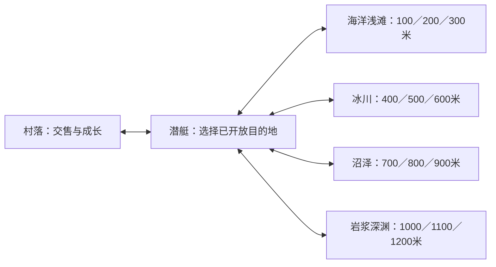
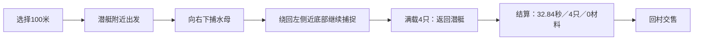
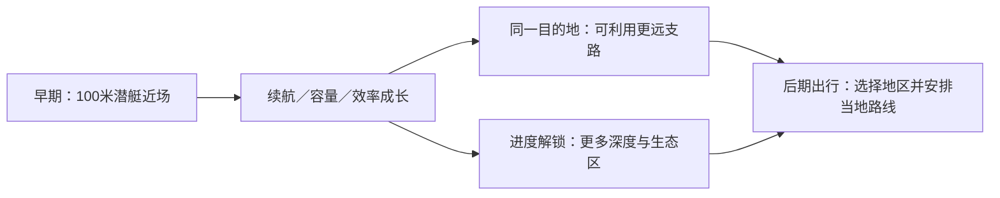
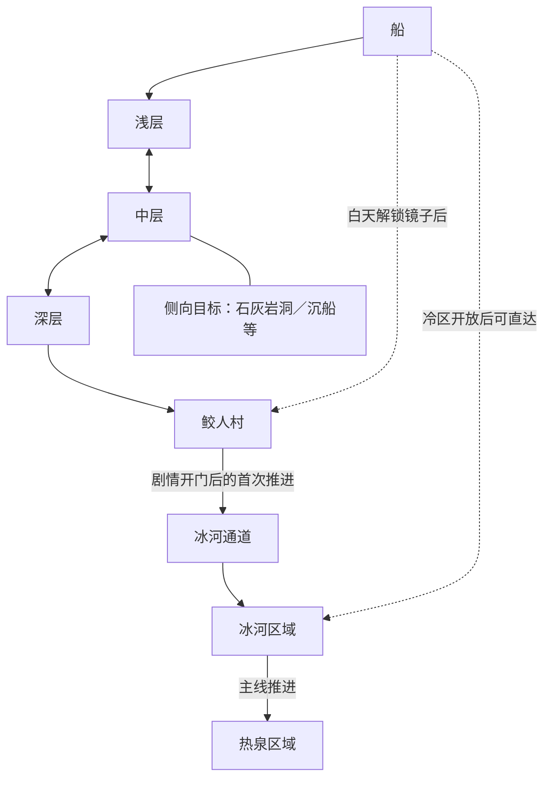
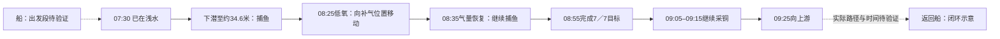
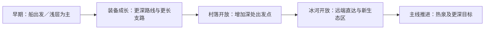
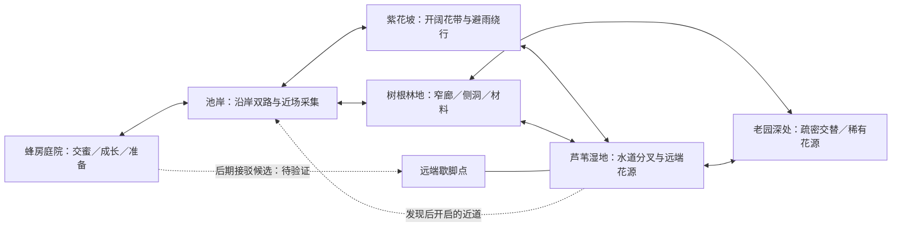
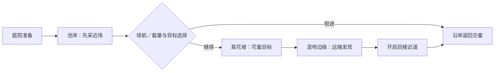
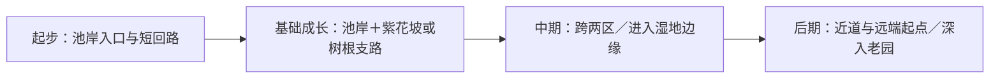

# 探索地图图解与本作整体方案

2026-11-09；GDD §8.1／§13.9 → M3 → [#322](https://github.com/alanthssss/nameless-becoming/issues/322)，原作证据沿 #313／#337。**只整理已有资料，不新增检索、视频或原作实验。** 图为结构示意，不按比例；“待验证”保留事实缺口。本作部分全部是候选，未改运行代码。

> 当前细化：[池岸与紫花地内部地图](../design/pond-violet-interior-maps.md)。针对小区域与重复出行，先展开两区内部空间、状态差异和成长路线；世界五区草案继续保留。

## Shelldiver：选择目的地，在当地完成短途采集

### 区域关系

菜单截图 C036／C046 支持四区、每区三个深度档；这些是**可选目的地**，不能把它们画成从100米一路游到1200米的连续海底。各档完整地形、解锁数值：**待验证**。

### 首趟出行

已有样本：视频00:49选择、00:54–01:24采集与返回、01:27结算、01:29–01:39回村交售。5秒间隔截图支持整趟阶段，**不代表逐帧轨迹或完整地图测绘**。短开场可以成立，后续地图须持续提供新去处。

### 成长后的范围

成长方向有菜单及升级观察支持；“同图究竟扩大多少”没有同条件前后测量，**待验证**。已有冰区局部路线是入口亮室→暗廊→下一亮室入口→回艇；岩浆区可见上方通道与向下沟槽，证明地区差异能来自空间形状。

证据：[既有连续观察](shelldiver-increment-2026-11-05.md)、[S11清单](shelldiver-S11-captures.json)、[本次已存样本清单](shelldiver-map-evidence.json)、[原视频](https://www.youtube.com/watch?v=S7EaREatF4w)。原作构建号未知。

## Dave the Diver：逐层深入，后期改变出发位置

### 区域关系

这是宏观连接，部分分支还受剧情／工具条件限制。区域内存在完整布局变体；**不据社区地图选项推断全随机拼接或所有组合**。门槛来源、返程方式和限定房间见[已有详细研究](dave-map-study.md)。

### 出行路线：已观察部分与缺口分开

已观察到“达成目标后继续采材料”的选择，不能把任务完成当作立即返程的证据。后段虽已保存截图，未完成视觉核验；**这不是完整出行实证**。以上时码来自[既有样本视频](https://www.youtube.com/watch?v=stCnndmvQmE&t=450s)，本轮不续看。

### 成长后的范围

潜水服安全深度影响耗氧风险，**不是不可跨越的墙**；剧情门、耐寒条件、补给和镜子分别改变通路、持续探索能力与出发位置。精确成长航程：**待验证**。来源见[证据数据](dave-map-evidence.json)。

## 本作候选：一个家、五片野外区域、两条向外展开的路线

建议把现有池岸和紫花地定位为世界近端。世界采用可记忆的人工地形骨架，随成长开放远端路线与返程近道；资源、花期和事件变化提供重访理由。五片野外区域是本轮**整体草案**，不代表五张最终关卡或已批准的生产规模。

### 世界关系

所有连接均为提案；现有池岸／紫花地不是按上图重新布局后的实现。名称可调整，空间职责先明确：

| 区域 | 应改变的路线选择 | 候选地标 |
|---|---|---|
| 池岸 | 沿岸稳妥返回，或绕向另一出口 | 荷叶湾、岸边灌木 |
| 紫花坡 | 连续采蜜，或从遮雨侧路绕行 | 花带缺口、叶棚 |
| 树根林地 | 走主廊，或深入材料侧洞 | 根拱、空树洞 |
| 芦苇湿地 | 选水道、绕向远端花源、发现回接 | 芦苇岛、歇脚叶台 |
| 老园深处 | 在已解锁支路间组合较长行程 | 老墙缺口、深处花圃 |

### 一次跨区出行与成长范围

**成长应让玩家重新选择目的地、路径和出发点。** 当前36→50→70体力、6→10→16容量只作既有预算输入，不能直接换算区域长度。远端歇脚点是否恢复体力、是否接驳返巢，均为候选，**待验证**；不得让新便利无意消除出行取舍。维持当前手绘风格、温和生物、两条经济线和现有动作，不新增氧气系统。

### 下一制作检查点

Codex沿 #322 先把“池岸→紫花坡→湿地边缘→近道回巢”做成跨区灰盒的候选规格；是否实施由后续授权决定。灰盒要能判断三件事：入口能否预告远方、岔路是否带来真实选择、成长后是否能规划不同的一趟。场景连接与存档先复用既有机制；距离按实际移动／采集／返程预算测量，暂不拍定像素、屏数或分钟数。

现有小图保留为近端区块与动作测试场。全作24关及既有内容目标保持；世界区域、关卡、出行次数是不同单位，映射关系**待验证**。地图草案不完成任何产品门禁。

决策人Alan；Codex负责本次图解和候选归档。重审触发：跨区行程预算不成立、分路没有实际选择、近道消除所有返程取舍，或全作内容无法映射。原作未知不自动生成新增调研任务。

## 交付边界

本轮交付六张原作分析图、三张本作候选图；仅利用既有观察与来源。Dave完整回船段、竞品全布局／刷新规则、本作尺度与真实玩家体验均待验证。未运行原作或游戏工程，未进行新视频／网页调查。校验范围为文档、JSON和引用完整性，不是玩法验收。

工时：本轮整理从北京时间13:55:20起记录，之前读取及历史研究未完整计量；墙钟不等于主动或计费工时。200＋40小时控制、累计／可靠剩余未知保持；新增采购0，自动化PAUSED。Draft PR336保留，M3／#322／#313／#337不因本次图解关闭。

本轮收口记录：2026-11-09 13:57:19 北京时间。本地文档／素材契约14项通过，两个JSON可解析，九张图的代码围栏及文内本地链接通过，`git diff --check`通过；限定独立AI复核未发现必须修正项。未进行图形渲染测试或游戏测试，CI结果以PR状态为准。
