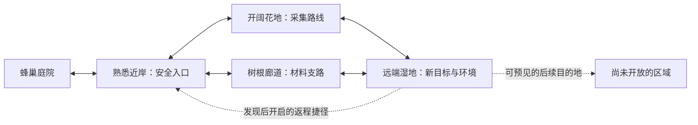

# 探索地图：调研与制作准备候选

2026-11-09。GDD §8.1 / §13.9 → [M3](https://github.com/alanthssss/nameless-becoming/milestone/3) → [#322](https://github.com/alanthssss/nameless-becoming/issues/322)；原作研究沿 #311–313，整体产品判断沿 #211。唯一执行指针仍为 [Now](../design/solar-term-campaign-production-spec.md#production-now)。

状态：调研方法与制作方向候选。Alan指出“现在一直在一个小图上面做文章，明显不是这种游戏的地图”，要求参考 Shelldiver、Dave the Diver 讨论调研准备。Codex负责分析与归档；本次询问没有被转换成新地图实施、批量美术或全作范围变更。采用哪个世界结构仍由Alan作产品决定。

## 现状与问题

核对基线为 main `ea4db61`，0.27已技术交付；GitHub #322/#211 的最新状态优先于旧Now中“等待最终集成”的历史措辞。当前有庭院、池岸、紫花地，池岸双路环、紫地避雨分路和跨区近道已经实现，不能称“完全没有地图”。[现行空间规则](../design/nectar-steam-demo.md)仍以既有采集场景与坐标范围为基础；[早期地区规格](../design/nectar-regions-mvp.md)解释了独立场景和出行循环。

设计判断：局部绕路与动作打磨不能独自证明世界探索成立。本轮要补的是世界、区域、局部遭遇三个尺度之间的关系：远处有什么，为什么值得去，如何到达，何时折返，成长后哪里发生变化。扩大画布而不改变这些关系，也可能只增加空飞。

当前小图可保留作动作/采集测试场或未来入口区域；它在完整世界中的位置需先确定。不能把整个游戏一直约束在同一测试场里。世界结构要先覆盖总体方向，之后选择其中一段验证；验证段不等于缩减全作目标。

## 参考各自回答什么

| 参考与直接来源 | 已核实的有限事实 | 调研要回答的问题 |
| --- | --- | --- |
| [Shelldiver 官方商店](https://store.steampowered.com/app/3862670/Shelldiver/) | Gagonfe的海龟潜水捕水母游戏；生态区、地区资源与装备升级相联系 | 地形如何容纳采集？地区如何随成长开放？升级怎样改变有效探索范围及折返位置？ |
| [Dave the Diver 官方商店](https://store.steampowered.com/app/1868140/DAVE_THE_DIVER/) | 白天探索采集、夜间经营，变化的蓝洞和氧气约束构成出行循环 | 如何在有限空间中逐步揭示未知？任务、资源与能力怎样改变下一趟目的和路线？ |
| [Dave开发者访谈](https://www.gamedeveloper.com/design/dave-the-diver)（2023-08-24） | 导演解释团队采用封闭但变化的环境，控制制作范围 | 哪些结构固定供玩家建立记忆，哪些内容变化支持重访？不能据此宣称所有地形全程序生成 |
| [DREDGE 官方商店](https://store.steampowered.com/app/1562430/DREDGE/) | 多岛区探索、区域资源/故事、船只成长和夜间风险 | 安全据点、横向目的地、航程与返航如何组成区域网络？仅借空间组织，不默认引入恐怖或惩罚 |

现有[Shelldiver增量研究](shelldiver-increment-2026-11-05.md)有冰区入口亮室—暗廊—下一亮室的局部轨迹、沼泽地标与重复访问对照。[覆盖记录](shelldiver-fullplay-checkpoint.md)也明确没有确认全部连通关系的拓扑图。这些可复用，不能把截图数量当地图研究完整度。本轮新增的是公开文字核查与方案，未新增全片观看、原作控制实验或真人试玩。

## 调研方法：跟完一趟，并比较下一趟

每作先选三种完整样本：第一次出行、第一次进入新区域、升级后重访旧区。Shelldiver已有覆盖优先补缺；Dave先标清本体版本与进度，不混入DLC；DREDGE只补区域网络问题，避免无限扩展参考库。

每条样本从出发记录到实际返回，沿途标入口、地标、分叉、资源、阻挡、补给/撤离、转场以及玩家的真实路径。遇到未走到的通路，用虚线和“未知”标出，不把一位玩家的路径当完整地图。新增看图/看视频和直接操作分别标注；攻略图只作索引，与版本和实机核对。

| 记录字段 | 用途 |
| --- | --- |
| 游戏版本、章节、装备/容量/续航、来源URL、视频时码 | 保证不同记录可比较，不把升级差异当布局差异 |
| 简化连通图与玩家路径 | 分清世界区域、房间连接和一次路线；能标明未观测边 |
| 屏幕跨度、到首个选择/远端目标/返回的秒数 | 以相机和行动尺度估地图，不从静帧猜原作像素大小 |
| 采集、移动、观察、遭遇和返程所占时间 | 识别有效探索与空跑；录像时长不冒充游戏内时间 |
| 入区目标、折返触发、未取资源 | 理解选择来源；氧气低/满载/任务完成若同时发生，不擅断单一原因 |
| 升级前后路线、可达范围和收益 | 验证成长是否改变计划；不同装备样本不当控制实验 |
| 固定地形、变化资源/生物、永久开启内容 | 分清空间记忆、重访变化、进度解锁与未知实现 |

每作最少交付三张分析图：区域关系图、完整出行路线图、成长前后可达/可利用范围对照图。地图中的关键边和门槛都应能定位来源或标为未知。

## 本作开工前的六份准备材料

| 产物 | 要回答的问题与验收 |
| --- | --- |
| 世界区域关系图 | 家在哪里，各地区有什么独特吸引力，哪些相邻、哪些需转场，何时可见/可达；草案涵盖整体方向，不能只重画池岸 |
| 区域差异表 | 每区的空间形态、花源/材料去向、主要行动、地标、环境与返程方式；差异不能仅为换色或数值变大 |
| 一次出行节奏图 | 从准备、熟悉入口、发现岔路、选择目标到折返/捷径及归巢，标出玩家自己作的决定 |
| 移动与镜头尺度表 | 用当前蜂的速度、可视距离、转弯和体力支出核对飞行时间、通口、视线和信息揭示；屏幕数是测量单位，不先拍一个“大十倍”的目标 |
| 地图制作约定 | 可通行地形、遮雨、碰撞、地标与装饰分层；区块接口/出口/出生点、持久ID、跨区存档与旧档恢复策略；先用现有Godot场景能力，不预设要造地图编辑器 |
| 视觉与生态参考板 | 每区用真实庭院/池岸/林下等地点核自然结构，明确地表/前中后景、比例、材质、花源附着、天气作用和生物活动；借构图关系，不复制竞品资产 |

地图尺寸应从路线时间和资源预算推导。例如先测去程、采集与遭遇、返程分别消耗多少续航，再安排远端收益和捷径。不能直接把潜水深度替换成飞行高度，也不默认添加氧气、死亡惩罚或第三种工具。

## 推荐的结构实验

推荐候选为“可记忆的人工地形骨架＋受控资源/生态变化”，理由是本作已有庭院、地区切换与固定地标，可逐步扩大探索，同时保持手绘构图与保存关系。生成算法、无缝大世界与区域总数留到拓扑/节奏验证后决定。

以下仅是说明结构的草图，名称/连接不是已采纳的新GDD，也不是竞品地图复原：

先制作其中一条完整跨区出行和可选支路的灰盒。区域应有多屏连续探索、遮挡后的发现与可辨地标；具体大小由速度、镜头和一趟时间决定。区块可以分场景加载，玩家感受到的世界连续性需由出口朝向、出生位置、天气/声音过渡和地标对应保证。

灰盒验收观察：

- 玩家能说明这次去哪、为什么去；至少出现一次目标或路线取舍。
- 玩家能够到达视野之外的新空间，并凭地标找到返程；大空地或绕圈不算新体验。
- 不同区域会改变实际行动/计划；单纯增加花数和收入不足以证明区域差异。
- 升级或开启捷径后再来，玩家会改变可行路线、目标或折返点；只让数字更大仍需复议。
- 退回、跨区、保存/冷续和资源状态可靠；这些技术通过与首次玩家理解/趣味分开记录。

参与首次路线观察的人不要事先得到解法。记录实际犹豫、回头和迷路；作者已知路线回归与AI操作不能代称独立真人验证。若出现持续空跑、看不出区域用途或升级后路线不变，先调整拓扑/分布/出行成本，再讨论美术扩产。

## 本轮收口与下一检查点

本轮产物为本候选方案，验收是来源/既有实现/建议分清，准备材料和实验条件可操作。尚未完成竞品三图、世界正式设计或灰盒。后续研究沿原#311–313补原作证据，地图与准备方案沿#322；不另建可变队列。

下一检查点：Codex先提供一份有证据的世界—区域拓扑和完整出行对照，Alan据具体图判断方向；进入实际制作时，再按原Issue拆分可独立验收的约10分钟工作项。此处是方法与顺序建议，未排定全地图生产。复议触发为拓扑仍限制在原小图、原作证据推翻假设、或灰盒不能产生上述探索行为。

本轮为文档/公开资料工作，无新增采购、图像生成或游戏构建；主动/账单工时、历史累计与可靠剩余未知，200＋40小时控制和自动化暂停保持。明确记录计时从2026-11-09北京时间13:39:06开始，之前上下文定位/研究时段未完整计量，不将该时点当整个对话开始。M3、#322与产品接受状态不因文档完成而提高。
