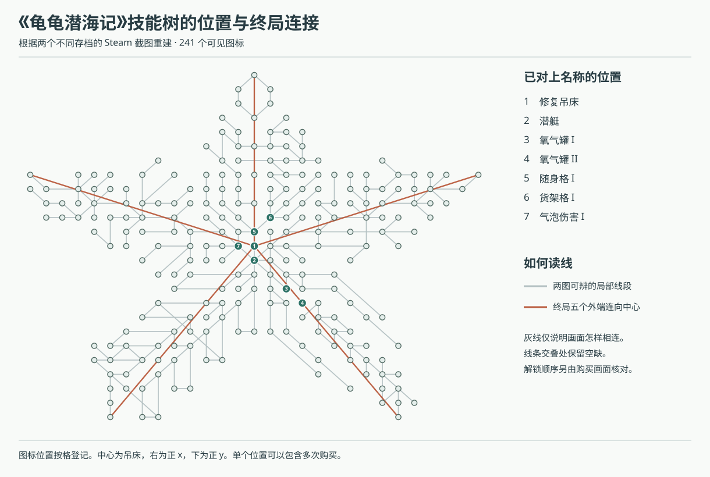

# 《龟龟潜海记》的技能树，以及《采蜜》该借什么

2026-11-24 至 25 日。对照《采蜜》0.32，代码基线 `b9bae44`。研究沿 GDD §13.9、M3 和 [#312](https://github.com/alanthssss/nameless-becoming/issues/312)。**结局剧透。**

一次潜水结束时，玩家往往知道刚才哪里不够用。氧气还剩不少，背包却已经装满；换到冰区，潜艇明明就在身后，氧气又先见底。《龟龟潜海记》把这些不同的遭遇变成回村后可以用同一笔积蓄解决的不同问题。对《采蜜》，最值得检验的是玩家自己赚到一项成长后，重回熟悉的花湾会改走哪条线。[第三趟账目与冰区复访](shelldiver-increment-2026-11-05.md)

## 一张全景，三种计数



正式版通关前后的两位玩家截图共同提供 **241 个图标位置**，其中一张的顶部被进度条遮挡，另一张补足。图上的 262 段局部线和 5 条朝中心汇拢的终局长线是可见几何关系。开局潜艇在中央吊床的正下一格。终局的 `799/800` 是 Prestige 进度；同一节点可以购买多档，一次购买可能只增加一点。正式版截图均未显示可核验的构建号。[全景核对方法](shelldiver-atlas/topology-notes.md) · [241 格坐标](shelldiver-atlas/shelldiver-node-positions.csv) · [267 段线的端点](shelldiver-atlas/shelldiver-visible-lines.csv) · [英文终局详情原图](https://steamcommunity.com/sharedfiles/filedetails/?id=3650782668)

五个方位提供了一种回村时的找路方法。下表的方位参考另一位通关玩家对各枝的描述，面板例子有录像支持。分枝之间会共用资源，具体节点的坐标以能完成画面对位的条目为准。[亲历者通关与分枝说明](https://www.xboxachievements.com/game/shelldiver/guide/)

| 去哪个方向找 | 玩家刚遇到的限制 | 从面板能看出什么 |
|---|---|---|
| 左上 · 捕水母 | 换一个目标就要补好几发，或密集目标难以兼顾 | 气泡伤害、穿透、暴击、开枪时额外发泡、命中时额外起泡分别作用于不同环节。后期还有在低生命阈值直接捕获的 Hunter Bubbles。 |
| 右上 · 拆环境材料 | 拆一块矿花太久，邻近矿块的机会从眼前错过 | 等离子伤害、溢出触发、溢出伤害、闪电概率、攻速拆开购买。同是提高产出，有的减单目标用时，有的只有现场存在其他目标时才值钱。 |
| 右下 · 在海里待多久 | 包没满却必须回艇，或工具可用时间太短 | 基础氧气、耗氧减免、氧气恢复量与速度分别有面板。买大氧气罐后若包先满，回村频率仍可能不变。 |
| 左下 · 去哪儿找、带什么回来 | 目标难找，或采得很多却不值钱 | 水母出现率、地区块的材料产量、售价和拾取距离有各自的成长。出现、到达、每块掉多少是三个问题，面板倍率不足以推出刷新秒数。 |
| 上方 · 携带、经营与便利 | 后方货架或人工搬运跟不上海中产量 | 随身格、单格容量、仓储、店格、售速、宝箱领取速度分别处理不同积压。转换器自动上架减少的是一次原本要亲手完成的搬运。 |

## 三笔账说明选择是怎么形成的

**开局先给一次能改变世界的购买。** 新档从免费潜艇开始。买下它后相邻节点展开，镜头回到村落，一艘潜艇驶入港口，玩家可以走过去出海。首趟 4 只水母收入共 40 贝。录像里的玩家花 20 买激光工具、10 买耗氧减免、5 买一级气泡伤害，余 5。激光让垃圾成为可采材料，同一片浅海立即多了一种行动。售价节点又已显示它需要材料，第二趟就有找垃圾的理由。[开局实况](https://www.youtube.com/watch?v=S7EaREatF4w&t=25s) · [首趟账目](shelldiver-fullplay-checkpoint.md)

**第三趟把不同瓶颈放到同一个钱包前。** 玩家带着 35 贝和 27 材料进树。5＋5 贝买两档氧气，100→110→120；10 贝把随身格 1→2；20 材料把货架 1→2；最后三笔各 5 贝，把气泡伤害总加成从 5% 提到 20%。离村时为 0 贝、7 材料。同样的 10 贝能换两档氧气或一个随身格，20 材料则解决上岸后的陈列限制。氧气 I 买第一档后 II 已能看见，I 还可以继续投。是否已经付得起 II，要另看购买条件和余额。[4:21–4:46 购买原片](https://www.youtube.com/watch?v=S7EaREatF4w&t=261s)

**中期能看见一次购买挤掉了什么。** 面板先后展示 2.5 亿贝的等离子闪电概率、1.5 亿的溢出伤害、8000 万的攻速。玩家持有约 2.84 亿，先买溢出伤害，余额约 1.34 亿，闪电报价转红，攻速仍然可买。再买攻速余约 5400 万。另一次购物里，命中时额外起泡、气泡尺寸和暴击概率三项各要 2000 紫材料，玩家只剩约 2800，三项都曾浏览。前一例能追踪到实际购买，后一例能看出可选而相互竞争的选项，画面不足以指定最终选择。[中期付款与报价变色](https://www.youtube.com/watch?v=S7EaREatF4w&t=5921s) · [后期三个同价选项](https://www.youtube.com/watch?v=S7EaREatF4w&t=8253s)

### 数值要逐档读

- **涨价方式因节点而异。** Plasma Overflow I 当时从 10% 加到 20% 要 10 万贝，下一档从 20% 到 30% 要 100 万。Doppel Bubble II 的 40%→60% 和 60%→80% 两次都报 1250 红材料。仅凭总收入增长曲线拟合一种通用定价公式，会错误解释至少一组实物。[54:12 附近的面板](https://www.youtube.com/watch?v=S7EaREatF4w&t=3252s) · [逐档读数](shelldiver-atlas/sampled-quotes.csv)
- **面板的增量与动作的增益有两道距离。** 官方图中 Bubble Damage V 处于 6/10，下一档把总面板 35,080% 提至 36,380%，标出的 +1,300 个百分点约为当时面板的 3.7%。若捕获刚好从三次命中变成两次，实际手感可能跳一档；基础伤害与目标阈值须实测。这里用的是面板算术。[官方节点详情原图](https://shared.akamai.steamstatic.com/store_item_assets/steam/apps/3862670/8db98935b90ce26a668eb2bb39f07dc97e6313b2/ss_8db98935b90ce26a668eb2bb39f07dc97e6313b2.1920x1080.jpg)
- **产出要与容器配套。** 另一位玩家的 Game Pass 实况中，Shellslot Capacity V 报 5 瓶，单格从 16 到 99，随后药瓶 5→0、面板 MAX。Biovalue Multiplication II 报 5 瓶，单次捕获 2→4；X 报 12 瓶，4→16，持有 4 瓶时红色，持有 13 瓶时绿色，随后达到 MAX。初读攻略时这两个末期数只是作者自述，这次已在不同于 S11 的实机面板读到。若背包先满，多产的水母就未必能带回；两项合用消除了这个限制。在有剪辑的时间段中，不能把每次余额变化归给画面里唯一一次购买。[17:48 起看单格和捕获倍率](https://www.youtube.com/watch?v=zBjgcqtnva0&t=1068s) · [S11 两趟 30＋33 的转存核账](shelldiver-increment-2026-11-05.md)

## 树怎样把浅海连到结尾

| 阶段 | 玩家实际做什么 | 成长带来的下一种选择 |
|---|---|---|
| 浅海 | 捕水母，靠艇返村，交货，等货架出售，再从宝箱收钱；解锁激光后可拆垃圾 | 商品已满还可以收材料。一次 200 m 行程里随身商品 5＋6 不变，材料仍从 177 增到 369。要不要回家取决于下一目标。[满载实况](https://www.youtube.com/watch?v=S7EaREatF4w&t=939s) |
| 冰区与沼泽 | 随购买增加 Prestige，前往新深度，带回晶体、蘑菇等区域材料 | 横向买不同技能也能向同一深度门槛前进。通关作者记录 140、300、500 分别开启 400、700、1000 m 的新区域；S11 在这些区段看到了对应地图，单条录像不足以独立复核每次过线的瞬间。[玩家门槛记录](https://www.xboxachievements.com/game/shelldiver/guide/) · [原片地区与材料](shelldiver-increment-2026-11-05.md) |
| 运量扩大 | 正常结束一趟后可将货转入潜艇，再出潜或回村。后期两趟捕了 30＋33，回村前货舱合计恰为 63 | 一趟潜水结束与一次村落经营可以发生在不同时间。Expedition Demand I 的面板写着出航期间售速 5 倍，离店时多留一批待售现在可能有用。实际离场周转率仍取决于库存、计时和货架。[转存原片](https://www.youtube.com/watch?v=S7EaREatF4w&t=9045s) · [经营面板](https://www.youtube.com/watch?v=S7EaREatF4w&t=7278s) |
| 经营便利 | 先能看到玩家亲手取出转换后的商品、走回商店。之后 Transmuter Automation 已购满，说明会自动上架 | 自动化删除了玩家先前实际承担的步骤。我们的蜜铺整篮交售立即到账，若引进同一种自动化，须先证明相应的分配或加工决定本身值得玩。[取货与交货](https://www.youtube.com/watch?v=S7EaREatF4w&t=7242s) · [自动化面板](https://www.youtube.com/watch?v=S7EaREatF4w&t=8250s) |
| 终局 | 解锁 Shellphone 后沿上方继续走，1 万亿贝是录像里建炼金台的报价。终点到 799/800 时位于五条长线交会处，吊床修理报价 10Q；买后回村，玩家亲自走去躺下 | 一次长期积累最后落实到开场已经见过的地方。两名玩家分别漏掉 Shellphone，其中一位误以为电话与炼金无关，另一位在一圈已购物中没看见它。若节点为后续功能开路，值得预告那个功能。[开发者解释](https://steamcommunity.com/app/3862670/discussions/0/691994366768692802/) · [另一名玩家的经历](https://steamcommunity.com/app/3862670/discussions/0/658216290030338945/) · [买下与使用吊床](https://www.youtube.com/watch?v=S7EaREatF4w&t=11645s) |

原作的材料经济还包含供给调整。1.0.1 同时增加 600 m 蘑菇数量、改善技能树中升级和收集物的查询。若玩家知道要买什么却总缺一份，排查时应同时看地图供给和界面能否提示去哪找。公告里“前三个区域、30 多项升级”是当时 Steam 节庆试玩版的范围。[开发者更新与 Demo 公告](https://steamcommunity.com/app/3862670/allnews/)

## 开发者公开试玩版里，能把哪些规则查到底

Gagonfe 在 GX.games 发布的固定版本为 build 69，发布于 2025-08-29。该版本给出了可核验的规则全集。在技能树房间中有 **117 个具名技能格、521 个节点内档次、120 条前置箭头**。每格的等级上限、各级价格、币种、数值增量、所需前置已经抄成可筛选的数据表。117 格用到 55 个技能家族。十种语言共用 58 套家族名和说明，还有 3 套只在语言表出现。这里统计的是固定构建内的配置，62 格受试玩锁保护，另 55 个格共有 217 档，全部显式配置价合计 42,270 贝壳、27,475 废料。资源何时能获得还取决于出航与经营。[开发者发布页](https://gx.games/games/kvqb1o/shelldiver/) · [固定构建资源清单](https://play.gx.games/3109ca18-4c93-4b86-be2a-576df19d59e3/b7f32ef4-67f7-4012-ac65-e0057e25f232/157ffd07-2b01-4b2a-a05f-7a971ea207c8/runner.json) · [117 格逐级价格与前置](shelldiver-atlas/gx-demo-nodes.csv) · [58 个家族的中英名与用途](shelldiver-atlas/gx-demo-families.csv)

同一张图把两种解锁节奏结合起来。63 条箭头只要求前置买到一级，57 条要求前置满级；有多个前置时要全部满足。潜艇有四个出边，分别通向耗氧减免、气泡伤害、售价、随身格。沿这些关系从潜艇可达 117 格，四处需要双前置。一级即开适合尽早展示方向，满级才开则让集中投资有回报。这是对配置作用的分析。试玩版的 Chest Speed 给出 400%，正式版 S11 录像的同名节点显示 250%；Store Speed I 也有 60% 对 100% 的差异。因此，两个版本各自保留自己的账，试玩版的完整性不能补齐正式版缺值。[120 条源端点、目标和条件](shelldiver-atlas/gx-demo-room-arrows.csv) · [正式版 19:39 的节点](https://www.youtube.com/watch?v=S7EaREatF4w&t=1179s)

例如 GX 的 Plasma Tank I 同时要求 Deep Breath 至少一级和 Plasma Gun 满级。把共同祖先去重，从免费潜艇起买到它的第一档，显式路径合计 45 贝壳。Oxygen Tank I 的首档路径只要 15 贝壳，走到 II 首档累计要 110；货架 I 的首档累计要 10 贝壳＋20 废料。树上标的本格报价、从零打通整路的花费、现实中跑几趟能凑齐，是三个可分别核验的量。[117 个目标的累计路径账](shelldiver-atlas/gx-demo-route-costs.csv) · [版本与配置核验方法](shelldiver-atlas/gx-source-method.md)

逐档价表也把“增量游戏必然每买一次都涨价”这一直觉放到了可检验的尺度。55 个可购格里，26 格只买一次，29 格可多次投入；29 格中有 26 格在同一节点内各档同价。其余 3 格分两种涨法：Deep Breath 的三档是 10、100、1000 贝，浅海多样性和废料出现率的十档从 5 到 50，每档加 5。相邻阶段、跨地区币种和格内重复投资可以各自定价。《采蜜》可以让基础操作的重复改善保持好算，把昂贵跃迁留给能实际改变行动的升级。[GX 逐级价表](shelldiver-atlas/gx-demo-nodes.csv)

## 对照《采蜜》0.32，同样的 9 币和 2 纤维值什么

用真实的地区模型做了 **64 趟配对实验**。四种购买状态 × 四条预先定好的路线 × 四个相同种子。每个档案先在庭院花 4 币学会「轻巧采蜜」，得到相同的 9 币、2 纤维决策点，再选择保留积蓄、买「利落振翅」8 币＋2 纤维、「轻盈双翼」9 币＋2 纤维，或「花地萌发」8 币＋1 纤维。使用实际购买、出发、飞行、采蜜、振翅、拾取、正常回巢或救援以及售卖逻辑。初始钱包是实验设定，场上没有把蜂移到取材点。每站采蜜 2.4 游戏秒，无冲刺，重复执行使用相同策略。玩家可自行提早折返，固定路线的结果只回答机制问题。[逐趟结果](shelldiver-atlas/nectar-choice.csv) · [复现脚本](shelldiver-atlas/nectar_choice.gd) · [0.32 两区实机回执](../production/region-greybox-receipt.md#field-ecology-032)

| 回到同一片池岸做什么 | 四个种子都出现的结果 | 说明哪个选择有价值 |
|---|---|---|
| 进侧湾，开同一株紧穗，接绒回家 | 每组都带回 1 纤维。「利落振翅」用 1 击、19.57 秒、回巢前余 14.54 体力。基础组用 2 击、20.13 秒、余 12.20。 | 省下一次出手、0.56 秒和 2.34 体力。若玩家根本不打紧穗，这个收益就不会出现。 |
| 依次采四朵花后回家 | 四种购买都带回 4 蜜，同种子内用时一致。 | 这条路上单纯增加供给没有增加收入。升级提示应让玩家知道什么走法能用上它。 |
| 四朵花采完后，绕回第一朵再回家 | 「花地萌发」四趟都带回 5 蜜，另三种都为 4 蜜。第五份实际采自同一株 0 号花。 | 同一个升级在第一次路过没有收益，回访就多一份。按蓝蜜单价 1 币，这一趟仍未收回 8 币与 1 纤维的投资。 |
| 采四花，再去远岸取纤维，按原路折返 | 只有「轻盈双翼」四次均正常返家，4 蜜＋1 纤维，余 8.23–9.30 体力。其他三组均耗尽遇救，带回 2 蜜＋1 纤维。 | 续航跨过的是一条完整往返的门槛。利落振翅在半途确实省了一击，也不足以救下这条贪取路线。 |

这些是已知路线的开发者模型实验，四个种子复核规则在不同花位上的表现。实际玩家会在哪儿停、是否会自己发现回访路线和首次购买时机，仍需普通新档真人试玩。脚本以 1/30 秒步长运行，Godot 4.6.2 的两个独立进程得到相同的逐趟输出。可从仓库根目录复跑，`godot` 替换为本机 Godot 4.6.2 可执行文件。

```sh
out_dir="$(mktemp -d)"
godot --headless --path prototypes/swarm-flight \
  --script "$PWD/docs/research/shelldiver-atlas/nectar_choice.gd" \
  -- --out="$out_dir"
diff "$out_dir/nectar-choice.csv" docs/research/shelldiver-atlas/nectar-choice.csv
```

### 接下来最值得让人玩什么

1. **先看玩家会不会把刚吃过的亏和下一次购买联系起来。** 新档自己挣币材，第一次交售后允许自由购买。问“上一趟为什么回来”，记当时可买且被放弃的选项。第二趟只记第一处改飞线的位置、回访哪朵花、实际带回数量和返程原因。若知道目标却找不到对应升级，先改预告、材料缺口或界面位置；若目标和升级都看懂却用不上，先看花湾布置。
2. **把一次质变挂在已有动作上。** 当前紧壳减击已经有可测收益。池岸候选用熟穗、两朵花和一只占花的小蚊，让一次振翅的余风可以作用到后方目标。初访不用教连招，买后重访看玩家是否侧飞，把蚊与穗摆到同一直线上，再顺路接绒或采蜜。若只是原地连按，先调站位和动作反馈；若会主动找第二处能这么玩的地方，再讨论扩展这根树枝。小蚊占位、余风第二目标是待打样设计。[池岸花湾设计与验收](../design/pond-violet-map-resource-design.md#nectar-wing-bay)
3. **让后期成长兑现一个看得见的生活目标。** 原作的潜艇、转换器和吊床都能在树外找到。我们的储粮、蜜囊和回铺已有所指，优先用这些对象证明升级的用处。货架排队、宝箱二次取款和加工自动化只在商品分配或加工确实带来有意思的取舍时才值得引入。新项目规模与发布日期仍由已有产品检查点决定。[首作范围](../design/swarm-flight-gdd.md#lean-nectar-first-game) · [当前制作指针](../design/solar-term-campaign-production-spec.md#production-now)
